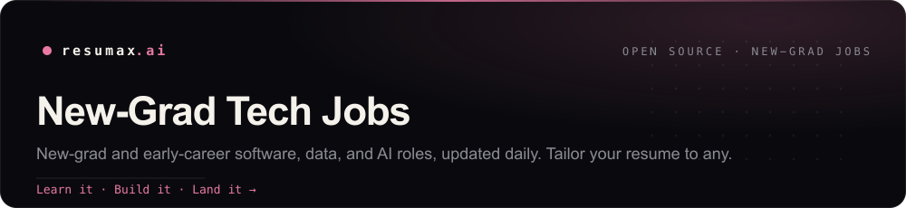

  

# New-Grad Tech Jobs

Open **new-grad** software, data, AI/ML, security, and hardware roles **posted in the last 30 days**, refreshed daily. We filter out senior, staff, and lead postings, dedupe across job boards, and drop anything older than 30 days, so the list stays fresh and actually open. Every role links into [ResuMax](https://resumax.ai/?utm_source=github&utm_medium=repo&utm_campaign=new-grad-tech-jobs&utm_content=intro), where **Atlas**, our AI career copilot, tailors your resume to it and preps you to ace the interview.

  

### Prepare a truthful, role-specific application.

**[Tailor your resume to any role above &rarr;](https://resumax.ai/?utm_source=github&utm_medium=repo&utm_campaign=new-grad-tech-jobs&utm_content=cta-link)**

Atlas compares the posting with your confirmed experience, prepares reviewable resume suggestions, and builds a focused coding, system-design, and behavioral interview plan. It never invents experience or submits an application for you.

**Found a role we're missing or a dead link?** [Open an issue](../../issues/new) and we'll fold it in.

## Open new-grad roles from the last 30 days

**1992** open roles from the last 30 days, newest first. Jump to a category:

**[Software Engineering](#software-engineering)** &nbsp;·&nbsp; 1075 open  
**[Data, AI & ML](#data-ai-and-ml)** &nbsp;·&nbsp; 455 open  
**[Security](#security)** &nbsp;·&nbsp; 81 open  
**[DevOps, Infra & Cloud](#devops-infra-and-cloud)** &nbsp;·&nbsp; 267 open  
**[Mobile](#mobile)** &nbsp;·&nbsp; 23 open  
**[Hardware & Embedded](#hardware-and-embedded)** &nbsp;·&nbsp; 91 open  

🌐 Remote &nbsp;·&nbsp; 🆕 Posted this week

## Software Engineering

| Company | Role | Location | Apply | Tailor | Age |
|---|---|---|:--:|:--:|--:|
| **[Liberty Mutual Canada](https://resumax.ai/companies/liberty-mutual-canada?utm_source=github&utm_medium=repo&utm_campaign=new-grad-tech-jobs)** 🆕 | Associate Software Developer (Node.js & Python) | Toronto, Ontario, Canada | [Apply](https://apply.workable.com/j/A60F74CB9D/apply) |  | 0d |
| **[Capco](https://resumax.ai/companies/capco?utm_source=github&utm_medium=repo&utm_campaign=new-grad-tech-jobs)** 🆕 | AAA Developer | India - Chennai | [Apply](https://job-boards.greenhouse.io/capco/jobs/8281149) |  | 2d |
| **[NielsenIQ](https://resumax.ai/companies/nielseniq?utm_source=github&utm_medium=repo&utm_campaign=new-grad-tech-jobs)** 🆕 | Junior Software Engineer (1 year experience Java) | Karachi, pk | [Apply](https://jobs.smartrecruiters.com/nielseniq/744000155500229) |  | 2d |
| **[Arista Networks](https://resumax.ai/companies/arista-networks?utm_source=github&utm_medium=repo&utm_campaign=new-grad-tech-jobs)** 🆕 | Back End Software Engineer - C++ - Spain | Madrid, MD, es | [Apply](https://jobs.smartrecruiters.com/aristanetworks/744000155490759) |  | 2d |
| **[Assystem](https://resumax.ai/companies/assystem?utm_source=github&utm_medium=repo&utm_campaign=new-grad-tech-jobs)** 🆕 | Ingénieur Commercial / Business Developer – Secteur Nucléaire… | Tours, Centre-Val de Loire, fr | [Apply](https://jobs.smartrecruiters.com/assystem/744000155487833) |  | 2d |
| **[Stripe](https://resumax.ai/companies/stripe?utm_source=github&utm_medium=repo&utm_campaign=new-grad-tech-jobs)** 🆕 | Software Engineer, Storage Integrations | Bucharest | [Apply](https://stripe.com/jobs/search?gh_jid=8231178) |  | 2d |
| **[Bet365](https://resumax.ai/companies/bet365?utm_source=github&utm_medium=repo&utm_campaign=new-grad-tech-jobs)** 🆕 | Frontend Software Developer, In-Play | Manchester, England, gb | [Apply](https://jobs.smartrecruiters.com/bet3651/744000155469069) |  | 2d |
| **[Smiths Group](https://resumax.ai/companies/smiths-group?utm_source=github&utm_medium=repo&utm_campaign=new-grad-tech-jobs)** 🆕 | Customer Reliability Engineer | Jubail, Jubail, sa | [Apply](https://jobs.smartrecruiters.com/smithsgroup2/744000155428679) |  | 2d |
| **[Sopra Steria](https://resumax.ai/companies/sopra-steria?utm_source=github&utm_medium=repo&utm_campaign=new-grad-tech-jobs)** 🆕 | Développeur Full Stack - Java - Energie et Telecoms - Orléans | Orléans, Centre-Val de Loire, fr | [Apply](https://jobs.smartrecruiters.com/soprasteria1/744000155428403) |  | 2d |
| **[Wabtec](https://resumax.ai/companies/wabtec?utm_source=github&utm_medium=repo&utm_campaign=new-grad-tech-jobs)** 🆕 | Mechanical Enclosure Design Engineer | Tokyo, JP, jp | [Apply](https://jobs.smartrecruiters.com/wabtec/3743990016106546) |  | 2d |
| **[Bosch Group](https://resumax.ai/companies/bosch-group?utm_source=github&utm_medium=repo&utm_campaign=new-grad-tech-jobs)** 🆕 | TW_Motorcycle Braking System Application Engineer_摩托車剎車系統調教工程師 | Taipei, tw | [Apply](https://jobs.smartrecruiters.com/boschgroup/744000155421489) |  | 2d |
| **[Imc](https://resumax.ai/companies/imc?utm_source=github&utm_medium=repo&utm_campaign=new-grad-tech-jobs)** 🆕 | Software Engineer (Java) - Research Data Platform | Mumbai, India | [Apply](https://job-boards.eu.greenhouse.io/imc/jobs/4988565101) |  | 2d |
| **[Anduril Industries](https://resumax.ai/companies/anduril-industries?utm_source=github&utm_medium=repo&utm_campaign=new-grad-tech-jobs)** 🆕 | Software Engineer, Interfaces | Waltham, Massachusetts, United States | [Apply](https://boards.greenhouse.io/andurilindustries/jobs/5265279007?gh_jid=5265279007) |  | 2d |
| **[Elevenlabs](https://resumax.ai/companies/elevenlabs?utm_source=github&utm_medium=repo&utm_campaign=new-grad-tech-jobs)** 🌐 🆕 | Forward Deployed Engineer - Software Engineer - USA | San Francisco | [Apply](https://jobs.ashbyhq.com/elevenlabs/6c4c57c1-ec72-42ba-af3a-eb7aebbde2e6/application) |  | 2d |
| **[Oxford Quantum Circuits](https://resumax.ai/companies/oxford-quantum-circuits?utm_source=github&utm_medium=repo&utm_campaign=new-grad-tech-jobs)** 🆕 | Associate Quantum Software Engineer | Reading, England, United Kingdom | [Apply](https://apply.workable.com/j/5A9494E612/apply) |  | 2d |
| **[Sigma Defense](https://resumax.ai/companies/sigma-defense?utm_source=github&utm_medium=repo&utm_campaign=new-grad-tech-jobs)** 🆕 | 1710 - Software Engineer II | Huntsville, Alabama, United States | [Apply](https://apply.workable.com/j/65D73A4611/apply) |  | 2d |
| **[Solirius Reply](https://resumax.ai/companies/solirius-reply?utm_source=github&utm_medium=repo&utm_campaign=new-grad-tech-jobs)** 🆕 | Node Developer | London, England, United Kingdom | [Apply](https://apply.workable.com/j/989BC89B27/apply) |  | 2d |
| **[Sword Group](https://resumax.ai/companies/sword-group?utm_source=github&utm_medium=repo&utm_campaign=new-grad-tech-jobs)** 🆕 | Server & Storage Design Engineer | Dundee, Scotland, United Kingdom | [Apply](https://apply.workable.com/j/FE4941A6FE/apply) |  | 2d |
| **[Bet365](https://resumax.ai/companies/bet365?utm_source=github&utm_medium=repo&utm_campaign=new-grad-tech-jobs)** 🆕 | Software Developer, Cerberus | Manchester, England, gb | [Apply](https://jobs.smartrecruiters.com/bet3651/744000155462867) |  | 2d |
| **[Smiths Group](https://resumax.ai/companies/smiths-group?utm_source=github&utm_medium=repo&utm_campaign=new-grad-tech-jobs)** 🆕 | Software Engineer | Bengaluru, KA, in | [Apply](https://jobs.smartrecruiters.com/smithsgroup2/744000155409219) |  | 2d |
| **[Sopra Steria](https://resumax.ai/companies/sopra-steria?utm_source=github&utm_medium=repo&utm_campaign=new-grad-tech-jobs)** 🆕 | Responsable développement - Java - Fullstack - Telecom, Medias… | Courbevoie, IDF, fr | [Apply](https://jobs.smartrecruiters.com/soprasteria1/744000155427978) |  | 2d |
| **[Wabtec](https://resumax.ai/companies/wabtec?utm_source=github&utm_medium=repo&utm_campaign=new-grad-tech-jobs)** 🆕 | Opto-mechanics Design Engineer | Tokyo, JP, jp | [Apply](https://jobs.smartrecruiters.com/wabtec/3743990016106326) |  | 2d |
| **[Bosch Group](https://resumax.ai/companies/bosch-group?utm_source=github&utm_medium=repo&utm_campaign=new-grad-tech-jobs)** 🆕 | SAP SLT Developer-2n | bengaluru, in | [Apply](https://jobs.smartrecruiters.com/boschgroup/744000155412979) |  | 2d |
| **[Sigma Defense](https://resumax.ai/companies/sigma-defense?utm_source=github&utm_medium=repo&utm_campaign=new-grad-tech-jobs)** 🆕 | 1760 - Application Developer | Dahlgren, Virginia, United States | [Apply](https://apply.workable.com/j/978BE86C01/apply) |  | 2d |
| **[Bet365](https://resumax.ai/companies/bet365?utm_source=github&utm_medium=repo&utm_campaign=new-grad-tech-jobs)** 🆕 | Software Developer, Cerberus | Stoke-on-Trent, England, gb | [Apply](https://jobs.smartrecruiters.com/bet3651/744000155464281) |  | 2d |
| **[Smiths Group](https://resumax.ai/companies/smiths-group?utm_source=github&utm_medium=repo&utm_campaign=new-grad-tech-jobs)** 🆕 | Software Engineer | Bengaluru, KA, in | [Apply](https://jobs.smartrecruiters.com/smithsgroup2/744000155409179) |  | 2d |
| **[Bet365](https://resumax.ai/companies/bet365?utm_source=github&utm_medium=repo&utm_campaign=new-grad-tech-jobs)** 🆕 | Software Developer, Account Management & Onboarding | Manchester, England, gb | [Apply](https://jobs.smartrecruiters.com/bet3651/744000155459714) |  | 2d |
| **[Bet365](https://resumax.ai/companies/bet365?utm_source=github&utm_medium=repo&utm_campaign=new-grad-tech-jobs)** 🆕 | Software Developer, Account Management & Onboarding | Stoke-on-Trent, England, gb | [Apply](https://jobs.smartrecruiters.com/bet3651/744000155461334) |  | 2d |
| **[Bet365](https://resumax.ai/companies/bet365?utm_source=github&utm_medium=repo&utm_campaign=new-grad-tech-jobs)** 🆕 | Data Lake Developer | Manchester, England, gb | [Apply](https://jobs.smartrecruiters.com/bet3651/744000155463271) |  | 2d |
| **[ALTEN Technology USA](https://resumax.ai/companies/alten-technology-usa?utm_source=github&utm_medium=repo&utm_campaign=new-grad-tech-jobs)** 🆕 | Design & Release Engineer - Exterior Lighting | Auburn Hills, Michigan, United States | [Apply](https://job-boards.greenhouse.io/altentechnologyusa/jobs/5265095007) |  | 2d |
| **[Clera](https://resumax.ai/companies/clera?utm_source=github&utm_medium=repo&utm_campaign=new-grad-tech-jobs)** 🆕 | Founding Software Engineer | San Francisco | [Apply](https://jobs.ashbyhq.com/clera/b73a1940-f763-42e8-9419-247f3a7028df/application) |  | 2d |
| **[Accenture Federal Services](https://resumax.ai/companies/accenture-federal-services?utm_source=github&utm_medium=repo&utm_campaign=new-grad-tech-jobs)** 🆕 | Software Installation Engineer | Chantilly, VA | [Apply](https://boards.greenhouse.io/accenturefederalservices/jobs/4721696006?gh_jid=4721696006) |  | 2d |
| **[AbbVie](https://resumax.ai/companies/abbvie?utm_source=github&utm_medium=repo&utm_campaign=new-grad-tech-jobs)** 🆕 | Associate Scientist, Data II | North Chicago, IL, us | [Apply](https://jobs.smartrecruiters.com/abbvie/3743990016100356) |  | 2d |
| **[Modal](https://resumax.ai/companies/modal?utm_source=github&utm_medium=repo&utm_campaign=new-grad-tech-jobs)** 🆕 | GTM Engineer - Data Platform | New York | [Apply](https://jobs.ashbyhq.com/modal/dd6fe63b-8265-474e-b1f0-fcc1c5a28daf/application) |  | 2d |
| **[Anduril Industries](https://resumax.ai/companies/anduril-industries?utm_source=github&utm_medium=repo&utm_campaign=new-grad-tech-jobs)** 🆕 | NX Developer | Costa Mesa, California, United States | [Apply](https://boards.greenhouse.io/andurilindustries/jobs/5265042007?gh_jid=5265042007) |  | 2d |
| **[Crusoe](https://resumax.ai/companies/crusoe?utm_source=github&utm_medium=repo&utm_campaign=new-grad-tech-jobs)** 🆕 | Electrical Design Engineer | Bellevue, WA - US | [Apply](https://jobs.ashbyhq.com/crusoe/fa72e508-1159-4650-a4a7-63561cb1546d/application) |  | 2d |
| **[Wabtec](https://resumax.ai/companies/wabtec?utm_source=github&utm_medium=repo&utm_campaign=new-grad-tech-jobs)** 🆕 | Software Test Engineer II | Germantown, MD, us | [Apply](https://jobs.smartrecruiters.com/wabtec/3743990016094347) |  | 2d |
| **[Adaptivesecurity](https://resumax.ai/companies/adaptivesecurity?utm_source=github&utm_medium=repo&utm_campaign=new-grad-tech-jobs)** 🆕 | Software Engineer, Product & Platform | NYC | [Apply](https://jobs.ashbyhq.com/adaptivesecurity/f68039ab-5904-41e0-b8e4-605ec642bfd3/application) |  | 3d |
| **[Astera Labs Early Career - North America 2027](https://resumax.ai/companies/astera-labs-early-career-north-america-2027?utm_source=github&utm_medium=repo&utm_campaign=new-grad-tech-jobs)** 🆕 | AMS Digital Design Engineer NCG | San Jose, CA | [Apply](https://job-boards.greenhouse.io/asteraearlycareer2027/jobs/4740701005) |  | 3d |
| **[Harvard University](https://resumax.ai/companies/harvard-university?utm_source=github&utm_medium=repo&utm_campaign=new-grad-tech-jobs)** 🌐 🆕 | Software Developer | Boston, MA, us | [Apply](https://jobs.smartrecruiters.com/harvarduniversity/3743990016091446) |  | 3d |
| **[Par Technology](https://resumax.ai/companies/par-technology?utm_source=github&utm_medium=repo&utm_campaign=new-grad-tech-jobs)** 🌐 🆕 | Software Developer | Remote - Illinois | [Apply](https://jobs.ashbyhq.com/par%20technology/cec2db23-b91d-42a6-9b8f-043c773faf56/application) |  | 3d |
| **[Handshake](https://resumax.ai/companies/handshake?utm_source=github&utm_medium=repo&utm_campaign=new-grad-tech-jobs)** 🆕 | Software Engineer II, Reinforcement Learning Environments | India | [Apply](https://jobs.ashbyhq.com/handshake/f7c4d8a5-c437-4710-a818-55d8ea5c6212/application) |  | 3d |
| **[Open AI](https://resumax.ai/companies/open-ai?utm_source=github&utm_medium=repo&utm_campaign=new-grad-tech-jobs)** 🌐 🆕 | Software Engineer, Cloud Computer | San Francisco | [Apply](https://jobs.ashbyhq.com/openai/eba9c8bc-dc0a-4666-a9c8-356d05b7daf5/application) |  | 3d |
| **[Experian](https://resumax.ai/companies/experian?utm_source=github&utm_medium=repo&utm_campaign=new-grad-tech-jobs)** 🆕 | Analista de Desenvolvimento de Software I | São Paulo, br | [Apply](https://jobs.smartrecruiters.com/Experian/744000155325500) |  | 3d |
| **[Palantir](https://resumax.ai/companies/palantir?utm_source=github&utm_medium=repo&utm_campaign=new-grad-tech-jobs)** 🆕 | Forward Deployed Software Engineer - US Government | Laurel, MD | [Apply](https://jobs.lever.co/palantir/29630180-0f10-4826-801f-12e226d3c7f1/apply) |  | 3d |
| **[Justworks](https://resumax.ai/companies/justworks?utm_source=github&utm_medium=repo&utm_campaign=new-grad-tech-jobs)** 🆕 | Associate Software Engineer, Frontend | New York, New York | [Apply](https://boards.greenhouse.io/justworks/jobs/8236815?gh_jid=8236815) |  | 3d |
| **[Smiths Group](https://resumax.ai/companies/smiths-group?utm_source=github&utm_medium=repo&utm_campaign=new-grad-tech-jobs)** 🆕 | Software Test Engineer  (Fixed Term Contract - 9 months) | Bengaluru, KA, in | [Apply](https://jobs.smartrecruiters.com/smithsgroup2/744000155301769) |  | 3d |
| **[Talan](https://resumax.ai/companies/talan?utm_source=github&utm_medium=repo&utm_campaign=new-grad-tech-jobs)** 🆕 | SAP BTP Full-Stack and Integration Developer | Toronto, ON, ca | [Apply](https://jobs.smartrecruiters.com/talan/744000155289625) |  | 3d |
| **[Ramboll](https://resumax.ai/companies/ramboll?utm_source=github&utm_medium=repo&utm_campaign=new-grad-tech-jobs)** 🆕 | Process Design Engineer | Syracuse, New York, us | [Apply](https://jobs.smartrecruiters.com/ramboll3/744000155292183) |  | 3d |
| **[Bosch Group](https://resumax.ai/companies/bosch-group?utm_source=github&utm_medium=repo&utm_campaign=new-grad-tech-jobs)** 🆕 | Mac Developer (f/m) | Łódź, województwo łódzkie, pl | [Apply](https://jobs.smartrecruiters.com/boschgroup/744000155262227) |  | 3d |
| **[Snowflake](https://resumax.ai/companies/snowflake?utm_source=github&utm_medium=repo&utm_campaign=new-grad-tech-jobs)** 🌐 🆕 | Software Engineer Observe Team | CH-Zurich-Observe | [Apply](https://jobs.ashbyhq.com/snowflake/a3a54f6d-2fb6-4962-8001-0732b890a859/application) |  | 3d |
| **[Sopra Steria](https://resumax.ai/companies/sopra-steria?utm_source=github&utm_medium=repo&utm_campaign=new-grad-tech-jobs)** 🆕 | Ingeniero/a Requisitos Software (entorno aeronáutico) | Getafe, MADRID, es | [Apply](https://jobs.smartrecruiters.com/soprasteria1/744000155218764) |  | 3d |
| **[NielsenIQ](https://resumax.ai/companies/nielseniq?utm_source=github&utm_medium=repo&utm_campaign=new-grad-tech-jobs)** 🆕 | Business Developer (Small& Medium Business) | Milano, MI, it | [Apply](https://jobs.smartrecruiters.com/nielseniq/744000155212515) |  | 3d |
| **[Socotec](https://resumax.ai/companies/socotec?utm_source=github&utm_medium=repo&utm_campaign=new-grad-tech-jobs)** 🆕 | Business Developer Formation H/F | Amiens, Hauts-de-France, fr | [Apply](https://jobs.smartrecruiters.com/socotec/744000155194699) |  | 3d |
| **[Wavestone](https://resumax.ai/companies/wavestone?utm_source=github&utm_medium=repo&utm_campaign=new-grad-tech-jobs)** 🆕 | Comment optimiser les processus opérationnels en tirant profit… | Paris, Île-de-France, fr | [Apply](https://jobs.smartrecruiters.com/wavestone1/744000155173239) |  | 3d |
| **[LinkedIn](https://resumax.ai/companies/linkedin?utm_source=github&utm_medium=repo&utm_campaign=new-grad-tech-jobs)** 🆕 | Software Engineer_iOS | Bengaluru, KA, in | [Apply](https://jobs.smartrecruiters.com/linkedin3/744000155161869) |  | 3d |
| **[Poshmark](https://resumax.ai/companies/poshmark?utm_source=github&utm_medium=repo&utm_campaign=new-grad-tech-jobs)** 🌐 🆕 | Software Engineer II | US California (Redwood City) - Office | [Apply](https://jobs.ashbyhq.com/poshmark/89b69b74-19d8-4f60-b38c-fd59af96abd2/application) |  | 3d |
| **[Western Digital](https://resumax.ai/companies/western-digital?utm_source=github&utm_medium=repo&utm_campaign=new-grad-tech-jobs)** 🆕 | Junior IT Developer | Bayan Lepas, Penang, my | [Apply](https://jobs.smartrecruiters.com/westerndigital/744000155153462) |  | 3d |
| **[Renesas Electronics](https://resumax.ai/companies/renesas-electronics?utm_source=github&utm_medium=repo&utm_campaign=new-grad-tech-jobs)** 🆕 | Mid-end and backend process technology (WET/Integration/Metal… | Saijo, Ehime, jp | [Apply](https://jobs.smartrecruiters.com/renesaselectronics/744000155135219) |  | 3d |
| **[Aerones](https://resumax.ai/companies/aerones?utm_source=github&utm_medium=repo&utm_campaign=new-grad-tech-jobs)** 🆕 | Field Robotics Operator US | Kansas City, Missouri, United States | [Apply](https://apply.workable.com/j/9815B66C27/apply) |  | 3d |
| **[Cwill](https://resumax.ai/companies/cwill?utm_source=github&utm_medium=repo&utm_campaign=new-grad-tech-jobs)** 🆕 | Loyalty & Referrals R&D Trainee - Full-Stack Engineer -… | cary, North Carolina, United States | [Apply](https://apply.workable.com/j/3DE00A2E99/apply) |  | 3d |
| **[Innovaccer Analytics](https://resumax.ai/companies/innovaccer-analytics?utm_source=github&utm_medium=repo&utm_campaign=new-grad-tech-jobs)** 🆕 | 4697- Software Development Engineer-II Backend | Noida, Uttar Pradesh, India | [Apply](https://apply.workable.com/j/488D9AC184/apply) |  | 3d |
| **[Liberty Mutual Canada](https://resumax.ai/companies/liberty-mutual-canada?utm_source=github&utm_medium=repo&utm_campaign=new-grad-tech-jobs)** 🆕 | Software Developer (Node.js & Python) | Toronto, Ontario, Canada | [Apply](https://apply.workable.com/j/ADD610E6D0/apply) |  | 3d |
| **[TP-Link Systems Inc.](https://resumax.ai/companies/tp-link-systems-inc?utm_source=github&utm_medium=repo&utm_campaign=new-grad-tech-jobs)** 🆕 | Software Quality Assurance Engineer - Cloud Web Platforms | Irvine, California, United States | [Apply](https://apply.workable.com/j/9A2D7565BB/apply) |  | 3d |
| **[ALTEN Technology USA](https://resumax.ai/companies/alten-technology-usa?utm_source=github&utm_medium=repo&utm_campaign=new-grad-tech-jobs)** 🆕 | Design Release Engineer (DRE) - Soft Trim | Auburn Hills, Michigan, United States | [Apply](https://job-boards.greenhouse.io/altentechnologyusa/jobs/5264658007) |  | 3d |
| **[Clera](https://resumax.ai/companies/clera?utm_source=github&utm_medium=repo&utm_campaign=new-grad-tech-jobs)** 🆕 | Founding Engineer | San Francisco | [Apply](https://jobs.ashbyhq.com/clera/30a58e12-ad93-4d9d-8e36-116c164f7c7d/application) |  | 3d |
| **[Accenture Federal Services](https://resumax.ai/companies/accenture-federal-services?utm_source=github&utm_medium=repo&utm_campaign=new-grad-tech-jobs)** 🆕 | Databricks Developer | Arlington, VA | [Apply](https://boards.greenhouse.io/accenturefederalservices/jobs/4700595006?gh_jid=4700595006) |  | 3d |
| **[Wabtec](https://resumax.ai/companies/wabtec?utm_source=github&utm_medium=repo&utm_campaign=new-grad-tech-jobs)** 🆕 | Manufacturing IT Systems & Software Engineer | Maxton, NC, us | [Apply](https://jobs.smartrecruiters.com/wabtec/3743990016088449) |  | 3d |
| **[Experian](https://resumax.ai/companies/experian?utm_source=github&utm_medium=repo&utm_campaign=new-grad-tech-jobs)** 🆕 | Especialista de Desenvolvimento de Software | São Paulo, SP, br | [Apply](https://jobs.smartrecruiters.com/Experian/744000155246435) |  | 3d |
| **[Talan](https://resumax.ai/companies/talan?utm_source=github&utm_medium=repo&utm_campaign=new-grad-tech-jobs)** 🌐 🆕 | Front-End Developer (Angular) | Buenos Aires, Buenos Aires, ar | [Apply](https://jobs.smartrecruiters.com/talan/744000155287384) |  | 3d |
| **[Ramboll](https://resumax.ai/companies/ramboll?utm_source=github&utm_medium=repo&utm_campaign=new-grad-tech-jobs)** 🆕 | Graduate Design Engineer | Madhapur, in | [Apply](https://jobs.smartrecruiters.com/ramboll3/744000155224349) |  | 3d |
| **[Bosch Group](https://resumax.ai/companies/bosch-group?utm_source=github&utm_medium=repo&utm_campaign=new-grad-tech-jobs)** 🆕 | DESENVOLVEDOR(A) BACKEND PL - 021 | Campinas, SP, br | [Apply](https://jobs.smartrecruiters.com/boschgroup/744000155246190) |  | 3d |
| **[Cwill](https://resumax.ai/companies/cwill?utm_source=github&utm_medium=repo&utm_campaign=new-grad-tech-jobs)** 🆕 | Pop-Up & Email Marketing R&D Trainee - Full-Stack Engineer -… | cary, North Carolina, United States | [Apply](https://apply.workable.com/j/7DB1CEF480/apply) |  | 3d |
| **[Clera](https://resumax.ai/companies/clera?utm_source=github&utm_medium=repo&utm_campaign=new-grad-tech-jobs)** 🌐 🆕 | Founding Engineer | New York | [Apply](https://jobs.ashbyhq.com/clera/ffb0071d-dac3-4c37-bdb3-3c3be1bd3a16/application) |  | 3d |
| **[Wabtec](https://resumax.ai/companies/wabtec?utm_source=github&utm_medium=repo&utm_campaign=new-grad-tech-jobs)** 🆕 | Enterprise Software Sales Executive (Digital Sales/ BNSF) | Fort Worth, TX, us | [Apply](https://jobs.smartrecruiters.com/wabtec/3743990016078376) |  | 3d |
| **[Experian](https://resumax.ai/companies/experian?utm_source=github&utm_medium=repo&utm_campaign=new-grad-tech-jobs)** 🆕 | Especialista de Desenvolvimento de Software | Blumenau, br | [Apply](https://jobs.smartrecruiters.com/Experian/744000155248029) |  | 3d |
| **[Talan](https://resumax.ai/companies/talan?utm_source=github&utm_medium=repo&utm_campaign=new-grad-tech-jobs)** 🌐 🆕 | Front-End Developer (Angular) | Málaga, AN, es | [Apply](https://jobs.smartrecruiters.com/talan/744000155287090) |  | 3d |
| **[Bosch Group](https://resumax.ai/companies/bosch-group?utm_source=github&utm_medium=repo&utm_campaign=new-grad-tech-jobs)** 🆕 | Software Development Engineer - Lab Automation & Test Systems… | Aveiro, Cacia, pt | [Apply](https://jobs.smartrecruiters.com/boschgroup/744000155233919) |  | 3d |
| **[Cwill](https://resumax.ai/companies/cwill?utm_source=github&utm_medium=repo&utm_campaign=new-grad-tech-jobs)** 🆕 | TrackingMore R&D Trainee - Full-Stack Engineer (Backend) -… | cary, North Carolina, United States | [Apply](https://apply.workable.com/j/D6136D8314/apply) |  | 3d |
| **[Clera](https://resumax.ai/companies/clera?utm_source=github&utm_medium=repo&utm_campaign=new-grad-tech-jobs)** 🌐 🆕 | Founding Engineer | New York | [Apply](https://jobs.ashbyhq.com/clera/8955d4a7-62ce-4ef2-b634-9042b315e437/application) |  | 3d |
| **[Wabtec](https://resumax.ai/companies/wabtec?utm_source=github&utm_medium=repo&utm_campaign=new-grad-tech-jobs)** 🆕 | Application Engineer Customer Service CPT (m/w/d) | Schüttorf, LS, de | [Apply](https://jobs.smartrecruiters.com/wabtec/3743990016075486) |  | 3d |
| **[Bosch Group](https://resumax.ai/companies/bosch-group?utm_source=github&utm_medium=repo&utm_campaign=new-grad-tech-jobs)** 🆕 | Robotics Dynamics & Optimization Scientist_CR | Shanghai, Shanghai, cn | [Apply](https://jobs.smartrecruiters.com/boschgroup/744000155229500) |  | 3d |
| **[Clera](https://resumax.ai/companies/clera?utm_source=github&utm_medium=repo&utm_campaign=new-grad-tech-jobs)** 🆕 | Research Engineer, Privacy and Anonymization (Mid-Level) | San Francisco | [Apply](https://jobs.ashbyhq.com/clera/806129a7-7ab0-4920-8748-d28d37df828f/application) |  | 3d |
| **[Bosch Group](https://resumax.ai/companies/bosch-group?utm_source=github&utm_medium=repo&utm_campaign=new-grad-tech-jobs)** 🆕 | Masterarbeit zum Closed-Loop-Reasoning in LLM-Agenten zur… | Renningen, BW, de | [Apply](https://jobs.smartrecruiters.com/boschgroup/744000155203124) |  | 3d |
| **[Clera](https://resumax.ai/companies/clera?utm_source=github&utm_medium=repo&utm_campaign=new-grad-tech-jobs)** 🆕 | Research Engineer, QC Automation | Singapore | [Apply](https://jobs.ashbyhq.com/clera/53fc40b6-f5d1-4485-8ec5-c19c12482432/application) |  | 3d |
| **[Bosch Group](https://resumax.ai/companies/bosch-group?utm_source=github&utm_medium=repo&utm_campaign=new-grad-tech-jobs)** 🆕 | Master Thesis on Closed-Loop Reasoning in LLM Agents for… | Renningen, BW, de | [Apply](https://jobs.smartrecruiters.com/boschgroup/744000155203499) |  | 3d |
| **[Netic](https://resumax.ai/companies/netic?utm_source=github&utm_medium=repo&utm_campaign=new-grad-tech-jobs)** 🆕 | Software Engineer – Gap Year | SF or NYC | [Apply](https://jobs.ashbyhq.com/netic/e645059a-a2e8-4cfd-84e8-085d92da6e62/application) |  | 3d |
| **[Benchling](https://resumax.ai/companies/benchling?utm_source=github&utm_medium=repo&utm_campaign=new-grad-tech-jobs)** 🌐 🆕 | Software Engineer, Extensibility Platform | San Francisco, CA | [Apply](https://jobs.ashbyhq.com/benchling/a0b8e8ed-99ff-4f80-a933-34f9a12e06fa/application) |  | 3d |
| **[Palantir](https://resumax.ai/companies/palantir?utm_source=github&utm_medium=repo&utm_campaign=new-grad-tech-jobs)** 🆕 | Forward Deployed Software Engineer - US Government | Norfolk, VA | [Apply](https://jobs.lever.co/palantir/5b0f37e6-8569-4a62-9e38-c5a4edc67dcf/apply) |  | 3d |
| **[Titan Msp](https://resumax.ai/companies/titan-msp?utm_source=github&utm_medium=repo&utm_campaign=new-grad-tech-jobs)** 🆕 | Forward Deployed Engineer | San Francisco | [Apply](https://jobs.ashbyhq.com/titan-msp/e9bc8401-f5aa-4a26-b735-e5dd65d9fcb5/application) |  | 3d |
| **[Lyft](https://resumax.ai/companies/lyft?utm_source=github&utm_medium=repo&utm_campaign=new-grad-tech-jobs)** 🆕 | Software Engineer, Supply Platform | Mexico City, Mexico | [Apply](https://app.careerpuck.com/job-board/lyft/job/8883515002?gh_jid=8883515002) |  | 3d |
| **[Encord](https://resumax.ai/companies/encord?utm_source=github&utm_medium=repo&utm_campaign=new-grad-tech-jobs)** 🆕 | Research Engineer | London | [Apply](https://jobs.ashbyhq.com/encord/19de3b55-70ac-4960-afaf-f488d46acaef/application) |  | 3d |
| **[Egis Group](https://resumax.ai/companies/egis-group?utm_source=github&utm_medium=repo&utm_campaign=new-grad-tech-jobs)** 🆕 | Roadway Design Engineer - EIT | Salina, KS, us | [Apply](https://jobs.smartrecruiters.com/egisgroup/744000155101814) |  | 3d |
| **[SBT Global, Inc.](https://resumax.ai/companies/sbt-global-inc?utm_source=github&utm_medium=repo&utm_campaign=new-grad-tech-jobs)** 🌐 🆕 | Jr. Front-End Developer(Korean Bilingual) | Plano, TX, us | [Apply](https://jobs.smartrecruiters.com/sbtglobalinc/3743990016065036) |  | 4d |
| **[Dodmg](https://resumax.ai/companies/dodmg?utm_source=github&utm_medium=repo&utm_campaign=new-grad-tech-jobs)** 🆕 | Software Engineer, Data Platform | Malibu, CA | [Apply](https://jobs.lever.co/dodmg/3e3bc78c-d5a6-4eef-aec9-01c9eaaa5a49/apply) |  | 4d |
| **[Datacor](https://resumax.ai/companies/datacor?utm_source=github&utm_medium=repo&utm_campaign=new-grad-tech-jobs)** 🌐 🆕 | Software Engineer | Remote, US | [Apply](https://job-boards.greenhouse.io/datacor/jobs/5257433007) |  | 4d |
| **[DV Trading](https://resumax.ai/companies/dv-trading?utm_source=github&utm_medium=repo&utm_campaign=new-grad-tech-jobs)** 🆕 | Graduate Software Engineer (DV Commodities) | London | [Apply](https://job-boards.greenhouse.io/dvtrading/jobs/4742955005) |  | 4d |
| **[Bosch Group](https://resumax.ai/companies/bosch-group?utm_source=github&utm_medium=repo&utm_campaign=new-grad-tech-jobs)** 🆕 | Chief Expert Robotics | Pittsburgh, PA, us | [Apply](https://jobs.smartrecruiters.com/boschgroup/744000155086259) |  | 4d |
| **[Clera](https://resumax.ai/companies/clera?utm_source=github&utm_medium=repo&utm_campaign=new-grad-tech-jobs)** 🆕 | Mid-Level Research Engineer, Benchmarks | Singapore | [Apply](https://jobs.ashbyhq.com/clera/05fef557-8bfc-4edb-bc46-8aedb4b8c03d/application) |  | 4d |
| **[Watershed](https://resumax.ai/companies/watershed?utm_source=github&utm_medium=repo&utm_campaign=new-grad-tech-jobs)** 🆕 | Software engineer, full-stack | Mexico City | [Apply](https://jobs.ashbyhq.com/watershed/34c3b39c-980d-4acd-a08e-4cb1c012d2c7/application) |  | 4d |
| **[Accenture Federal Services](https://resumax.ai/companies/accenture-federal-services?utm_source=github&utm_medium=repo&utm_campaign=new-grad-tech-jobs)** 🆕 | PeopleSoft Application Developer | Washington, DC | [Apply](https://boards.greenhouse.io/accenturefederalservices/jobs/4721082006?gh_jid=4721082006) |  | 4d |
| **[Sopra Steria](https://resumax.ai/companies/sopra-steria?utm_source=github&utm_medium=repo&utm_campaign=new-grad-tech-jobs)** 🆕 | Stage - Ingénieur Full Stack  - Services Financiers - Brest | Guipavas, Bretagne, fr | [Apply](https://jobs.smartrecruiters.com/soprasteria1/744000155057078) |  | 4d |
| **[Bet365](https://resumax.ai/companies/bet365?utm_source=github&utm_medium=repo&utm_campaign=new-grad-tech-jobs)** 🆕 | Software Tester, PAY | Manchester, England, gb | [Apply](https://jobs.smartrecruiters.com/bet3651/744000155020162) |  | 4d |
| **[ServiceNow](https://resumax.ai/companies/servicenow?utm_source=github&utm_medium=repo&utm_campaign=new-grad-tech-jobs)** 🆕 | Dir, Software Engrg Mgmt | Hyderabad, in | [Apply](https://jobs.smartrecruiters.com/servicenow/744000155008281) |  | 4d |
| **[Aecom](https://resumax.ai/companies/aecom?utm_source=github&utm_medium=repo&utm_campaign=new-grad-tech-jobs)** 🆕 | Electrical Design Engineer | Hyderabad, in | [Apply](https://jobs.smartrecruiters.com/aecom2/744000155001709) |  | 4d |
| **[Filevine](https://resumax.ai/companies/filevine?utm_source=github&utm_medium=repo&utm_campaign=new-grad-tech-jobs)** 🆕 | Software Engineer | Bratislava | [Apply](https://jobs.lever.co/filevine/21fbe868-f78e-449d-9ad0-efd5f752c383/apply) |  | 4d |
| **[Scopely](https://resumax.ai/companies/scopely?utm_source=github&utm_medium=repo&utm_campaign=new-grad-tech-jobs)** 🆕 | Playable Ads Developer | IN - Bangalore, India | [Apply](https://job-boards.greenhouse.io/scopely/jobs/5443353008?gh_jid=5443353008) |  | 4d |
| **[Colliers International EMEA](https://resumax.ai/companies/colliers-international-emea?utm_source=github&utm_medium=repo&utm_campaign=new-grad-tech-jobs)** 🆕 | Salesforce Developer \| EMEA | Warszawa, Województwo mazowieckie, pl | [Apply](https://jobs.smartrecruiters.com/colliersinternationalemea/744000154945699) |  | 4d |
| **[Data Intellect](https://resumax.ai/companies/data-intellect?utm_source=github&utm_medium=repo&utm_campaign=new-grad-tech-jobs)** 🆕 | Graduate STEM Developer (January 2027) | Belfast, Northern Ireland, gb | [Apply](https://jobs.smartrecruiters.com/dataintellect/744000154937120) |  | 4d |
| **[Renesas Electronics](https://resumax.ai/companies/renesas-electronics?utm_source=github&utm_medium=repo&utm_campaign=new-grad-tech-jobs)** 🆕 | Software Development Engineer -Backend | Bangalore, in | [Apply](https://jobs.smartrecruiters.com/renesaselectronics/744000154920835) |  | 4d |
| **[Alexander Dennis](https://resumax.ai/companies/alexander-dennis?utm_source=github&utm_medium=repo&utm_campaign=new-grad-tech-jobs)** 🆕 | Software and Controls Engineer | Farnborough, England, United Kingdom | [Apply](https://apply.workable.com/j/34351E5E76/apply) |  | 4d |
| **[Flexion Robotics](https://resumax.ai/companies/flexion-robotics?utm_source=github&utm_medium=repo&utm_campaign=new-grad-tech-jobs)** 🆕 | Forward Deployed Engineer - Robotics | Zürich, Switzerland | [Apply](https://apply.workable.com/j/15E54A027D/apply) |  | 4d |
| **[Motia](https://resumax.ai/companies/motia?utm_source=github&utm_medium=repo&utm_campaign=new-grad-tech-jobs)** 🆕 | BI Developer | Leeds, England, United Kingdom | [Apply](https://apply.workable.com/j/1E331F6F2C/apply) |  | 4d |
| **[Starling](https://resumax.ai/companies/starling?utm_source=github&utm_medium=repo&utm_campaign=new-grad-tech-jobs)** 🆕 | Java Software Engineer - Getting Paid & Open Banking | Manchester, England, United Kingdom | [Apply](https://apply.workable.com/j/DC314E7FEE/apply) |  | 4d |
| **[Valsoft Corporation](https://resumax.ai/companies/valsoft-corporation?utm_source=github&utm_medium=repo&utm_campaign=new-grad-tech-jobs)** 🆕 | ERP Integration Developer - Corporate | Beirut, Beirut Governorate, Lebanon | [Apply](https://apply.workable.com/j/23D89BCC5C/apply) |  | 4d |
| **[Egis Group](https://resumax.ai/companies/egis-group?utm_source=github&utm_medium=repo&utm_campaign=new-grad-tech-jobs)** 🆕 | Rail Software and Systems Engineer | Brisbane, QLD, au | [Apply](https://jobs.smartrecruiters.com/egisgroup/744000154893329) |  | 4d |
| **[Bosch Group](https://resumax.ai/companies/bosch-group?utm_source=github&utm_medium=repo&utm_campaign=new-grad-tech-jobs)** 🆕 | Software Developer (f/m/div.) | Cacia, Aveiro, pt | [Apply](https://jobs.smartrecruiters.com/boschgroup/744000155078749) |  | 4d |
| **[Clera](https://resumax.ai/companies/clera?utm_source=github&utm_medium=repo&utm_campaign=new-grad-tech-jobs)** 🆕 | Research Engineer, Synthetic Data (Mid-Level) | Singapore | [Apply](https://jobs.ashbyhq.com/clera/e5e89b26-a853-4fd1-aaaf-8ba51a4b99e2/application) |  | 4d |
| **[Sopra Steria](https://resumax.ai/companies/sopra-steria?utm_source=github&utm_medium=repo&utm_campaign=new-grad-tech-jobs)** 🆕 | Ingénieur développeur fullstack Java/Angular - Services… | Angers, Pays de la Loire, fr | [Apply](https://jobs.smartrecruiters.com/soprasteria1/744000155055238) |  | 4d |
| **[Bet365](https://resumax.ai/companies/bet365?utm_source=github&utm_medium=repo&utm_campaign=new-grad-tech-jobs)** 🆕 | Software Tester, PAY | Stoke-on-Trent, England, gb | [Apply](https://jobs.smartrecruiters.com/bet3651/744000155019839) |  | 4d |
| **[Data Intellect](https://resumax.ai/companies/data-intellect?utm_source=github&utm_medium=repo&utm_campaign=new-grad-tech-jobs)** 🆕 | Graduate STEM Developer (Summer 2027) | Belfast, Northern Ireland, gb | [Apply](https://jobs.smartrecruiters.com/dataintellect/744000154938759) |  | 4d |
| **[Bosch Group](https://resumax.ai/companies/bosch-group?utm_source=github&utm_medium=repo&utm_campaign=new-grad-tech-jobs)** 🆕 | Software Engineer Python mit Schwerpunkt Knowledge Graphs &… | Linz, Oberösterreich, at | [Apply](https://jobs.smartrecruiters.com/boschgroup/744000155039816) |  | 4d |
| **[Clera](https://resumax.ai/companies/clera?utm_source=github&utm_medium=repo&utm_campaign=new-grad-tech-jobs)** 🆕 | Mid-Level Forward Deployed Research Engineer | Singapore | [Apply](https://jobs.ashbyhq.com/clera/ea133b61-da1c-4f7b-a42e-95c7a617b69e/application) |  | 4d |
| **[Sopra Steria](https://resumax.ai/companies/sopra-steria?utm_source=github&utm_medium=repo&utm_campaign=new-grad-tech-jobs)** 🆕 | Développeur/se Full Stack - Services Financiers - Brest | Guipavas, Bretagne, fr | [Apply](https://jobs.smartrecruiters.com/soprasteria1/744000155032578) |  | 4d |
| **[Bosch Group](https://resumax.ai/companies/bosch-group?utm_source=github&utm_medium=repo&utm_campaign=new-grad-tech-jobs)** 🆕 | Backend Developer Python mit Schwerpunkt Data Platform & Cloud… | Linz, Oberösterreich, at | [Apply](https://jobs.smartrecruiters.com/boschgroup/744000155038912) |  | 4d |
| **[Clera](https://resumax.ai/companies/clera?utm_source=github&utm_medium=repo&utm_campaign=new-grad-tech-jobs)** 🌐 🆕 | US Founding Engineer | New York | [Apply](https://jobs.ashbyhq.com/clera/c559a9e6-fc2c-48da-9a82-739160947900/application) |  | 4d |
| **[Sopra Steria](https://resumax.ai/companies/sopra-steria?utm_source=github&utm_medium=repo&utm_campaign=new-grad-tech-jobs)** 🆕 | Mid-Level Python Developer (GenAI) | Sofia, bg | [Apply](https://jobs.smartrecruiters.com/soprasteria1/744000154993801) |  | 4d |
| **[Bosch Group](https://resumax.ai/companies/bosch-group?utm_source=github&utm_medium=repo&utm_campaign=new-grad-tech-jobs)** 🆕 | IN_Bosch Rexroth India_Design Engineer/Executive_ Bangalore | Bangalore, Karnataka, in | [Apply](https://jobs.smartrecruiters.com/boschgroup/744000154990505) |  | 4d |
| **[Bosch Group](https://resumax.ai/companies/bosch-group?utm_source=github&utm_medium=repo&utm_campaign=new-grad-tech-jobs)** 🆕 | Design Engineer | Manisa, tr | [Apply](https://jobs.smartrecruiters.com/boschgroup/744000154921219) |  | 4d |
| **[Clera](https://resumax.ai/companies/clera?utm_source=github&utm_medium=repo&utm_campaign=new-grad-tech-jobs)** 🆕 | Founding Engineer | Berlin | [Apply](https://jobs.ashbyhq.com/clera/1ed53642-8b0e-4de5-8d66-8cb81a3e7e73/application) |  | 5d |
| **[Jobs for Humanity](https://resumax.ai/companies/jobs-for-humanity?utm_source=github&utm_medium=repo&utm_campaign=new-grad-tech-jobs)** 🆕 | Fullstack Developer (Reactjs / ROR) | Ho Chi Minh City, Ho Chi Minh, vn | [Apply](https://jobs.smartrecruiters.com/jobsforhumanity/744000154883369) |  | 5d |
| **[Anduril Industries](https://resumax.ai/companies/anduril-industries?utm_source=github&utm_medium=repo&utm_campaign=new-grad-tech-jobs)** 🆕 | Software Engineer, Strategic Defense | Costa Mesa, California, United States; Huntsville, Alabama, United States; Irvine, California, United States; Reston, Virginia, United States; Seattle, Washington, United States; Washington, District of Columbia, United States | [Apply](https://boards.greenhouse.io/andurilindustries/jobs/5260733007?gh_jid=5260733007) |  | 5d |
| **[Clera](https://resumax.ai/companies/clera?utm_source=github&utm_medium=repo&utm_campaign=new-grad-tech-jobs)** 🆕 | Founding Engineer | San Francisco | [Apply](https://jobs.ashbyhq.com/clera/a8670752-a7b1-4c8c-82c2-d8c70d3e0ed6/application) |  | 5d |
| **[Pointone](https://resumax.ai/companies/pointone?utm_source=github&utm_medium=repo&utm_campaign=new-grad-tech-jobs)** 🆕 | Software Engineer | New York City | [Apply](https://jobs.ashbyhq.com/pointone/bb42f37c-8a7c-434d-aae8-089820a7171d/application) |  | 6d |
| **[AbbVie](https://resumax.ai/companies/abbvie?utm_source=github&utm_medium=repo&utm_campaign=new-grad-tech-jobs)** 🆕 | Instructional Designer / Content Developer | North Chicago, IL, us | [Apply](https://jobs.smartrecruiters.com/abbvie/3743990016039496) |  | 6d |
| **[Shield AI](https://resumax.ai/companies/shield-ai?utm_source=github&utm_medium=repo&utm_campaign=new-grad-tech-jobs)** 🆕 | Engineer I, Software - Factory Team (R6235) | Washington, D.C. | [Apply](https://jobs.lever.co/shieldai/59e0cf9b-04d7-43c0-8a65-9d411fe56c68/apply) |  | 6d |
| **[Clera](https://resumax.ai/companies/clera?utm_source=github&utm_medium=repo&utm_campaign=new-grad-tech-jobs)** 🆕 | Software Engineer, Foundation | Berlin | [Apply](https://jobs.ashbyhq.com/clera/6c4e7249-e16e-41f1-b1f2-e45b3a3a6c74/application) |  | 6d |
| **[Pointone](https://resumax.ai/companies/pointone?utm_source=github&utm_medium=repo&utm_campaign=new-grad-tech-jobs)** 🆕 | Forward Deployed Engineer | New York City | [Apply](https://jobs.ashbyhq.com/pointone/834a8648-5581-4d69-80cb-41382928d220/application) |  | 6d |
| **[Shield AI](https://resumax.ai/companies/shield-ai?utm_source=github&utm_medium=repo&utm_campaign=new-grad-tech-jobs)** 🆕 | Engineer II, Software Test and Automation (R6221) | Washington, D.C. | [Apply](https://jobs.lever.co/shieldai/ebf49595-032b-493d-a80e-3ac00eb4d0ab/apply) |  | 6d |
| **[Clera](https://resumax.ai/companies/clera?utm_source=github&utm_medium=repo&utm_campaign=new-grad-tech-jobs)** 🆕 | Developer Relations Engineer | San Francisco | [Apply](https://jobs.ashbyhq.com/clera/695cd6f6-67eb-4685-b329-cf96b7d3e1d0/application) |  | 6d |
| **[Shield AI](https://resumax.ai/companies/shield-ai?utm_source=github&utm_medium=repo&utm_campaign=new-grad-tech-jobs)** 🆕 | Engineer II, Software - Factory (R6217) | Washington, D.C. | [Apply](https://jobs.lever.co/shieldai/681efe7f-2c2a-4830-8976-9a6f77d9d3e5/apply) |  | 6d |
| **[Clera](https://resumax.ai/companies/clera?utm_source=github&utm_medium=repo&utm_campaign=new-grad-tech-jobs)** 🆕 | Founding Engineer | Berlin | [Apply](https://jobs.ashbyhq.com/clera/1214b42e-bd8c-4496-a21e-017d0f2a6cf6/application) |  | 6d |
| **[Shield AI](https://resumax.ai/companies/shield-ai?utm_source=github&utm_medium=repo&utm_campaign=new-grad-tech-jobs)** 🆕 | Engineer I, Software Test and Automation (R6216) | Washington, D.C. | [Apply](https://jobs.lever.co/shieldai/d80f9bad-a014-475a-a018-a676eb6fbad7/apply) |  | 6d |
| **[Perrknight](https://resumax.ai/companies/perrknight?utm_source=github&utm_medium=repo&utm_campaign=new-grad-tech-jobs)** 🆕 | Associate Programmer | Charlotte, NC | [Apply](https://jobs.lever.co/perrknight/b15ed1e0-a7f1-444a-8130-6047c4cbcf44/apply) |  | 6d |
| **[Suno](https://resumax.ai/companies/suno?utm_source=github&utm_medium=repo&utm_campaign=new-grad-tech-jobs)** 🆕 | Software Engineer, Internal Tools | Boston | [Apply](https://jobs.ashbyhq.com/suno/f19de1aa-0965-43db-acbe-b6917e268ff0/application) |  | 6d |
| **[Twitch](https://resumax.ai/companies/twitch?utm_source=github&utm_medium=repo&utm_campaign=new-grad-tech-jobs)** 🆕 | Software Engineer II, Fintech | San Francisco, CA | [Apply](https://job-boards.greenhouse.io/twitch/jobs/8879836002) |  | 6d |
| **[Shield AI](https://resumax.ai/companies/shield-ai?utm_source=github&utm_medium=repo&utm_campaign=new-grad-tech-jobs)** 🆕 | Engineer I, Software Integration (R6214) | Washington, D.C. | [Apply](https://jobs.lever.co/shieldai/7c8aaf63-ab92-4c0f-8a54-9cf1ce07ca69/apply) |  | 6d |
| **[Woven By Toyota](https://resumax.ai/companies/woven-by-toyota?utm_source=github&utm_medium=repo&utm_campaign=new-grad-tech-jobs)** 🆕 | Software Engineer - Data Acquisition | Ann Arbor, MI | [Apply](https://jobs.lever.co/woven-by-toyota/5c46ddc8-a963-47f9-9138-c74c54d2414a/apply) |  | 6d |
| **[Open AI](https://resumax.ai/companies/open-ai?utm_source=github&utm_medium=repo&utm_campaign=new-grad-tech-jobs)** 🆕 | Software Engineer, API Agents | San Francisco | [Apply](https://jobs.ashbyhq.com/openai/a6ab3111-7092-4da2-a7a6-71e01351bfda/application) |  | 6d |
| **[Triumph Arcade](https://resumax.ai/companies/triumph-arcade?utm_source=github&utm_medium=repo&utm_campaign=new-grad-tech-jobs)** 🆕 | Software Engineer, Operations Technology & Automation… | Mountain View | [Apply](https://jobs.ashbyhq.com/triumph-arcade/2d8c5061-2419-4755-80d8-c808eef4a82b/application) |  | 6d |

Showing 150 of 1075 Software Engineering roles &middot; <a href="https://resumax.ai/career-market?utm_source=github&utm_medium=repo&utm_campaign=new-grad-tech-jobs">see them all on ResuMax &rarr;</a>

## Data, AI & ML

| Company | Role | Location | Apply | Tailor | Age |
|---|---|---|:--:|:--:|--:|
| **[Spaice Tech](https://resumax.ai/companies/spaice-tech?utm_source=github&utm_medium=repo&utm_campaign=new-grad-tech-jobs)** 🆕 | Computer Vision Engineer | London | [Apply](https://jobs.ashbyhq.com/spaice-tech/185e5614-1105-48c5-b434-85ff49587615/application) |  | 0d |
| **[Thumbtack](https://resumax.ai/companies/thumbtack?utm_source=github&utm_medium=repo&utm_campaign=new-grad-tech-jobs)** 🌐 🆕 | Software Engineer, AI/ML Infrastructure | Remote, Ontario | [Apply](https://jobs.ashbyhq.com/thumbtack/fc9f96bc-bd4e-4883-95a8-91d25833fa35/application) |  | 2d |
| **[Bosch Group](https://resumax.ai/companies/bosch-group?utm_source=github&utm_medium=repo&utm_campaign=new-grad-tech-jobs)** 🆕 | Full Stack Software Developer with AI expertise, Pune | hosur road bangalore, in | [Apply](https://jobs.smartrecruiters.com/boschgroup/744000155451389) |  | 2d |
| **[Gen Digital](https://resumax.ai/companies/gen-digital?utm_source=github&utm_medium=repo&utm_campaign=new-grad-tech-jobs)** 🆕 | Data Engineer - MoneyLion | MYS - Kuala Lumpur | [Apply](https://jobs.ashbyhq.com/gen-digital/cf481e28-f073-4b13-93e3-c8222642ed29/application) |  | 2d |
| **[Longshot Systems Ltd](https://resumax.ai/companies/longshot-systems-ltd?utm_source=github&utm_medium=repo&utm_campaign=new-grad-tech-jobs)** 🆕 | Graduate Machine Learning Researcher | London, England, United Kingdom | [Apply](https://apply.workable.com/j/EA27D81554/apply) |  | 2d |
| **[Bosch Group](https://resumax.ai/companies/bosch-group?utm_source=github&utm_medium=repo&utm_campaign=new-grad-tech-jobs)** 🆕 | Research Scientist | Singapore, sg | [Apply](https://jobs.smartrecruiters.com/boschgroup/744000155415659) |  | 2d |
| **[NielsenIQ](https://resumax.ai/companies/nielseniq?utm_source=github&utm_medium=repo&utm_campaign=new-grad-tech-jobs)** 🆕 | Data Scientist | Ciudad de México, DIF, mx | [Apply](https://jobs.smartrecruiters.com/nielseniq/744000155371519) |  | 2d |
| **[Replit](https://resumax.ai/companies/replit?utm_source=github&utm_medium=repo&utm_campaign=new-grad-tech-jobs)** 🌐 🆕 | Data Scientist, Growth | Foster City, CA | [Apply](https://jobs.ashbyhq.com/replit/1066b974-3cd8-42cf-a11c-a4217c06f70f/application) |  | 2d |
| **[ServiceNow](https://resumax.ai/companies/servicenow?utm_source=github&utm_medium=repo&utm_campaign=new-grad-tech-jobs)** 🆕 | AI Engineering - Assoc Software Engineer Internships - Summer… | Santa Clara, CALIFORNIA, us | [Apply](https://jobs.smartrecruiters.com/servicenow/744000155345889) |  | 2d |
| **[Talan](https://resumax.ai/companies/talan?utm_source=github&utm_medium=repo&utm_campaign=new-grad-tech-jobs)** 🆕 | SAP AI Orchestration Developer | Toronto, ON, ca | [Apply](https://jobs.smartrecruiters.com/talan/744000155342919) |  | 2d |
| **[Adaptivesecurity](https://resumax.ai/companies/adaptivesecurity?utm_source=github&utm_medium=repo&utm_campaign=new-grad-tech-jobs)** 🆕 | Founding Machine Learning Engineer | NYC | [Apply](https://jobs.ashbyhq.com/adaptivesecurity/547fef33-6371-4a49-9085-5810744f95b0/application) |  | 3d |
| **[Everpure](https://resumax.ai/companies/everpure?utm_source=github&utm_medium=repo&utm_campaign=new-grad-tech-jobs)** 🆕 | Data Scientist Engineer, Digital Experience | Santa Clara, California | [Apply](https://job-boards.greenhouse.io/purestorage/jobs/8237850) |  | 3d |
| **[Open AI](https://resumax.ai/companies/open-ai?utm_source=github&utm_medium=repo&utm_campaign=new-grad-tech-jobs)** 🌐 🆕 | Applied AI Engineer, Digital Natives | Munich, Germany | [Apply](https://jobs.ashbyhq.com/openai/d039c0ef-ab36-4d40-bc5e-5c70295b2eb7/application) |  | 3d |
| **[Clera](https://resumax.ai/companies/clera?utm_source=github&utm_medium=repo&utm_campaign=new-grad-tech-jobs)** 🆕 | Founding Engineer, Full-Stack/AI (m/w/d) | Munich | [Apply](https://jobs.ashbyhq.com/clera/e2ce8621-9261-4e3a-91e4-106012f47f5a/application) |  | 3d |
| **[Airbnb](https://resumax.ai/companies/airbnb?utm_source=github&utm_medium=repo&utm_campaign=new-grad-tech-jobs)** 🆕 | Software Engineer, Analytics Infrastructure | Brazil | [Apply](https://careers.airbnb.com/positions/8263303?gh_jid=8263303) |  | 3d |
| **[Cantina](https://resumax.ai/companies/cantina?utm_source=github&utm_medium=repo&utm_campaign=new-grad-tech-jobs)** 🆕 | Research Scientist, Real-Time Video Generation | Europe | [Apply](https://jobs.ashbyhq.com/cantina/20449e9f-3b1b-4f35-8d05-756b11e6c191/application) |  | 3d |
| **[Loveholidays](https://resumax.ai/companies/loveholidays?utm_source=github&utm_medium=repo&utm_campaign=new-grad-tech-jobs)** 🌐 🆕 | Applied AI Engineer | London | [Apply](https://jobs.ashbyhq.com/loveholidays/10ba54b7-8c04-455b-b7e9-287202e448e9/application) |  | 3d |
| **[Capco](https://resumax.ai/companies/capco?utm_source=github&utm_medium=repo&utm_campaign=new-grad-tech-jobs)** 🆕 | AI Security Engineer | Canada - Toronto | [Apply](https://job-boards.greenhouse.io/capco/jobs/8265693) |  | 3d |
| **[Iwoca.co.uk](https://resumax.ai/companies/iwoca-co-uk?utm_source=github&utm_medium=repo&utm_campaign=new-grad-tech-jobs)** 🌐 🆕 | Data Scientist - Broker Flow | London | [Apply](https://jobs.ashbyhq.com/iwoca.co.uk/dc2fdef7-d5b1-486d-ba77-044f7c44f980/application) |  | 3d |
| **[Anthropic](https://resumax.ai/companies/anthropic?utm_source=github&utm_medium=repo&utm_campaign=new-grad-tech-jobs)** 🆕 | Applied AI Engineer, Beneficial Deployments (Lab Automation) | London, UK | [Apply](https://job-boards.greenhouse.io/anthropic/jobs/5440821008) |  | 3d |
| **[Tsmg](https://resumax.ai/companies/tsmg?utm_source=github&utm_medium=repo&utm_campaign=new-grad-tech-jobs)** 🌐 🆕 | Quality control specialist for AI/ ML with Portuguese (Brazil)… | Remote in Brasil | [Apply](https://jobs.lever.co/tsmg/36d39099-b627-438c-9008-652a4681e80f/apply) |  | 3d |
| **[Experian](https://resumax.ai/companies/experian?utm_source=github&utm_medium=repo&utm_campaign=new-grad-tech-jobs)** 🆕 | Machine Learning Engineer | Sofia, bg | [Apply](https://jobs.smartrecruiters.com/Experian/744000155172054) |  | 3d |
| **[Smiths Group](https://resumax.ai/companies/smiths-group?utm_source=github&utm_medium=repo&utm_campaign=new-grad-tech-jobs)** 🆕 | Data Scientist | Bengaluru, KA, in | [Apply](https://jobs.smartrecruiters.com/smithsgroup2/744000155167139) |  | 3d |
| **[Snowflake](https://resumax.ai/companies/snowflake?utm_source=github&utm_medium=repo&utm_campaign=new-grad-tech-jobs)** 🌐 🆕 | AI Software Engineer | CA-Ontario-Toronto | [Apply](https://jobs.ashbyhq.com/snowflake/628f36e0-8554-4d5f-8d5e-a017a761ca54/application) |  | 3d |
| **[Cwill](https://resumax.ai/companies/cwill?utm_source=github&utm_medium=repo&utm_campaign=new-grad-tech-jobs)** 🆕 | AI Chat R&D Trainee - Full-Stack Engineer (Go Backend) -… | cary, North Carolina, United States | [Apply](https://apply.workable.com/j/116215D01E/apply) |  | 3d |
| **[TMEIC Corporation Americas](https://resumax.ai/companies/tmeic-corporation-americas?utm_source=github&utm_medium=repo&utm_campaign=new-grad-tech-jobs)** 🆕 | Associate Software Developer - AI (EE26117) | Houston, Texas, United States | [Apply](https://apply.workable.com/j/C4B8B72648/apply) |  | 3d |
| **[Valsoft Corporation](https://resumax.ai/companies/valsoft-corporation?utm_source=github&utm_medium=repo&utm_campaign=new-grad-tech-jobs)** 🌐 🆕 | AI Engineer | Canada | [Apply](https://apply.workable.com/j/8FE8F68BE1/apply) |  | 3d |
| **[ServiceNow](https://resumax.ai/companies/servicenow?utm_source=github&utm_medium=repo&utm_campaign=new-grad-tech-jobs)** 🆕 | AI Engineering - Software Engineer Internships - Summer 2027… | Santa Clara, CALIFORNIA, us | [Apply](https://jobs.smartrecruiters.com/servicenow/744000155345689) |  | 2d |
| **[Open AI](https://resumax.ai/companies/open-ai?utm_source=github&utm_medium=repo&utm_campaign=new-grad-tech-jobs)** 🌐 🆕 | Machine Learning Engineer, Implicit Signals | San Francisco | [Apply](https://jobs.ashbyhq.com/openai/a01fc9ed-de08-4326-9206-4ee3f08000dc/application) |  | 3d |
| **[Clera](https://resumax.ai/companies/clera?utm_source=github&utm_medium=repo&utm_campaign=new-grad-tech-jobs)** 🆕 | Founding Engineer, NLP Systems & Infrastructure | Munich | [Apply](https://jobs.ashbyhq.com/clera/fa719901-f545-48a5-bd02-fa532dc8d7f6/application) |  | 3d |
| **[Tsmg](https://resumax.ai/companies/tsmg?utm_source=github&utm_medium=repo&utm_campaign=new-grad-tech-jobs)** 🌐 🆕 | Quality control specialist for AI/ ML with Ukrainian language | Remote in Ukraine | [Apply](https://jobs.lever.co/tsmg/2e50a6c8-d01d-4ede-b3bd-fd3de590ca90/apply) |  | 3d |
| **[Experian](https://resumax.ai/companies/experian?utm_source=github&utm_medium=repo&utm_campaign=new-grad-tech-jobs)** 🆕 | Associate Machine Learning Scientist | Sofia, bg | [Apply](https://jobs.smartrecruiters.com/Experian/744000155170869) |  | 3d |
| **[Cwill](https://resumax.ai/companies/cwill?utm_source=github&utm_medium=repo&utm_campaign=new-grad-tech-jobs)** 🆕 | AI SEO R&D Trainee - Full-Stack Engineer (Go Backend) -… | cary, North Carolina, United States | [Apply](https://apply.workable.com/j/82C35F8307/apply) |  | 3d |
| **[Open AI](https://resumax.ai/companies/open-ai?utm_source=github&utm_medium=repo&utm_campaign=new-grad-tech-jobs)** 🌐 🆕 | Machine Learning Engineer, Growth | San Francisco | [Apply](https://jobs.ashbyhq.com/openai/70042d81-4db6-4c5c-bdb2-76c133ee2917/application) |  | 3d |
| **[Clera](https://resumax.ai/companies/clera?utm_source=github&utm_medium=repo&utm_campaign=new-grad-tech-jobs)** 🌐 🆕 | Founding Data Engineer (Pricing/Comps) | remote | [Apply](https://jobs.ashbyhq.com/clera/2e731691-815f-4920-a74a-e6923eab716e/application) |  | 3d |
| **[Llnl](https://resumax.ai/companies/llnl?utm_source=github&utm_medium=repo&utm_campaign=new-grad-tech-jobs)** 🆕 | Computational Biologist (ML) Postdoctoral Researcher | Livermore, CA, us | [Apply](https://jobs.smartrecruiters.com/llnl/3743990016071796) |  | 3d |
| **[Experian](https://resumax.ai/companies/experian?utm_source=github&utm_medium=repo&utm_campaign=new-grad-tech-jobs)** 🌐 🆕 | Expert Data Scientist, Fraud Risk Detection | United States, UNITED STATES, us | [Apply](https://jobs.smartrecruiters.com/Experian/744000155129799) |  | 3d |
| **[Zoox](https://resumax.ai/companies/zoox?utm_source=github&utm_medium=repo&utm_campaign=new-grad-tech-jobs)** 🆕 | Machine Learning Engineer - 3D Sensor Simulation | Foster City, CA | [Apply](https://jobs.lever.co/zoox/2347453a-f11f-4dc2-ad14-572bc1f6247f/apply) |  | 3d |
| **[AbbVie](https://resumax.ai/companies/abbvie?utm_source=github&utm_medium=repo&utm_campaign=new-grad-tech-jobs)** 🆕 | Associate Data Scientist I | North Chicago, IL, us | [Apply](https://jobs.smartrecruiters.com/abbvie/3743990016070676) |  | 3d |
| **[Titan Msp](https://resumax.ai/companies/titan-msp?utm_source=github&utm_medium=repo&utm_campaign=new-grad-tech-jobs)** 🆕 | Software Engineer - Applied AI | San Francisco | [Apply](https://jobs.ashbyhq.com/titan-msp/1cb431df-d44a-4407-a173-5338dc11de11/application) |  | 3d |
| **[Nectar Social](https://resumax.ai/companies/nectar-social?utm_source=github&utm_medium=repo&utm_campaign=new-grad-tech-jobs)** 🌐 🆕 | Founding Data Scientist | Palo Alto, CA | [Apply](https://jobs.ashbyhq.com/nectar-social/d97fb7f3-227a-4d0f-807e-8edfab627b10/application) |  | 3d |
| **[Anthropic](https://resumax.ai/companies/anthropic?utm_source=github&utm_medium=repo&utm_campaign=new-grad-tech-jobs)** 🆕 | Data Engineer, Billing & Payments | San Francisco, CA \| New York City, NY | [Apply](https://job-boards.greenhouse.io/anthropic/jobs/5450099008) |  | 3d |
| **[Bosch Group](https://resumax.ai/companies/bosch-group?utm_source=github&utm_medium=repo&utm_campaign=new-grad-tech-jobs)** 🆕 | AI Research Scientist- Multimodal Foundational Models | Sunnyvale, CA, us | [Apply](https://jobs.smartrecruiters.com/boschgroup/744000155092369) |  | 4d |
| **[Duolingo University Recruitment](https://resumax.ai/companies/duolingo-university-recruitment?utm_source=github&utm_medium=repo&utm_campaign=new-grad-tech-jobs)** 🆕 | AI Research Engineer, New PhD Graduate | Pittsburgh, PA; New York, NY | [Apply](https://job-boards.greenhouse.io/duolingounirecruitment/jobs/8883870002) |  | 4d |
| **[Clera](https://resumax.ai/companies/clera?utm_source=github&utm_medium=repo&utm_campaign=new-grad-tech-jobs)** 🌐 🆕 | Founding ML Engineer, Computer Vision (Object Detection) | remote | [Apply](https://jobs.ashbyhq.com/clera/a4e649a7-1b60-4ebd-9d5f-0925c4423a04/application) |  | 4d |
| **[SBT Global, Inc.](https://resumax.ai/companies/sbt-global-inc?utm_source=github&utm_medium=repo&utm_campaign=new-grad-tech-jobs)** 🆕 | Azure Cloud Data Engineer(Korean Bilingual) | Irvine, CA, us | [Apply](https://jobs.smartrecruiters.com/sbtglobalinc/3743990016061066) |  | 4d |
| **[Brillio 2](https://resumax.ai/companies/brillio-2?utm_source=github&utm_medium=repo&utm_campaign=new-grad-tech-jobs)** 🆕 | AI Engineer | Dallas, Texas, United States | [Apply](https://jobs.lever.co/brillio-2/3de75f8b-9ddc-4908-b67d-d6e91bafd9e2/apply) |  | 4d |
| **[Sopra Steria](https://resumax.ai/companies/sopra-steria?utm_source=github&utm_medium=repo&utm_campaign=new-grad-tech-jobs)** 🆕 | Stage - Data Engineer - Services Financiers - Nantes | Nantes, Pays de la Loire, fr | [Apply](https://jobs.smartrecruiters.com/soprasteria1/744000155057488) |  | 4d |
| **[Sia](https://resumax.ai/companies/sia?utm_source=github&utm_medium=repo&utm_campaign=new-grad-tech-jobs)** 🆕 | Machine learning Engineer | Amsterdam, NH, nl | [Apply](https://jobs.smartrecruiters.com/sia/744000155050864) |  | 4d |
| **[Capco](https://resumax.ai/companies/capco?utm_source=github&utm_medium=repo&utm_campaign=new-grad-tech-jobs)** 🆕 | Snowflake Data Engineer (Qatar location) | Poland - Warsaw | [Apply](https://job-boards.greenhouse.io/capco/jobs/8273875) |  | 4d |
| **[Kayak](https://resumax.ai/companies/kayak?utm_source=github&utm_medium=repo&utm_campaign=new-grad-tech-jobs)** 🌐 🆕 | Data Scientist | Zurich Office | [Apply](https://jobs.ashbyhq.com/kayak/b50015a4-b1c0-4220-b098-f752cfec826c/application) |  | 4d |
| **[Wavestone](https://resumax.ai/companies/wavestone?utm_source=github&utm_medium=repo&utm_campaign=new-grad-tech-jobs)** 🆕 | Data and AI - AI Engineer | London, England, gb | [Apply](https://jobs.smartrecruiters.com/wavestone1/744000154989689) |  | 4d |
| **[Bosch Group](https://resumax.ai/companies/bosch-group?utm_source=github&utm_medium=repo&utm_campaign=new-grad-tech-jobs)** 🆕 | Data Engineer mit Schwerpunkt Data Governance & Data Quality… | Linz, Oberösterreich, at | [Apply](https://jobs.smartrecruiters.com/boschgroup/744000155035805) |  | 4d |
| **[Sopra Steria](https://resumax.ai/companies/sopra-steria?utm_source=github&utm_medium=repo&utm_campaign=new-grad-tech-jobs)** 🆕 | AI Native Developer | Stockholm, Stockholms län, se | [Apply](https://jobs.smartrecruiters.com/soprasteria1/744000154921799) |  | 4d |
| **[Sia](https://resumax.ai/companies/sia?utm_source=github&utm_medium=repo&utm_campaign=new-grad-tech-jobs)** 🆕 | Data Engineer Consultant - | Amsterdam, NH, nl | [Apply](https://jobs.smartrecruiters.com/sia/744000155051308) |  | 4d |
| **[Capco](https://resumax.ai/companies/capco?utm_source=github&utm_medium=repo&utm_campaign=new-grad-tech-jobs)** 🆕 | Data Engineer \| Banking | China - Hong Kong | [Apply](https://job-boards.greenhouse.io/capco/jobs/8273448) |  | 4d |
| **[Kayak](https://resumax.ai/companies/kayak?utm_source=github&utm_medium=repo&utm_campaign=new-grad-tech-jobs)** 🌐 🆕 | Data Scientist | Berlin Office | [Apply](https://jobs.ashbyhq.com/kayak/0c1aad83-c097-4464-ad6b-2cfc46c2cc3c/application) |  | 4d |
| **[Bosch Group](https://resumax.ai/companies/bosch-group?utm_source=github&utm_medium=repo&utm_campaign=new-grad-tech-jobs)** 🆕 | [EAF] AI Engineer (with Joining Bonus) | Ho Chi Minh City, vn | [Apply](https://jobs.smartrecruiters.com/boschgroup/744000154918659) |  | 4d |
| **[Sia](https://resumax.ai/companies/sia?utm_source=github&utm_medium=repo&utm_campaign=new-grad-tech-jobs)** 🆕 | Consultant Data Engineer | Maastricht, nl | [Apply](https://jobs.smartrecruiters.com/sia/744000155051088) |  | 4d |
| **[Sia](https://resumax.ai/companies/sia?utm_source=github&utm_medium=repo&utm_campaign=new-grad-tech-jobs)** 🆕 | Data Science Consultant | Maastricht, nl | [Apply](https://jobs.smartrecruiters.com/sia/744000155046181) |  | 4d |
| **[Sia](https://resumax.ai/companies/sia?utm_source=github&utm_medium=repo&utm_campaign=new-grad-tech-jobs)** 🆕 | Consultant in Data Science | Antwerp, be | [Apply](https://jobs.smartrecruiters.com/sia/744000155050222) |  | 4d |
| **[Sia](https://resumax.ai/companies/sia?utm_source=github&utm_medium=repo&utm_campaign=new-grad-tech-jobs)** 🆕 | Data Science Consultant | Amsterdam, NH, nl | [Apply](https://jobs.smartrecruiters.com/sia/744000155049979) |  | 4d |
| **[Sia](https://resumax.ai/companies/sia?utm_source=github&utm_medium=repo&utm_campaign=new-grad-tech-jobs)** 🆕 | Machine learning Engineer | Rotterdam, nl | [Apply](https://jobs.smartrecruiters.com/sia/744000155049490) |  | 4d |
| **[Sia](https://resumax.ai/companies/sia?utm_source=github&utm_medium=repo&utm_campaign=new-grad-tech-jobs)** 🆕 | Consultant in Data Science | Brussels, be | [Apply](https://jobs.smartrecruiters.com/sia/744000155045516) |  | 4d |
| **[Sia](https://resumax.ai/companies/sia?utm_source=github&utm_medium=repo&utm_campaign=new-grad-tech-jobs)** 🆕 | Consultant Data Engineer | Antwerp, be | [Apply](https://jobs.smartrecruiters.com/sia/744000155049519) |  | 4d |
| **[Sia](https://resumax.ai/companies/sia?utm_source=github&utm_medium=repo&utm_campaign=new-grad-tech-jobs)** 🆕 | Machine Learning Engineer | Antwerp, be | [Apply](https://jobs.smartrecruiters.com/sia/744000155049167) |  | 4d |
| **[Sia](https://resumax.ai/companies/sia?utm_source=github&utm_medium=repo&utm_campaign=new-grad-tech-jobs)** 🆕 | Machine Learning Engineer | Brussel, be | [Apply](https://jobs.smartrecruiters.com/sia/744000155047040) |  | 4d |
| **[Sia](https://resumax.ai/companies/sia?utm_source=github&utm_medium=repo&utm_campaign=new-grad-tech-jobs)** 🆕 | Data Science Consultant | Rotterdam, nl | [Apply](https://jobs.smartrecruiters.com/sia/744000155047854) |  | 4d |
| **[Sia](https://resumax.ai/companies/sia?utm_source=github&utm_medium=repo&utm_campaign=new-grad-tech-jobs)** 🆕 | Consultant Data Engineer | Brussels, be | [Apply](https://jobs.smartrecruiters.com/sia/744000155047569) |  | 4d |
| **[Sia](https://resumax.ai/companies/sia?utm_source=github&utm_medium=repo&utm_campaign=new-grad-tech-jobs)** 🆕 | Consultant Data Engineer | Amsterdam, nl | [Apply](https://jobs.smartrecruiters.com/sia/744000155046990) |  | 4d |
| **[Sia](https://resumax.ai/companies/sia?utm_source=github&utm_medium=repo&utm_campaign=new-grad-tech-jobs)** 🆕 | Machine learning Engineer | Maastricht, nl | [Apply](https://jobs.smartrecruiters.com/sia/744000155045798) |  | 4d |
| **[Clera](https://resumax.ai/companies/clera?utm_source=github&utm_medium=repo&utm_campaign=new-grad-tech-jobs)** 🆕 | Founding Engineer (AI/ML) | San Francisco | [Apply](https://jobs.ashbyhq.com/clera/dafd4b03-73fc-4ce8-a246-4b6df9557365/application) |  | 5d |
| **[Domino's](https://resumax.ai/companies/domino-s?utm_source=github&utm_medium=repo&utm_campaign=new-grad-tech-jobs)** 🆕 | Data Scientist | Ann Arbor, MI, us | [Apply](https://jobs.smartrecruiters.com/dominos/744000154844893) |  | 5d |
| **[Clera](https://resumax.ai/companies/clera?utm_source=github&utm_medium=repo&utm_campaign=new-grad-tech-jobs)** 🆕 | Founding Engineer (Applied AI) | San Francisco | [Apply](https://jobs.ashbyhq.com/clera/9ac0b557-68e5-43b4-820f-1ac97b5f61cc/application) |  | 5d |
| **[Clera](https://resumax.ai/companies/clera?utm_source=github&utm_medium=repo&utm_campaign=new-grad-tech-jobs)** 🆕 | AI/ML Engineer | San Francisco | [Apply](https://jobs.ashbyhq.com/clera/ed8a3210-b6d2-4756-930e-83af93efa3ec/application) |  | 5d |
| **[Clera](https://resumax.ai/companies/clera?utm_source=github&utm_medium=repo&utm_campaign=new-grad-tech-jobs)** 🆕 | Founding Engineer (AI and Geometry/CAD) | Karlsruhe | [Apply](https://jobs.ashbyhq.com/clera/a85003d6-352d-4033-8a4c-19655c04594f/application) |  | 5d |
| **[Clera](https://resumax.ai/companies/clera?utm_source=github&utm_medium=repo&utm_campaign=new-grad-tech-jobs)** 🌐 🆕 | AI Infrastructure / Product Engineer | remote | [Apply](https://jobs.ashbyhq.com/clera/1de10a46-e916-466e-b2ab-bfdd5fd38e1a/application) |  | 6d |
| **[Clera](https://resumax.ai/companies/clera?utm_source=github&utm_medium=repo&utm_campaign=new-grad-tech-jobs)** 🆕 | Full Stack Developer (AI SaaS) | Cologne | [Apply](https://jobs.ashbyhq.com/clera/b9d9b59a-fcf1-44b5-b4ed-18a58cf31897/application) |  | 6d |
| **[Accenture Federal Services](https://resumax.ai/companies/accenture-federal-services?utm_source=github&utm_medium=repo&utm_campaign=new-grad-tech-jobs)** 🆕 | Data Scientist | Los Angeles, CA | [Apply](https://boards.greenhouse.io/accenturefederalservices/jobs/4720790006?gh_jid=4720790006) |  | 6d |
| **[PlayStation Global](https://resumax.ai/companies/playstation-global?utm_source=github&utm_medium=repo&utm_campaign=new-grad-tech-jobs)** 🌐 🆕 | Tableau Developer, People Analytics (Contract) | United States, Remote | [Apply](https://job-boards.greenhouse.io/sonyinteractiveentertainmentglobal/jobs/6215600004) |  | 6d |
| **[Capco](https://resumax.ai/companies/capco?utm_source=github&utm_medium=repo&utm_campaign=new-grad-tech-jobs)** 🆕 | Backend Developer – Java/Python & AI | Canada - Toronto | [Apply](https://job-boards.greenhouse.io/capco/jobs/8268408) |  | 6d |
| **[Field Ai](https://resumax.ai/companies/field-ai?utm_source=github&utm_medium=repo&utm_campaign=new-grad-tech-jobs)** 🆕 | Robotics AI Engineer – Calibration, Localization, and Mapping | Boston, MA | [Apply](https://jobs.lever.co/field-ai/9524c7c2-8be2-4463-afe3-7c1c60f7e6f2/apply) |  | 6d |
| **[Bobyard](https://resumax.ai/companies/bobyard?utm_source=github&utm_medium=repo&utm_campaign=new-grad-tech-jobs)** 🌐 🆕 | Data Annotation Specialist - Computer Vision | Remote | [Apply](https://jobs.ashbyhq.com/bobyard/5df8467f-53d5-497f-98df-ae01886cc9ed/application) |  | 6d |
| **[Hadrian Automation](https://resumax.ai/companies/hadrian-automation?utm_source=github&utm_medium=repo&utm_campaign=new-grad-tech-jobs)** 🆕 | Machine Learning Engineer | Los Angeles, CA | [Apply](https://jobs.ashbyhq.com/hadrian-automation/a4dd4748-9825-4090-885c-a79e475f8952/application) |  | 6d |
| **[Permitflow](https://resumax.ai/companies/permitflow?utm_source=github&utm_medium=repo&utm_campaign=new-grad-tech-jobs)** 🌐 | Applied Machine Learning Engineer | New York City, NY | [Apply](https://jobs.ashbyhq.com/permitflow/036ad66d-a31e-4f08-9533-838345641335/application) |  | 7d |
| **[Anthropic](https://resumax.ai/companies/anthropic?utm_source=github&utm_medium=repo&utm_campaign=new-grad-tech-jobs)** | Data Engineer, Product | San Francisco, CA \| New York City, NY \| Seattle, WA | [Apply](https://job-boards.greenhouse.io/anthropic/jobs/5448481008) |  | 7d |
| **[Circle Logistics](https://resumax.ai/companies/circle-logistics?utm_source=github&utm_medium=repo&utm_campaign=new-grad-tech-jobs)** | Entry Level Data Engineer | Fort Wayne, IN, us | [Apply](https://jobs.smartrecruiters.com/CircleLogistics1/3743990016023696) |  | 7d |
| **[Sopra Steria](https://resumax.ai/companies/sopra-steria?utm_source=github&utm_medium=repo&utm_campaign=new-grad-tech-jobs)** | Data Engineer – Cloud & AI Solutions | ASSAGO, Lombardia(MI), it | [Apply](https://jobs.smartrecruiters.com/soprasteria1/744000154728542) |  | 7d |
| **[Pointclickcare](https://resumax.ai/companies/pointclickcare?utm_source=github&utm_medium=repo&utm_campaign=new-grad-tech-jobs)** 🌐 | Marketing Data Analytics Engineer (CA) | Remote or Mississauga | [Apply](https://jobs.lever.co/pointclickcare/e826a207-dba8-41ff-b7b0-c4a4210d5f7d/apply) |  | 7d |
| **[Bosch Group](https://resumax.ai/companies/bosch-group?utm_source=github&utm_medium=repo&utm_campaign=new-grad-tech-jobs)** | Embodied AI Engineer (Humanoid Robotics)_RBCN | Shanghai, Shanghai, cn | [Apply](https://jobs.smartrecruiters.com/boschgroup/744000154663199) |  | 7d |
| **[Cerebras](https://resumax.ai/companies/cerebras?utm_source=github&utm_medium=repo&utm_campaign=new-grad-tech-jobs)** 🌐 | Full Stack Machine Learning Engineer | Bengaluru, IND | [Apply](https://jobs.ashbyhq.com/cerebras/c2198d42-ccad-4bee-aa43-83027aa5e46e/application) |  | 7d |
| **[Experian](https://resumax.ai/companies/experian?utm_source=github&utm_medium=repo&utm_campaign=new-grad-tech-jobs)** | Data Scientist (Contract) | Cyberjaya, Selangor, my | [Apply](https://jobs.smartrecruiters.com/Experian/744000154635349) |  | 7d |
| **[Sia](https://resumax.ai/companies/sia?utm_source=github&utm_medium=repo&utm_campaign=new-grad-tech-jobs)** | Marketing Data Scientist Consultant | Paris, IDF, fr | [Apply](https://jobs.smartrecruiters.com/sia/744000154608869) |  | 7d |
| **[SpaceX](https://resumax.ai/companies/spacex?utm_source=github&utm_medium=repo&utm_campaign=new-grad-tech-jobs)** | Software Engineer (AI Data Engineering) | Hawthorne, CA | [Apply](https://boards.greenhouse.io/spacex/jobs/8880868002?gh_jid=8880868002) |  | 7d |
| **[Amax](https://resumax.ai/companies/amax?utm_source=github&utm_medium=repo&utm_campaign=new-grad-tech-jobs)** | AI Infrastructure Engineer | Fremont, California, United States | [Apply](https://apply.workable.com/j/97D4EB5E32/apply) |  | 7d |
| **[Sopra Steria](https://resumax.ai/companies/sopra-steria?utm_source=github&utm_medium=repo&utm_campaign=new-grad-tech-jobs)** | Cloud Data Engineer | ASSAGO, Lombardia(MI), it | [Apply](https://jobs.smartrecruiters.com/soprasteria1/744000154725804) |  | 7d |
| **[Pointclickcare](https://resumax.ai/companies/pointclickcare?utm_source=github&utm_medium=repo&utm_campaign=new-grad-tech-jobs)** 🌐 | Marketing Data Analytics Engineer (US) | Remote, USA | [Apply](https://jobs.lever.co/pointclickcare/96d77b19-2396-4f9e-9513-59471b3e28ed/apply) |  | 7d |
| **[Open AI](https://resumax.ai/companies/open-ai?utm_source=github&utm_medium=repo&utm_campaign=new-grad-tech-jobs)** 🌐 | Data Scientist, FinEng | San Francisco | [Apply](https://jobs.ashbyhq.com/openai/082f4d82-499f-4150-892f-0b0d1105fffe/application) |  | 7d |
| **[SpaceX](https://resumax.ai/companies/spacex?utm_source=github&utm_medium=repo&utm_campaign=new-grad-tech-jobs)** | AI Security Software Engineer (Starshield) | Washington, DC | [Apply](https://boards.greenhouse.io/spacex/jobs/8880570002?gh_jid=8880570002) |  | 7d |
| **[Llnl](https://resumax.ai/companies/llnl?utm_source=github&utm_medium=repo&utm_campaign=new-grad-tech-jobs)** | AI/ML Computational Biologist - Postdoctoral Researcher | Livermore, CA, us | [Apply](https://jobs.smartrecruiters.com/llnl/3743990016006056) |  | 7d |
| **[Handshake](https://resumax.ai/companies/handshake?utm_source=github&utm_medium=repo&utm_campaign=new-grad-tech-jobs)** | Machine Learning Engineer | San Francisco, CA | [Apply](https://jobs.ashbyhq.com/handshake/42aca7f5-2f58-40ef-a6ce-19027d32a12f/application) |  | 7d |
| **[66degrees](https://resumax.ai/companies/66degrees?utm_source=github&utm_medium=repo&utm_campaign=new-grad-tech-jobs)** | Associate Data Engineer, Gradient Specialist | Chicago, IL | [Apply](https://job-boards.greenhouse.io/66degrees/jobs/6220280004) |  | 7d |
| **[Accenture Federal Services](https://resumax.ai/companies/accenture-federal-services?utm_source=github&utm_medium=repo&utm_campaign=new-grad-tech-jobs)** | AI Engineer (Agentic AI) - Secret cleared | Arlington, VA | [Apply](https://boards.greenhouse.io/accenturefederalservices/jobs/4719499006?gh_jid=4719499006) |  | 8d |
| **[Twitch](https://resumax.ai/companies/twitch?utm_source=github&utm_medium=repo&utm_campaign=new-grad-tech-jobs)** | Applied Scientist | San Francisco, CA | [Apply](https://job-boards.greenhouse.io/twitch/jobs/8872835002) |  | 8d |
| **[Asana](https://resumax.ai/companies/asana?utm_source=github&utm_medium=repo&utm_campaign=new-grad-tech-jobs)** | Software Engineer, AI Teammates Experience | San Francisco | [Apply](https://www.asana.com/jobs/apply/8227390?gh_jid=8227390) |  | 8d |
| **[The Nielsen Company](https://resumax.ai/companies/the-nielsen-company?utm_source=github&utm_medium=repo&utm_campaign=new-grad-tech-jobs)** 🌐 | Data Scientist | Mexico, mx | [Apply](https://jobs.smartrecruiters.com/thenielsencompany/3743990015990196) |  | 8d |
| **[Agile Defense](https://resumax.ai/companies/agile-defense?utm_source=github&utm_medium=repo&utm_campaign=new-grad-tech-jobs)** | SME AI/ML Engineer | Fort Meade, MD | [Apply](https://jobs.lever.co/agile-defense/4ac86a23-3302-41ea-bac8-58f716f8a19b/apply) |  | 8d |
| **[SixGen, Inc.](https://resumax.ai/companies/sixgen-inc?utm_source=github&utm_medium=repo&utm_campaign=new-grad-tech-jobs)** | AI/ML Engineer-TS/SCI  & CI POLY | Columbia, MD | [Apply](https://job-boards.greenhouse.io/sixgeninc/jobs/5447622008) |  | 8d |
| **[Sia](https://resumax.ai/companies/sia?utm_source=github&utm_medium=repo&utm_campaign=new-grad-tech-jobs)** | Data Scientist & AI Consultant | Paris, IDF, fr | [Apply](https://jobs.smartrecruiters.com/sia/744000154447899) |  | 8d |
| **[Twilio](https://resumax.ai/companies/twilio?utm_source=github&utm_medium=repo&utm_campaign=new-grad-tech-jobs)** 🌐 | Machine Learning Engineer (L3) | Remote - India | [Apply](https://job-boards.greenhouse.io/twilio/jobs/8258587) |  | 8d |
| **[Everpure](https://resumax.ai/companies/everpure?utm_source=github&utm_medium=repo&utm_campaign=new-grad-tech-jobs)** | Data Engineer - Data Platform & AI Enablement | Prague, Czech Republic | [Apply](https://job-boards.greenhouse.io/purestorage/jobs/8261038) |  | 8d |
| **[Bosch Group](https://resumax.ai/companies/bosch-group?utm_source=github&utm_medium=repo&utm_campaign=new-grad-tech-jobs)** | Research Engineer:  AI/ML enhanced control engineering | bengaluru, in | [Apply](https://jobs.smartrecruiters.com/boschgroup/744000154399049) |  | 8d |
| **[Bertelsmann-jobs](https://resumax.ai/companies/bertelsmann-jobs?utm_source=github&utm_medium=repo&utm_campaign=new-grad-tech-jobs)** | AI Engineer | London, gb | [Apply](https://jobs.smartrecruiters.com/bertelsmann-jobs/744000154397499) |  | 8d |
| **[Avalore, LLC](https://resumax.ai/companies/avalore-llc?utm_source=github&utm_medium=repo&utm_campaign=new-grad-tech-jobs)** | Exploitation Specialist / Data Scientist, Expert | Springfield, Virginia, United States | [Apply](https://apply.workable.com/j/AD06DB78F5/apply) |  | 8d |
| **[Credence](https://resumax.ai/companies/credence?utm_source=github&utm_medium=repo&utm_campaign=new-grad-tech-jobs)** | AI Software Engineer | Tysons, Virginia, United States | [Apply](https://apply.workable.com/j/545B9377E4/apply) |  | 8d |
| **[Flexion Robotics](https://resumax.ai/companies/flexion-robotics?utm_source=github&utm_medium=repo&utm_campaign=new-grad-tech-jobs)** | AI Research Engineer - Human Data - Robotics | San Francisco, California, United States | [Apply](https://apply.workable.com/j/CC3F9AC458/apply) |  | 8d |
| **[Trexquant Investment](https://resumax.ai/companies/trexquant-investment?utm_source=github&utm_medium=repo&utm_campaign=new-grad-tech-jobs)** | Data Engineer (CHINA) | Beijing, Beijing, China | [Apply](https://apply.workable.com/j/F075DFAA51/apply) |  | 8d |
| **[Valsoft Corporation](https://resumax.ai/companies/valsoft-corporation?utm_source=github&utm_medium=repo&utm_campaign=new-grad-tech-jobs)** | ML/AI Engineer - QMTC | Beirut, Beirut Governorate, Lebanon | [Apply](https://apply.workable.com/j/A40A057F8F/apply) |  | 8d |
| **[Open AI](https://resumax.ai/companies/open-ai?utm_source=github&utm_medium=repo&utm_campaign=new-grad-tech-jobs)** 🌐 | Applied AI Engineer, Codex | Singapore | [Apply](https://jobs.ashbyhq.com/openai/02ec1893-17df-420c-8d19-48eca8edd884/application) |  | 8d |
| **[SpaceX](https://resumax.ai/companies/spacex?utm_source=github&utm_medium=repo&utm_campaign=new-grad-tech-jobs)** | AI Security Software Engineer (Starshield) | Hawthorne, CA | [Apply](https://boards.greenhouse.io/spacex/jobs/8880556002?gh_jid=8880556002) |  | 7d |
| **[66degrees](https://resumax.ai/companies/66degrees?utm_source=github&utm_medium=repo&utm_campaign=new-grad-tech-jobs)** | Associate AI/ML Engineer, Gradient Specialist | Chicago, IL | [Apply](https://job-boards.greenhouse.io/66degrees/jobs/6220259004) |  | 7d |
| **[Accenture Federal Services](https://resumax.ai/companies/accenture-federal-services?utm_source=github&utm_medium=repo&utm_campaign=new-grad-tech-jobs)** | AI Augmented Full Stack Engineer | San Antonio, TX | [Apply](https://boards.greenhouse.io/accenturefederalservices/jobs/4719859006?gh_jid=4719859006) |  | 8d |
| **[Bosch Group](https://resumax.ai/companies/bosch-group?utm_source=github&utm_medium=repo&utm_campaign=new-grad-tech-jobs)** | AI Engineer_BD | Suzhou, Jiangsu, cn | [Apply](https://jobs.smartrecruiters.com/boschgroup/744000154362640) |  | 8d |
| **[Flexion Robotics](https://resumax.ai/companies/flexion-robotics?utm_source=github&utm_medium=repo&utm_campaign=new-grad-tech-jobs)** | ML Engineer - Infrastructure | San Francisco, California, United States | [Apply](https://apply.workable.com/j/8A9234F4C1/apply) |  | 8d |
| **[Accenture Federal Services](https://resumax.ai/companies/accenture-federal-services?utm_source=github&utm_medium=repo&utm_campaign=new-grad-tech-jobs)** | AI/ML Security Specialist | Leesburg, VA | [Apply](https://boards.greenhouse.io/accenturefederalservices/jobs/4719752006?gh_jid=4719752006) |  | 8d |
| **[Bosch Group](https://resumax.ai/companies/bosch-group?utm_source=github&utm_medium=repo&utm_campaign=new-grad-tech-jobs)** | AI / ML and Generative AI research assistant | coimbatore, in | [Apply](https://jobs.smartrecruiters.com/boschgroup/744000154347015) |  | 8d |
| **[Palantir](https://resumax.ai/companies/palantir?utm_source=github&utm_medium=repo&utm_campaign=new-grad-tech-jobs)** | Data Engineer - Talent Acquisition Operations | New York, NY | [Apply](https://jobs.lever.co/palantir/1b690123-1766-4e75-a0ef-0f58afa864b4/apply) |  | 8d |
| **[Niantic Spatial](https://resumax.ai/companies/niantic-spatial?utm_source=github&utm_medium=repo&utm_campaign=new-grad-tech-jobs)** 🌐 | AI Engineer, Computer Vision | San Francisco, CA | [Apply](https://jobs.ashbyhq.com/niantic-spatial/aa5cac58-e677-4238-9d90-f05f3da9cd4f/application) |  | 8d |
| **[Stripe](https://resumax.ai/companies/stripe?utm_source=github&utm_medium=repo&utm_campaign=new-grad-tech-jobs)** | Machine Learning Engineer, Radar | Seattle | [Apply](https://stripe.com/jobs/search?gh_jid=8243617) |  | 8d |
| **[Shepherd](https://resumax.ai/companies/shepherd?utm_source=github&utm_medium=repo&utm_campaign=new-grad-tech-jobs)** | Analytics Engineer | San Francisco | [Apply](https://jobs.ashbyhq.com/shepherd/2ee4ffbf-a5fd-4f6b-99bd-a06eb0efc4ce/application) |  | 8d |
| **[Accenture Federal Services](https://resumax.ai/companies/accenture-federal-services?utm_source=github&utm_medium=repo&utm_campaign=new-grad-tech-jobs)** | AI and Data Engineer | Tampa, FL | [Apply](https://boards.greenhouse.io/accenturefederalservices/jobs/4719108006?gh_jid=4719108006) |  | 8d |
| **[Iwoca.co.uk](https://resumax.ai/companies/iwoca-co-uk?utm_source=github&utm_medium=repo&utm_campaign=new-grad-tech-jobs)** 🌐 | Data Scientist - Partner Flow Team | London | [Apply](https://jobs.ashbyhq.com/iwoca.co.uk/d6239e27-9b0c-4792-9322-3f58cd1d1ee2/application) |  | 9d |
| **[Quantum](https://resumax.ai/companies/quantum?utm_source=github&utm_medium=repo&utm_campaign=new-grad-tech-jobs)** 🌐 | Graduate Data Engineer | London | [Apply](https://jobs.ashbyhq.com/quantum/4e81ce91-ecf2-4be2-8aba-bf3e80d1f8b6/application) |  | 9d |
| **[Aecom](https://resumax.ai/companies/aecom?utm_source=github&utm_medium=repo&utm_campaign=new-grad-tech-jobs)** | Data Engineering Specialist | Bucharest, Bucharest, ro | [Apply](https://jobs.smartrecruiters.com/aecom2/744000154066440) |  | 9d |
| **[Bet365](https://resumax.ai/companies/bet365?utm_source=github&utm_medium=repo&utm_campaign=new-grad-tech-jobs)** | Data Scientist | Manchester, England, gb | [Apply](https://jobs.smartrecruiters.com/bet3651/744000154068479) |  | 9d |
| **[Asos](https://resumax.ai/companies/asos?utm_source=github&utm_medium=repo&utm_campaign=new-grad-tech-jobs)** | Associate Data Engineer | London, England, gb | [Apply](https://jobs.smartrecruiters.com/asos/744000154054514) |  | 9d |
| **[Faculty](https://resumax.ai/companies/faculty?utm_source=github&utm_medium=repo&utm_campaign=new-grad-tech-jobs)** 🌐 | Machine Learning Engineer | London | [Apply](https://jobs.ashbyhq.com/faculty/7a6e49b5-3f14-4d23-9abe-ec285ce7ee2e/application) |  | 9d |
| **[Wavestone](https://resumax.ai/companies/wavestone?utm_source=github&utm_medium=repo&utm_campaign=new-grad-tech-jobs)** | Business Developer – AI & Cybersecurity (Belgium & EU… | Saint-Josse-ten-Noode, Bruxelles, be | [Apply](https://jobs.smartrecruiters.com/wavestone1/744000154023459) |  | 9d |
| **[Anthropic](https://resumax.ai/companies/anthropic?utm_source=github&utm_medium=repo&utm_campaign=new-grad-tech-jobs)** | Applied AI Engineer, Public Sector | Washington, DC | [Apply](https://job-boards.greenhouse.io/anthropic/jobs/5445410008) |  | 9d |
| **[Accora](https://resumax.ai/companies/accora?utm_source=github&utm_medium=repo&utm_campaign=new-grad-tech-jobs)** | Technology & AI Engineer | Orwell, Cambridgeshire, United Kingdom | [Apply](https://apply.workable.com/j/EE400FA804/apply) |  | 9d |
| **[Stripe](https://resumax.ai/companies/stripe?utm_source=github&utm_medium=repo&utm_campaign=new-grad-tech-jobs)** | AI Engineer | Chicago | [Apply](https://stripe.com/jobs/search?gh_jid=8144196) |  | 9d |
| **[Bet365](https://resumax.ai/companies/bet365?utm_source=github&utm_medium=repo&utm_campaign=new-grad-tech-jobs)** | Data Scientist | Stoke-on-Trent, England, gb | [Apply](https://jobs.smartrecruiters.com/bet3651/744000154066315) |  | 9d |
| **[Accenture Federal Services](https://resumax.ai/companies/accenture-federal-services?utm_source=github&utm_medium=repo&utm_campaign=new-grad-tech-jobs)** | Data Engineer | Washington, DC | [Apply](https://boards.greenhouse.io/accenturefederalservices/jobs/4718041006?gh_jid=4718041006) |  | 9d |
| **[Anduril Industries](https://resumax.ai/companies/anduril-industries?utm_source=github&utm_medium=repo&utm_campaign=new-grad-tech-jobs)** | Supplier Quality Data Analytics Engineer | Costa Mesa, California, United States | [Apply](https://boards.greenhouse.io/andurilindustries/jobs/5244483007?gh_jid=5244483007) |  | 9d |
| **[Open AI](https://resumax.ai/companies/open-ai?utm_source=github&utm_medium=repo&utm_campaign=new-grad-tech-jobs)** 🌐 | Data Engineer, Core Experimentation | Seattle | [Apply](https://jobs.ashbyhq.com/openai/2796d32a-9f7c-4008-a2c5-50dd53b0f2fe/application) |  | 9d |
| **[Commure](https://resumax.ai/companies/commure?utm_source=github&utm_medium=repo&utm_campaign=new-grad-tech-jobs)** 🌐 | Software Engineer, AI Integrations | Mountain View, CA | [Apply](https://jobs.ashbyhq.com/commure/39e07152-a3d2-47c0-8c5b-36e8b3a6cdf5/application) |  | 9d |
| **[Anthropic](https://resumax.ai/companies/anthropic?utm_source=github&utm_medium=repo&utm_campaign=new-grad-tech-jobs)** | Applied AI Engineer, Beneficial Deployments (Clinical… | London, UK | [Apply](https://job-boards.greenhouse.io/anthropic/jobs/5445760008) |  | 9d |
| **[Whoop](https://resumax.ai/companies/whoop?utm_source=github&utm_medium=repo&utm_campaign=new-grad-tech-jobs)** | Software Engineer I (Frontend, AI Platform) | Boston, MA | [Apply](https://jobs.ashbyhq.com/whoop/ae351985-e5cf-4bd8-b8a1-6f8c2d5b5de3/application) |  | 10d |
| **[LinkedIn](https://resumax.ai/companies/linkedin?utm_source=github&utm_medium=repo&utm_campaign=new-grad-tech-jobs)** | AI Engineer | Mountain View, CA, us | [Apply](https://jobs.smartrecruiters.com/linkedin3/744000153827538) |  | 10d |
| **[Version 1](https://resumax.ai/companies/version-1?utm_source=github&utm_medium=repo&utm_campaign=new-grad-tech-jobs)** | Data Engineer | Birmingham, London, Newcastle, Edinburgh, Belfast, gb | [Apply](https://jobs.smartrecruiters.com/version1/744000153802059) |  | 10d |

Showing 150 of 455 Data, AI & ML roles &middot; <a href="https://resumax.ai/career-market?utm_source=github&utm_medium=repo&utm_campaign=new-grad-tech-jobs">see them all on ResuMax &rarr;</a>

## Security

| Company | Role | Location | Apply | Tailor | Age |
|---|---|---|:--:|:--:|--:|
| **[Agile Defense](https://resumax.ai/companies/agile-defense?utm_source=github&utm_medium=repo&utm_campaign=new-grad-tech-jobs)** 🆕 | Cybersecurity Engineer / RMF Specialist | Columbus, OH | [Apply](https://jobs.lever.co/agile-defense/fa2d1054-655b-416b-ad2a-4518902334e3/apply) |  | 3d |
| **[Wabtec](https://resumax.ai/companies/wabtec?utm_source=github&utm_medium=repo&utm_campaign=new-grad-tech-jobs)** 🆕 | Cyber Security Engineer | Bengaluru, KA, in | [Apply](https://jobs.smartrecruiters.com/wabtec/3743990016085016) |  | 3d |
| **[Spotify](https://resumax.ai/companies/spotify?utm_source=github&utm_medium=repo&utm_campaign=new-grad-tech-jobs)** 🆕 | Security Engineer - Enterprise Security | London | [Apply](https://jobs.lever.co/spotify/234ec969-a406-4956-8d85-365b9053ccf5/apply) |  | 3d |
| **[Fuse Integration](https://resumax.ai/companies/fuse-integration?utm_source=github&utm_medium=repo&utm_campaign=new-grad-tech-jobs)** 🆕 | Cybersecurity Engineer - DoD RMF & Authorization | San Diego, California, United States | [Apply](https://apply.workable.com/j/9BA7015614/apply) |  | 3d |
| **[Innovaccer Analytics](https://resumax.ai/companies/innovaccer-analytics?utm_source=github&utm_medium=repo&utm_campaign=new-grad-tech-jobs)** 🌐 🆕 | 4745-Security Engineer II (GRC) | United States | [Apply](https://apply.workable.com/j/0BD4B004E4/apply) |  | 3d |
| **[Accenture Federal Services](https://resumax.ai/companies/accenture-federal-services?utm_source=github&utm_medium=repo&utm_campaign=new-grad-tech-jobs)** 🆕 | Information Systems Security Engineer (ISSE) | Arlington, VA | [Apply](https://boards.greenhouse.io/accenturefederalservices/jobs/4719692006?gh_jid=4719692006) |  | 4d |
| **[AJ Bell](https://resumax.ai/companies/aj-bell?utm_source=github&utm_medium=repo&utm_campaign=new-grad-tech-jobs)** 🆕 | Information Security Engineer | Manchester or London - Hybrid, gb | [Apply](https://jobs.smartrecruiters.com/ajbell1/744000154997050) |  | 4d |
| **[Asana](https://resumax.ai/companies/asana?utm_source=github&utm_medium=repo&utm_campaign=new-grad-tech-jobs)** 🆕 | Product Security Engineer | Warsaw | [Apply](https://www.asana.com/jobs/apply/8244347?gh_jid=8244347) |  | 4d |
| **[Pointone](https://resumax.ai/companies/pointone?utm_source=github&utm_medium=repo&utm_campaign=new-grad-tech-jobs)** 🆕 | Security & Infrastructure Engineer | New York City | [Apply](https://jobs.ashbyhq.com/pointone/e57df388-58d1-41b5-b388-6b4ad41a6c57/application) |  | 6d |
| **[SpaceXSI](https://resumax.ai/companies/spacexsi?utm_source=github&utm_medium=repo&utm_campaign=new-grad-tech-jobs)** 🆕 | Infrastructure Security Engineer (Bare Metal & Platform) | Palo Alto, CA; Austin, TX; New York, NY; Seattle, WA | [Apply](https://job-boards.greenhouse.io/xai/jobs/5262880007) |  | 6d |
| **[Asana](https://resumax.ai/companies/asana?utm_source=github&utm_medium=repo&utm_campaign=new-grad-tech-jobs)** | Product Security Engineer | Vancouver, BC | [Apply](https://www.asana.com/jobs/apply/8137817?gh_jid=8137817) |  | 7d |
| **[Bosch Group](https://resumax.ai/companies/bosch-group?utm_source=github&utm_medium=repo&utm_campaign=new-grad-tech-jobs)** | Security Function developer | bengaluru, in | [Apply](https://jobs.smartrecruiters.com/boschgroup/744000154604338) |  | 7d |
| **[Open AI](https://resumax.ai/companies/open-ai?utm_source=github&utm_medium=repo&utm_campaign=new-grad-tech-jobs)** | Software Engineer, HSM Infrastructure Security, Consumer Devices | Seattle | [Apply](https://jobs.ashbyhq.com/openai/96475a30-5aa1-4c56-802d-fe8a54c9cbd9/application) |  | 7d |
| **[Sword Group](https://resumax.ai/companies/sword-group?utm_source=github&utm_medium=repo&utm_campaign=new-grad-tech-jobs)** | Cyber Security Engineer | Aberdeen, Scotland, United Kingdom | [Apply](https://apply.workable.com/j/8394AC990B/apply) |  | 8d |
| **[UBDS Group](https://resumax.ai/companies/ubds-group?utm_source=github&utm_medium=repo&utm_campaign=new-grad-tech-jobs)** | Security & Infrastructure Operations Centre (SIOC) Analyst | Manchester, England, United Kingdom | [Apply](https://apply.workable.com/j/D423ACB951/apply) |  | 8d |
| **[Wabtec](https://resumax.ai/companies/wabtec?utm_source=github&utm_medium=repo&utm_campaign=new-grad-tech-jobs)** | Cybersecurity Engineer, Product Cybersecurity | Contagem, MG, br | [Apply](https://jobs.smartrecruiters.com/wabtec/3743990015971786) |  | 8d |
| **[Anduril Industries](https://resumax.ai/companies/anduril-industries?utm_source=github&utm_medium=repo&utm_campaign=new-grad-tech-jobs)** | Mission Software Engineer, Mission Systems, Cyber Security | Costa Mesa, California, United States | [Apply](https://boards.greenhouse.io/andurilindustries/jobs/5260387007?gh_jid=5260387007) |  | 9d |
| **[Stripe](https://resumax.ai/companies/stripe?utm_source=github&utm_medium=repo&utm_campaign=new-grad-tech-jobs)** | Security Engineer, New Grad | Dublin | [Apply](https://stripe.com/jobs/search?gh_jid=8257892) |  | 9d |
| **[Fluidstack](https://resumax.ai/companies/fluidstack?utm_source=github&utm_medium=repo&utm_campaign=new-grad-tech-jobs)** | Security Engineer, Incident Response | London | [Apply](https://jobs.ashbyhq.com/fluidstack/412f8e9d-c6ae-497f-9f4e-522deeb26861/application) |  | 10d |
| **[Accenture Federal Services](https://resumax.ai/companies/accenture-federal-services?utm_source=github&utm_medium=repo&utm_campaign=new-grad-tech-jobs)** | Information Systems Security Engineer (ISSE) | Arlington, VA | [Apply](https://boards.greenhouse.io/accenturefederalservices/jobs/4719254006?gh_jid=4719254006) |  | 10d |
| **[Spotify](https://resumax.ai/companies/spotify?utm_source=github&utm_medium=repo&utm_campaign=new-grad-tech-jobs)** | Backend Engineer - Platform Security | London | [Apply](https://jobs.lever.co/spotify/71eb64a0-ce99-4166-8462-bad3901a967c/apply) |  | 10d |
| **[Credence](https://resumax.ai/companies/credence?utm_source=github&utm_medium=repo&utm_campaign=new-grad-tech-jobs)** | Cyber Security Engineering B-2, 01.6.35 | Wright-Patterson Air Force Base, Ohio, United States | [Apply](https://apply.workable.com/j/B11722DB12/apply) |  | 10d |
| **[SpaceXSI](https://resumax.ai/companies/spacexsi?utm_source=github&utm_medium=repo&utm_campaign=new-grad-tech-jobs)** | Infrastructure Security Engineer - Tokyo | Tokyo, Japan | [Apply](https://job-boards.greenhouse.io/xai/jobs/5257411007) |  | 10d |
| **[Pinterest](https://resumax.ai/companies/pinterest?utm_source=github&utm_medium=repo&utm_campaign=new-grad-tech-jobs)** 🌐 | Security Software Engineer II, Detection and Response | San Francisco, CA, US; Remote, US | [Apply](https://www.pinterestcareers.com/jobs/?gh_jid=8015547) |  | 10d |
| **[Replit](https://resumax.ai/companies/replit?utm_source=github&utm_medium=repo&utm_campaign=new-grad-tech-jobs)** 🌐 | Security Engineer - Incident Response | Foster City, CA | [Apply](https://jobs.ashbyhq.com/replit/de941de4-b0f2-4de8-a018-af667c67f33e/application) |  | 10d |
| **[Rain](https://resumax.ai/companies/rain?utm_source=github&utm_medium=repo&utm_campaign=new-grad-tech-jobs)** 🌐 | Security Engineer - AppSec | Remote | [Apply](https://jobs.ashbyhq.com/rain/7e211b55-5069-45b2-8072-c6555a5b53cd/application) |  | 11d |
| **[Freedom Technology Solutions Group](https://resumax.ai/companies/freedom-technology-solutions-group?utm_source=github&utm_medium=repo&utm_campaign=new-grad-tech-jobs)** | Cybersecurity Engineer 793 | St. Louis, MO | [Apply](https://job-boards.greenhouse.io/freedomconsulting/jobs/5255674007) |  | 14d |
| **[Kayak](https://resumax.ai/companies/kayak?utm_source=github&utm_medium=repo&utm_campaign=new-grad-tech-jobs)** 🌐 | Associate Security Engineer | Berlin Office | [Apply](https://jobs.ashbyhq.com/kayak/7be95bc8-eb9d-4231-a14f-c06ea97a4d23/application) |  | 14d |
| **[Everpure](https://resumax.ai/companies/everpure?utm_source=github&utm_medium=repo&utm_campaign=new-grad-tech-jobs)** | Security Engineer | Prague, Czech Republic | [Apply](https://job-boards.greenhouse.io/purestorage/jobs/8191920) |  | 14d |
| **[UBDS Group](https://resumax.ai/companies/ubds-group?utm_source=github&utm_medium=repo&utm_campaign=new-grad-tech-jobs)** | Security & Infrastructure Operations Centre (SIOC) Engineer | Manchester, England, United Kingdom | [Apply](https://apply.workable.com/j/B6D5A8FAF6/apply) |  | 14d |
| **[Trm Labs](https://resumax.ai/companies/trm-labs?utm_source=github&utm_medium=repo&utm_campaign=new-grad-tech-jobs)** 🌐 | Cloud Security Engineer | United States | [Apply](https://jobs.ashbyhq.com/trm-labs/1167ee73-5d20-40c0-9f0d-cdf6f1e8988f/application) |  | 14d |
| **[Dlh](https://resumax.ai/companies/dlh?utm_source=github&utm_medium=repo&utm_campaign=new-grad-tech-jobs)** | Cyber Security Engineer (Job 1480) | Bethesda, Maryland | [Apply](https://job-boards.greenhouse.io/dlhcorporation/jobs/5254076007) |  | 14d |
| **[Sword Group](https://resumax.ai/companies/sword-group?utm_source=github&utm_medium=repo&utm_campaign=new-grad-tech-jobs)** | OT Security Engineer | Aberdeen, Scotland, United Kingdom | [Apply](https://apply.workable.com/j/D50D0D076F/apply) |  | 15d |
| **[Trm Labs](https://resumax.ai/companies/trm-labs?utm_source=github&utm_medium=repo&utm_campaign=new-grad-tech-jobs)** 🌐 | Product Security Engineer | United States | [Apply](https://jobs.ashbyhq.com/trm-labs/9baef3fe-045c-4ba0-ba17-05257111505c/application) |  | 14d |
| **[SpaceXSI](https://resumax.ai/companies/spacexsi?utm_source=github&utm_medium=repo&utm_campaign=new-grad-tech-jobs)** | Application Security Engineer (X Money) | Palo Alto, CA; Austin, TX; New York, NY; Washington, DC | [Apply](https://job-boards.greenhouse.io/xai/jobs/5253534007) |  | 15d |
| **[Cx2](https://resumax.ai/companies/cx2?utm_source=github&utm_medium=repo&utm_campaign=new-grad-tech-jobs)** | Software Engineer - Software Infrastructure (Cybersecurity) | El Segundo, CA | [Apply](https://jobs.lever.co/cx2/003bd199-3191-4b97-8ee6-4ace916cb446/apply) |  | 15d |
| **[Stripe](https://resumax.ai/companies/stripe?utm_source=github&utm_medium=repo&utm_campaign=new-grad-tech-jobs)** | Software Engineer, Security Business Enablement | Dublin | [Apply](https://stripe.com/jobs/search?gh_jid=8175656) |  | 16d |
| **[Innovaccer Analytics](https://resumax.ai/companies/innovaccer-analytics?utm_source=github&utm_medium=repo&utm_campaign=new-grad-tech-jobs)** 🌐 | 4666-Security Engineer II | United States | [Apply](https://apply.workable.com/j/D5A5B6DF59/apply) |  | 16d |
| **[Zello](https://resumax.ai/companies/zello?utm_source=github&utm_medium=repo&utm_campaign=new-grad-tech-jobs)** 🌐 | Security Engineer- Application & Cloud | Austin, Texas | [Apply](https://jobs.ashbyhq.com/zello/037dea75-a0f4-46ed-b62c-a51fe0147492/application) |  | 16d |
| **[SpaceX](https://resumax.ai/companies/spacex?utm_source=github&utm_medium=repo&utm_campaign=new-grad-tech-jobs)** | Security Engineer (OT) | Cape Canaveral, FL | [Apply](https://boards.greenhouse.io/spacex/jobs/8854691002?gh_jid=8854691002) |  | 17d |
| **[Netcompany](https://resumax.ai/companies/netcompany?utm_source=github&utm_medium=repo&utm_campaign=new-grad-tech-jobs)** | Purple Security Engineer | Copenhagen, dk | [Apply](https://jobs.smartrecruiters.com/netcompany1/744000152447554) |  | 17d |
| **[Sigma Defense](https://resumax.ai/companies/sigma-defense?utm_source=github&utm_medium=repo&utm_campaign=new-grad-tech-jobs)** | 1756 - Cybersecurity Engineer | Rome, New York, United States | [Apply](https://apply.workable.com/j/436BA973BF/apply) |  | 17d |
| **[SpaceX](https://resumax.ai/companies/spacex?utm_source=github&utm_medium=repo&utm_campaign=new-grad-tech-jobs)** | Security Engineer (Software) | Redmond, WA | [Apply](https://boards.greenhouse.io/spacex/jobs/8856394002?gh_jid=8856394002) |  | 17d |
| **[SpaceX](https://resumax.ai/companies/spacex?utm_source=github&utm_medium=repo&utm_campaign=new-grad-tech-jobs)** | Security Engineer | Redmond, WA | [Apply](https://boards.greenhouse.io/spacex/jobs/8854707002?gh_jid=8854707002) |  | 17d |
| **[SpaceXSI](https://resumax.ai/companies/spacexsi?utm_source=github&utm_medium=repo&utm_campaign=new-grad-tech-jobs)** | Infrastructure Security Engineer - London | Dublin, Ireland; London, England, United Kingdom | [Apply](https://job-boards.greenhouse.io/xai/jobs/5241280007) |  | 18d |
| **[Patreon](https://resumax.ai/companies/patreon?utm_source=github&utm_medium=repo&utm_campaign=new-grad-tech-jobs)** 🌐 | Security Engineer | Remote | [Apply](https://jobs.ashbyhq.com/patreon/95a84e99-4405-4cd1-ade4-13c17dc99293/application) |  | 18d |
| **[Notion](https://resumax.ai/companies/notion?utm_source=github&utm_medium=repo&utm_campaign=new-grad-tech-jobs)** 🌐 | Security Engineer, Detection and Response | Dublin, Ireland | [Apply](https://jobs.ashbyhq.com/notion/fbcaf076-830e-4daf-ad39-1e0e8ce9f89c/application) |  | 18d |
| **[Jane Street](https://resumax.ai/companies/jane-street?utm_source=github&utm_medium=repo&utm_campaign=new-grad-tech-jobs)** | Cybersecurity Engineer | London, England, United Kingdom | [Apply](https://www.janestreet.com/join-jane-street/apply/8842136002?gh_jid=8842136002) |  | 18d |
| **[Jane Street](https://resumax.ai/companies/jane-street?utm_source=github&utm_medium=repo&utm_campaign=new-grad-tech-jobs)** | Cybersecurity Engineer | Hong Kong, Hong Kong | [Apply](https://www.janestreet.com/join-jane-street/apply/8842129002?gh_jid=8842129002) |  | 18d |
| **[SpaceX](https://resumax.ai/companies/spacex?utm_source=github&utm_medium=repo&utm_campaign=new-grad-tech-jobs)** | Security Engineer (Red Team) | Starbase, TX | [Apply](https://boards.greenhouse.io/spacex/jobs/8847094002?gh_jid=8847094002) |  | 20d |
| **[Accenture Federal Services](https://resumax.ai/companies/accenture-federal-services?utm_source=github&utm_medium=repo&utm_campaign=new-grad-tech-jobs)** | Information System Security Engineer (ISSE) | Huntsville, AL | [Apply](https://boards.greenhouse.io/accenturefederalservices/jobs/4716108006?gh_jid=4716108006) |  | 20d |
| **[Stripe](https://resumax.ai/companies/stripe?utm_source=github&utm_medium=repo&utm_campaign=new-grad-tech-jobs)** 🌐 | Offensive Security Engineer | US - Remote | [Apply](https://stripe.com/jobs/search?gh_jid=8233889) |  | 21d |
| **[SpaceX](https://resumax.ai/companies/spacex?utm_source=github&utm_medium=repo&utm_campaign=new-grad-tech-jobs)** | Security Engineer (Vulnerability Management) | Starbase, TX | [Apply](https://boards.greenhouse.io/spacex/jobs/8843974002?gh_jid=8843974002) |  | 21d |
| **[Wpp](https://resumax.ai/companies/wpp?utm_source=github&utm_medium=repo&utm_campaign=new-grad-tech-jobs)** | Security Detection Engineer | Chennai, India | [Apply](https://job-boards.greenhouse.io/wpp/jobs/8829806002) |  | 21d |
| **[Anduril Industries](https://resumax.ai/companies/anduril-industries?utm_source=github&utm_medium=repo&utm_campaign=new-grad-tech-jobs)** | Security Software Engineer, Endpoint Security | Boston, Massachusetts, United States | [Apply](https://boards.greenhouse.io/andurilindustries/jobs/5248751007?gh_jid=5248751007) |  | 21d |
| **[Spotify](https://resumax.ai/companies/spotify?utm_source=github&utm_medium=repo&utm_campaign=new-grad-tech-jobs)** | Security Engineer - Detection and Response | New York, NY | [Apply](https://jobs.lever.co/spotify/cb29d857-395b-401d-9749-367e666ff870/apply) |  | 22d |
| **[Jobs for Humanity](https://resumax.ai/companies/jobs-for-humanity?utm_source=github&utm_medium=repo&utm_campaign=new-grad-tech-jobs)** | Junior Cybersecurity Engineer | Beirut, Beirut Governorate, lb | [Apply](https://jobs.smartrecruiters.com/jobsforhumanity/744000151641432) |  | 22d |
| **[Anduril Industries](https://resumax.ai/companies/anduril-industries?utm_source=github&utm_medium=repo&utm_campaign=new-grad-tech-jobs)** | Security Software Engineer, Endpoint Security | Washington, District of Columbia, United States | [Apply](https://boards.greenhouse.io/andurilindustries/jobs/5248750007?gh_jid=5248750007) |  | 21d |
| **[Anduril Industries](https://resumax.ai/companies/anduril-industries?utm_source=github&utm_medium=repo&utm_campaign=new-grad-tech-jobs)** | Security Software Engineer, Endpoint Security | Seattle, Washington, United States | [Apply](https://boards.greenhouse.io/andurilindustries/jobs/5248741007?gh_jid=5248741007) |  | 21d |
| **[Ramboll](https://resumax.ai/companies/ramboll?utm_source=github&utm_medium=repo&utm_campaign=new-grad-tech-jobs)** | OT Security Engineer | Warsaw, pl | [Apply](https://jobs.smartrecruiters.com/ramboll3/744000151363065) |  | 23d |
| **[Anduril Industries](https://resumax.ai/companies/anduril-industries?utm_source=github&utm_medium=repo&utm_campaign=new-grad-tech-jobs)** | IT Security Engineer, Space | Chantilly, Virginia, United States | [Apply](https://boards.greenhouse.io/andurilindustries/jobs/5246822007?gh_jid=5246822007) |  | 23d |
| **[Sopra Steria](https://resumax.ai/companies/sopra-steria?utm_source=github&utm_medium=repo&utm_campaign=new-grad-tech-jobs)** | Application Security Engineer | Singapore, sg | [Apply](https://jobs.smartrecruiters.com/soprasteria1/744000151261265) |  | 23d |
| **[Anduril Industries](https://resumax.ai/companies/anduril-industries?utm_source=github&utm_medium=repo&utm_campaign=new-grad-tech-jobs)** | IT Security Engineer, Space | Costa Mesa, California, United States | [Apply](https://boards.greenhouse.io/andurilindustries/jobs/5246717007?gh_jid=5246717007) |  | 23d |
| **[Sopra Steria](https://resumax.ai/companies/sopra-steria?utm_source=github&utm_medium=repo&utm_campaign=new-grad-tech-jobs)** | HK Network Security Engineer (Firewall) | All Cities, hk | [Apply](https://jobs.smartrecruiters.com/soprasteria1/744000151244447) |  | 23d |
| **[General Dynamics Missions System International](https://resumax.ai/companies/general-dynamics-missions-system-international?utm_source=github&utm_medium=repo&utm_campaign=new-grad-tech-jobs)** | Security Engineer (Contractor) | Oakdale, Wales, gb | [Apply](https://jobs.smartrecruiters.com/GDMSI/744000151056189) |  | 24d |
| **[Ramboll](https://resumax.ai/companies/ramboll?utm_source=github&utm_medium=repo&utm_campaign=new-grad-tech-jobs)** | Application Security Specialist | Chennai, in | [Apply](https://jobs.smartrecruiters.com/ramboll3/744000150961540) |  | 24d |
| **[General Dynamics Missions System International](https://resumax.ai/companies/general-dynamics-missions-system-international?utm_source=github&utm_medium=repo&utm_campaign=new-grad-tech-jobs)** | Security Engineer (Contractor) | Oakdale, Wales, gb | [Apply](https://jobs.smartrecruiters.com/GDMSI/744000151055399) |  | 24d |
| **[General Dynamics Missions System International](https://resumax.ai/companies/general-dynamics-missions-system-international?utm_source=github&utm_medium=repo&utm_campaign=new-grad-tech-jobs)** | Cybersecurity Engineer (System Engineering) - Multiple level | Calgary, AB, ca | [Apply](https://jobs.smartrecruiters.com/GDMSI/744000150776994) |  | 24d |
| **[Cerebras](https://resumax.ai/companies/cerebras?utm_source=github&utm_medium=repo&utm_campaign=new-grad-tech-jobs)** 🌐 | Network Security Engineer (Remote) | Remote (US) | [Apply](https://jobs.ashbyhq.com/cerebras/84a9df6b-fe96-4711-8106-971d829b6dc2/application) |  | 25d |
| **[Cerebras](https://resumax.ai/companies/cerebras?utm_source=github&utm_medium=repo&utm_campaign=new-grad-tech-jobs)** 🌐 | Distributed Systems Security Engineer | Sunnyvale, CA | [Apply](https://jobs.ashbyhq.com/cerebras/ce441c5a-5c03-465a-8447-2bf1fdabf370/application) |  | 25d |
| **[Cerebras](https://resumax.ai/companies/cerebras?utm_source=github&utm_medium=repo&utm_campaign=new-grad-tech-jobs)** 🌐 | Software Supply Chain Security Engineer | Sunnyvale, CA | [Apply](https://jobs.ashbyhq.com/cerebras/e46c1d18-14b2-4b13-a5f9-1de10f401a2e/application) |  | 25d |
| **[Assembledhq](https://resumax.ai/companies/assembledhq?utm_source=github&utm_medium=repo&utm_campaign=new-grad-tech-jobs)** | Security Engineer | New York City, NY | [Apply](https://jobs.ashbyhq.com/assembledhq/493d9c4f-997b-442e-b1d2-776c014abbaa/application) |  | 27d |
| **[Stripe](https://resumax.ai/companies/stripe?utm_source=github&utm_medium=repo&utm_campaign=new-grad-tech-jobs)** | Security Engineer, ACE | Dublin, Ireland | [Apply](https://stripe.com/jobs/search?gh_jid=8174984) |  | 28d |
| **[Cohere](https://resumax.ai/companies/cohere?utm_source=github&utm_medium=repo&utm_campaign=new-grad-tech-jobs)** 🌐 | Software Engineer, Security | Toronto | [Apply](https://jobs.ashbyhq.com/cohere/a10a96b5-f772-466d-9297-f021f78ca9c0/application) |  | 28d |
| **[Hadrian Automation](https://resumax.ai/companies/hadrian-automation?utm_source=github&utm_medium=repo&utm_campaign=new-grad-tech-jobs)** | Security Engineer, Full Stack | Seattle/Bellevue Area, WA | [Apply](https://jobs.ashbyhq.com/hadrian-automation/2a92e015-66b8-4f1a-b20f-06cd598651c5/application) |  | 29d |
| **[Captivation Software](https://resumax.ai/companies/captivation-software?utm_source=github&utm_medium=repo&utm_campaign=new-grad-tech-jobs)** | Systems Engineer 3 - Cisco/Juniper/Arista/Windows/Linux/Kubernet… | Annapolis Junction, MD | [Apply](https://job-boards.greenhouse.io/captivation/jobs/5426597008) |  | 29d |
| **[Trm Labs](https://resumax.ai/companies/trm-labs?utm_source=github&utm_medium=repo&utm_campaign=new-grad-tech-jobs)** 🌐 | Forward Deployed Engineer - US National Security | North America | [Apply](https://jobs.ashbyhq.com/trm-labs/e4992057-b59e-4fb3-8f18-a919497d0ba5/application) |  | 29d |
| **[People Culture Talent](https://resumax.ai/companies/people-culture-talent?utm_source=github&utm_medium=repo&utm_campaign=new-grad-tech-jobs)** | Security Engineer | San Francisco, CA | [Apply](https://jobs.ashbyhq.com/people-culture-talent/a2f5e8fe-e25f-4dff-8782-aea9fc9783db/application) |  | 30d |
| **[Theodo](https://resumax.ai/companies/theodo?utm_source=github&utm_medium=repo&utm_campaign=new-grad-tech-jobs)** | Plateform Security Engineer - CDI Paris - Theodo Cloud | Paris | [Apply](https://jobs.lever.co/theodo/652748d8-4fc4-4d59-9b3f-59a651c0dd0b/apply) |  | 30d |
| **[Jane Street](https://resumax.ai/companies/jane-street?utm_source=github&utm_medium=repo&utm_campaign=new-grad-tech-jobs)** | Cybersecurity Engineer | Hong Kong, Hong Kong | [Apply](https://www.janestreet.com/join-jane-street/apply/8810604002?gh_jid=8810604002) |  | 30d |
| **[Allen Control Systems](https://resumax.ai/companies/allen-control-systems?utm_source=github&utm_medium=repo&utm_campaign=new-grad-tech-jobs)** | Cybersecurity Engineer | Austin, TX | [Apply](https://jobs.ashbyhq.com/allen-control-systems/87a1ca0c-72bc-4cb7-943d-c58316c69558/application) |  | 30d |

## DevOps, Infra & Cloud

| Company | Role | Location | Apply | Tailor | Age |
|---|---|---|:--:|:--:|--:|
| **[Supabase](https://resumax.ai/companies/supabase?utm_source=github&utm_medium=repo&utm_campaign=new-grad-tech-jobs)** 🌐 🆕 | Site Reliability Engineer | Remote, Global | [Apply](https://jobs.ashbyhq.com/supabase/ed6cedb1-b9bf-4609-ac5c-c75c33b31bf3/application) |  | 1d |
| **[Talan](https://resumax.ai/companies/talan?utm_source=github&utm_medium=repo&utm_campaign=new-grad-tech-jobs)** 🆕 | Ingénieur DevOps F/H | Lyon, Auvergne-Rhône-Alpes, fr | [Apply](https://jobs.smartrecruiters.com/talan/744000155493579) |  | 2d |
| **[Bet365](https://resumax.ai/companies/bet365?utm_source=github&utm_medium=repo&utm_campaign=new-grad-tech-jobs)** 🆕 | Site Reliability Engineer | Manchester, England, gb | [Apply](https://jobs.smartrecruiters.com/bet3651/744000155464574) |  | 2d |
| **[Aecom](https://resumax.ai/companies/aecom?utm_source=github&utm_medium=repo&utm_campaign=new-grad-tech-jobs)** 🆕 | Electrical Design Engineer - Infrastructure إماراتيين (خلاصة… | Abu Dhabi, UAE, ae | [Apply](https://jobs.smartrecruiters.com/aecom2/744000155425155) |  | 2d |
| **[Clera](https://resumax.ai/companies/clera?utm_source=github&utm_medium=repo&utm_campaign=new-grad-tech-jobs)** 🆕 | Mid-Level Platform Engineer, Biotech | San Francisco | [Apply](https://jobs.ashbyhq.com/clera/272f82c7-60dc-447e-8615-e9a99cd7caff/application) |  | 2d |
| **[Innovaccer Analytics](https://resumax.ai/companies/innovaccer-analytics?utm_source=github&utm_medium=repo&utm_campaign=new-grad-tech-jobs)** 🆕 | 4748 - Site Reliability Engineer II | Noida, Uttar Pradesh, India | [Apply](https://apply.workable.com/j/2A7BBC007B/apply) |  | 2d |
| **[Sigma Defense](https://resumax.ai/companies/sigma-defense?utm_source=github&utm_medium=repo&utm_campaign=new-grad-tech-jobs)** 🆕 | 1750 - Virtual Desktop Infrastructure Engineer | Rome, New York, United States | [Apply](https://apply.workable.com/j/7348F00696/apply) |  | 2d |
| **[Bet365](https://resumax.ai/companies/bet365?utm_source=github&utm_medium=repo&utm_campaign=new-grad-tech-jobs)** 🆕 | Site Reliability Engineer | Stoke-on-Trent, England, gb | [Apply](https://jobs.smartrecruiters.com/bet3651/744000155461943) |  | 2d |
| **[Distyl](https://resumax.ai/companies/distyl?utm_source=github&utm_medium=repo&utm_campaign=new-grad-tech-jobs)** 🌐 🆕 | Infrastructure Engineer, Agentic DevSecOps | San Francisco | [Apply](https://jobs.ashbyhq.com/distyl/6b13df85-e705-4a69-9340-0e83c54e78c5/application) |  | 2d |
| **[Capco](https://resumax.ai/companies/capco?utm_source=github&utm_medium=repo&utm_campaign=new-grad-tech-jobs)** 🆕 | DevOps Engineer | Canada - Toronto | [Apply](https://job-boards.greenhouse.io/capco/jobs/8279909) |  | 2d |
| **[Optionmetrics](https://resumax.ai/companies/optionmetrics?utm_source=github&utm_medium=repo&utm_campaign=new-grad-tech-jobs)** 🆕 | Cloud Infrastructure & DevOps Engineer | New York, NY | [Apply](https://jobs.lever.co/optionmetrics/683191d1-634f-44bc-a2a4-cb34a4487086/apply) |  | 2d |
| **[Clera](https://resumax.ai/companies/clera?utm_source=github&utm_medium=repo&utm_campaign=new-grad-tech-jobs)** 🆕 | Founding Cloud Infrastructure Engineer | San Mateo | [Apply](https://jobs.ashbyhq.com/clera/920a8d72-22b8-4aad-a81c-0c1c9d1618c4/application) |  | 3d |
| **[Supabase](https://resumax.ai/companies/supabase?utm_source=github&utm_medium=repo&utm_campaign=new-grad-tech-jobs)** 🌐 🆕 | Platform Engineer - Compute | Remote, Global | [Apply](https://jobs.ashbyhq.com/supabase/6b314e83-6617-49fc-8c73-021ebae9a757/application) |  | 3d |
| **[Anduril Industries](https://resumax.ai/companies/anduril-industries?utm_source=github&utm_medium=repo&utm_campaign=new-grad-tech-jobs)** 🆕 | Infrastructure Engineer | Reston, Virginia, United States | [Apply](https://boards.greenhouse.io/andurilindustries/jobs/5264403007?gh_jid=5264403007) |  | 3d |
| **[Egis Group](https://resumax.ai/companies/egis-group?utm_source=github&utm_medium=repo&utm_campaign=new-grad-tech-jobs)** 🆕 | Electrical Engineer - Infrastructure | Amman, Amman Governorate, jo | [Apply](https://jobs.smartrecruiters.com/egisgroup/744000155250478) |  | 3d |
| **[AccorCorpo](https://resumax.ai/companies/accorcorpo?utm_source=github&utm_medium=repo&utm_campaign=new-grad-tech-jobs)** 🌐 🆕 | Cloud Data Platform Engineer - F/H/X | Issy-les-Moulineaux, IDF, fr | [Apply](https://jobs.smartrecruiters.com/accorcorpo/744000155216571) |  | 3d |
| **[Sopra Steria](https://resumax.ai/companies/sopra-steria?utm_source=github&utm_medium=repo&utm_campaign=new-grad-tech-jobs)** 🆕 | Site Reliability Engineer - SRE - Lille | Villeneuve-d'Ascq, Hauts-de-France, fr | [Apply](https://jobs.smartrecruiters.com/soprasteria1/744000155179245) |  | 3d |
| **[Wavestone](https://resumax.ai/companies/wavestone?utm_source=github&utm_medium=repo&utm_campaign=new-grad-tech-jobs)** 🆕 | Évolution des infrastructures réseau : quels enjeux pour les… | Paris, Île-de-France, fr | [Apply](https://jobs.smartrecruiters.com/wavestone1/744000155171909) |  | 3d |
| **[Woven By Toyota](https://resumax.ai/companies/woven-by-toyota?utm_source=github&utm_medium=repo&utm_campaign=new-grad-tech-jobs)** 🆕 | テクニカルセールス・EV & V2X Infrastructure for B2B, xEV-Fleet Energy… | 東京都中央区 | [Apply](https://jobs.lever.co/woven-by-toyota/e9850d7b-7419-4220-a262-0af1b43b461c/apply) |  | 3d |
| **[Infleqtion](https://resumax.ai/companies/infleqtion?utm_source=github&utm_medium=repo&utm_campaign=new-grad-tech-jobs)** 🆕 | Cloud Infrastructure Engineer (IT) | Louisville, Colorado, United States | [Apply](https://apply.workable.com/j/0B3ABA7CD8/apply) |  | 3d |
| **[Distyl](https://resumax.ai/companies/distyl?utm_source=github&utm_medium=repo&utm_campaign=new-grad-tech-jobs)** 🌐 🆕 | Infrastructure Engineer, Customer Delivery | San Francisco | [Apply](https://jobs.ashbyhq.com/distyl/276721f0-332e-4017-8298-9cd07b1de4d1/application) |  | 2d |
| **[Wavestone](https://resumax.ai/companies/wavestone?utm_source=github&utm_medium=repo&utm_campaign=new-grad-tech-jobs)** 🆕 | Comment moderniser les infrastructures cloud face aux défis… | Paris, Île-de-France, fr | [Apply](https://jobs.smartrecruiters.com/wavestone1/744000155171799) |  | 3d |
| **[Woven By Toyota](https://resumax.ai/companies/woven-by-toyota?utm_source=github&utm_medium=repo&utm_campaign=new-grad-tech-jobs)** 🆕 | Technical Sales, EV & V2X Infrastructure for B2B, xEV-Fleet… | Tokyo | [Apply](https://jobs.lever.co/woven-by-toyota/7b417ca9-ea63-43df-a7a2-b231a9b7c916/apply) |  | 3d |
| **[Turner & Townsend](https://resumax.ai/companies/turner-and-townsend?utm_source=github&utm_medium=repo&utm_campaign=new-grad-tech-jobs)** 🆕 | Project Change Controller \| Infrastructure & Defence | Adelaide, Australia & New Zealand, au | [Apply](https://jobs.smartrecruiters.com/turnertownsend/744000155127680) |  | 3d |
| **[CapTech Consulting](https://resumax.ai/companies/captech-consulting?utm_source=github&utm_medium=repo&utm_campaign=new-grad-tech-jobs)** 🆕 | SaaS Platform Engineer | Columbus, OH, us | [Apply](https://jobs.smartrecruiters.com/captechconsulting/744000155106699) |  | 3d |
| **[Bosch Group](https://resumax.ai/companies/bosch-group?utm_source=github&utm_medium=repo&utm_campaign=new-grad-tech-jobs)** 🆕 | DevOps/MLOps Specialist | bengaluru, in | [Apply](https://jobs.smartrecruiters.com/boschgroup/744000154982800) |  | 4d |
| **[Talan](https://resumax.ai/companies/talan?utm_source=github&utm_medium=repo&utm_campaign=new-grad-tech-jobs)** 🆕 | Développeur .NET / Full Stack & Azure DevOps (H/F) | Paris, IDF, fr | [Apply](https://jobs.smartrecruiters.com/talan/744000154944619) |  | 4d |
| **[Aecom](https://resumax.ai/companies/aecom?utm_source=github&utm_medium=repo&utm_campaign=new-grad-tech-jobs)** 🆕 | Cost Engineer (Rail / Civil Infrastructure) | Abu Dhabi, UAE, ae | [Apply](https://jobs.smartrecruiters.com/aecom2/744000154940919) |  | 4d |
| **[Experian](https://resumax.ai/companies/experian?utm_source=github&utm_medium=repo&utm_campaign=new-grad-tech-jobs)** 🆕 | Azure Cloud Engineer (6 months Contract) | Cyberjaya, Selangor, my | [Apply](https://jobs.smartrecruiters.com/Experian/744000154936780) |  | 4d |
| **[Turner & Townsend](https://resumax.ai/companies/turner-and-townsend?utm_source=github&utm_medium=repo&utm_campaign=new-grad-tech-jobs)** 🆕 | Quantity Surveyor - Energy Infrastructure | Northern England, gb | [Apply](https://jobs.smartrecruiters.com/turnertownsend/744000155037179) |  | 4d |
| **[CapTech Consulting](https://resumax.ai/companies/captech-consulting?utm_source=github&utm_medium=repo&utm_campaign=new-grad-tech-jobs)** 🆕 | SaaS Platform Engineer | Atlanta, GA, us | [Apply](https://jobs.smartrecruiters.com/captechconsulting/744000155106559) |  | 3d |
| **[Turner & Townsend](https://resumax.ai/companies/turner-and-townsend?utm_source=github&utm_medium=repo&utm_campaign=new-grad-tech-jobs)** 🆕 | Quantity Surveyor - Energy Infrastructure | UK wide, UK, gb | [Apply](https://jobs.smartrecruiters.com/turnertownsend/744000155030605) |  | 4d |
| **[CapTech Consulting](https://resumax.ai/companies/captech-consulting?utm_source=github&utm_medium=repo&utm_campaign=new-grad-tech-jobs)** 🆕 | SaaS Platform Engineer | Philadelphia, PA, us | [Apply](https://jobs.smartrecruiters.com/captechconsulting/744000155106439) |  | 3d |
| **[CapTech Consulting](https://resumax.ai/companies/captech-consulting?utm_source=github&utm_medium=repo&utm_campaign=new-grad-tech-jobs)** 🆕 | SaaS Platform Engineer | Charlotte, NC, us | [Apply](https://jobs.smartrecruiters.com/captechconsulting/744000155105729) |  | 3d |
| **[CapTech Consulting](https://resumax.ai/companies/captech-consulting?utm_source=github&utm_medium=repo&utm_campaign=new-grad-tech-jobs)** 🆕 | SaaS Platform Engineer | Reston, VA, us | [Apply](https://jobs.smartrecruiters.com/captechconsulting/744000155105678) |  | 3d |
| **[SpaceX](https://resumax.ai/companies/spacex?utm_source=github&utm_medium=repo&utm_campaign=new-grad-tech-jobs)** 🆕 | Site Reliability Engineer, Data Center Infrastructure | Bastrop, TX | [Apply](https://boards.greenhouse.io/spacex/jobs/8882642002?gh_jid=8882642002) |  | 6d |
| **[Valsoft Corporation](https://resumax.ai/companies/valsoft-corporation?utm_source=github&utm_medium=repo&utm_campaign=new-grad-tech-jobs)** 🆕 | DevOps Engineer - B&T | Beirut, Beirut Governorate, Lebanon | [Apply](https://apply.workable.com/j/D4A56C4048/apply) |  | 6d |
| **[General Dynamics Missions System International](https://resumax.ai/companies/general-dynamics-missions-system-international?utm_source=github&utm_medium=repo&utm_campaign=new-grad-tech-jobs)** 🆕 | Technical Infrastructure Analyst, Junior | Calgary, AB, ca | [Apply](https://jobs.smartrecruiters.com/GDMSI/744000154785499) |  | 6d |
| **[Sparksoft Corporation](https://resumax.ai/companies/sparksoft-corporation?utm_source=github&utm_medium=repo&utm_campaign=new-grad-tech-jobs)** 🌐 🆕 | DevOps Engineer | Remote/Hybrid if local to Maryland | [Apply](https://job-boards.greenhouse.io/sparksoftcorporation/jobs/5262202007) |  | 6d |
| **[Supabase](https://resumax.ai/companies/supabase?utm_source=github&utm_medium=repo&utm_campaign=new-grad-tech-jobs)** 🌐 | Platform Engineer, Managed Postgres | Remote, Global | [Apply](https://jobs.ashbyhq.com/supabase/9073c0cd-2545-473a-b2ac-63e4615c69b5/application) |  | 7d |
| **[Renesas Electronics](https://resumax.ai/companies/renesas-electronics?utm_source=github&utm_medium=repo&utm_campaign=new-grad-tech-jobs)** | Site Reliability Engineer (SRE) | Cambridge, England, gb | [Apply](https://jobs.smartrecruiters.com/renesaselectronics/744000154737738) |  | 7d |
| **[Sopra Steria](https://resumax.ai/companies/sopra-steria?utm_source=github&utm_medium=repo&utm_campaign=new-grad-tech-jobs)** | DevOps Engineer | Leudelange, Esch-sur-Alzette, lu | [Apply](https://jobs.smartrecruiters.com/soprasteria1/744000154689361) |  | 7d |
| **[Anduril Industries](https://resumax.ai/companies/anduril-industries?utm_source=github&utm_medium=repo&utm_campaign=new-grad-tech-jobs)** | Site Reliability Engineer | Waltham, Massachusetts, United States | [Apply](https://boards.greenhouse.io/andurilindustries/jobs/5262100007?gh_jid=5262100007) |  | 7d |
| **[Eurofins](https://resumax.ai/companies/eurofins?utm_source=github&utm_medium=repo&utm_campaign=new-grad-tech-jobs)** | IT Solutions DevOps Engineer | Belo Horizonte, MG, br | [Apply](https://jobs.smartrecruiters.com/eurofins/744000154640299) |  | 7d |
| **[Talan](https://resumax.ai/companies/talan?utm_source=github&utm_medium=repo&utm_campaign=new-grad-tech-jobs)** | Platform Engineer (DevOps, Quality & Reliability) | Warsaw, Masovian Voivodeship, pl | [Apply](https://jobs.smartrecruiters.com/talan/744000154626999) |  | 7d |
| **[Etched](https://resumax.ai/companies/etched?utm_source=github&utm_medium=repo&utm_campaign=new-grad-tech-jobs)** | Capital Projects - Electrical Infrastructure Engineer | San Jose | [Apply](https://jobs.ashbyhq.com/etched/4cd00190-49b5-44a5-b457-e3f4e3d1c2e8/application) |  | 7d |
| **[Wavestone](https://resumax.ai/companies/wavestone?utm_source=github&utm_medium=repo&utm_campaign=new-grad-tech-jobs)** | Stage de fin d'études - Consultant.e transformation digitale -… | Paris, Île-de-France, fr | [Apply](https://jobs.smartrecruiters.com/wavestone1/744000154596239) |  | 7d |
| **[NielsenIQ](https://resumax.ai/companies/nielseniq?utm_source=github&utm_medium=repo&utm_campaign=new-grad-tech-jobs)** | Specialist, Application Support - GCP Site Reliability… | Chennai, TN, in | [Apply](https://jobs.smartrecruiters.com/nielseniq/744000154590498) |  | 7d |
| **[Valsoft Corporation](https://resumax.ai/companies/valsoft-corporation?utm_source=github&utm_medium=repo&utm_campaign=new-grad-tech-jobs)** | DevOps Engineer- QMTC | Beirut, Beirut Governorate, Lebanon | [Apply](https://apply.workable.com/j/911E2E9939/apply) |  | 7d |
| **[Supabase](https://resumax.ai/companies/supabase?utm_source=github&utm_medium=repo&utm_campaign=new-grad-tech-jobs)** 🌐 | Cloud Platform Engineer | Remote, Global | [Apply](https://jobs.ashbyhq.com/supabase/5d09daeb-2d7e-42de-9151-81a1341195c4/application) |  | 7d |
| **[Renesas Electronics](https://resumax.ai/companies/renesas-electronics?utm_source=github&utm_medium=repo&utm_campaign=new-grad-tech-jobs)** | Site Reliability Engineer (SRE) | Katowice, Silesian Voivodeship, pl | [Apply](https://jobs.smartrecruiters.com/renesaselectronics/744000154736205) |  | 7d |
| **[Sopra Steria](https://resumax.ai/companies/sopra-steria?utm_source=github&utm_medium=repo&utm_campaign=new-grad-tech-jobs)** | Ingénieur(e) Devops - Infrastructure - Nantes | Saint-Herblain, Pays de la Loire, fr | [Apply](https://jobs.smartrecruiters.com/soprasteria1/744000154626918) |  | 7d |
| **[Anduril Industries](https://resumax.ai/companies/anduril-industries?utm_source=github&utm_medium=repo&utm_campaign=new-grad-tech-jobs)** | Fielded Site Reliability Engineer | Waltham, Massachusetts, United States | [Apply](https://boards.greenhouse.io/andurilindustries/jobs/5262099007?gh_jid=5262099007) |  | 7d |
| **[Wavestone](https://resumax.ai/companies/wavestone?utm_source=github&utm_medium=repo&utm_campaign=new-grad-tech-jobs)** | CDI - Consultant.e Transport, Infrastructure, Manufacturing &… | Paris, Île-de-France, fr | [Apply](https://jobs.smartrecruiters.com/wavestone1/744000154596059) |  | 7d |
| **[Renesas Electronics](https://resumax.ai/companies/renesas-electronics?utm_source=github&utm_medium=repo&utm_campaign=new-grad-tech-jobs)** | Site Reliability Engineer (SRE) | Lisbon, Lisbon, pt | [Apply](https://jobs.smartrecruiters.com/renesaselectronics/744000154733392) |  | 7d |
| **[Sopra Steria](https://resumax.ai/companies/sopra-steria?utm_source=github&utm_medium=repo&utm_campaign=new-grad-tech-jobs)** | Ingénieur(e) DevOps - Infrastructure - Rennes | Cesson-Sévigné, Bretagne, fr | [Apply](https://jobs.smartrecruiters.com/soprasteria1/744000154625799) |  | 7d |
| **[Renesas Electronics](https://resumax.ai/companies/renesas-electronics?utm_source=github&utm_medium=repo&utm_campaign=new-grad-tech-jobs)** | Site Reliability Engineer (SRE) | Wrocław, Lower Silesian Voivodeship, pl | [Apply](https://jobs.smartrecruiters.com/renesaselectronics/744000154732017) |  | 7d |
| **[Sopra Steria](https://resumax.ai/companies/sopra-steria?utm_source=github&utm_medium=repo&utm_campaign=new-grad-tech-jobs)** | Ingénieur(e) DevOps/SRE - Digital Platform Services - Nantes | Saint-Herblain, Pays de la Loire, fr | [Apply](https://jobs.smartrecruiters.com/soprasteria1/744000154626148) |  | 7d |
| **[Renesas Electronics](https://resumax.ai/companies/renesas-electronics?utm_source=github&utm_medium=repo&utm_campaign=new-grad-tech-jobs)** | Site Reliability Engineer (SRE) | Belgrade, rs | [Apply](https://jobs.smartrecruiters.com/renesaselectronics/744000154737459) |  | 7d |
| **[Sopra Steria](https://resumax.ai/companies/sopra-steria?utm_source=github&utm_medium=repo&utm_campaign=new-grad-tech-jobs)** | Architecte infrastructure PKI - Digital Platform Services -… | Saint-Herblain, Pays de la Loire, fr | [Apply](https://jobs.smartrecruiters.com/soprasteria1/744000154625832) |  | 7d |
| **[Sopra Steria](https://resumax.ai/companies/sopra-steria?utm_source=github&utm_medium=repo&utm_campaign=new-grad-tech-jobs)** | Ingénieur(e) NetDevOps - Digital Platform Services - Nantes | Saint-Herblain, Pays de la Loire, fr | [Apply](https://jobs.smartrecruiters.com/soprasteria1/744000154625541) |  | 7d |
| **[Sopra Steria](https://resumax.ai/companies/sopra-steria?utm_source=github&utm_medium=repo&utm_campaign=new-grad-tech-jobs)** | Ingénieur(e) DevOps / Stack ELK - Digital Platform Services -… | Saint-Herblain, Pays de la Loire, fr | [Apply](https://jobs.smartrecruiters.com/soprasteria1/744000154622470) |  | 7d |
| **[SpaceX](https://resumax.ai/companies/spacex?utm_source=github&utm_medium=repo&utm_campaign=new-grad-tech-jobs)** | Site Reliability Engineer, Data Center Infrastructure | Bastrop, TX | [Apply](https://boards.greenhouse.io/spacex/jobs/8880672002?gh_jid=8880672002) |  | 7d |
| **[Version 1](https://resumax.ai/companies/version-1?utm_source=github&utm_medium=repo&utm_campaign=new-grad-tech-jobs)** | AWS DevOps Engineer | London, Birmingham, Manchester, Newcastle upon Tyne, Edinburgh, Belfast, England, gb | [Apply](https://jobs.smartrecruiters.com/version1/744000154471820) |  | 8d |
| **[SixGen, Inc.](https://resumax.ai/companies/sixgen-inc?utm_source=github&utm_medium=repo&utm_campaign=new-grad-tech-jobs)** | Platform Devops Engineer-TS/SCI & CI POLY | Columbia, MD | [Apply](https://job-boards.greenhouse.io/sixgeninc/jobs/5447627008) |  | 8d |
| **[The Nielsen Company](https://resumax.ai/companies/the-nielsen-company?utm_source=github&utm_medium=repo&utm_campaign=new-grad-tech-jobs)** | IT Infrastructure Professional II (L1 Storage & Backup… | Bengaluru, in | [Apply](https://jobs.smartrecruiters.com/thenielsencompany/3743990015981376) |  | 8d |
| **[Aecom](https://resumax.ai/companies/aecom?utm_source=github&utm_medium=repo&utm_campaign=new-grad-tech-jobs)** | Infrastructure Inspector – Dry Utilities | Abu Dhabi, UAE, ae | [Apply](https://jobs.smartrecruiters.com/aecom2/744000154400920) |  | 8d |
| **[Bertelsmann-jobs](https://resumax.ai/companies/bertelsmann-jobs?utm_source=github&utm_medium=repo&utm_campaign=new-grad-tech-jobs)** | DevOps Engineer (m/f/d) | Chiasso, ch | [Apply](https://jobs.smartrecruiters.com/bertelsmann-jobs/744000154387869) |  | 8d |
| **[Bosch Group](https://resumax.ai/companies/bosch-group?utm_source=github&utm_medium=repo&utm_campaign=new-grad-tech-jobs)** | [EPM] Software Integration & DevOps Engineer - Azure Cloud… | Thành phố Hồ Chí Minh, Hồ Chí Minh, vn | [Apply](https://jobs.smartrecruiters.com/boschgroup/744000154302375) |  | 8d |
| **[Eurofins](https://resumax.ai/companies/eurofins?utm_source=github&utm_medium=repo&utm_campaign=new-grad-tech-jobs)** | IT Infrastructure Service Desk Agent | Coimbatore, TN, in | [Apply](https://jobs.smartrecruiters.com/eurofins/744000154292628) |  | 8d |
| **[Flexion Robotics](https://resumax.ai/companies/flexion-robotics?utm_source=github&utm_medium=repo&utm_campaign=new-grad-tech-jobs)** | Software Engineer - Infrastructure | San Francisco, California, United States | [Apply](https://apply.workable.com/j/6E0B2A2595/apply) |  | 8d |
| **[Aecom](https://resumax.ai/companies/aecom?utm_source=github&utm_medium=repo&utm_campaign=new-grad-tech-jobs)** | Infrastructure Engineer -Dry Utilities | Abu Dhabi, UAE, ae | [Apply](https://jobs.smartrecruiters.com/aecom2/744000154398879) |  | 8d |
| **[Jane Street](https://resumax.ai/companies/jane-street?utm_source=github&utm_medium=repo&utm_campaign=new-grad-tech-jobs)** | Talent Development, Infrastructure and Operations Specialist | New York, New York, United States | [Apply](https://www.janestreet.com/join-jane-street/apply/8868904002?gh_jid=8868904002) |  | 8d |
| **[Sika AG](https://resumax.ai/companies/sika-ag?utm_source=github&utm_medium=repo&utm_campaign=new-grad-tech-jobs)** 🌐 | Project Sales Representative-Infrastructure | Houston, TX, us | [Apply](https://jobs.smartrecruiters.com/sikaag/744000154180434) |  | 8d |
| **[Sopra Steria](https://resumax.ai/companies/sopra-steria?utm_source=github&utm_medium=repo&utm_campaign=new-grad-tech-jobs)** | Azure DevOps Engineer | Nieuwegein, UT, nl | [Apply](https://jobs.smartrecruiters.com/soprasteria1/744000154180079) |  | 8d |
| **[Anduril Industries](https://resumax.ai/companies/anduril-industries?utm_source=github&utm_medium=repo&utm_campaign=new-grad-tech-jobs)** | Mission Software Engineer, Mission Systems, Deployment and… | Costa Mesa, California, United States | [Apply](https://boards.greenhouse.io/andurilindustries/jobs/5260431007?gh_jid=5260431007) |  | 9d |
| **[SpaceX](https://resumax.ai/companies/spacex?utm_source=github&utm_medium=repo&utm_campaign=new-grad-tech-jobs)** | IT Infrastructure Engineer, Virtualization & Storage | Hawthorne, CA | [Apply](https://boards.greenhouse.io/spacex/jobs/8875925002?gh_jid=8875925002) |  | 9d |
| **[Accenture Federal Services](https://resumax.ai/companies/accenture-federal-services?utm_source=github&utm_medium=repo&utm_campaign=new-grad-tech-jobs)** | GCP Cloud Engineer | Washington, DC | [Apply](https://boards.greenhouse.io/accenturefederalservices/jobs/4717896006?gh_jid=4717896006) |  | 9d |
| **[Anthropic](https://resumax.ai/companies/anthropic?utm_source=github&utm_medium=repo&utm_campaign=new-grad-tech-jobs)** 🌐 | IT Systems Engineer, Client Platform Engineer, macOS | Boston, MA; Remote-Friendly (Travel-Required) \| San Francisco, CA \| Seattle, WA \| New York City, NY; Washington, DC | [Apply](https://job-boards.greenhouse.io/anthropic/jobs/5445625008) |  | 9d |
| **[Nbcuniversal](https://resumax.ai/companies/nbcuniversal?utm_source=github&utm_medium=repo&utm_campaign=new-grad-tech-jobs)** | Design Engineer (Parkwide Technical Infrastructure) | Bedford, gb | [Apply](https://jobs.smartrecruiters.com/nbcuniversal3/744000154036954) |  | 9d |
| **[Bosch Group](https://resumax.ai/companies/bosch-group?utm_source=github&utm_medium=repo&utm_campaign=new-grad-tech-jobs)** | [EPM] Software Integration & DevOps Engineer - Azure Cloud… | Thành phố Hồ Chí Minh, Hồ Chí Minh, vn | [Apply](https://jobs.smartrecruiters.com/boschgroup/744000154024989) |  | 9d |
| **[Agoda](https://resumax.ai/companies/agoda?utm_source=github&utm_medium=repo&utm_campaign=new-grad-tech-jobs)** | Software Developer - Infrastructure Platform (Bangkok-based,… | Bangkok | [Apply](https://job-boards.greenhouse.io/agoda/jobs/8260757) |  | 9d |
| **[Aecom](https://resumax.ai/companies/aecom?utm_source=github&utm_medium=repo&utm_campaign=new-grad-tech-jobs)** | Resident Engineer (Roads and Infrastructure) | Dubai, UAE, ae | [Apply](https://jobs.smartrecruiters.com/aecom2/744000154007789) |  | 9d |
| **[Sopra Steria](https://resumax.ai/companies/sopra-steria?utm_source=github&utm_medium=repo&utm_campaign=new-grad-tech-jobs)** | DevOps Engineer | Nieuwegein, UT, nl | [Apply](https://jobs.smartrecruiters.com/soprasteria1/744000154106960) |  | 9d |
| **[Bosch Group](https://resumax.ai/companies/bosch-group?utm_source=github&utm_medium=repo&utm_campaign=new-grad-tech-jobs)** | Folyamatmérnök PCB tesztelésre I Process engineer of PCB Testing | Hatvan, hu | [Apply](https://jobs.smartrecruiters.com/boschgroup/744000154015106) |  | 9d |
| **[Bosch Group](https://resumax.ai/companies/bosch-group?utm_source=github&utm_medium=repo&utm_campaign=new-grad-tech-jobs)** | Azure Migration and DevOps Consultant | bangalore, in | [Apply](https://jobs.smartrecruiters.com/boschgroup/744000154010709) |  | 9d |
| **[Experian](https://resumax.ai/companies/experian?utm_source=github&utm_medium=repo&utm_campaign=new-grad-tech-jobs)** 🌐 | Vice President, Platform Engineering | United States, UNITED STATES, us | [Apply](https://jobs.smartrecruiters.com/Experian/744000153868579) |  | 9d |
| **[TMS LLC](https://resumax.ai/companies/tms-llc?utm_source=github&utm_medium=repo&utm_campaign=new-grad-tech-jobs)** | W2 Hiring \| Middleware System Administrator / DevOps Engineer \|… | Remote, OR, us | [Apply](https://jobs.smartrecruiters.com/tmsllc/744000153847610) |  | 9d |
| **[Appian Corporation](https://resumax.ai/companies/appian-corporation?utm_source=github&utm_medium=repo&utm_campaign=new-grad-tech-jobs)** | DevOps Engineer | McLean, Virginia | [Apply](https://job-boards.greenhouse.io/appian/jobs/8259128) |  | 10d |
| **[Egis Group](https://resumax.ai/companies/egis-group?utm_source=github&utm_medium=repo&utm_campaign=new-grad-tech-jobs)** | Stage 3A - Ingénieur d'Appels d'Offres - Infrastructure de… | Lyon, Auvergne-Rhône-Alpes, fr | [Apply](https://jobs.smartrecruiters.com/egisgroup/744000153766949) |  | 10d |
| **[Renesas Electronics](https://resumax.ai/companies/renesas-electronics?utm_source=github&utm_medium=repo&utm_campaign=new-grad-tech-jobs)** | Cloud DevOps Engineer (AWS, Terraform, K8S, Automation) | Cambridge, England, gb | [Apply](https://jobs.smartrecruiters.com/renesaselectronics/744000153757320) |  | 10d |
| **[Sparksoft Corporation](https://resumax.ai/companies/sparksoft-corporation?utm_source=github&utm_medium=repo&utm_campaign=new-grad-tech-jobs)** 🌐 | Junior DevOps Engineer | Remote/Hybrid if local to Maryland | [Apply](https://job-boards.greenhouse.io/sparksoftcorporation/jobs/5257480007) |  | 10d |
| **[Aecom](https://resumax.ai/companies/aecom?utm_source=github&utm_medium=repo&utm_campaign=new-grad-tech-jobs)** | QA/QC Engineer - Infrastructure Projects | Al Ain, UAE, ae | [Apply](https://jobs.smartrecruiters.com/aecom2/744000153749389) |  | 10d |
| **[Bosch Group](https://resumax.ai/companies/bosch-group?utm_source=github&utm_medium=repo&utm_campaign=new-grad-tech-jobs)** | Infrastructure, Automation & Integration Engineer | hosur road bangalore, in | [Apply](https://jobs.smartrecruiters.com/boschgroup/744000153674539) |  | 10d |
| **[Infleqtion](https://resumax.ai/companies/infleqtion?utm_source=github&utm_medium=repo&utm_campaign=new-grad-tech-jobs)** | Embedded DevOps Engineer | Harwell, England, United Kingdom | [Apply](https://apply.workable.com/j/484E3F5E40/apply) |  | 10d |
| **[Stafford Gray](https://resumax.ai/companies/stafford-gray?utm_source=github&utm_medium=repo&utm_campaign=new-grad-tech-jobs)** 🌐 | Azure Infrastructure as Code Engineer (Contract, 25 hrs/week) | Miami, Florida, United States | [Apply](https://apply.workable.com/j/8DFAD1B18B/apply) |  | 10d |
| **[Renesas Electronics](https://resumax.ai/companies/renesas-electronics?utm_source=github&utm_medium=repo&utm_campaign=new-grad-tech-jobs)** | Cloud DevOps Engineer (AWS, Terraform, K8S, Automation) | Lisbon, Lisbon, pt | [Apply](https://jobs.smartrecruiters.com/renesaselectronics/744000153759319) |  | 10d |
| **[Sparksoft Corporation](https://resumax.ai/companies/sparksoft-corporation?utm_source=github&utm_medium=repo&utm_campaign=new-grad-tech-jobs)** 🌐 | DevOps Engineer - Mid Level | Remote/Hybrid if local to Maryland | [Apply](https://job-boards.greenhouse.io/sparksoftcorporation/jobs/5257500007) |  | 10d |
| **[Renesas Electronics](https://resumax.ai/companies/renesas-electronics?utm_source=github&utm_medium=repo&utm_campaign=new-grad-tech-jobs)** | Cloud DevOps Engineer (AWS, Terraform, K8S, Automation) | Wrocław, Lower Silesian Voivodeship, pl | [Apply](https://jobs.smartrecruiters.com/renesaselectronics/744000153756316) |  | 10d |
| **[Sparksoft Corporation](https://resumax.ai/companies/sparksoft-corporation?utm_source=github&utm_medium=repo&utm_campaign=new-grad-tech-jobs)** 🌐 | Container Infrastructure Engineer | Remote/Hybrid if local to Maryland | [Apply](https://job-boards.greenhouse.io/sparksoftcorporation/jobs/5257367007) |  | 10d |
| **[Renesas Electronics](https://resumax.ai/companies/renesas-electronics?utm_source=github&utm_medium=repo&utm_campaign=new-grad-tech-jobs)** | Cloud DevOps Engineer (AWS, Terraform, K8S, Automation) | Katowice, Silesian Voivodeship, pl | [Apply](https://jobs.smartrecruiters.com/renesaselectronics/744000153759249) |  | 10d |
| **[Sparksoft Corporation](https://resumax.ai/companies/sparksoft-corporation?utm_source=github&utm_medium=repo&utm_campaign=new-grad-tech-jobs)** 🌐 | Cloud Infrastructure Engineer - (Junior) | Remote/Hybrid if local to Maryland | [Apply](https://job-boards.greenhouse.io/sparksoftcorporation/jobs/5257455007) |  | 10d |
| **[Renesas Electronics](https://resumax.ai/companies/renesas-electronics?utm_source=github&utm_medium=repo&utm_campaign=new-grad-tech-jobs)** | Cloud DevOps Engineer (AWS, Terraform, K8S, Automation) | Belgrade, rs | [Apply](https://jobs.smartrecruiters.com/renesaselectronics/744000153758347) |  | 10d |
| **[SpaceX](https://resumax.ai/companies/spacex?utm_source=github&utm_medium=repo&utm_campaign=new-grad-tech-jobs)** | IT Network Infrastructure Engineer, Outside Plant | Starbase, TX | [Apply](https://boards.greenhouse.io/spacex/jobs/8869044002?gh_jid=8869044002) |  | 10d |
| **[Zoox](https://resumax.ai/companies/zoox?utm_source=github&utm_medium=repo&utm_campaign=new-grad-tech-jobs)** | Contract Student Worker - Charging Infrastructure Partnerships | Foster City, CA | [Apply](https://jobs.lever.co/zoox/4645fddd-019c-470c-96c8-552496b30450/apply) |  | 10d |
| **[City and County of San Francisco](https://resumax.ai/companies/city-and-county-of-san-francisco?utm_source=github&utm_medium=repo&utm_campaign=new-grad-tech-jobs)** | Cloud Engineer (1042) – Department of Technology | San Francisco, CA, us | [Apply](https://jobs.smartrecruiters.com/cityandcountyofsanfrancisco1/3743990015903766) |  | 10d |
| **[Anthropic](https://resumax.ai/companies/anthropic?utm_source=github&utm_medium=repo&utm_campaign=new-grad-tech-jobs)** | Data Center Engineer, Reliability & Infrastructure Management –… | San Francisco, CA \| New York City, NY | [Apply](https://job-boards.greenhouse.io/anthropic/jobs/5440636008) |  | 11d |
| **[Impact.com](https://resumax.ai/companies/impact-com?utm_source=github&utm_medium=repo&utm_campaign=new-grad-tech-jobs)** | Data Platform Engineer | Cape Town | [Apply](https://job-boards.greenhouse.io/impact/jobs/8867903002) |  | 11d |
| **[Experian](https://resumax.ai/companies/experian?utm_source=github&utm_medium=repo&utm_campaign=new-grad-tech-jobs)** | DevOps Engineer | Sofia, bg | [Apply](https://jobs.smartrecruiters.com/Experian/744000153473409) |  | 11d |
| **[Egis Group](https://resumax.ai/companies/egis-group?utm_source=github&utm_medium=repo&utm_campaign=new-grad-tech-jobs)** | Planning Engineer - Infrastructure | Dubai, Dubai, ae | [Apply](https://jobs.smartrecruiters.com/egisgroup/744000153469080) |  | 11d |
| **[Bosch Group](https://resumax.ai/companies/bosch-group?utm_source=github&utm_medium=repo&utm_campaign=new-grad-tech-jobs)** | [ETA] Junior DevOps Engineer (1-3 years of experience-HCM Based) | Ho Chi Minh city, vn | [Apply](https://jobs.smartrecruiters.com/boschgroup/744000153448249) |  | 11d |
| **[Sopra Steria](https://resumax.ai/companies/sopra-steria?utm_source=github&utm_medium=repo&utm_campaign=new-grad-tech-jobs)** 🌐 | DevOps Engineer | Bilbao, es | [Apply](https://jobs.smartrecruiters.com/soprasteria1/744000153423529) |  | 11d |
| **[Eurofins](https://resumax.ai/companies/eurofins?utm_source=github&utm_medium=repo&utm_campaign=new-grad-tech-jobs)** | Data Platform Engineer | Bengaluru, KA, in | [Apply](https://jobs.smartrecruiters.com/eurofins/744000153405499) |  | 11d |
| **[SpaceX](https://resumax.ai/companies/spacex?utm_source=github&utm_medium=repo&utm_campaign=new-grad-tech-jobs)** | IT Network Infrastructure Technician (Night Shift) | Cape Canaveral, FL | [Apply](https://boards.greenhouse.io/spacex/jobs/8869126002?gh_jid=8869126002) |  | 10d |
| **[Fluidstack](https://resumax.ai/companies/fluidstack?utm_source=github&utm_medium=repo&utm_campaign=new-grad-tech-jobs)** | Product Engineer, Infrastructure Development & Delivery | San Francisco, CA | [Apply](https://jobs.ashbyhq.com/fluidstack/b1f04ac9-e0a0-430c-a77b-41ff56dd643a/application) |  | 13d |
| **[Anduril Industries](https://resumax.ai/companies/anduril-industries?utm_source=github&utm_medium=repo&utm_campaign=new-grad-tech-jobs)** | Platform Engineer, Radar | Fort Collins, Colorado, United States | [Apply](https://boards.greenhouse.io/andurilindustries/jobs/5256305007?gh_jid=5256305007) |  | 13d |
| **[Fluidstack](https://resumax.ai/companies/fluidstack?utm_source=github&utm_medium=repo&utm_campaign=new-grad-tech-jobs)** | Forward Deployed Engineer, Infrastructure Development & Delivery | San Francisco, CA | [Apply](https://jobs.ashbyhq.com/fluidstack/c3d2563b-c884-4e8e-9f1d-aa4163aad4df/application) |  | 13d |
| **[Anduril Industries](https://resumax.ai/companies/anduril-industries?utm_source=github&utm_medium=repo&utm_campaign=new-grad-tech-jobs)** | DevOps Engineer, Radar | Fort Collins, Colorado, United States | [Apply](https://boards.greenhouse.io/andurilindustries/jobs/5256306007?gh_jid=5256306007) |  | 13d |
| **[UAP Inc.](https://resumax.ai/companies/uap-inc?utm_source=github&utm_medium=repo&utm_campaign=new-grad-tech-jobs)** | Chef de service, Infrastructure Réseau | Montréal, QC, ca | [Apply](https://jobs.smartrecruiters.com/uapinc/744000153264579) |  | 13d |
| **[Accenture Federal Services](https://resumax.ai/companies/accenture-federal-services?utm_source=github&utm_medium=repo&utm_campaign=new-grad-tech-jobs)** | Cloud Engineer | Eglin AFB, FL | [Apply](https://boards.greenhouse.io/accenturefederalservices/jobs/4718456006?gh_jid=4718456006) |  | 14d |
| **[Bosch Group](https://resumax.ai/companies/bosch-group?utm_source=github&utm_medium=repo&utm_campaign=new-grad-tech-jobs)** | 2026_MS_EMT1_VM_Senior VS Code Extension Developer (TypeScript… | bangalore, in | [Apply](https://jobs.smartrecruiters.com/boschgroup/744000153229468) |  | 14d |
| **[Wintermute Trading](https://resumax.ai/companies/wintermute-trading?utm_source=github&utm_medium=repo&utm_campaign=new-grad-tech-jobs)** | Infrastructure Engineer | London / Singapore | [Apply](https://jobs.lever.co/wintermute-trading/62f77abd-1f4a-44dc-858e-06ebe45d51a3/apply) |  | 14d |
| **[Sopra Steria](https://resumax.ai/companies/sopra-steria?utm_source=github&utm_medium=repo&utm_campaign=new-grad-tech-jobs)** | Ingénieur(e) DevOps - Infrastructure - Lille | Villeneuve-d'Ascq, Hauts-de-France, fr | [Apply](https://jobs.smartrecruiters.com/soprasteria1/744000153194096) |  | 14d |
| **[Turner & Townsend](https://resumax.ai/companies/turner-and-townsend?utm_source=github&utm_medium=repo&utm_campaign=new-grad-tech-jobs)** | Project Controls Engineer - Infrastructure | London, United Kingdom, gb | [Apply](https://jobs.smartrecruiters.com/turnertownsend/744000153125269) |  | 14d |
| **[Terabase Energy](https://resumax.ai/companies/terabase-energy?utm_source=github&utm_medium=repo&utm_campaign=new-grad-tech-jobs)** | IT Infrastructure Engineer | Berkeley, California, United States | [Apply](https://apply.workable.com/j/5E8EEB1087/apply) |  | 14d |
| **[UBDS Group](https://resumax.ai/companies/ubds-group?utm_source=github&utm_medium=repo&utm_campaign=new-grad-tech-jobs)** | Cloud Engineer - Early Careers | Manchester, England, United Kingdom | [Apply](https://apply.workable.com/j/0DBF9051B0/apply) |  | 14d |
| **[Accenture Federal Services](https://resumax.ai/companies/accenture-federal-services?utm_source=github&utm_medium=repo&utm_campaign=new-grad-tech-jobs)** | DevOps Engineer | Chantilly, VA | [Apply](https://boards.greenhouse.io/accenturefederalservices/jobs/4718511006?gh_jid=4718511006) |  | 14d |
| **[Sopra Steria](https://resumax.ai/companies/sopra-steria?utm_source=github&utm_medium=repo&utm_campaign=new-grad-tech-jobs)** | Infrastructure Administrator (Integration) | Katowice, pl | [Apply](https://jobs.smartrecruiters.com/soprasteria1/744000153168744) |  | 14d |
| **[Turner & Townsend](https://resumax.ai/companies/turner-and-townsend?utm_source=github&utm_medium=repo&utm_campaign=new-grad-tech-jobs)** | Estimators – Infrastructure – North East & Yorkshire | Newcastle Upon Tyne, United Kingdom, gb | [Apply](https://jobs.smartrecruiters.com/turnertownsend/744000153122149) |  | 14d |
| **[UBDS Group](https://resumax.ai/companies/ubds-group?utm_source=github&utm_medium=repo&utm_campaign=new-grad-tech-jobs)** | Cloud Engineer - EUC | London, England, United Kingdom | [Apply](https://apply.workable.com/j/CF83DFFA4D/apply) |  | 14d |
| **[Turner & Townsend](https://resumax.ai/companies/turner-and-townsend?utm_source=github&utm_medium=repo&utm_campaign=new-grad-tech-jobs)** | Estimator - Infrastructure | Glasgow, United Kingdom, gb | [Apply](https://jobs.smartrecruiters.com/turnertownsend/744000153119454) |  | 14d |
| **[Turner & Townsend](https://resumax.ai/companies/turner-and-townsend?utm_source=github&utm_medium=repo&utm_campaign=new-grad-tech-jobs)** | Estimators – Infrastructure – Midlands | Birmingham, United Kingdom, gb | [Apply](https://jobs.smartrecruiters.com/turnertownsend/744000153121739) |  | 14d |
| **[Turner & Townsend](https://resumax.ai/companies/turner-and-townsend?utm_source=github&utm_medium=repo&utm_campaign=new-grad-tech-jobs)** | Estimator - Infrastructure | Bristol, United Kingdom, gb | [Apply](https://jobs.smartrecruiters.com/turnertownsend/744000153121698) |  | 14d |
| **[Turner & Townsend](https://resumax.ai/companies/turner-and-townsend?utm_source=github&utm_medium=repo&utm_campaign=new-grad-tech-jobs)** | Cost Intelligence, Data & Benchmarking - Infrastructure | Newcastle Upon Tyne, United Kingdom, gb | [Apply](https://jobs.smartrecruiters.com/turnertownsend/744000153121139) |  | 14d |
| **[Turner & Townsend](https://resumax.ai/companies/turner-and-townsend?utm_source=github&utm_medium=repo&utm_campaign=new-grad-tech-jobs)** | Estimator - Infrastructure | London, United Kingdom, gb | [Apply](https://jobs.smartrecruiters.com/turnertownsend/744000153120749) |  | 14d |
| **[Turner & Townsend](https://resumax.ai/companies/turner-and-townsend?utm_source=github&utm_medium=repo&utm_campaign=new-grad-tech-jobs)** | Cost Intelligence, Data & Benchmarking - Infrastructure | Leeds, gb | [Apply](https://jobs.smartrecruiters.com/turnertownsend/744000153120649) |  | 14d |
| **[Turner & Townsend](https://resumax.ai/companies/turner-and-townsend?utm_source=github&utm_medium=repo&utm_campaign=new-grad-tech-jobs)** | Quantity Surveyor - Infrastructure | London, United Kingdom, gb | [Apply](https://jobs.smartrecruiters.com/turnertownsend/744000153119309) |  | 14d |
| **[Turner & Townsend](https://resumax.ai/companies/turner-and-townsend?utm_source=github&utm_medium=repo&utm_campaign=new-grad-tech-jobs)** | Associate Quantity Surveyor - Infrastructure | London, United Kingdom, gb | [Apply](https://jobs.smartrecruiters.com/turnertownsend/744000153118426) |  | 14d |
| **[Kong](https://resumax.ai/companies/kong?utm_source=github&utm_medium=repo&utm_campaign=new-grad-tech-jobs)** 🌐 | Site Reliability Engineer 2 | Washington, United States | [Apply](https://jobs.ashbyhq.com/kong/7ae8b357-a8f0-4c3d-868d-add1789de7ff/application) |  | 14d |
| **[Open AI](https://resumax.ai/companies/open-ai?utm_source=github&utm_medium=repo&utm_campaign=new-grad-tech-jobs)** 🌐 | Software Engineer, DevOps | San Francisco | [Apply](https://jobs.ashbyhq.com/openai/a5dd77a2-9ab1-4165-98aa-c7bb0260985b/application) |  | 15d |
| **[Sopra Steria](https://resumax.ai/companies/sopra-steria?utm_source=github&utm_medium=repo&utm_campaign=new-grad-tech-jobs)** | Coordinateur(trice) des Infrastructures - Digital Platform… | Courbevoie, IDF, fr | [Apply](https://jobs.smartrecruiters.com/soprasteria1/744000152859162) |  | 15d |
| **[Aecom](https://resumax.ai/companies/aecom?utm_source=github&utm_medium=repo&utm_campaign=new-grad-tech-jobs)** | Infrastructure Engineer-Wet Utilities | Abu Dhabi, UAE, ae | [Apply](https://jobs.smartrecruiters.com/aecom2/744000152840874) |  | 15d |
| **[Aecom](https://resumax.ai/companies/aecom?utm_source=github&utm_medium=repo&utm_campaign=new-grad-tech-jobs)** | Infrastructure Inspector - Wet Utilities | Abu Dhabi, UAE, ae | [Apply](https://jobs.smartrecruiters.com/aecom2/744000152834363) |  | 15d |
| **[Stripe](https://resumax.ai/companies/stripe?utm_source=github&utm_medium=repo&utm_campaign=new-grad-tech-jobs)** 🌐 | Software Engineer, Metronome Infrastructure | Toronto, Vancouver, Canada-Remote | [Apply](https://stripe.com/jobs/search?gh_jid=8231439) |  | 16d |
| **[Asana](https://resumax.ai/companies/asana?utm_source=github&utm_medium=repo&utm_campaign=new-grad-tech-jobs)** | Software Engineer, Data Loading Infrastructure | San Francisco | [Apply](https://www.asana.com/jobs/apply/7962412?gh_jid=7962412) |  | 16d |
| **[Accenture Federal Services](https://resumax.ai/companies/accenture-federal-services?utm_source=github&utm_medium=repo&utm_campaign=new-grad-tech-jobs)** | HPC Cloud Engineer | Hill AFB, UT | [Apply](https://boards.greenhouse.io/accenturefederalservices/jobs/4716770006?gh_jid=4716770006) |  | 16d |
| **[Per Scholas](https://resumax.ai/companies/per-scholas?utm_source=github&utm_medium=repo&utm_campaign=new-grad-tech-jobs)** | Critical Infrastructure Expert Trainer | Atlanta, Georgia, United States | [Apply](https://job-boards.greenhouse.io/perscholashires/jobs/4717656006) |  | 16d |
| **[OpenEye](https://resumax.ai/companies/openeye?utm_source=github&utm_medium=repo&utm_campaign=new-grad-tech-jobs)** | DevOps Engineer II | Liberty Lake, Washington | [Apply](https://job-boards.greenhouse.io/openeye/jobs/8858377002) |  | 16d |
| **[Wise](https://resumax.ai/companies/wise?utm_source=github&utm_medium=repo&utm_campaign=new-grad-tech-jobs)** | Platform Engineer - Compute | London, gb | [Apply](https://jobs.smartrecruiters.com/wise/744000152722719) |  | 16d |
| **[Ubisoft](https://resumax.ai/companies/ubisoft?utm_source=github&utm_medium=repo&utm_campaign=new-grad-tech-jobs)** | Infrastructure Planner/Installer | Montreal, QC, ca | [Apply](https://jobs.smartrecruiters.com/ubisoft2/744000152701139) |  | 16d |

Showing 150 of 267 DevOps, Infra & Cloud roles &middot; <a href="https://resumax.ai/career-market?utm_source=github&utm_medium=repo&utm_campaign=new-grad-tech-jobs">see them all on ResuMax &rarr;</a>

## Mobile

| Company | Role | Location | Apply | Tailor | Age |
|---|---|---|:--:|:--:|--:|
| **[Stripe](https://resumax.ai/companies/stripe?utm_source=github&utm_medium=repo&utm_campaign=new-grad-tech-jobs)** 🆕 | Android Engineer, Terminal - CA | Toronto, CA | [Apply](https://stripe.com/jobs/search?gh_jid=8274893) |  | 3d |
| **[Bosch Group](https://resumax.ai/companies/bosch-group?utm_source=github&utm_medium=repo&utm_campaign=new-grad-tech-jobs)** 🆕 | Audio techstack: Automotive Android and QNX developer | bangalore, in | [Apply](https://jobs.smartrecruiters.com/boschgroup/744000155034608) |  | 4d |
| **[Experian](https://resumax.ai/companies/experian?utm_source=github&utm_medium=repo&utm_campaign=new-grad-tech-jobs)** | Analista de Desenvolvimento de Software II ( Flutter) | Blumenau, br | [Apply](https://jobs.smartrecruiters.com/Experian/744000154194229) |  | 8d |
| **[Open AI](https://resumax.ai/companies/open-ai?utm_source=github&utm_medium=repo&utm_campaign=new-grad-tech-jobs)** 🌐 | Android Engineer, Plugin Developer Platform | San Francisco | [Apply](https://jobs.ashbyhq.com/openai/e6e5e4b6-a1d9-4a4e-beef-8d3befef08c0/application) |  | 10d |
| **[Match Group](https://resumax.ai/companies/match-group?utm_source=github&utm_medium=repo&utm_campaign=new-grad-tech-jobs)** | Software Engineer, Android | Los Angeles, California | [Apply](https://jobs.lever.co/matchgroup/32b18f00-af1a-4067-ad7d-9cba43711d2e/apply) |  | 13d |
| **[Robinhood](https://resumax.ai/companies/robinhood?utm_source=github&utm_medium=repo&utm_campaign=new-grad-tech-jobs)** | iOS Developer, International | Toronto, Canada | [Apply](https://boards.greenhouse.io/robinhood/jobs/8246088?t=gh_src=&gh_jid=8246088) |  | 14d |
| **[Nectar Social](https://resumax.ai/companies/nectar-social?utm_source=github&utm_medium=repo&utm_campaign=new-grad-tech-jobs)** 🌐 | Founding Mobile Engineer (React Native) | Remote - USA | [Apply](https://jobs.ashbyhq.com/nectar-social/81462c5a-84f4-406b-9ceb-e34c6cc10b4b/application) |  | 14d |
| **[Notion](https://resumax.ai/companies/notion?utm_source=github&utm_medium=repo&utm_campaign=new-grad-tech-jobs)** 🌐 | Software Engineer, Mobile Core (Android) | San Francisco, California | [Apply](https://jobs.ashbyhq.com/notion/d82a0b31-59b8-4699-ae8d-6fb3fe47518c/application) |  | 15d |
| **[Axon](https://resumax.ai/companies/axon?utm_source=github&utm_medium=repo&utm_campaign=new-grad-tech-jobs)** | iOS Engineer I | Ho Chi Minh City, Ho Chi Minh City, Vietnam | [Apply](https://job-boards.greenhouse.io/axon/jobs/7576651003) |  | 15d |
| **[Notion](https://resumax.ai/companies/notion?utm_source=github&utm_medium=repo&utm_campaign=new-grad-tech-jobs)** 🌐 | Software Engineer, Mobile Platform (iOS) | San Francisco, California | [Apply](https://jobs.ashbyhq.com/notion/95800771-37a4-4226-b03f-d4fc6ea88f65/application) |  | 15d |
| **[Snowflake](https://resumax.ai/companies/snowflake?utm_source=github&utm_medium=repo&utm_campaign=new-grad-tech-jobs)** | Software Engineer – Mobile Team | US-CA-Menlo Park | [Apply](https://jobs.ashbyhq.com/snowflake/16d130a1-4014-4458-829f-ea2ba48d366d/application) |  | 15d |
| **[Gen Digital](https://resumax.ai/companies/gen-digital?utm_source=github&utm_medium=repo&utm_campaign=new-grad-tech-jobs)** 🌐 | Mobile Engineer II - MoneyLion | MYS - Kuala Lumpur | [Apply](https://jobs.ashbyhq.com/gen-digital/987e6f07-6268-4d8b-85f6-5fd84d1fac4c/application) |  | 16d |
| **[Stripe](https://resumax.ai/companies/stripe?utm_source=github&utm_medium=repo&utm_campaign=new-grad-tech-jobs)** | Android BSP Engineer | Taipei, Taiwan | [Apply](https://stripe.com/jobs/search?gh_jid=8239006) |  | 17d |
| **[Sentilink](https://resumax.ai/companies/sentilink?utm_source=github&utm_medium=repo&utm_campaign=new-grad-tech-jobs)** 🌐 | Founding Mobile Developer | United States | [Apply](https://jobs.ashbyhq.com/sentilink/f4d310e6-0117-47fa-ac2a-21efc6e3a5d7/application) |  | 17d |
| **[NielsenIQ](https://resumax.ai/companies/nielseniq?utm_source=github&utm_medium=repo&utm_campaign=new-grad-tech-jobs)** | Software Engineer (Mobile development: Xamarin, MAUI) | Chennai, TN, in | [Apply](https://jobs.smartrecruiters.com/nielseniq/744000151576150) |  | 22d |
| **[Beacon AI](https://resumax.ai/companies/beacon-ai?utm_source=github&utm_medium=repo&utm_campaign=new-grad-tech-jobs)** | Software Engineer, iOS/Mobile | San Carlos  - Hybrid | [Apply](https://jobs.ashbyhq.com/beaconai/57f209e6-d555-4d2f-9cea-82195796acd3/application) |  | 22d |
| **[Asos](https://resumax.ai/companies/asos?utm_source=github&utm_medium=repo&utm_campaign=new-grad-tech-jobs)** | iOS Engineer | London, England, gb | [Apply](https://jobs.smartrecruiters.com/asos/744000151337889) |  | 23d |
| **[Bosch Group](https://resumax.ai/companies/bosch-group?utm_source=github&utm_medium=repo&utm_campaign=new-grad-tech-jobs)** | [EMC] Embedded Android Automotive Developer | Ho Chi Minh, vn | [Apply](https://jobs.smartrecruiters.com/boschgroup/744000150928849) |  | 24d |
| **[Starling](https://resumax.ai/companies/starling?utm_source=github&utm_medium=repo&utm_campaign=new-grad-tech-jobs)** | Android Engineer - Engine by Starling | Cardiff, Wales, United Kingdom | [Apply](https://apply.workable.com/j/4A1A00B7C8/apply) |  | 24d |
| **[Bosch Group](https://resumax.ai/companies/bosch-group?utm_source=github&utm_medium=repo&utm_campaign=new-grad-tech-jobs)** | [EJV] Junior Telematics Software Engineer — Embedded Android | Ho Chi Minh, vn | [Apply](https://jobs.smartrecruiters.com/boschgroup/744000150340229) |  | 28d |
| **[PerfectServe](https://resumax.ai/companies/perfectserve?utm_source=github&utm_medium=repo&utm_campaign=new-grad-tech-jobs)** 🌐 | Mobile Developer I - US Remote | Remote | [Apply](https://job-boards.greenhouse.io/perfectserve/jobs/6188374004) |  | 29d |
| **[Captivation Software](https://resumax.ai/companies/captivation-software?utm_source=github&utm_medium=repo&utm_campaign=new-grad-tech-jobs)** | Software Engineer 2 - Python/Kotlin/Java/Terraform/Elasticsearch… | Annapolis Junction, MD | [Apply](https://job-boards.greenhouse.io/captivation/jobs/5426538008) |  | 29d |
| **[Captivation Software](https://resumax.ai/companies/captivation-software?utm_source=github&utm_medium=repo&utm_campaign=new-grad-tech-jobs)** | Software Engineer 1 - Python/Kotlin/Java/Terraform/Elasticsearch… | Annapolis Junction, MD | [Apply](https://job-boards.greenhouse.io/captivation/jobs/5426537008) |  | 29d |

## Hardware & Embedded

| Company | Role | Location | Apply | Tailor | Age |
|---|---|---|:--:|:--:|--:|
| **[Cricut](https://resumax.ai/companies/cricut?utm_source=github&utm_medium=repo&utm_campaign=new-grad-tech-jobs)** 🆕 | Firmware Engineer | South Jordan, UT, us | [Apply](https://jobs.smartrecruiters.com/Cricut/744000155306769) |  | 3d |
| **[Make Rain](https://resumax.ai/companies/make-rain?utm_source=github&utm_medium=repo&utm_campaign=new-grad-tech-jobs)** 🆕 | Embedded Software Engineer | El Segundo, CA | [Apply](https://jobs.lever.co/make-rain/f18752c9-4979-41a3-8102-a165e86c6521/apply) |  | 3d |
| **[Ennoble Care](https://resumax.ai/companies/ennoble-care?utm_source=github&utm_medium=repo&utm_campaign=new-grad-tech-jobs)** 🆕 | Care Coordinator, Embedded (Alexandria, VA) | Alexandria, VA | [Apply](https://job-boards.greenhouse.io/ennoblecare/jobs/4721311006) |  | 3d |
| **[Str](https://resumax.ai/companies/str?utm_source=github&utm_medium=repo&utm_campaign=new-grad-tech-jobs)** 🆕 | Associate Embedded Systems Emulation Engineer | Woburn, MA | [Apply](https://job-boards.greenhouse.io/systemstechnologyresearch/jobs/4721162006) |  | 4d |
| **[Accenture Federal Services](https://resumax.ai/companies/accenture-federal-services?utm_source=github&utm_medium=repo&utm_campaign=new-grad-tech-jobs)** 🆕 | Embedded Software Engineer | Fairmont, WV | [Apply](https://boards.greenhouse.io/accenturefederalservices/jobs/4721018006?gh_jid=4721018006) |  | 4d |
| **[Acronaviation](https://resumax.ai/companies/acronaviation?utm_source=github&utm_medium=repo&utm_campaign=new-grad-tech-jobs)** 🆕 | Embedded Hardware Engineer - Electro Optical Systems | Sarasota, FL | [Apply](https://jobs.lever.co/acronaviation/218feecc-cd7c-4b9c-b4e9-5d1848a53c1b/apply) |  | 4d |
| **[Bosch Group](https://resumax.ai/companies/bosch-group?utm_source=github&utm_medium=repo&utm_campaign=new-grad-tech-jobs)** 🆕 | Embedded Engineer - Model based developer | bangalore, in | [Apply](https://jobs.smartrecruiters.com/boschgroup/744000154989118) |  | 4d |
| **[Bosch Group](https://resumax.ai/companies/bosch-group?utm_source=github&utm_medium=repo&utm_campaign=new-grad-tech-jobs)** 🆕 | Embedded C++ Developer_ECT1 | hosur road bangalore, in | [Apply](https://jobs.smartrecruiters.com/boschgroup/744000154955389) |  | 4d |
| **[Bosch Group](https://resumax.ai/companies/bosch-group?utm_source=github&utm_medium=repo&utm_campaign=new-grad-tech-jobs)** 🆕 | Embedded_Project_System_Architect | coimbatore, in | [Apply](https://jobs.smartrecruiters.com/boschgroup/744000154935968) |  | 4d |
| **[SpaceX](https://resumax.ai/companies/spacex?utm_source=github&utm_medium=repo&utm_campaign=new-grad-tech-jobs)** 🆕 | ASIC Design Engineer (Silicon Engineering) | Palo Alto, CA | [Apply](https://boards.greenhouse.io/spacex/jobs/8882616002?gh_jid=8882616002) |  | 6d |
| **[Arista Networks](https://resumax.ai/companies/arista-networks?utm_source=github&utm_medium=repo&utm_campaign=new-grad-tech-jobs)** 🆕 | FPGA Design Engineer | Nashua, NH, us | [Apply](https://jobs.smartrecruiters.com/aristanetworks/744000154787277) |  | 6d |
| **[Bosch Group](https://resumax.ai/companies/bosch-group?utm_source=github&utm_medium=repo&utm_campaign=new-grad-tech-jobs)** | [EPC]  Embedded Software Engineer _ In-Vehicle Network… | Ho Chi Minh city, vn | [Apply](https://jobs.smartrecruiters.com/boschgroup/744000154575390) |  | 7d |
| **[Arista Networks](https://resumax.ai/companies/arista-networks?utm_source=github&utm_medium=repo&utm_campaign=new-grad-tech-jobs)** 🆕 | FPGA Design Engineer | Santa Clara, CA, us | [Apply](https://jobs.smartrecruiters.com/aristanetworks/744000154787389) |  | 6d |
| **[Arista Networks](https://resumax.ai/companies/arista-networks?utm_source=github&utm_medium=repo&utm_campaign=new-grad-tech-jobs)** 🆕 | FPGA Design Engineer | Roseville, CA, us | [Apply](https://jobs.smartrecruiters.com/aristanetworks/744000154787349) |  | 6d |
| **[SpaceX](https://resumax.ai/companies/spacex?utm_source=github&utm_medium=repo&utm_campaign=new-grad-tech-jobs)** | Embedded Software Engineer, Platform (Starshield) | Hawthorne, CA | [Apply](https://boards.greenhouse.io/spacex/jobs/8880385002?gh_jid=8880385002) |  | 7d |
| **[Field Ai](https://resumax.ai/companies/field-ai?utm_source=github&utm_medium=repo&utm_campaign=new-grad-tech-jobs)** | Mechatronics Engineer, Robotics Hardware | Irvine, CA | [Apply](https://jobs.lever.co/field-ai/7e41ac8f-4269-492b-9e1d-97b30a00c92b/apply) |  | 7d |
| **[Bosch Group](https://resumax.ai/companies/bosch-group?utm_source=github&utm_medium=repo&utm_campaign=new-grad-tech-jobs)** | [SX/EIT-MM] Embedded C++ Engineer (1-year contract) | Thành phố Hồ Chí Minh, Hồ Chí Minh, vn | [Apply](https://jobs.smartrecruiters.com/boschgroup/744000154344130) |  | 8d |
| **[Field Ai](https://resumax.ai/companies/field-ai?utm_source=github&utm_medium=repo&utm_campaign=new-grad-tech-jobs)** | Systems Engineer, Robotics Hardware, Large Wheeled Platforms | Irvine, CA | [Apply](https://jobs.lever.co/field-ai/f26ea8d7-81d6-45b2-9af6-28d67406815d/apply) |  | 7d |
| **[ALTEN Technology USA](https://resumax.ai/companies/alten-technology-usa?utm_source=github&utm_medium=repo&utm_campaign=new-grad-tech-jobs)** | Firmware Engineer | Waukesha, Wisconsin, United States | [Apply](https://job-boards.greenhouse.io/altentechnologyusa/jobs/5260699007) |  | 8d |
| **[Bosch Group](https://resumax.ai/companies/bosch-group?utm_source=github&utm_medium=repo&utm_campaign=new-grad-tech-jobs)** | [ETA] Fresher Embedded Software Engineer (C focused) | Ho Chi Minh city, vn | [Apply](https://jobs.smartrecruiters.com/boschgroup/744000154052649) |  | 9d |
| **[ALTEN Technology USA](https://resumax.ai/companies/alten-technology-usa?utm_source=github&utm_medium=repo&utm_campaign=new-grad-tech-jobs)** 🌐 | Automotive Embedded Software Engineer | Remote | [Apply](https://job-boards.greenhouse.io/altentechnologyusa/jobs/5259789007) |  | 9d |
| **[SpaceX](https://resumax.ai/companies/spacex?utm_source=github&utm_medium=repo&utm_campaign=new-grad-tech-jobs)** | Embedded Software Engineer, Data Center Engineering (Starmind) | Bastrop, TX | [Apply](https://boards.greenhouse.io/spacex/jobs/8871006002?gh_jid=8871006002) |  | 10d |
| **[Ennoble Care](https://resumax.ai/companies/ennoble-care?utm_source=github&utm_medium=repo&utm_campaign=new-grad-tech-jobs)** | Care Coordinator, Embedded @ Partnered-Dialysis Clinics | Little Rock, AR | [Apply](https://job-boards.greenhouse.io/ennoblecare/jobs/4719361006) |  | 10d |
| **[Renesas Electronics](https://resumax.ai/companies/renesas-electronics?utm_source=github&utm_medium=repo&utm_campaign=new-grad-tech-jobs)** | Associate Embedded Software Engineer | Athens, gr | [Apply](https://jobs.smartrecruiters.com/renesaselectronics/744000153721679) |  | 10d |
| **[Bosch Group](https://resumax.ai/companies/bosch-group?utm_source=github&utm_medium=repo&utm_campaign=new-grad-tech-jobs)** | [ETA] Embedded Firmware Engineer | Ho Chi Minh City, vn | [Apply](https://jobs.smartrecruiters.com/boschgroup/744000153687146) |  | 10d |
| **[Wabtec](https://resumax.ai/companies/wabtec?utm_source=github&utm_medium=repo&utm_campaign=new-grad-tech-jobs)** | Bare Metal Embedded Firmware Engineer (C, Microcontrollers) | Salem, VA, us | [Apply](https://jobs.smartrecruiters.com/wabtec/3743990015908316) |  | 10d |
| **[Wabtec](https://resumax.ai/companies/wabtec?utm_source=github&utm_medium=repo&utm_campaign=new-grad-tech-jobs)** | Embedded Network Design Engineer | Fort Worth, TX, us | [Apply](https://jobs.smartrecruiters.com/wabtec/3743990015890446) |  | 11d |
| **[Wabtec](https://resumax.ai/companies/wabtec?utm_source=github&utm_medium=repo&utm_campaign=new-grad-tech-jobs)** | Embedded Network Design Engineer | Erie, PA, us | [Apply](https://jobs.smartrecruiters.com/wabtec/3743990015890386) |  | 11d |
| **[Wabtec](https://resumax.ai/companies/wabtec?utm_source=github&utm_medium=repo&utm_campaign=new-grad-tech-jobs)** | Embedded Software Engineer Specialist | Bengaluru, KA, in | [Apply](https://jobs.smartrecruiters.com/wabtec/3743990015888876) |  | 11d |
| **[Bosch Group](https://resumax.ai/companies/bosch-group?utm_source=github&utm_medium=repo&utm_campaign=new-grad-tech-jobs)** | Embedded Developer Functional Safety | coimbatore, in | [Apply](https://jobs.smartrecruiters.com/boschgroup/744000153372798) |  | 12d |
| **[Axon](https://resumax.ai/companies/axon?utm_source=github&utm_medium=repo&utm_campaign=new-grad-tech-jobs)** | Firmware Validation Engineer I (Onsite) | Scottsdale, Arizona, United States | [Apply](https://job-boards.greenhouse.io/axon/jobs/7908744003) |  | 13d |
| **[Apptronik](https://resumax.ai/companies/apptronik?utm_source=github&utm_medium=repo&utm_campaign=new-grad-tech-jobs)** | Firmware Engineer – Hands | Austin, TX | [Apply](https://boards.greenhouse.io/apptronik/jobs/6216205004?gh_jid=6216205004) |  | 13d |
| **[Ennoble Care](https://resumax.ai/companies/ennoble-care?utm_source=github&utm_medium=repo&utm_campaign=new-grad-tech-jobs)** | Care Coordinator, Embedded (Reading, PA) | Reading, PA | [Apply](https://job-boards.greenhouse.io/ennoblecare/jobs/4718629006) |  | 14d |
| **[Bosch Group](https://resumax.ai/companies/bosch-group?utm_source=github&utm_medium=repo&utm_campaign=new-grad-tech-jobs)** | [ETA] Embedded Software Developer - Flash Bootloader | Ho Chi Minh cỉty, vn | [Apply](https://jobs.smartrecruiters.com/boschgroup/744000153089029) |  | 14d |
| **[Bosch Group](https://resumax.ai/companies/bosch-group?utm_source=github&utm_medium=repo&utm_campaign=new-grad-tech-jobs)** | [EJH] Embedded Software Engineer - Application Software (ASW) | Ho Chi Minh, vn | [Apply](https://jobs.smartrecruiters.com/boschgroup/744000152820040) |  | 15d |
| **[Trm Labs](https://resumax.ai/companies/trm-labs?utm_source=github&utm_medium=repo&utm_campaign=new-grad-tech-jobs)** 🌐 | Deployment Strategist, Public Sector (Embedded Account) | Washington DC | [Apply](https://jobs.ashbyhq.com/trm-labs/47efd510-290c-4114-b4b5-8cfa384dd7dd/application) |  | 15d |
| **[SpaceX](https://resumax.ai/companies/spacex?utm_source=github&utm_medium=repo&utm_campaign=new-grad-tech-jobs)** | FPGA/ASIC Design Engineer (Silicon Engineering) | Irvine, CA | [Apply](https://boards.greenhouse.io/spacex/jobs/8858634002?gh_jid=8858634002) |  | 15d |
| **[Axon](https://resumax.ai/companies/axon?utm_source=github&utm_medium=repo&utm_campaign=new-grad-tech-jobs)** | Embedded software automation Engineer | Seattle, Washington, United States | [Apply](https://job-boards.greenhouse.io/axon/jobs/7750157003) |  | 15d |
| **[Bosch Group](https://resumax.ai/companies/bosch-group?utm_source=github&utm_medium=repo&utm_campaign=new-grad-tech-jobs)** | Embedded Software Developer for Radar (f/m/div.) | Braga, Braga, pt | [Apply](https://jobs.smartrecruiters.com/boschgroup/744000152700239) |  | 16d |
| **[Spaice Tech](https://resumax.ai/companies/spaice-tech?utm_source=github&utm_medium=repo&utm_campaign=new-grad-tech-jobs)** | Robotics & Embedded Systems Engineer | London | [Apply](https://jobs.ashbyhq.com/spaice-tech/4781a128-2392-47b9-8908-10b1f57e4062/application) |  | 16d |
| **[The Focusrite Group](https://resumax.ai/companies/the-focusrite-group?utm_source=github&utm_medium=repo&utm_campaign=new-grad-tech-jobs)** | Embedded Software Engineer (m/f/d) - ADAM Audio GmbH | Berlin, Berlin, Germany | [Apply](https://apply.workable.com/j/7E117BA04C/apply) |  | 16d |
| **[SpaceX](https://resumax.ai/companies/spacex?utm_source=github&utm_medium=repo&utm_campaign=new-grad-tech-jobs)** | FPGA/ASIC Design Engineer (Silicon Engineering) | Redmond, WA | [Apply](https://boards.greenhouse.io/spacex/jobs/8858650002?gh_jid=8858650002) |  | 15d |
| **[Bosch Group](https://resumax.ai/companies/bosch-group?utm_source=github&utm_medium=repo&utm_campaign=new-grad-tech-jobs)** | [EBS2] Automotive Embedded Software Engineer (1-3 years of… | Ho Chi Minh city, vn | [Apply](https://jobs.smartrecruiters.com/boschgroup/744000152582897) |  | 16d |
| **[SpaceX](https://resumax.ai/companies/spacex?utm_source=github&utm_medium=repo&utm_campaign=new-grad-tech-jobs)** | RF Silicon Software Engineer (RFIC Engineering) | Redmond, WA | [Apply](https://boards.greenhouse.io/spacex/jobs/8856971002?gh_jid=8856971002) |  | 16d |
| **[SpaceX](https://resumax.ai/companies/spacex?utm_source=github&utm_medium=repo&utm_campaign=new-grad-tech-jobs)** | Hardware Reliability Engineer (Build Reliability) | Hawthorne, CA | [Apply](https://boards.greenhouse.io/spacex/jobs/8856708002?gh_jid=8856708002) |  | 16d |
| **[Zoox](https://resumax.ai/companies/zoox?utm_source=github&utm_medium=repo&utm_campaign=new-grad-tech-jobs)** | Software Engineer - Embedded Linux Operating Systems | Foster City, CA | [Apply](https://jobs.lever.co/zoox/63307a27-f2b1-43dc-8e78-a2e09d0eba2b/apply) |  | 17d |
| **[Bosch Group](https://resumax.ai/companies/bosch-group?utm_source=github&utm_medium=repo&utm_campaign=new-grad-tech-jobs)** | [BGSV] 30 Fresher Embedded Software Engineers (C/C++) - One Day… | Ho Chi Minh, vn | [Apply](https://jobs.smartrecruiters.com/boschgroup/744000152324331) |  | 17d |
| **[ALTEN Technology USA](https://resumax.ai/companies/alten-technology-usa?utm_source=github&utm_medium=repo&utm_campaign=new-grad-tech-jobs)** | Embedded Software Engineer, Vehicle Access | Palo Alto, California, United States | [Apply](https://job-boards.greenhouse.io/altentechnologyusa/jobs/5250865007) |  | 17d |
| **[SpaceX](https://resumax.ai/companies/spacex?utm_source=github&utm_medium=repo&utm_campaign=new-grad-tech-jobs)** | Embedded Software Engineer, RF Payloads (Starshield) | Hawthorne, CA | [Apply](https://boards.greenhouse.io/spacex/jobs/8853324002?gh_jid=8853324002) |  | 18d |
| **[Open AI](https://resumax.ai/companies/open-ai?utm_source=github&utm_medium=repo&utm_campaign=new-grad-tech-jobs)** 🌐 | Data Center Hardware Quality & Reliability Engineer | San Francisco | [Apply](https://jobs.ashbyhq.com/openai/e7594296-a38b-43a1-b4f8-01253a3b7732/application) |  | 18d |
| **[The Focusrite Group](https://resumax.ai/companies/the-focusrite-group?utm_source=github&utm_medium=repo&utm_campaign=new-grad-tech-jobs)** | Embedded Software Placement | High Wycombe, Buckinghamshire, United Kingdom | [Apply](https://apply.workable.com/j/6520BBBFF1/apply) |  | 18d |
| **[The Focusrite Group](https://resumax.ai/companies/the-focusrite-group?utm_source=github&utm_medium=repo&utm_campaign=new-grad-tech-jobs)** | Hardware (Electronics and Firmware) Placement | High Wycombe, Buckinghamshire, United Kingdom | [Apply](https://apply.workable.com/j/4296FAD493/apply) |  | 18d |
| **[The Focusrite Group](https://resumax.ai/companies/the-focusrite-group?utm_source=github&utm_medium=repo&utm_campaign=new-grad-tech-jobs)** | QA Engineering Placement (Audio & MIDI Hardware, Software,… | High Wycombe, Buckinghamshire, United Kingdom | [Apply](https://apply.workable.com/j/7D70C84FE2/apply) |  | 18d |
| **[Aescape](https://resumax.ai/companies/aescape?utm_source=github&utm_medium=repo&utm_campaign=new-grad-tech-jobs)** | Junior Electrical & Firmware Engineer | NYC/Metro Area | [Apply](https://jobs.ashbyhq.com/aescape/5ab3f804-c547-40e3-b496-53f1d3b5048e/application) |  | 20d |
| **[Skydio](https://resumax.ai/companies/skydio?utm_source=github&utm_medium=repo&utm_campaign=new-grad-tech-jobs)** 🌐 | Software Engineer - Embedded | San Mateo, California, United States | [Apply](https://jobs.ashbyhq.com/skydio/d415cf2b-616c-459e-9c5f-58a1b2c4a1bb/application) |  | 21d |
| **[Heron Power](https://resumax.ai/companies/heron-power?utm_source=github&utm_medium=repo&utm_campaign=new-grad-tech-jobs)** | Hardware Validation Systems Developer | Scotts Valley | [Apply](https://jobs.ashbyhq.com/heron-power/f0fd81d7-2037-47ef-8222-a0755604bfd5/application) |  | 21d |
| **[Bosch Group](https://resumax.ai/companies/bosch-group?utm_source=github&utm_medium=repo&utm_campaign=new-grad-tech-jobs)** | [EAE] Embedded System Engineer (Joining Bonus) | Thành phố Hồ Chí Minh, Hồ Chí Minh, vn | [Apply](https://jobs.smartrecruiters.com/boschgroup/744000151754769) |  | 21d |
| **[Bosch Group](https://resumax.ai/companies/bosch-group?utm_source=github&utm_medium=repo&utm_campaign=new-grad-tech-jobs)** | [BGSV] 30 Fresher Embedded Software Engineers (C/C++) - One Day… | Ha Noi, vn | [Apply](https://jobs.smartrecruiters.com/boschgroup/744000151754569) |  | 21d |
| **[Bosch Group](https://resumax.ai/companies/bosch-group?utm_source=github&utm_medium=repo&utm_campaign=new-grad-tech-jobs)** | [BGSV] 30 Fresher Embedded Software Engineers (C/C++) - One Day… | Ho Chi Minh, vn | [Apply](https://jobs.smartrecruiters.com/boschgroup/744000151754539) |  | 21d |
| **[CesiumAstro](https://resumax.ai/companies/cesiumastro?utm_source=github&utm_medium=repo&utm_campaign=new-grad-tech-jobs)** | Embedded Software Engineer I | Westminster, CO | [Apply](https://jobs.lever.co/CesiumAstro/d56f6207-fc5b-421d-904d-4d2e9ff621bf/apply) |  | 21d |
| **[Bosch Group](https://resumax.ai/companies/bosch-group?utm_source=github&utm_medium=repo&utm_campaign=new-grad-tech-jobs)** | [EJV] 3 Embedded Software Developer (Open for Fresh graduate) | Ho Chi Minh city, vn | [Apply](https://jobs.smartrecruiters.com/boschgroup/744000151592479) |  | 22d |
| **[CesiumAstro](https://resumax.ai/companies/cesiumastro?utm_source=github&utm_medium=repo&utm_campaign=new-grad-tech-jobs)** | Embedded Software Engineer II | Westminster, CO | [Apply](https://jobs.lever.co/CesiumAstro/faaa9fff-1404-4b4c-908b-fe79d2c653fa/apply) |  | 21d |
| **[Bosch Group](https://resumax.ai/companies/bosch-group?utm_source=github&utm_medium=repo&utm_campaign=new-grad-tech-jobs)** | [EPC] 3 Embedded Software Engineers (1-3 YoE) | Ho Chi Minh, vn | [Apply](https://jobs.smartrecruiters.com/boschgroup/744000151587865) |  | 22d |
| **[CesiumAstro](https://resumax.ai/companies/cesiumastro?utm_source=github&utm_medium=repo&utm_campaign=new-grad-tech-jobs)** | Embedded Software Engineer II | El Segundo, CA | [Apply](https://jobs.lever.co/CesiumAstro/82062dc6-9c65-4efb-9439-089655585bb4/apply) |  | 22d |
| **[Bosch Group](https://resumax.ai/companies/bosch-group?utm_source=github&utm_medium=repo&utm_campaign=new-grad-tech-jobs)** | [EMN] Software-Hardware Integration Verification and Validation… | Ho Chi Minh City, vn | [Apply](https://jobs.smartrecruiters.com/boschgroup/744000151588219) |  | 22d |
| **[CesiumAstro](https://resumax.ai/companies/cesiumastro?utm_source=github&utm_medium=repo&utm_campaign=new-grad-tech-jobs)** | Embedded Software Engineer II | Westminster, CO | [Apply](https://jobs.lever.co/CesiumAstro/12513ce9-7d92-4821-8d78-c3a9fa045da1/apply) |  | 22d |
| **[Bosch Group](https://resumax.ai/companies/bosch-group?utm_source=github&utm_medium=repo&utm_campaign=new-grad-tech-jobs)** | [EJH] Embedded Software Developer - Sensor Signal Processing… | Ho Chi Minhh, vn | [Apply](https://jobs.smartrecruiters.com/boschgroup/744000151536031) |  | 22d |
| **[CesiumAstro](https://resumax.ai/companies/cesiumastro?utm_source=github&utm_medium=repo&utm_campaign=new-grad-tech-jobs)** | Embedded Software Engineer II | Austin, TX | [Apply](https://jobs.lever.co/CesiumAstro/b96bc61b-9dbe-4cc3-bcef-41223b7feec5/apply) |  | 22d |
| **[Allen Control Systems](https://resumax.ai/companies/allen-control-systems?utm_source=github&utm_medium=repo&utm_campaign=new-grad-tech-jobs)** | Firmware Engineer | Mountain View, CA | [Apply](https://jobs.ashbyhq.com/allen-control-systems/ed69e35a-b3fe-490c-a542-ea43d2d75b3a/application) |  | 22d |
| **[Astranis](https://resumax.ai/companies/astranis?utm_source=github&utm_medium=repo&utm_campaign=new-grad-tech-jobs)** | Software Defined Radio Hardware Associate (Winter 2027) | San Francisco | [Apply](https://job-boards.greenhouse.io/astranis/jobs/4715985006) |  | 22d |
| **[Dodmg](https://resumax.ai/companies/dodmg?utm_source=github&utm_medium=repo&utm_campaign=new-grad-tech-jobs)** | Embedded Systems Engineer | Calabasas, CA | [Apply](https://jobs.lever.co/dodmg/dcc3761e-ed8a-4c2d-829b-81d111ecc9c9/apply) |  | 22d |
| **[Astranis](https://resumax.ai/companies/astranis?utm_source=github&utm_medium=repo&utm_campaign=new-grad-tech-jobs)** | Software Defined Radio Hardware Associate (Summer 2027) | San Francisco | [Apply](https://job-boards.greenhouse.io/astranis/jobs/4715983006) |  | 22d |
| **[Dodmg](https://resumax.ai/companies/dodmg?utm_source=github&utm_medium=repo&utm_campaign=new-grad-tech-jobs)** | Embedded Systems Engineer | Calabasas, CA | [Apply](https://jobs.lever.co/dodmg/3d33ab31-a4ca-482a-a6d1-a471089c129f/apply) |  | 22d |
| **[Anduril Industries](https://resumax.ai/companies/anduril-industries?utm_source=github&utm_medium=repo&utm_campaign=new-grad-tech-jobs)** | 2027 Early Career Firmware Engineer | Costa Mesa, California, United States | [Apply](https://boards.greenhouse.io/andurilindustries/jobs/5246141007?gh_jid=5246141007) |  | 24d |
| **[Ennoble Care](https://resumax.ai/companies/ennoble-care?utm_source=github&utm_medium=repo&utm_campaign=new-grad-tech-jobs)** | Care Coordinator, Embedded (Westwood, NJ) | Westwood, NJ | [Apply](https://job-boards.greenhouse.io/ennoblecare/jobs/4715559006) |  | 24d |
| **[Bosch Group](https://resumax.ai/companies/bosch-group?utm_source=github&utm_medium=repo&utm_campaign=new-grad-tech-jobs)** | [EMC] NEO Vehicle Autosar Embedded SW Engineer (1 year contract) | Ho Chi Minh, vn | [Apply](https://jobs.smartrecruiters.com/boschgroup/744000150931499) |  | 24d |
| **[Bosch Group](https://resumax.ai/companies/bosch-group?utm_source=github&utm_medium=repo&utm_campaign=new-grad-tech-jobs)** | [EMC] NEO SoC1 Embedded SW Engineer (QnX) | Ho Chi Minh, vn | [Apply](https://jobs.smartrecruiters.com/boschgroup/744000150930879) |  | 24d |
| **[Everpure](https://resumax.ai/companies/everpure?utm_source=github&utm_medium=repo&utm_campaign=new-grad-tech-jobs)** | Hardware Design Engineer, Systems | Santa Clara, California | [Apply](https://job-boards.greenhouse.io/purestorage/jobs/8180150) |  | 25d |
| **[Sambatv](https://resumax.ai/companies/sambatv?utm_source=github&utm_medium=repo&utm_campaign=new-grad-tech-jobs)** | Integration Embedded Engineer | Taipei | [Apply](https://jobs.lever.co/sambatv/669b56ca-6b95-47c0-9739-65b24d13b6e3/apply) |  | 25d |
| **[Bosch Group](https://resumax.ai/companies/bosch-group?utm_source=github&utm_medium=repo&utm_campaign=new-grad-tech-jobs)** | IN_Bosch Rexroth India_Engineer / Executive_Embedded Software… | Bangalore, Karnataka, in | [Apply](https://jobs.smartrecruiters.com/boschgroup/744000150650319) |  | 25d |
| **[Western Digital](https://resumax.ai/companies/western-digital?utm_source=github&utm_medium=repo&utm_campaign=new-grad-tech-jobs)** | Engineer, Software Development Engineering (Embedded) | Petaling Jaya, Selangor, my | [Apply](https://jobs.smartrecruiters.com/westerndigital/744000150594619) |  | 25d |
| **[Western Digital](https://resumax.ai/companies/western-digital?utm_source=github&utm_medium=repo&utm_campaign=new-grad-tech-jobs)** | Engineer, Software Development Engineering (Embedded) | Petaling Jaya, Selangor, my | [Apply](https://jobs.smartrecruiters.com/westerndigital/744000150594389) |  | 25d |
| **[Western Digital](https://resumax.ai/companies/western-digital?utm_source=github&utm_medium=repo&utm_campaign=new-grad-tech-jobs)** | Engineer, Software Development Engineering (Embedded) | Petaling Jaya, Selangor, my | [Apply](https://jobs.smartrecruiters.com/westerndigital/744000150567865) |  | 25d |
| **[Anduril Industries](https://resumax.ai/companies/anduril-industries?utm_source=github&utm_medium=repo&utm_campaign=new-grad-tech-jobs)** | Firmware Engineer, Manufacturing Test | Atlanta, Georgia, United States | [Apply](https://boards.greenhouse.io/andurilindustries/jobs/5243033007?gh_jid=5243033007) |  | 27d |
| **[Anduril Industries](https://resumax.ai/companies/anduril-industries?utm_source=github&utm_medium=repo&utm_campaign=new-grad-tech-jobs)** | Embedded Linux Software Engineer – Robotics Platform (DeviceOS) | Costa Mesa, California, United States | [Apply](https://boards.greenhouse.io/andurilindustries/jobs/5241352007?gh_jid=5241352007) |  | 28d |
| **[Bosch Group](https://resumax.ai/companies/bosch-group?utm_source=github&utm_medium=repo&utm_campaign=new-grad-tech-jobs)** | [BSV-VN] Embedded Software/System Tester | Ho Chi Minh, vn | [Apply](https://jobs.smartrecruiters.com/boschgroup/744000150005709) |  | 29d |
| **[Thorlabs](https://resumax.ai/companies/thorlabs?utm_source=github&utm_medium=repo&utm_campaign=new-grad-tech-jobs)** | Firmware Engineer II | Newton, New Jersey, United States | [Apply](https://apply.workable.com/j/E349BA9F03/apply) |  | 29d |
| **[Captivation Software](https://resumax.ai/companies/captivation-software?utm_source=github&utm_medium=repo&utm_campaign=new-grad-tech-jobs)** | Software Engineer 3 - Python/C/C++/RF/Bash/Hardware | Annapolis Junction, MD | [Apply](https://job-boards.greenhouse.io/captivation/jobs/5426551008) |  | 29d |
| **[Str](https://resumax.ai/companies/str?utm_source=github&utm_medium=repo&utm_campaign=new-grad-tech-jobs)** | Undersea Robotics Electrical Engineer | Woburn, MA | [Apply](https://job-boards.greenhouse.io/systemstechnologyresearch/jobs/4713202006) |  | 30d |
| **[Bosch Group](https://resumax.ai/companies/bosch-group?utm_source=github&utm_medium=repo&utm_campaign=new-grad-tech-jobs)** | 2026_Embedded_Application_SW_Developer_COB_EBG2 | coimbatore, in | [Apply](https://jobs.smartrecruiters.com/boschgroup/744000149849174) |  | 30d |
| **[Bosch Group](https://resumax.ai/companies/bosch-group?utm_source=github&utm_medium=repo&utm_campaign=new-grad-tech-jobs)** | 2026_Embedded_Application_SW_Developer_SDV_Ethernet_COB_EGM3 | coimbatore, in | [Apply](https://jobs.smartrecruiters.com/boschgroup/744000149849059) |  | 30d |

---

### Turn a live role into a complete opportunity.

**[ResuMax](https://resumax.ai/?utm_source=github&utm_medium=repo&utm_campaign=new-grad-tech-jobs&utm_content=footer)** connects live tech roles with reviewable resume tailoring, role-specific interview preparation, and application tracking in one career workspace.

**[Get started free &rarr;](https://resumax.ai/?utm_source=github&utm_medium=repo&utm_campaign=new-grad-tech-jobs&utm_content=footer-cta)**

Generated automatically from open postings and refreshed daily. Spot something off? Open an issue or PR.
