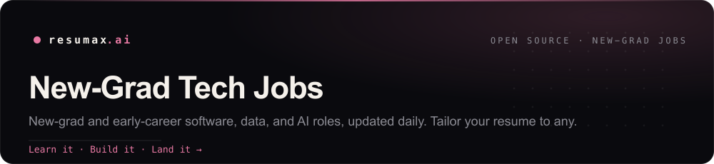

  

# New-Grad Tech Jobs

Open **new-grad** software, data, AI/ML, security, and hardware roles **posted in the last 30 days**, refreshed daily. We filter out senior, staff, and lead postings, dedupe across job boards, and drop anything older than 30 days, so the list stays fresh and actually open. Every role links into [ResuMax](https://resumax.ai/?utm_source=github&utm_medium=repo&utm_campaign=new-grad-tech-jobs&utm_content=intro), where **Atlas**, our AI career copilot, tailors your resume to it and preps you to ace the interview.

  

### Prepare a truthful, role-specific application.

**[Tailor your resume to any role above &rarr;](https://resumax.ai/?utm_source=github&utm_medium=repo&utm_campaign=new-grad-tech-jobs&utm_content=cta-link)**

Atlas compares the posting with your confirmed experience, prepares reviewable resume suggestions, and builds a focused coding, system-design, and behavioral interview plan. It never invents experience or submits an application for you.

**Found a role we're missing or a dead link?** [Open an issue](../../issues/new) and we'll fold it in.

## Open new-grad roles from the last 30 days

**2491** open roles from the last 30 days, newest first. Jump to a category:

**[Software Engineering](#software-engineering)** &nbsp;·&nbsp; 1284 open  
**[Data, AI & ML](#data-ai-and-ml)** &nbsp;·&nbsp; 612 open  
**[Security](#security)** &nbsp;·&nbsp; 101 open  
**[DevOps, Infra & Cloud](#devops-infra-and-cloud)** &nbsp;·&nbsp; 357 open  
**[Mobile](#mobile)** &nbsp;·&nbsp; 33 open  
**[Hardware & Embedded](#hardware-and-embedded)** &nbsp;·&nbsp; 104 open  

🌐 Remote &nbsp;·&nbsp; 🆕 Posted this week

## Software Engineering

| Company | Role | Location | Apply | Tailor | Age |
|---|---|---|:--:|:--:|--:|
| **[Joinpogo](https://resumax.ai/companies/joinpogo?utm_source=github&utm_medium=repo&utm_campaign=new-grad-tech-jobs)** 🌐 🆕 | Full Stack Engineer | United States/Canada | [Apply](https://jobs.ashbyhq.com/joinpogo/e6531037-a3cd-4979-bd01-0f8e0c4ef3e0/application) |  | 0d |
| **[Aecom](https://resumax.ai/companies/aecom?utm_source=github&utm_medium=repo&utm_campaign=new-grad-tech-jobs)** 🆕 | ELV Design Engineer | Hyderabad, in | [Apply](https://jobs.smartrecruiters.com/aecom2/744000160866543) |  | 0d |
| **[Anthropic](https://resumax.ai/companies/anthropic?utm_source=github&utm_medium=repo&utm_campaign=new-grad-tech-jobs)** 🆕 | [C] Research Engineer, Discovery | San Francisco, CA \| New York City, NY | [Apply](https://job-boards.greenhouse.io/anthropic/jobs/5467305008) |  | 0d |
| **[Red Bull](https://resumax.ai/companies/red-bull?utm_source=github&utm_medium=repo&utm_campaign=new-grad-tech-jobs)** 🆕 | VCARB F1 Team - Composite Design Engineer | Faenza, Emilia-Romagna, it | [Apply](https://jobs.smartrecruiters.com/redbull/744000160846277) |  | 0d |
| **[STOW Group](https://resumax.ai/companies/stow-group?utm_source=github&utm_medium=repo&utm_campaign=new-grad-tech-jobs)** 🆕 | Robotics Validation Engineer | Lokeren, Vlaams Gewest, be | [Apply](https://jobs.smartrecruiters.com/stowgroup/744000160845529) |  | 0d |
| **[Bosch Group](https://resumax.ai/companies/bosch-group?utm_source=github&utm_medium=repo&utm_campaign=new-grad-tech-jobs)** 🆕 | Software Engineer at Bosch Thermotechnology AB | Tranås, Jönköpings län, se | [Apply](https://jobs.smartrecruiters.com/boschgroup/744000160838859) |  | 0d |
| **[Impact.com](https://resumax.ai/companies/impact-com?utm_source=github&utm_medium=repo&utm_campaign=new-grad-tech-jobs)** 🆕 | GenAI Engineer - Sales Enablement | Capetown | [Apply](https://job-boards.greenhouse.io/impact/jobs/8867802002) |  | 0d |
| **[Continental](https://resumax.ai/companies/continental?utm_source=github&utm_medium=repo&utm_campaign=new-grad-tech-jobs)** 🆕 | Full Stack Developer | Lousado, Braga, pt | [Apply](https://jobs.smartrecruiters.com/continental/744000160825904) |  | 0d |
| **[NielsenIQ](https://resumax.ai/companies/nielseniq?utm_source=github&utm_medium=repo&utm_campaign=new-grad-tech-jobs)** 🆕 | Associate Software Engineer (Python + Oracle SQL) | Pune, MH, in | [Apply](https://jobs.smartrecruiters.com/nielseniq/744000160829735) |  | 0d |
| **[Alten](https://resumax.ai/companies/alten?utm_source=github&utm_medium=repo&utm_campaign=new-grad-tech-jobs)** 🆕 | C++ Developer | Valbonne, Provence-Alpes-Côte d'Azur, fr | [Apply](https://jobs.smartrecruiters.com/alten/744000160828158) |  | 0d |
| **[Netcompany](https://resumax.ai/companies/netcompany?utm_source=github&utm_medium=repo&utm_campaign=new-grad-tech-jobs)** 🆕 | Junior Full-Stack Consultant | Athens, gr | [Apply](https://jobs.smartrecruiters.com/netcompany1/744000160819959) |  | 0d |
| **[Veolia Environnement SA](https://resumax.ai/companies/veolia-environnement-sa?utm_source=github&utm_medium=repo&utm_campaign=new-grad-tech-jobs)** 🆕 | Workday Integration Developer | Hyderabad, in | [Apply](https://jobs.smartrecruiters.com/veoliaenvironnementsa/744000160800619) |  | 0d |
| **[Bertelsmann-jobs](https://resumax.ai/companies/bertelsmann-jobs?utm_source=github&utm_medium=repo&utm_campaign=new-grad-tech-jobs)** 🆕 | Software Engineer (C#/.Net) (m/f/d) | Stockholm, se | [Apply](https://jobs.smartrecruiters.com/bertelsmann-jobs/744000160794833) |  | 0d |
| **[Vast](https://resumax.ai/companies/vast?utm_source=github&utm_medium=repo&utm_campaign=new-grad-tech-jobs)** 🆕 | Integration Build Engineer | Long Beach, California, United States | [Apply](https://boards.greenhouse.io/vast/jobs/4728490006?gh_jid=4728490006) |  | 0d |
| **[Open AI](https://resumax.ai/companies/open-ai?utm_source=github&utm_medium=repo&utm_campaign=new-grad-tech-jobs)** 🌐 🆕 | RTL Design Engineer, Networking / NoC | San Francisco | [Apply](https://jobs.ashbyhq.com/openai/ead83ff6-7a58-43dd-b7da-b85e7ddd679c/application) |  | 0d |
| **[Hadrian Automation](https://resumax.ai/companies/hadrian-automation?utm_source=github&utm_medium=repo&utm_campaign=new-grad-tech-jobs)** 🆕 | Build Engineer | Los Angeles, CA | [Apply](https://jobs.ashbyhq.com/hadrian-automation/32bc8210-18d8-4f8f-99a8-702dcf59326f/application) |  | 0d |
| **[Cursor](https://resumax.ai/companies/cursor?utm_source=github&utm_medium=repo&utm_campaign=new-grad-tech-jobs)** 🆕 | Software Engineer, New Grad 2027 | San Francisco, CA | [Apply](https://jobs.ashbyhq.com/cursor/164e27cd-289e-4bcd-8aaf-5280e75c5ed6/application) |  | 0d |
| **[Torc Robotics](https://resumax.ai/companies/torc-robotics?utm_source=github&utm_medium=repo&utm_campaign=new-grad-tech-jobs)** 🌐 🆕 | Engineer II - Systems and Software Quality | Ann Arbor, MI; Remote - US | [Apply](https://job-boards.greenhouse.io/torcrobotics/jobs/8926863002) |  | 0d |
| **[Multi Media LLC](https://resumax.ai/companies/multi-media-llc?utm_source=github&utm_medium=repo&utm_campaign=new-grad-tech-jobs)** 🌐 🆕 | Software Engineer I/II | United States | [Apply](https://apply.workable.com/j/24DBCDDF27/apply) |  | 0d |
| **[Raydar](https://resumax.ai/companies/raydar?utm_source=github&utm_medium=repo&utm_campaign=new-grad-tech-jobs)** 🆕 | Backend Software Engineer | San Francisco, California, United States | [Apply](https://apply.workable.com/j/A21923EC3F/apply) |  | 0d |
| **[Sigma Defense](https://resumax.ai/companies/sigma-defense?utm_source=github&utm_medium=repo&utm_campaign=new-grad-tech-jobs)** 🆕 | 1564 - Software Engineer II | Ridgecrest, California, United States | [Apply](https://apply.workable.com/j/BC14FB8B57/apply) |  | 0d |
| **[Aecom](https://resumax.ai/companies/aecom?utm_source=github&utm_medium=repo&utm_campaign=new-grad-tech-jobs)** 🆕 | ELV Design Engineer | Gurgaon, in | [Apply](https://jobs.smartrecruiters.com/aecom2/744000160866129) |  | 0d |
| **[STOW Group](https://resumax.ai/companies/stow-group?utm_source=github&utm_medium=repo&utm_campaign=new-grad-tech-jobs)** 🆕 | Robotics Test and Validation Engineer | Lokeren, Vlaams Gewest, be | [Apply](https://jobs.smartrecruiters.com/stowgroup/744000160844909) |  | 0d |
| **[Bosch Group](https://resumax.ai/companies/bosch-group?utm_source=github&utm_medium=repo&utm_campaign=new-grad-tech-jobs)** 🆕 | Thermal Management Design Engineer_PS-TS | Shanghai, cn | [Apply](https://jobs.smartrecruiters.com/boschgroup/744000160824222) |  | 0d |
| **[NielsenIQ](https://resumax.ai/companies/nielseniq?utm_source=github&utm_medium=repo&utm_campaign=new-grad-tech-jobs)** 🆕 | Software Engineer | Chennai, TN, in | [Apply](https://jobs.smartrecruiters.com/nielseniq/744000160794888) |  | 0d |
| **[Netcompany](https://resumax.ai/companies/netcompany?utm_source=github&utm_medium=repo&utm_campaign=new-grad-tech-jobs)** 🆕 | Junior Software Engineer/Consultant | Athens, gr | [Apply](https://jobs.smartrecruiters.com/netcompany1/744000160817801) |  | 0d |
| **[Sigma Defense](https://resumax.ai/companies/sigma-defense?utm_source=github&utm_medium=repo&utm_campaign=new-grad-tech-jobs)** 🆕 | 1760 - Application Developer | Dahlgren, Virginia, United States | [Apply](https://apply.workable.com/j/978BE86C01/apply) |  | 0d |
| **[Bosch Group](https://resumax.ai/companies/bosch-group?utm_source=github&utm_medium=repo&utm_campaign=new-grad-tech-jobs)** 🆕 | Full stack Engineer | bengaluru, in | [Apply](https://jobs.smartrecruiters.com/boschgroup/744000160794268) |  | 0d |
| **[Sigma Defense](https://resumax.ai/companies/sigma-defense?utm_source=github&utm_medium=repo&utm_campaign=new-grad-tech-jobs)** 🆕 | 1792 - Software Engineer | Norfolk, Virginia, United States | [Apply](https://apply.workable.com/j/26693DF183/apply) |  | 0d |
| **[Bosch Group](https://resumax.ai/companies/bosch-group?utm_source=github&utm_medium=repo&utm_campaign=new-grad-tech-jobs)** 🆕 | Python_Fullstack_And_Cloud_Developer | bangalore, in | [Apply](https://jobs.smartrecruiters.com/boschgroup/744000160790108) |  | 0d |
| **[Clera](https://resumax.ai/companies/clera?utm_source=github&utm_medium=repo&utm_campaign=new-grad-tech-jobs)** 🆕 | Founding Software Engineer | San Francisco | [Apply](https://jobs.ashbyhq.com/Clera/6b643d0f-3ab6-4e6f-a382-eab9d166aeea/application) |  | 0d |
| **[Open AI](https://resumax.ai/companies/open-ai?utm_source=github&utm_medium=repo&utm_campaign=new-grad-tech-jobs)** 🌐 🆕 | Full-Stack Software Engineer, Child Safety Tools & Systems… | London, UK | [Apply](https://jobs.ashbyhq.com/openai/8ddb799f-f0c7-4df8-9665-5016a1f39da3/application) |  | 0d |
| **[PointOne](https://resumax.ai/companies/pointone?utm_source=github&utm_medium=repo&utm_campaign=new-grad-tech-jobs)** 🆕 | Software Engineer | New York City | [Apply](https://jobs.ashbyhq.com/PointOne/bb42f37c-8a7c-434d-aae8-089820a7171d/application) |  | 0d |
| **[Rocket Lab Corporation](https://resumax.ai/companies/rocket-lab-corporation?utm_source=github&utm_medium=repo&utm_campaign=new-grad-tech-jobs)** 🆕 | Software Engineer I | Pasadena, CA | [Apply](https://job-boards.greenhouse.io/rocketlab/jobs/8057246003) |  | 0d |
| **[Aecom](https://resumax.ai/companies/aecom?utm_source=github&utm_medium=repo&utm_campaign=new-grad-tech-jobs)** 🆕 | Structural Design Engineer/EIT | Calgary, AB, ca | [Apply](https://jobs.smartrecruiters.com/aecom2/744000160740939) |  | 0d |
| **[Anduril Industries](https://resumax.ai/companies/anduril-industries?utm_source=github&utm_medium=repo&utm_campaign=new-grad-tech-jobs)** 🆕 | Software Engineer, Sentry Software (Manufacturing) | Irvine, California, United States | [Apply](https://boards.greenhouse.io/andurilindustries/jobs/5290232007?gh_jid=5290232007) |  | 0d |
| **[Ifs](https://resumax.ai/companies/ifs?utm_source=github&utm_medium=repo&utm_campaign=new-grad-tech-jobs)** 🆕 | Forward deployed engineer - M&A group | Itasca, Illinois, us | [Apply](https://jobs.smartrecruiters.com/ifs1/744000160739129) |  | 0d |
| **[Netcompany](https://resumax.ai/companies/netcompany?utm_source=github&utm_medium=repo&utm_campaign=new-grad-tech-jobs)** 🆕 | Database Developer - Cache/Iris  - 4 month contract | London, England, gb | [Apply](https://jobs.smartrecruiters.com/netcompany1/744000160738468) |  | 0d |
| **[Llnl](https://resumax.ai/companies/llnl?utm_source=github&utm_medium=repo&utm_campaign=new-grad-tech-jobs)** 🆕 | Software Developer | Livermore, CA, us | [Apply](https://jobs.smartrecruiters.com/llnl/3743990016744146) |  | 0d |
| **[Beacon AI](https://resumax.ai/companies/beacon-ai?utm_source=github&utm_medium=repo&utm_campaign=new-grad-tech-jobs)** 🆕 | Software Engineer, Frontend/Web App | San Carlos  - Hybrid | [Apply](https://jobs.ashbyhq.com/beaconai/b991777e-9156-47c7-960e-3e29defc0c3a/application) |  | 0d |
| **[Experian](https://resumax.ai/companies/experian?utm_source=github&utm_medium=repo&utm_campaign=new-grad-tech-jobs)** 🆕 | Analista de Desenvolvimento de Software Sênior (Java) | Blumenau, br | [Apply](https://jobs.smartrecruiters.com/Experian/744000160734049) |  | 0d |
| **[Allegiantair](https://resumax.ai/companies/allegiantair?utm_source=github&utm_medium=repo&utm_campaign=new-grad-tech-jobs)** 🆕 | Software Engineer in Test (SET) | Las Vegas, NV | [Apply](https://jobs.lever.co/allegiantair/324f22bc-32bb-4c0a-87f1-285a92530302/apply) |  | 0d |
| **[Gusto, Inc.](https://resumax.ai/companies/gusto-inc?utm_source=github&utm_medium=repo&utm_campaign=new-grad-tech-jobs)** 🌐 🆕 | Software Engineer,  Financial Data & Payments | Denver, CO - Hybrid; New York, NY - Hybrid; San Francisco, CA - Hybrid; Seattle, WA - Remote | [Apply](https://job-boards.greenhouse.io/gusto/jobs/8360497) |  | 1d |
| **[Whoop](https://resumax.ai/companies/whoop?utm_source=github&utm_medium=repo&utm_campaign=new-grad-tech-jobs)** 🆕 | Software Engineer I (Backend, Growth) | Boston, MA | [Apply](https://jobs.ashbyhq.com/whoop/d31312c2-236a-45f1-8da7-61a7ca8d1622/application) |  | 1d |
| **[Versant](https://resumax.ai/companies/versant?utm_source=github&utm_medium=repo&utm_campaign=new-grad-tech-jobs)** 🆕 | Software Engineer | Englewood Cliffs, NEW JERSEY, us | [Apply](https://jobs.smartrecruiters.com/versant3/744000160700378) |  | 1d |
| **[Erg](https://resumax.ai/companies/erg?utm_source=github&utm_medium=repo&utm_campaign=new-grad-tech-jobs)** 🆕 | Electrical Design Engineer | Indian Head, MD | [Apply](https://jobs.lever.co/erg/189e9534-4ed9-4bbe-a7ad-9031cbed7cf3/apply) |  | 1d |
| **[Northwoodspace](https://resumax.ai/companies/northwoodspace?utm_source=github&utm_medium=repo&utm_campaign=new-grad-tech-jobs)** 🆕 | Software Engineer (Portal) | Torrance, CA | [Apply](https://jobs.ashbyhq.com/northwoodspace/707d464d-a114-4721-95fd-a00398e04404/application) |  | 1d |
| **[Cscgeneration 2](https://resumax.ai/companies/cscgeneration-2?utm_source=github&utm_medium=repo&utm_campaign=new-grad-tech-jobs)** 🌐 🆕 | Junior Software Engineer | Remote - Toronto | [Apply](https://jobs.lever.co/cscgeneration-2/61ba3ce6-b92b-45b4-932d-0c66e5e19185/apply) |  | 1d |
| **[Ramp](https://resumax.ai/companies/ramp?utm_source=github&utm_medium=repo&utm_campaign=new-grad-tech-jobs)** 🌐 🆕 | Software Engineer, Backend, Comms Platform | Remote (US) | [Apply](https://jobs.ashbyhq.com/ramp/939892e5-5273-4bfc-8c41-a6c51cabb228/application) |  | 1d |
| **[Nbcuniversal](https://resumax.ai/companies/nbcuniversal?utm_source=github&utm_medium=repo&utm_campaign=new-grad-tech-jobs)** 🆕 | Software Engineer | New York, NEW YORK, us | [Apply](https://jobs.smartrecruiters.com/nbcuniversal3/744000160686477) |  | 1d |
| **[Quest Analytics](https://resumax.ai/companies/quest-analytics?utm_source=github&utm_medium=repo&utm_campaign=new-grad-tech-jobs)** 🆕 | Software Engineer | United States | [Apply](https://jobs.lever.co/questanalytics/0ef2155f-a1d9-4af8-a81d-917177c7e6d8/apply) |  | 1d |
| **[Bosch Group](https://resumax.ai/companies/bosch-group?utm_source=github&utm_medium=repo&utm_campaign=new-grad-tech-jobs)** 🆕 | MID-LEVEL -  SOFTWARE QUALITY ANALYST - 36527 | Campinas, SP, br | [Apply](https://jobs.smartrecruiters.com/boschgroup/744000160685470) |  | 1d |
| **[Intelerad](https://resumax.ai/companies/intelerad?utm_source=github&utm_medium=repo&utm_campaign=new-grad-tech-jobs)** 🆕 | Platform Software Developer (AWS, Terraform, Kubernetes) | Remote, CANADA, ca | [Apply](https://jobs.smartrecruiters.com/intelerad/744000160685899) |  | 1d |
| **[Intuitive](https://resumax.ai/companies/intuitive?utm_source=github&utm_medium=repo&utm_campaign=new-grad-tech-jobs)** 🆕 | Software Engineer, Manufacturing Automation & Test | Sunnyvale, CA, us | [Apply](https://jobs.smartrecruiters.com/intuitive/744000160682859) |  | 1d |
| **[Avery Dennison](https://resumax.ai/companies/avery-dennison?utm_source=github&utm_medium=repo&utm_campaign=new-grad-tech-jobs)** 🆕 | Label Machine Operator, Backend Night shift, Wed 11pm-5am,… | Lewis Center, OH, us | [Apply](https://jobs.smartrecruiters.com/AveryDennison/744000160671572) |  | 1d |
| **[Sopra Steria](https://resumax.ai/companies/sopra-steria?utm_source=github&utm_medium=repo&utm_campaign=new-grad-tech-jobs)** 🆕 | Développeur Fullstack Java | Meyrin, GE, ch | [Apply](https://jobs.smartrecruiters.com/soprasteria1/744000160666465) |  | 1d |
| **[Hardin Design](https://resumax.ai/companies/hardin-design?utm_source=github&utm_medium=repo&utm_campaign=new-grad-tech-jobs)** 🆕 | Web Developer - Entry Level | Madison, WI, us | [Apply](https://jobs.smartrecruiters.com/hardindesign/744000160661857) |  | 1d |
| **[Scopely](https://resumax.ai/companies/scopely?utm_source=github&utm_medium=repo&utm_campaign=new-grad-tech-jobs)** 🆕 | Full Stack Engineer | US - United States | [Apply](https://job-boards.greenhouse.io/scopely/jobs/5476480008?gh_jid=5476480008) |  | 1d |
| **[Mirage](https://resumax.ai/companies/mirage?utm_source=github&utm_medium=repo&utm_campaign=new-grad-tech-jobs)** 🆕 | Software Engineer, Agents | Union Square, New York City | [Apply](https://jobs.ashbyhq.com/mirage/e812e12d-465b-4dfa-90b1-085ac29ab848/application) |  | 1d |
| **[Socotec](https://resumax.ai/companies/socotec?utm_source=github&utm_medium=repo&utm_campaign=new-grad-tech-jobs)** 🆕 | Ingénieur Commercial / Business Developer Nucléaire H/F | Rouen, fr | [Apply](https://jobs.smartrecruiters.com/socotec/744000160642909) |  | 1d |
| **[Metron](https://resumax.ai/companies/metron?utm_source=github&utm_medium=repo&utm_campaign=new-grad-tech-jobs)** 🆕 | Software Engineer (On-site, Aurora, CO) | Aurora, CO | [Apply](https://job-boards.greenhouse.io/metron/jobs/5289210007) |  | 1d |
| **[Space Kinetic](https://resumax.ai/companies/space-kinetic?utm_source=github&utm_medium=repo&utm_campaign=new-grad-tech-jobs)** 🆕 | Electrical Design Engineer | El Segundo, California | [Apply](https://job-boards.greenhouse.io/spacekinetic/jobs/5476158008) |  | 1d |
| **[Canadian Bank Note Company](https://resumax.ai/companies/canadian-bank-note-company?utm_source=github&utm_medium=repo&utm_campaign=new-grad-tech-jobs)** 🆕 | Platform Developer | Ottawa, ON, ca | [Apply](https://jobs.smartrecruiters.com/canadianbanknotecompany/744000160621100) |  | 1d |
| **[Aera Technology](https://resumax.ai/companies/aera-technology?utm_source=github&utm_medium=repo&utm_campaign=new-grad-tech-jobs)** 🆕 | Developer Support Engineer | Bucharest, Romania | [Apply](https://jobs.lever.co/aeratechnology/3aae2830-272f-4e45-9dd5-4a85414e96e6/apply) |  | 1d |
| **[Version 1](https://resumax.ai/companies/version-1?utm_source=github&utm_medium=repo&utm_campaign=new-grad-tech-jobs)** 🆕 | Power Platform Developer | Dublin, County Dublin, ie | [Apply](https://jobs.smartrecruiters.com/version1/744000160616959) |  | 1d |
| **[Axon](https://resumax.ai/companies/axon?utm_source=github&utm_medium=repo&utm_campaign=new-grad-tech-jobs)** 🆕 | Software Engineer I | Romania-Bucharest Office; Romania-Timisoara Office | [Apply](https://job-boards.greenhouse.io/axon/jobs/7816769003) |  | 1d |
| **[Crown Innovations, Inc.](https://resumax.ai/companies/crown-innovations-inc?utm_source=github&utm_medium=repo&utm_campaign=new-grad-tech-jobs)** 🌐 🆕 | Software Verification & Test Engineer | Arlington, VA, us | [Apply](https://jobs.smartrecruiters.com/crowninnovationsinc/744000160600979) |  | 1d |
| **[Robinhood](https://resumax.ai/companies/robinhood?utm_source=github&utm_medium=repo&utm_campaign=new-grad-tech-jobs)** 🆕 | Web Engineer, International Expansion | Toronto, Canada | [Apply](https://boards.greenhouse.io/robinhood/jobs/8177444?t=gh_src=&gh_jid=8177444) |  | 1d |
| **[Ubisoft](https://resumax.ai/companies/ubisoft?utm_source=github&utm_medium=repo&utm_campaign=new-grad-tech-jobs)** 🆕 | Data Developer | Bucharest, Bucharest, ro | [Apply](https://jobs.smartrecruiters.com/ubisoft2/744000160600558) |  | 1d |
| **[Alten](https://resumax.ai/companies/alten?utm_source=github&utm_medium=repo&utm_campaign=new-grad-tech-jobs)** 🆕 | Développement Back-End Java / Data Kafka, RabbitMQ Expérimenté | Rabat, Rabat-Salé-Kénitra, ma | [Apply](https://jobs.smartrecruiters.com/alten/744000160592660) |  | 1d |
| **[Faculty](https://resumax.ai/companies/faculty?utm_source=github&utm_medium=repo&utm_campaign=new-grad-tech-jobs)** 🌐 🆕 | Full Stack Software Engineer | London | [Apply](https://jobs.ashbyhq.com/faculty/67645c5e-abe8-434f-8013-f13e82259e81/application) |  | 1d |
| **[AJ Bell](https://resumax.ai/companies/aj-bell?utm_source=github&utm_medium=repo&utm_campaign=new-grad-tech-jobs)** 🆕 | Software Engineer (GenAI) | Manchester, England, gb | [Apply](https://jobs.smartrecruiters.com/ajbell1/744000160585884) |  | 1d |
| **[Eurofins](https://resumax.ai/companies/eurofins?utm_source=github&utm_medium=repo&utm_campaign=new-grad-tech-jobs)** 🆕 | C# Developer | Amersfoort, UT, nl | [Apply](https://jobs.smartrecruiters.com/eurofins/744000160580379) |  | 1d |
| **[Wise](https://resumax.ai/companies/wise?utm_source=github&utm_medium=repo&utm_campaign=new-grad-tech-jobs)** 🆕 | Software Engineer - Fincrime Reporting | Tallinn, ee | [Apply](https://jobs.smartrecruiters.com/wise/744000160573050) |  | 1d |
| **[SOMFY Group](https://resumax.ai/companies/somfy-group?utm_source=github&utm_medium=repo&utm_campaign=new-grad-tech-jobs)** 🌐 🆕 | Project Business Developer – Commercial & Residential Market… | Bucharest, Bucharest, ro | [Apply](https://jobs.smartrecruiters.com/somfygroup/744000160546709) |  | 1d |
| **[Capco](https://resumax.ai/companies/capco?utm_source=github&utm_medium=repo&utm_campaign=new-grad-tech-jobs)** 🆕 | .NET - Fullstack | India - Bengaluru | [Apply](https://job-boards.greenhouse.io/capco/jobs/8317891) |  | 1d |
| **[Uipath](https://resumax.ai/companies/uipath?utm_source=github&utm_medium=repo&utm_campaign=new-grad-tech-jobs)** 🆕 | Software Engineer II | Bangalore - Engineering | [Apply](https://jobs.ashbyhq.com/uipath/4a6e6497-c17e-45d3-b989-985d60a193ff/application) |  | 1d |
| **[SpaceX](https://resumax.ai/companies/spacex?utm_source=github&utm_medium=repo&utm_campaign=new-grad-tech-jobs)** 🆕 | Full Stack Software Engineer, Manufacturing Systems | Bastrop, TX | [Apply](https://boards.greenhouse.io/spacex/jobs/8934567002?gh_jid=8934567002) |  | 1d |
| **[Domino's](https://resumax.ai/companies/domino-s?utm_source=github&utm_medium=repo&utm_campaign=new-grad-tech-jobs)** 🆕 | Software Engineer II | Ann Arbor, MI, us | [Apply](https://jobs.smartrecruiters.com/dominos/744000160500849) |  | 1d |
| **[Aerones](https://resumax.ai/companies/aerones?utm_source=github&utm_medium=repo&utm_campaign=new-grad-tech-jobs)** 🆕 | Field Robotics Operator US | Kansas City, Missouri, United States | [Apply](https://apply.workable.com/j/9815B66C27/apply) |  | 1d |
| **[Credence](https://resumax.ai/companies/credence?utm_source=github&utm_medium=repo&utm_campaign=new-grad-tech-jobs)** 🆕 | Junior SAP ABAP Developer | McLean, Virginia, United States | [Apply](https://apply.workable.com/j/207F2F6631/apply) |  | 1d |
| **[Cwill](https://resumax.ai/companies/cwill?utm_source=github&utm_medium=repo&utm_campaign=new-grad-tech-jobs)** 🆕 | Order Tracking R&D Trainee - Backend Engineer (Go / PHP) -… | cary, North Carolina, United States | [Apply](https://apply.workable.com/j/F8335216DC/apply) |  | 1d |
| **[Intetics](https://resumax.ai/companies/intetics?utm_source=github&utm_medium=repo&utm_campaign=new-grad-tech-jobs)** 🌐 🆕 | 1183 \| Middle .NET MAUI Developer (Part-Time) | Kazakhstan | [Apply](https://apply.workable.com/j/EDAB3B0A0E/apply) |  | 1d |
| **[Valsoft Corporation](https://resumax.ai/companies/valsoft-corporation?utm_source=github&utm_medium=repo&utm_campaign=new-grad-tech-jobs)** 🆕 | Intermediate Software Developer - H&L | Beirut, Beirut Governorate, Lebanon | [Apply](https://apply.workable.com/j/FA953ADDA8/apply) |  | 1d |
| **[Weekday AI](https://resumax.ai/companies/weekday-ai?utm_source=github&utm_medium=repo&utm_campaign=new-grad-tech-jobs)** 🆕 | Backend Developer (Go Language Developer) | Mumbai, Maharashtra, India | [Apply](https://apply.workable.com/j/ACBF2F7B21/apply) |  | 1d |
| **[Clera](https://resumax.ai/companies/clera?utm_source=github&utm_medium=repo&utm_campaign=new-grad-tech-jobs)** 🆕 | Founding Engineer | Berlin | [Apply](https://jobs.ashbyhq.com/Clera/23c9c7bb-6a6b-4fdc-9e9b-ad5c1a10e5d4/application) |  | 1d |
| **[Open AI](https://resumax.ai/companies/open-ai?utm_source=github&utm_medium=repo&utm_campaign=new-grad-tech-jobs)** 🌐 🆕 | Full-Stack Software Engineer, Child Safety Tools & Systems | San Francisco | [Apply](https://jobs.ashbyhq.com/openai/d7dfc19d-e508-4522-91fa-e31c3b612a47/application) |  | 0d |
| **[PointOne](https://resumax.ai/companies/pointone?utm_source=github&utm_medium=repo&utm_campaign=new-grad-tech-jobs)** 🆕 | Forward Deployed Engineer | New York City | [Apply](https://jobs.ashbyhq.com/PointOne/834a8648-5581-4d69-80cb-41382928d220/application) |  | 0d |
| **[Aecom](https://resumax.ai/companies/aecom?utm_source=github&utm_medium=repo&utm_campaign=new-grad-tech-jobs)** 🆕 | Structural Design Engineer/EIT | Edmonton, AB, ca | [Apply](https://jobs.smartrecruiters.com/aecom2/744000160740759) |  | 0d |
| **[Anduril Industries](https://resumax.ai/companies/anduril-industries?utm_source=github&utm_medium=repo&utm_campaign=new-grad-tech-jobs)** 🆕 | Software Engineer, Sentry Software (Ground Based Air Defense) | Irvine, California, United States | [Apply](https://boards.greenhouse.io/andurilindustries/jobs/5290228007?gh_jid=5290228007) |  | 0d |
| **[Ifs](https://resumax.ai/companies/ifs?utm_source=github&utm_medium=repo&utm_campaign=new-grad-tech-jobs)** 🌐 🆕 | Forward Deployed Engineer- Asset Management \| IFS Copperleaf | Itasca, Illinois, us | [Apply](https://jobs.smartrecruiters.com/ifs1/744000160682099) |  | 1d |
| **[Experian](https://resumax.ai/companies/experian?utm_source=github&utm_medium=repo&utm_campaign=new-grad-tech-jobs)** 🆕 | Analista de Garantia de Qualidade Software Sênior | São Paulo, SP, br | [Apply](https://jobs.smartrecruiters.com/Experian/744000160725429) |  | 1d |
| **[Nbcuniversal](https://resumax.ai/companies/nbcuniversal?utm_source=github&utm_medium=repo&utm_campaign=new-grad-tech-jobs)** 🆕 | Software Engineering Internships – Summer 2027 | New York, NY, us | [Apply](https://jobs.smartrecruiters.com/nbcuniversal3/744000160659459) |  | 1d |
| **[Bosch Group](https://resumax.ai/companies/bosch-group?utm_source=github&utm_medium=repo&utm_campaign=new-grad-tech-jobs)** 🆕 | Stagiaire Développeur Full Stack F/H | Vénissieux, Auvergne-Rhône-Alpes, fr | [Apply](https://jobs.smartrecruiters.com/boschgroup/744000160651869) |  | 1d |
| **[Intelerad](https://resumax.ai/companies/intelerad?utm_source=github&utm_medium=repo&utm_campaign=new-grad-tech-jobs)** 🆕 | Platform Software Developer (AWS, Terraform, Kubernetes) | Remote, UNITED STATES, us | [Apply](https://jobs.smartrecruiters.com/intelerad/744000160685339) |  | 1d |
| **[Sopra Steria](https://resumax.ai/companies/sopra-steria?utm_source=github&utm_medium=repo&utm_campaign=new-grad-tech-jobs)** 🆕 | Développeur(euse) Fullstack Java/Angular Confirmé/e - Industrie… | Le Plessis-Robinson, IDF, fr | [Apply](https://jobs.smartrecruiters.com/soprasteria1/744000160660125) |  | 1d |
| **[Mirage](https://resumax.ai/companies/mirage?utm_source=github&utm_medium=repo&utm_campaign=new-grad-tech-jobs)** 🆕 | Software Engineer, Backend | Union Square, New York City | [Apply](https://jobs.ashbyhq.com/mirage/794a57cc-daf6-4636-b295-81e892418414/application) |  | 1d |
| **[Alten](https://resumax.ai/companies/alten?utm_source=github&utm_medium=repo&utm_campaign=new-grad-tech-jobs)** 🌐 🆕 | Electrical Design Engineer (AutoCAD electrical) | Southampton, England, gb | [Apply](https://jobs.smartrecruiters.com/alten/744000160590989) |  | 1d |
| **[Wise](https://resumax.ai/companies/wise?utm_source=github&utm_medium=repo&utm_campaign=new-grad-tech-jobs)** 🆕 | Software Engineer - Risk Control & Governance | London, gb | [Apply](https://jobs.smartrecruiters.com/wise/744000160549671) |  | 1d |
| **[SpaceX](https://resumax.ai/companies/spacex?utm_source=github&utm_medium=repo&utm_campaign=new-grad-tech-jobs)** 🆕 | Full Stack Software Engineer, Internal Platforms | Starbase, TX | [Apply](https://boards.greenhouse.io/spacex/jobs/8934566002?gh_jid=8934566002) |  | 1d |
| **[Clera](https://resumax.ai/companies/clera?utm_source=github&utm_medium=repo&utm_campaign=new-grad-tech-jobs)** 🆕 | Forward Deployed Engineer | Berlin | [Apply](https://jobs.ashbyhq.com/Clera/61071bc3-8208-42c0-86a5-157a67fbf431/application) |  | 1d |
| **[Aecom](https://resumax.ai/companies/aecom?utm_source=github&utm_medium=repo&utm_campaign=new-grad-tech-jobs)** 🆕 | Design Engineer | New York, NY, us | [Apply](https://jobs.smartrecruiters.com/aecom2/744000160728129) |  | 1d |
| **[Anduril Industries](https://resumax.ai/companies/anduril-industries?utm_source=github&utm_medium=repo&utm_campaign=new-grad-tech-jobs)** 🆕 | Software Engineer, Sentry Software (Allied Customer Deployment) | Irvine, California, United States | [Apply](https://boards.greenhouse.io/andurilindustries/jobs/5290223007?gh_jid=5290223007) |  | 0d |
| **[Ifs](https://resumax.ai/companies/ifs?utm_source=github&utm_medium=repo&utm_campaign=new-grad-tech-jobs)** 🆕 | Forward deployed engineer - M&A group | Staines-upon-Thames, England, gb | [Apply](https://jobs.smartrecruiters.com/ifs1/744000160579291) |  | 1d |
| **[Nbcuniversal](https://resumax.ai/companies/nbcuniversal?utm_source=github&utm_medium=repo&utm_campaign=new-grad-tech-jobs)** 🆕 | Software Engineering Internships – Summer 2027 | Universal City, CA, us | [Apply](https://jobs.smartrecruiters.com/nbcuniversal3/744000160659379) |  | 1d |
| **[Bosch Group](https://resumax.ai/companies/bosch-group?utm_source=github&utm_medium=repo&utm_campaign=new-grad-tech-jobs)** 🆕 | Full Stack Developer | bangalore, in | [Apply](https://jobs.smartrecruiters.com/boschgroup/744000160600719) |  | 1d |
| **[Sopra Steria](https://resumax.ai/companies/sopra-steria?utm_source=github&utm_medium=repo&utm_campaign=new-grad-tech-jobs)** 🆕 | Business Developer Data / IA - Industrie - Le Plessis Robinson | Le Plessis-Robinson, IDF, fr | [Apply](https://jobs.smartrecruiters.com/soprasteria1/744000160636200) |  | 1d |
| **[Mirage](https://resumax.ai/companies/mirage?utm_source=github&utm_medium=repo&utm_campaign=new-grad-tech-jobs)** 🆕 | Software Engineer, Photoreal 3D | Union Square, New York City | [Apply](https://jobs.ashbyhq.com/mirage/116d0417-6235-44e8-be17-80f0891ed16b/application) |  | 1d |
| **[Alten](https://resumax.ai/companies/alten?utm_source=github&utm_medium=repo&utm_campaign=new-grad-tech-jobs)** 🆕 | C++ Software Engineer | Glasgow, Scotland, gb | [Apply](https://jobs.smartrecruiters.com/alten/744000160580744) |  | 1d |
| **[SpaceX](https://resumax.ai/companies/spacex?utm_source=github&utm_medium=repo&utm_campaign=new-grad-tech-jobs)** 🆕 | Full Stack Software Engineer, Internal Platforms | Hawthorne, CA | [Apply](https://boards.greenhouse.io/spacex/jobs/8934563002?gh_jid=8934563002) |  | 1d |
| **[Aecom](https://resumax.ai/companies/aecom?utm_source=github&utm_medium=repo&utm_campaign=new-grad-tech-jobs)** 🌐 🆕 | Digital Solutions Software Developer I | Tallahassee, FL, us | [Apply](https://jobs.smartrecruiters.com/aecom2/744000160723419) |  | 1d |
| **[Anduril Industries](https://resumax.ai/companies/anduril-industries?utm_source=github&utm_medium=repo&utm_campaign=new-grad-tech-jobs)** 🆕 | Realtime Software Engineer | Waltham, Massachusetts, United States | [Apply](https://boards.greenhouse.io/andurilindustries/jobs/5289370007?gh_jid=5289370007) |  | 1d |
| **[Bosch Group](https://resumax.ai/companies/bosch-group?utm_source=github&utm_medium=repo&utm_campaign=new-grad-tech-jobs)** 🆕 | Robot Programmer | Cluj, Jucu, ro | [Apply](https://jobs.smartrecruiters.com/boschgroup/744000160593355) |  | 1d |
| **[Sopra Steria](https://resumax.ai/companies/sopra-steria?utm_source=github&utm_medium=repo&utm_campaign=new-grad-tech-jobs)** 🆕 | Stage - Développeur(se) Java Fullstack – Services Financiers –… | Le Mans, fr | [Apply](https://jobs.smartrecruiters.com/soprasteria1/744000160584182) |  | 1d |
| **[Alten](https://resumax.ai/companies/alten?utm_source=github&utm_medium=repo&utm_campaign=new-grad-tech-jobs)** 🆕 | Backend Engineer | Valbonne, Provence-Alpes-Côte d'Azur, fr | [Apply](https://jobs.smartrecruiters.com/alten/744000160559590) |  | 1d |
| **[Anduril Industries](https://resumax.ai/companies/anduril-industries?utm_source=github&utm_medium=repo&utm_campaign=new-grad-tech-jobs)** 🆕 | Mission Software Engineer | Waltham, Massachusetts, United States | [Apply](https://boards.greenhouse.io/andurilindustries/jobs/5289345007?gh_jid=5289345007) |  | 1d |
| **[Bosch Group](https://resumax.ai/companies/bosch-group?utm_source=github&utm_medium=repo&utm_campaign=new-grad-tech-jobs)** 🆕 | ServiceNow Developer (f/m) | Warszawa, Województwo mazowieckie, pl | [Apply](https://jobs.smartrecruiters.com/boschgroup/744000160573896) |  | 1d |
| **[Sopra Steria](https://resumax.ai/companies/sopra-steria?utm_source=github&utm_medium=repo&utm_campaign=new-grad-tech-jobs)** 🆕 | Java Developer | Urdorf, ZH, ch | [Apply](https://jobs.smartrecruiters.com/soprasteria1/744000160580673) |  | 1d |
| **[Sopra Steria](https://resumax.ai/companies/sopra-steria?utm_source=github&utm_medium=repo&utm_campaign=new-grad-tech-jobs)** 🆕 | Stage - Ingénieur Full Stack  - Services Financiers - Brest | Guipavas, Bretagne, fr | [Apply](https://jobs.smartrecruiters.com/soprasteria1/744000160581018) |  | 1d |
| **[Sopra Steria](https://resumax.ai/companies/sopra-steria?utm_source=github&utm_medium=repo&utm_campaign=new-grad-tech-jobs)** 🆕 | Développeur Fullstack - Services Financiers - Angers | Angers, Pays de la Loire, fr | [Apply](https://jobs.smartrecruiters.com/soprasteria1/744000160552523) |  | 1d |
| **[Sopra Steria](https://resumax.ai/companies/sopra-steria?utm_source=github&utm_medium=repo&utm_campaign=new-grad-tech-jobs)** 🆕 | Développeur(se) Java Backend - Spatial - Toulouse | Toulouse, Occitanie, fr | [Apply](https://jobs.smartrecruiters.com/soprasteria1/744000160544484) |  | 1d |
| **[Base Power](https://resumax.ai/companies/base-power?utm_source=github&utm_medium=repo&utm_campaign=new-grad-tech-jobs)** 🌐 🆕 | Software Engineer, Backend - Distributed Compute | Austin, TX | [Apply](https://jobs.ashbyhq.com/base-power/5ea771cb-099f-40e7-a73f-a813494dc037/application) |  | 2d |
| **[Clera](https://resumax.ai/companies/clera?utm_source=github&utm_medium=repo&utm_campaign=new-grad-tech-jobs)** 🌐 🆕 | Forward Deployed Engineer | New York | [Apply](https://jobs.ashbyhq.com/Clera/ff86c115-30f4-46d1-b3ff-06f3154acabe/application) |  | 2d |
| **[Continuum Resource Network](https://resumax.ai/companies/continuum-resource-network?utm_source=github&utm_medium=repo&utm_campaign=new-grad-tech-jobs)** 🆕 | GenAI Forward Deployed Engineer (client facing) - Financial… | New York, New York, United States | [Apply](https://apply.workable.com/j/CF95035152/apply) |  | 2d |
| **[Artificialanalysis](https://resumax.ai/companies/artificialanalysis?utm_source=github&utm_medium=repo&utm_campaign=new-grad-tech-jobs)** 🆕 | Robotics Research Assistant | San Francisco (On-site) | [Apply](https://jobs.ashbyhq.com/artificialanalysis/45f1b5ed-b508-4a4e-8f5f-fdaacb1bac8f/application) |  | 2d |
| **[NielsenIQ](https://resumax.ai/companies/nielseniq?utm_source=github&utm_medium=repo&utm_campaign=new-grad-tech-jobs)** 🆕 | Fullstack Software Engineer (Mid Level) | Ciudad de México, DIF, mx | [Apply](https://jobs.smartrecruiters.com/nielseniq/744000160450189) |  | 3d |
| **[Clera](https://resumax.ai/companies/clera?utm_source=github&utm_medium=repo&utm_campaign=new-grad-tech-jobs)** 🆕 | Founding Software Engineer | Munich | [Apply](https://jobs.ashbyhq.com/Clera/e42bb619-e075-468f-a910-c89b5029dffc/application) |  | 3d |
| **[Anduril Industries](https://resumax.ai/companies/anduril-industries?utm_source=github&utm_medium=repo&utm_campaign=new-grad-tech-jobs)** 🆕 | Curriculum Developer | Santa Ana, California, United States | [Apply](https://boards.greenhouse.io/andurilindustries/jobs/5287840007?gh_jid=5287840007) |  | 3d |
| **[AbbVie](https://resumax.ai/companies/abbvie?utm_source=github&utm_medium=repo&utm_campaign=new-grad-tech-jobs)** 🆕 | Associate Software Engineer I | North Chicago, IL, us | [Apply](https://jobs.smartrecruiters.com/abbvie/3743990016715126) |  | 3d |
| **[Raydar](https://resumax.ai/companies/raydar?utm_source=github&utm_medium=repo&utm_campaign=new-grad-tech-jobs)** 🆕 | Backend Software Engineer | San Francisco, California, United States | [Apply](https://apply.workable.com/j/7ABBBE229A/apply) |  | 3d |
| **[Clera](https://resumax.ai/companies/clera?utm_source=github&utm_medium=repo&utm_campaign=new-grad-tech-jobs)** 🆕 | Founding Backend Engineer | San Francisco | [Apply](https://jobs.ashbyhq.com/Clera/7e4f6158-ad8d-4c31-939f-030b72385d65/application) |  | 3d |
| **[Raydar](https://resumax.ai/companies/raydar?utm_source=github&utm_medium=repo&utm_campaign=new-grad-tech-jobs)** 🆕 | Backend Software Engineer | New York, New York, United States | [Apply](https://apply.workable.com/j/EF10FA0C3C/apply) |  | 3d |
| **[Clera](https://resumax.ai/companies/clera?utm_source=github&utm_medium=repo&utm_campaign=new-grad-tech-jobs)** 🆕 | Founding Engineer | Munich | [Apply](https://jobs.ashbyhq.com/Clera/c51ce537-5e93-497a-b433-dd4b43c442d3/application) |  | 3d |
| **[Raydar](https://resumax.ai/companies/raydar?utm_source=github&utm_medium=repo&utm_campaign=new-grad-tech-jobs)** 🆕 | Front End Software Engineer | Washington, District of Columbia, United States | [Apply](https://apply.workable.com/j/919183586C/apply) |  | 3d |
| **[Clera](https://resumax.ai/companies/clera?utm_source=github&utm_medium=repo&utm_campaign=new-grad-tech-jobs)** 🌐 🆕 | Founding Forward Deployed Engineer | New York | [Apply](https://jobs.ashbyhq.com/Clera/81f80a6b-9e8b-4c95-ba2c-353415d008fc/application) |  | 3d |
| **[Clera](https://resumax.ai/companies/clera?utm_source=github&utm_medium=repo&utm_campaign=new-grad-tech-jobs)** 🆕 | Software Engineer, Foundation | Berlin | [Apply](https://jobs.ashbyhq.com/Clera/f6d21eea-ae26-45d6-b952-0eabcbb6264d/application) |  | 3d |
| **[Clera](https://resumax.ai/companies/clera?utm_source=github&utm_medium=repo&utm_campaign=new-grad-tech-jobs)** 🆕 | Product Engineer, Frontend Focus | Munich | [Apply](https://jobs.ashbyhq.com/Clera/4925faf8-f0c0-4d16-9dff-1938031787c2/application) |  | 3d |
| **[Engine](https://resumax.ai/companies/engine?utm_source=github&utm_medium=repo&utm_campaign=new-grad-tech-jobs)** 🌐 🆕 | Software Engineer - GTM Engineering | Remote - US | [Apply](https://job-boards.greenhouse.io/engine/jobs/8046374003) |  | 3d |
| **[Affirm](https://resumax.ai/companies/affirm?utm_source=github&utm_medium=repo&utm_campaign=new-grad-tech-jobs)** 🌐 🆕 | Software Engineer II, Backend | Remote Canada | [Apply](https://job-boards.greenhouse.io/affirm/jobs/8196114003) |  | 3d |
| **[Open AI](https://resumax.ai/companies/open-ai?utm_source=github&utm_medium=repo&utm_campaign=new-grad-tech-jobs)** 🆕 | Robotics Test Engineer | San Francisco | [Apply](https://jobs.ashbyhq.com/openai/0369bd4b-bfb1-4c36-90cb-4e3a24365150/application) |  | 3d |
| **[Woven By Toyota](https://resumax.ai/companies/woven-by-toyota?utm_source=github&utm_medium=repo&utm_campaign=new-grad-tech-jobs)** 🆕 | Software Engineer II, Arene Applied Engineering | Ann Arbor, MI | [Apply](https://jobs.lever.co/woven-by-toyota/67fbf85b-6c59-4a29-ad1d-335658aaa5ae/apply) |  | 3d |
| **[mthree Recruiting Portal](https://resumax.ai/companies/mthree-recruiting-portal?utm_source=github&utm_medium=repo&utm_campaign=new-grad-tech-jobs)** 🆕 | Java Developer | Boston, MA | [Apply](https://job-boards.greenhouse.io/mthreerecruitingportal/jobs/4728037006) |  | 3d |
| **[Pendar Technologies](https://resumax.ai/companies/pendar-technologies?utm_source=github&utm_medium=repo&utm_campaign=new-grad-tech-jobs)** 🆕 | Scientific Software Engineer – Algorithms | Cambridge, MA | [Apply](https://job-boards.greenhouse.io/pendartechnologies/jobs/5475948008) |  | 4d |
| **[Smiths Group](https://resumax.ai/companies/smiths-group?utm_source=github&utm_medium=repo&utm_campaign=new-grad-tech-jobs)** 🆕 | Customer Reliability Engineer or Technical Specialist | Swedesboro, NJ, us | [Apply](https://jobs.smartrecruiters.com/smithsgroup2/744000160300379) |  | 4d |
| **[Aera Technology](https://resumax.ai/companies/aera-technology?utm_source=github&utm_medium=repo&utm_campaign=new-grad-tech-jobs)** 🆕 | Developer Support Engineer | Pune, India | [Apply](https://jobs.lever.co/aeratechnology/276feffb-4ea8-4d17-a866-39e1c088b672/apply) |  | 4d |
| **[Accenture Federal Services](https://resumax.ai/companies/accenture-federal-services?utm_source=github&utm_medium=repo&utm_campaign=new-grad-tech-jobs)** 🆕 | SAP ABAP/BTP Developer | Washington, DC | [Apply](https://boards.greenhouse.io/accenturefederalservices/jobs/4727957006?gh_jid=4727957006) |  | 4d |
| **[SpaceX](https://resumax.ai/companies/spacex?utm_source=github&utm_medium=repo&utm_campaign=new-grad-tech-jobs)** 🆕 | Software Engineer, Flight Software (Starship) | Cape Canaveral, FL | [Apply](https://boards.greenhouse.io/spacex/jobs/8933873002?gh_jid=8933873002) |  | 4d |
| **[Bosch Group](https://resumax.ai/companies/bosch-group?utm_source=github&utm_medium=repo&utm_campaign=new-grad-tech-jobs)** 🆕 | Fullstack Engineer | Mexicali, BAJA CALIFORNIA, mx | [Apply](https://jobs.smartrecruiters.com/boschgroup/744000160293306) |  | 4d |
| **[Stripe](https://resumax.ai/companies/stripe?utm_source=github&utm_medium=repo&utm_campaign=new-grad-tech-jobs)** 🆕 | Backend Engineer, Internationalisation | Barcelona | [Apply](https://stripe.com/jobs/search?gh_jid=8353516) |  | 4d |
| **[Pariveda](https://resumax.ai/companies/pariveda?utm_source=github&utm_medium=repo&utm_campaign=new-grad-tech-jobs)** 🌐 🆕 | Software Engineer II | Dallas | [Apply](https://jobs.ashbyhq.com/pariveda/48cfdabe-9dcc-4324-8e07-4a5ddf3af2e1/application) |  | 4d |

Showing 150 of 1284 Software Engineering roles &middot; <a href="https://resumax.ai/career-market?utm_source=github&utm_medium=repo&utm_campaign=new-grad-tech-jobs">see them all on ResuMax &rarr;</a>

## Data, AI & ML

| Company | Role | Location | Apply | Tailor | Age |
|---|---|---|:--:|:--:|--:|
| **[Experian](https://resumax.ai/companies/experian?utm_source=github&utm_medium=repo&utm_campaign=new-grad-tech-jobs)** 🆕 | Machine Learning Engineer | Sofia, bg | [Apply](https://jobs.smartrecruiters.com/Experian/744000160850105) |  | 0d |
| **[Alten](https://resumax.ai/companies/alten?utm_source=github&utm_medium=repo&utm_campaign=new-grad-tech-jobs)** 🆕 | Data Engineer – Plateforme Skywise (H/F) | Toulouse, Occitanie, fr | [Apply](https://jobs.smartrecruiters.com/alten/744000160841249) |  | 0d |
| **[Sportradar](https://resumax.ai/companies/sportradar?utm_source=github&utm_medium=repo&utm_campaign=new-grad-tech-jobs)** 🆕 | Forward Deployed AI Engineer (m/f/d) | Wien, Wien, at | [Apply](https://jobs.smartrecruiters.com/sportradar/744000160836899) |  | 0d |
| **[Continental](https://resumax.ai/companies/continental?utm_source=github&utm_medium=repo&utm_campaign=new-grad-tech-jobs)** 🆕 | Data Engineer (Digital Solutions) | Lousado, Braga, pt | [Apply](https://jobs.smartrecruiters.com/continental/744000160831059) |  | 0d |
| **[Talan](https://resumax.ai/companies/talan?utm_source=github&utm_medium=repo&utm_campaign=new-grad-tech-jobs)** 🆕 | Data Engineer Cloud AWS / GCP (CDI - H/F) | Toulouse, Occitanie, fr | [Apply](https://jobs.smartrecruiters.com/talan/744000160826877) |  | 0d |
| **[Affirm](https://resumax.ai/companies/affirm?utm_source=github&utm_medium=repo&utm_campaign=new-grad-tech-jobs)** 🌐 🆕 | Software Engineer II, Back-end, (AI Agents) | Remote Canada | [Apply](https://job-boards.greenhouse.io/affirm/jobs/8042371003) |  | 0d |
| **[Shyftlabs](https://resumax.ai/companies/shyftlabs?utm_source=github&utm_medium=repo&utm_campaign=new-grad-tech-jobs)** 🆕 | Technical Data Engineer -Databricks | Coimbatore | [Apply](https://jobs.lever.co/shyftlabs/54431330-e0f8-4993-9cb6-97e219e1120b/apply) |  | 0d |
| **[Ifs](https://resumax.ai/companies/ifs?utm_source=github&utm_medium=repo&utm_campaign=new-grad-tech-jobs)** 🆕 | Data Engineer - IFS Logistics | Nunspeet, Gelderland, nl | [Apply](https://jobs.smartrecruiters.com/ifs1/744000160812649) |  | 0d |
| **[Western Digital](https://resumax.ai/companies/western-digital?utm_source=github&utm_medium=repo&utm_campaign=new-grad-tech-jobs)** 🆕 | Scientist 1, Data Science | Amphoe Si Maha Phot, Prachin Buri, th | [Apply](https://jobs.smartrecruiters.com/westerndigital/744000160801744) |  | 0d |
| **[Hinge Health](https://resumax.ai/companies/hinge-health?utm_source=github&utm_medium=repo&utm_campaign=new-grad-tech-jobs)** 🌐 🆕 | Data Engineer II | Bengaluru-HQ | [Apply](https://jobs.ashbyhq.com/hinge-health/a59b0796-25b2-4731-aff7-4fb3403bfcdd/application) |  | 0d |
| **[Blueprint Technologies](https://resumax.ai/companies/blueprint-technologies?utm_source=github&utm_medium=repo&utm_campaign=new-grad-tech-jobs)** 🆕 | AI Data Engineer - AI Training data | Redmond, WA | [Apply](https://job-boards.greenhouse.io/bpcs/jobs/8369998) |  | 0d |
| **[Fuku](https://resumax.ai/companies/fuku?utm_source=github&utm_medium=repo&utm_campaign=new-grad-tech-jobs)** 🆕 | AI Platform Engineer | Johor Bahru, Johor, Malaysia | [Apply](https://apply.workable.com/j/E348F9D008/apply) |  | 0d |
| **[Javelin Global Commodities](https://resumax.ai/companies/javelin-global-commodities?utm_source=github&utm_medium=repo&utm_campaign=new-grad-tech-jobs)** 🆕 | Penetration Tester & AI Security Engineer | London, London, United Kingdom | [Apply](https://apply.workable.com/j/0B61B99164/apply) |  | 0d |
| **[Raydar](https://resumax.ai/companies/raydar?utm_source=github&utm_medium=repo&utm_campaign=new-grad-tech-jobs)** 🆕 | Machine Learning Researcher | San Francisco, California, United States | [Apply](https://apply.workable.com/j/62F833F2E1/apply) |  | 0d |
| **[Weekday AI](https://resumax.ai/companies/weekday-ai?utm_source=github&utm_medium=repo&utm_campaign=new-grad-tech-jobs)** 🆕 | Founding AI Engineer | Noida, Uttar Pradesh, India | [Apply](https://apply.workable.com/j/55036C11EF/apply) |  | 0d |
| **[Alten](https://resumax.ai/companies/alten?utm_source=github&utm_medium=repo&utm_campaign=new-grad-tech-jobs)** 🆕 | Stage Innovation : Ingénieur Data Science | Valbonne, Provence-Alpes-Côte d'Azur, fr | [Apply](https://jobs.smartrecruiters.com/alten/744000160823634) |  | 0d |
| **[Continental](https://resumax.ai/companies/continental?utm_source=github&utm_medium=repo&utm_campaign=new-grad-tech-jobs)** 🆕 | Data Engineer - R&D Digital Solutions | Lousado, Braga, pt | [Apply](https://jobs.smartrecruiters.com/continental/744000160829020) |  | 0d |
| **[Fuku](https://resumax.ai/companies/fuku?utm_source=github&utm_medium=repo&utm_campaign=new-grad-tech-jobs)** 🆕 | Data Engineer - Data Goverance | Singapore, Singapore, Singapore | [Apply](https://apply.workable.com/j/268D8C104A/apply) |  | 0d |
| **[Jerry. AI](https://resumax.ai/companies/jerry-ai?utm_source=github&utm_medium=repo&utm_campaign=new-grad-tech-jobs)** 🌐 🆕 | Associate Data Scientist | New York, New York | [Apply](https://jobs.ashbyhq.com/Jerry.ai/81fcaf5e-3203-4a9d-88cd-fb01c7edf1ea/application) |  | 0d |
| **[Lucid Motors](https://resumax.ai/companies/lucid-motors?utm_source=github&utm_medium=repo&utm_campaign=new-grad-tech-jobs)** 🆕 | Data Engineer II, Vehicle Test | Newark, CA | [Apply](https://lucidmotors.com/careers/search/5269123007?gh_jid=5269123007) |  | 0d |
| **[Elise AI](https://resumax.ai/companies/elise-ai?utm_source=github&utm_medium=repo&utm_campaign=new-grad-tech-jobs)** 🆕 | Junior Research Scientist | San Francisco | [Apply](https://jobs.ashbyhq.com/EliseAI/2c7b711e-2fd2-439f-a3da-f9ac435e900a/application) |  | 0d |
| **[Mercor](https://resumax.ai/companies/mercor?utm_source=github&utm_medium=repo&utm_campaign=new-grad-tech-jobs)** 🆕 | Software Engineer, Applied AI- Evals | San Francisco | [Apply](https://jobs.ashbyhq.com/mercor/4b0920c5-49f9-4851-a8ca-26825ff570f8/application) |  | 0d |
| **[Netcompany](https://resumax.ai/companies/netcompany?utm_source=github&utm_medium=repo&utm_campaign=new-grad-tech-jobs)** 🆕 | Data Engineer | Leeds, England, gb | [Apply](https://jobs.smartrecruiters.com/netcompany1/744000160737189) |  | 0d |
| **[Stratolaunch](https://resumax.ai/companies/stratolaunch?utm_source=github&utm_medium=repo&utm_campaign=new-grad-tech-jobs)** 🆕 | MLO Engineer (Machine Learning Operations) | Mojave, California, United States | [Apply](https://job-boards.greenhouse.io/stratolaunch/jobs/5477299008) |  | 1d |
| **[Bosch Group](https://resumax.ai/companies/bosch-group?utm_source=github&utm_medium=repo&utm_campaign=new-grad-tech-jobs)** 🆕 | Research Engineer - Robotics AI | Sunnyvale, CA, us | [Apply](https://jobs.smartrecruiters.com/boschgroup/744000160688669) |  | 1d |
| **[Self Financial](https://resumax.ai/companies/self-financial?utm_source=github&utm_medium=repo&utm_campaign=new-grad-tech-jobs)** 🆕 | Data Scientist | Austin, TX | [Apply](https://job-boards.greenhouse.io/selffinancial/jobs/6252143004) |  | 1d |
| **[Str](https://resumax.ai/companies/str?utm_source=github&utm_medium=repo&utm_campaign=new-grad-tech-jobs)** 🆕 | Applied AI Engineer | Woburn, MA | [Apply](https://job-boards.greenhouse.io/systemstechnologyresearch/jobs/4728298006) |  | 1d |
| **[Alten](https://resumax.ai/companies/alten?utm_source=github&utm_medium=repo&utm_campaign=new-grad-tech-jobs)** 🆕 | Data Engineer - Secteur de l'Energie (H/F) | Bezons, IDF, fr | [Apply](https://jobs.smartrecruiters.com/alten/744000160670778) |  | 1d |
| **[Sopra Steria](https://resumax.ai/companies/sopra-steria?utm_source=github&utm_medium=repo&utm_campaign=new-grad-tech-jobs)** 🆕 | AI Application Engineer confirmé(e) | Tunis, Tunisie, ao | [Apply](https://jobs.smartrecruiters.com/soprasteria1/744000160663749) |  | 1d |
| **[Nbcuniversal](https://resumax.ai/companies/nbcuniversal?utm_source=github&utm_medium=repo&utm_campaign=new-grad-tech-jobs)** 🆕 | Media Tech: Data, AI & Machine Learning Internships – Summer… | Universal City, CA, us | [Apply](https://jobs.smartrecruiters.com/nbcuniversal3/744000160649935) |  | 1d |
| **[Mirage](https://resumax.ai/companies/mirage?utm_source=github&utm_medium=repo&utm_campaign=new-grad-tech-jobs)** 🆕 | Software Engineer, AI Developer Platform | Union Square, New York City | [Apply](https://jobs.ashbyhq.com/mirage/466c3648-fc4e-427d-a66f-ab67576fad69/application) |  | 1d |
| **[Northwestern Memorial Healthcare](https://resumax.ai/companies/northwestern-memorial-healthcare?utm_source=github&utm_medium=repo&utm_campaign=new-grad-tech-jobs)** 🆕 | Analytics Developer, Hospital Medicine (1-2 Days a week Onsite) | Chicago, IL, us | [Apply](https://jobs.smartrecruiters.com/northwesternmedicine/744000160642981) |  | 1d |
| **[Syncreon Consulting](https://resumax.ai/companies/syncreon-consulting?utm_source=github&utm_medium=repo&utm_campaign=new-grad-tech-jobs)** 🆕 | Infrastructure Solutions Engineering (AI & Automation) - Java,… | New York, NY, us | [Apply](https://jobs.smartrecruiters.com/syncreonconsulting/744000160638610) |  | 1d |
| **[Continental](https://resumax.ai/companies/continental?utm_source=github&utm_medium=repo&utm_campaign=new-grad-tech-jobs)** 🆕 | AI & Cloud Application Security Specialist - Tires | Timișoara, TM, ro | [Apply](https://jobs.smartrecruiters.com/continental/744000160637194) |  | 1d |
| **[Harvard University](https://resumax.ai/companies/harvard-university?utm_source=github&utm_medium=repo&utm_campaign=new-grad-tech-jobs)** 🆕 | Data Scientist | Cambridge, MA, us | [Apply](https://jobs.smartrecruiters.com/harvarduniversity/3743990016725996) |  | 1d |
| **[Open AI](https://resumax.ai/companies/open-ai?utm_source=github&utm_medium=repo&utm_campaign=new-grad-tech-jobs)** 🌐 🆕 | Applied AI Engineer, Large Enterprise | Munich, Germany | [Apply](https://jobs.ashbyhq.com/openai/0cbc002e-bd6e-4aa3-9dbc-ed7fe59511ea/application) |  | 1d |
| **[Talan](https://resumax.ai/companies/talan?utm_source=github&utm_medium=repo&utm_campaign=new-grad-tech-jobs)** 🆕 | Data Engineer/Data Analyst CDI - H/F | Marseille, Provence-Alpes-Côte d'Azur, fr | [Apply](https://jobs.smartrecruiters.com/talan/744000160617439) |  | 1d |
| **[Anthropic](https://resumax.ai/companies/anthropic?utm_source=github&utm_medium=repo&utm_campaign=new-grad-tech-jobs)** 🆕 | Research Scientist, Discovery (Engineering & Applied Sciences) | San Francisco, CA \| New York City, NY | [Apply](https://job-boards.greenhouse.io/anthropic/jobs/5468930008) |  | 1d |
| **[Netholabs](https://resumax.ai/companies/netholabs?utm_source=github&utm_medium=repo&utm_campaign=new-grad-tech-jobs)** 🆕 | Junior AI/ML Engineer | San Francisco | [Apply](https://jobs.ashbyhq.com/netholabs/a16457f4-63a5-4a75-82d4-04ea2fc4e393/application) |  | 1d |
| **[Experian](https://resumax.ai/companies/experian?utm_source=github&utm_medium=repo&utm_campaign=new-grad-tech-jobs)** 🆕 | Data Scientist – GenAI & AI Engineering-4 month secondment | London, gb | [Apply](https://jobs.smartrecruiters.com/Experian/744000160591425) |  | 1d |
| **[Lifted, an Upwork Company™](https://resumax.ai/companies/lifted-an-upwork-company?utm_source=github&utm_medium=repo&utm_campaign=new-grad-tech-jobs)** 🌐 🆕 | Copy of Software Developer – AI Coding Assistant Evaluation | Hyderabad, TS, in | [Apply](https://jobs.smartrecruiters.com/liftedanupworkcompany/3743990016724306) |  | 1d |
| **[PA Consulting](https://resumax.ai/companies/pa-consulting?utm_source=github&utm_medium=repo&utm_campaign=new-grad-tech-jobs)** 🆕 | AI Engineers - building and scaling AI solutions | Utrecht, nl | [Apply](https://jobs.smartrecruiters.com/paconsulting/744000160580615) |  | 1d |
| **[Smarkets](https://resumax.ai/companies/smarkets?utm_source=github&utm_medium=repo&utm_campaign=new-grad-tech-jobs)** 🌐 🆕 | Data Engineer | London | [Apply](https://jobs.ashbyhq.com/smarkets/3038bed9-d75e-45b9-9283-9db6b4ab93f8/application) |  | 1d |
| **[Sika AG](https://resumax.ai/companies/sika-ag?utm_source=github&utm_medium=repo&utm_campaign=new-grad-tech-jobs)** 🆕 | Data Engineer / Sustainability | Zürich, ZH, ch | [Apply](https://jobs.smartrecruiters.com/sikaag/744000160555419) |  | 1d |
| **[Sia](https://resumax.ai/companies/sia?utm_source=github&utm_medium=repo&utm_campaign=new-grad-tech-jobs)** 🆕 | Marketing Data Scientist Consultant | Paris, IDF, fr | [Apply](https://jobs.smartrecruiters.com/sia/744000160553251) |  | 1d |
| **[Faculty](https://resumax.ai/companies/faculty?utm_source=github&utm_medium=repo&utm_campaign=new-grad-tech-jobs)** 🌐 🆕 | Machine Learning Engineer | Sydney | [Apply](https://jobs.ashbyhq.com/faculty/d1f0541e-a99b-4077-8522-397e88d1b98c/application) |  | 1d |
| **[Weekday AI](https://resumax.ai/companies/weekday-ai?utm_source=github&utm_medium=repo&utm_campaign=new-grad-tech-jobs)** 🆕 | AI Data Engineer | Bengaluru, Karnataka, India | [Apply](https://apply.workable.com/j/B6E57B258C/apply) |  | 1d |
| **[Jerry. AI](https://resumax.ai/companies/jerry-ai?utm_source=github&utm_medium=repo&utm_campaign=new-grad-tech-jobs)** 🌐 🆕 | Data Scientist | New York, New York | [Apply](https://jobs.ashbyhq.com/Jerry.ai/e32c24bc-d76a-4030-8ac5-4a9814d1e618/application) |  | 0d |
| **[Mercor](https://resumax.ai/companies/mercor?utm_source=github&utm_medium=repo&utm_campaign=new-grad-tech-jobs)** 🆕 | Software Engineer, Applied AI - Systems | San Francisco | [Apply](https://jobs.ashbyhq.com/mercor/6d1de461-c08d-419c-96cf-ed38083e0976/application) |  | 1d |
| **[Alten](https://resumax.ai/companies/alten?utm_source=github&utm_medium=repo&utm_campaign=new-grad-tech-jobs)** 🆕 | Ingénieur IA Sénior (AI Engineering) | Rabat, Rabat-Salé-Kénitra, ma | [Apply](https://jobs.smartrecruiters.com/alten/744000160594919) |  | 1d |
| **[Nbcuniversal](https://resumax.ai/companies/nbcuniversal?utm_source=github&utm_medium=repo&utm_campaign=new-grad-tech-jobs)** 🆕 | Media Tech: Data, AI & Machine Learning Internships – Summer… | New York, NY, us | [Apply](https://jobs.smartrecruiters.com/nbcuniversal3/744000160650767) |  | 1d |
| **[Talan](https://resumax.ai/companies/talan?utm_source=github&utm_medium=repo&utm_campaign=new-grad-tech-jobs)** 🆕 | Data Engineer Cloud GCP / AWS (CDI - H/F) | Bordeaux, Nouvelle-Aquitaine, fr | [Apply](https://jobs.smartrecruiters.com/talan/744000160613070) |  | 1d |
| **[Lifted, an Upwork Company™](https://resumax.ai/companies/lifted-an-upwork-company?utm_source=github&utm_medium=repo&utm_campaign=new-grad-tech-jobs)** 🌐 🆕 | Copy of Software Developer – AI Coding Assistant Evaluation | Buenos Aires, Buenos Aires, ar | [Apply](https://jobs.smartrecruiters.com/liftedanupworkcompany/3743990016724266) |  | 1d |
| **[Faculty](https://resumax.ai/companies/faculty?utm_source=github&utm_medium=repo&utm_campaign=new-grad-tech-jobs)** 🌐 🆕 | Data Scientist | Sydney | [Apply](https://jobs.ashbyhq.com/faculty/8e468539-a6d1-4de9-a293-018c4c3ebd9b/application) |  | 1d |
| **[Lifted, an Upwork Company™](https://resumax.ai/companies/lifted-an-upwork-company?utm_source=github&utm_medium=repo&utm_campaign=new-grad-tech-jobs)** 🌐 🆕 | Copy of Software Developer – AI Coding Assistant Evaluation | Ottawa, ON, ca | [Apply](https://jobs.smartrecruiters.com/liftedanupworkcompany/3743990016724216) |  | 1d |
| **[Lifted, an Upwork Company™](https://resumax.ai/companies/lifted-an-upwork-company?utm_source=github&utm_medium=repo&utm_campaign=new-grad-tech-jobs)** 🌐 🆕 | Copy of Software Developer – AI Coding Assistant Evaluation | Bucharest, Bucharest, ro | [Apply](https://jobs.smartrecruiters.com/liftedanupworkcompany/3743990016724166) |  | 1d |
| **[Clera](https://resumax.ai/companies/clera?utm_source=github&utm_medium=repo&utm_campaign=new-grad-tech-jobs)** 🆕 | Mid-Level AI Engineer | San Francisco | [Apply](https://jobs.ashbyhq.com/Clera/5046284d-39c1-4e2e-b58c-481a25ff09e8/application) |  | 2d |
| **[Sutherland](https://resumax.ai/companies/sutherland?utm_source=github&utm_medium=repo&utm_campaign=new-grad-tech-jobs)** 🆕 | Data Engineer | Hyderabad, TS, in | [Apply](https://jobs.smartrecruiters.com/sutherland/744000160483469) |  | 2d |
| **[Renesas Electronics](https://resumax.ai/companies/renesas-electronics?utm_source=github&utm_medium=repo&utm_campaign=new-grad-tech-jobs)** 🆕 | Vice President of AI & Infrastructure Sales | San Jose, CA, us | [Apply](https://jobs.smartrecruiters.com/renesaselectronics/744000160476749) |  | 2d |
| **[BestEx Research](https://resumax.ai/companies/bestex-research?utm_source=github&utm_medium=repo&utm_campaign=new-grad-tech-jobs)** 🆕 | Quant Data Engineer- | Bengaluru, Karnataka, India | [Apply](https://apply.workable.com/j/A67145866A/apply) |  | 2d |
| **[Clera](https://resumax.ai/companies/clera?utm_source=github&utm_medium=repo&utm_campaign=new-grad-tech-jobs)** 🆕 | Founding Applied AI Engineer | San Francisco | [Apply](https://jobs.ashbyhq.com/Clera/ac506f1a-80de-45db-8015-6d70ff90a130/application) |  | 2d |
| **[Clera](https://resumax.ai/companies/clera?utm_source=github&utm_medium=repo&utm_campaign=new-grad-tech-jobs)** 🆕 | Machine Learning Engineer (Mid-Level) | San Francisco | [Apply](https://jobs.ashbyhq.com/Clera/f7cc4a44-2baa-49cd-a2e0-9ce9250d05d9/application) |  | 3d |
| **[Ande](https://resumax.ai/companies/ande?utm_source=github&utm_medium=repo&utm_campaign=new-grad-tech-jobs)** 🆕 | Software Engineer, AI (Early Career) | New York City | [Apply](https://jobs.ashbyhq.com/ande/8ff8145e-8040-4a7a-a90c-cc1fdc36deb1/application) |  | 3d |
| **[Provectus](https://resumax.ai/companies/provectus?utm_source=github&utm_medium=repo&utm_campaign=new-grad-tech-jobs)** 🆕 | Junior AI/ML Engineer (GenAI, AWS) | Ukraine | [Apply](https://jobs.lever.co/provectus/92ccf747-e1a2-48b8-b0b5-9f8503480dc5/apply) |  | 3d |
| **[Raydar](https://resumax.ai/companies/raydar?utm_source=github&utm_medium=repo&utm_campaign=new-grad-tech-jobs)** 🆕 | Machine Learning Engineer | San Francisco, California, United States | [Apply](https://apply.workable.com/j/6765125A92/apply) |  | 3d |
| **[Volga Partners](https://resumax.ai/companies/volga-partners?utm_source=github&utm_medium=repo&utm_campaign=new-grad-tech-jobs)** 🌐 🆕 | AI/ML Engineer - Production AI & LLM Systems (India) | India | [Apply](https://apply.workable.com/j/61F7CCDF5B/apply) |  | 3d |
| **[Clera](https://resumax.ai/companies/clera?utm_source=github&utm_medium=repo&utm_campaign=new-grad-tech-jobs)** 🆕 | Founding Machine Learning Engineer | Munich | [Apply](https://jobs.ashbyhq.com/Clera/2d6a5280-40e6-4c33-aedd-bf06737b68d6/application) |  | 3d |
| **[Raydar](https://resumax.ai/companies/raydar?utm_source=github&utm_medium=repo&utm_campaign=new-grad-tech-jobs)** 🆕 | Machine Learning Engineer | San Francisco, California, United States | [Apply](https://apply.workable.com/j/DB5C68DD13/apply) |  | 3d |
| **[Bosch Group](https://resumax.ai/companies/bosch-group?utm_source=github&utm_medium=repo&utm_campaign=new-grad-tech-jobs)** 🆕 | Research Scientist- Robotics AI | Sunnyvale, CA, us | [Apply](https://jobs.smartrecruiters.com/boschgroup/744000160309940) |  | 3d |
| **[Open AI](https://resumax.ai/companies/open-ai?utm_source=github&utm_medium=repo&utm_campaign=new-grad-tech-jobs)** 🆕 | Applied AI Engineer, Enterprise - EDU | San Francisco | [Apply](https://jobs.ashbyhq.com/openai/087aa4f5-1192-413a-ba34-3ae324cf90e5/application) |  | 3d |
| **[Modal](https://resumax.ai/companies/modal?utm_source=github&utm_medium=repo&utm_campaign=new-grad-tech-jobs)** 🆕 | Forward Deployed Engineer - ML (London) | London | [Apply](https://jobs.ashbyhq.com/modal/053ff040-7701-40fb-b349-2f8ea5f870d6/application) |  | 4d |
| **[NielsenIQ](https://resumax.ai/companies/nielseniq?utm_source=github&utm_medium=repo&utm_campaign=new-grad-tech-jobs)** 🆕 | Data Scientist | Ciudad de México, DIF, mx | [Apply](https://jobs.smartrecruiters.com/nielseniq/744000160295189) |  | 4d |
| **[Bluesight](https://resumax.ai/companies/bluesight?utm_source=github&utm_medium=repo&utm_campaign=new-grad-tech-jobs)** 🌐 🆕 | Customer Data Engineer - Pre-Sales | United States - Remote | [Apply](https://jobs.lever.co/bluesight/56024d4f-c87d-49f2-baaa-004b2d65abb9/apply) |  | 4d |
| **[The Brattle Group](https://resumax.ai/companies/the-brattle-group?utm_source=github&utm_medium=repo&utm_campaign=new-grad-tech-jobs)** 🆕 | Data and AI Engineer - July 2027 | San Francisco, California, United States | [Apply](https://job-boards.greenhouse.io/thebrattlegroup/jobs/4751955005) |  | 4d |
| **[Samsara](https://resumax.ai/companies/samsara?utm_source=github&utm_medium=repo&utm_campaign=new-grad-tech-jobs)** 🌐 🆕 | ML/AI - Supply Chain | Remote - US | [Apply](https://www.samsara.com/company/careers/roles/8359956?gh_jid=8359956) |  | 4d |
| **[Clera](https://resumax.ai/companies/clera?utm_source=github&utm_medium=repo&utm_campaign=new-grad-tech-jobs)** 🆕 | Founding Engineer (Full-Stack/AI) | Munich | [Apply](https://jobs.ashbyhq.com/Clera/20549897-9c4b-4650-aa05-f7ef443e6cae/application) |  | 4d |
| **[Imc](https://resumax.ai/companies/imc?utm_source=github&utm_medium=repo&utm_campaign=new-grad-tech-jobs)** 🆕 | Software Engineer - AI Tooling | Chicago, United States | [Apply](https://job-boards.eu.greenhouse.io/imc/jobs/4960533101) |  | 4d |
| **[Alten](https://resumax.ai/companies/alten?utm_source=github&utm_medium=repo&utm_campaign=new-grad-tech-jobs)** 🆕 | AI Data Scientist (H/F) | Boulogne-Billancourt, IDF, fr | [Apply](https://jobs.smartrecruiters.com/alten/744000160248164) |  | 4d |
| **[Cohere](https://resumax.ai/companies/cohere?utm_source=github&utm_medium=repo&utm_campaign=new-grad-tech-jobs)** 🌐 🆕 | Software Engineer, ML Ops | London | [Apply](https://jobs.ashbyhq.com/cohere/2a9a9b65-4f1b-4387-aa7f-d58c78e738c4/application) |  | 4d |
| **[Freedom Technology Solutions Group](https://resumax.ai/companies/freedom-technology-solutions-group?utm_source=github&utm_medium=repo&utm_campaign=new-grad-tech-jobs)** 🆕 | AI Engineer 811 | Annapolis Junction, MD | [Apply](https://job-boards.greenhouse.io/freedomconsulting/jobs/5287272007) |  | 4d |
| **[AeroVect](https://resumax.ai/companies/aerovect?utm_source=github&utm_medium=repo&utm_campaign=new-grad-tech-jobs)** 🌐 🆕 | Software Engineer, ML Ops | Toronto | [Apply](https://jobs.ashbyhq.com/AeroVect/6058be12-918f-4016-87d8-cdbeb0ecdfbf/application) |  | 4d |
| **[Smiths Group](https://resumax.ai/companies/smiths-group?utm_source=github&utm_medium=repo&utm_campaign=new-grad-tech-jobs)** 🆕 | Software Engineer - Computer Vision & Künstliche Intelligenz… | Wiesbaden, HE, de | [Apply](https://jobs.smartrecruiters.com/smithsgroup2/744000160182128) |  | 4d |
| **[Capco](https://resumax.ai/companies/capco?utm_source=github&utm_medium=repo&utm_campaign=new-grad-tech-jobs)** 🆕 | AI & ML Engineer \| Banking | China - Hong Kong | [Apply](https://job-boards.greenhouse.io/capco/jobs/8358340) |  | 4d |
| **[The Wonderful Company](https://resumax.ai/companies/the-wonderful-company?utm_source=github&utm_medium=repo&utm_campaign=new-grad-tech-jobs)** 🆕 | Data Scientist, Marketing & eCommerce | Houston, TX, us | [Apply](https://jobs.smartrecruiters.com/thewonderfulcompany/744000160078019) |  | 4d |
| **[SpaceXSI](https://resumax.ai/companies/spacexsi?utm_source=github&utm_medium=repo&utm_campaign=new-grad-tech-jobs)** 🆕 | Analytics Engineer (X) | Palo Alto, CA | [Apply](https://job-boards.greenhouse.io/xai/jobs/5286889007) |  | 4d |
| **[Neurohire. AI](https://resumax.ai/companies/neurohire-ai?utm_source=github&utm_medium=repo&utm_campaign=new-grad-tech-jobs)** 🌐 🆕 | Data Scientist | Canada | [Apply](https://apply.workable.com/j/FC707275E0/apply) |  | 4d |
| **[Valsoft Corporation](https://resumax.ai/companies/valsoft-corporation?utm_source=github&utm_medium=repo&utm_campaign=new-grad-tech-jobs)** 🆕 | AI Engineer I \| Ingénieur.e IA I | Saint-Laurent, Quebec, Canada | [Apply](https://apply.workable.com/j/D0C585CAB5/apply) |  | 4d |
| **[Weekday AI](https://resumax.ai/companies/weekday-ai?utm_source=github&utm_medium=repo&utm_campaign=new-grad-tech-jobs)** 🆕 | Research Scientist / Research Engineer (Computer Vision &… | Chennai, Tamil Nadu, India | [Apply](https://apply.workable.com/j/E4837B1919/apply) |  | 4d |
| **[Bosch Group](https://resumax.ai/companies/bosch-group?utm_source=github&utm_medium=repo&utm_campaign=new-grad-tech-jobs)** 🆕 | Data Engineer | Cluj, Jucu, ro | [Apply](https://jobs.smartrecruiters.com/boschgroup/744000160210569) |  | 4d |
| **[Open AI](https://resumax.ai/companies/open-ai?utm_source=github&utm_medium=repo&utm_campaign=new-grad-tech-jobs)** 🌐 🆕 | Applied AI Engineer, Enterprise - Healthcare Life Sciences (HLS) | San Francisco | [Apply](https://jobs.ashbyhq.com/openai/6fc25168-bc4c-47a0-8601-583dfaf7fcbd/application) |  | 3d |
| **[Alten](https://resumax.ai/companies/alten?utm_source=github&utm_medium=repo&utm_campaign=new-grad-tech-jobs)** 🆕 | Data engineer AWS Python Apache Iceberg | Boulogne-Billancourt, IDF, fr | [Apply](https://jobs.smartrecruiters.com/alten/744000160219994) |  | 4d |
| **[Cohere](https://resumax.ai/companies/cohere?utm_source=github&utm_medium=repo&utm_campaign=new-grad-tech-jobs)** 🌐 🆕 | Software Engineer, ML Workload Platform | Canada | [Apply](https://jobs.ashbyhq.com/cohere/8f60b8e2-55b9-4258-a4cc-813273161f97/application) |  | 4d |
| **[The Wonderful Company](https://resumax.ai/companies/the-wonderful-company?utm_source=github&utm_medium=repo&utm_campaign=new-grad-tech-jobs)** 🆕 | Data Scientist, Marketing & eCommerce | Minneapolis, MN, us | [Apply](https://jobs.smartrecruiters.com/thewonderfulcompany/744000160077598) |  | 4d |
| **[Bosch Group](https://resumax.ai/companies/bosch-group?utm_source=github&utm_medium=repo&utm_campaign=new-grad-tech-jobs)** 🆕 | Development Engineer - Machine Learning  (f/m/div.) | Cacia, Aveiro, pt | [Apply](https://jobs.smartrecruiters.com/boschgroup/744000160171804) |  | 4d |
| **[Open AI](https://resumax.ai/companies/open-ai?utm_source=github&utm_medium=repo&utm_campaign=new-grad-tech-jobs)** 🆕 | Data Scientist, Preparedness | San Francisco | [Apply](https://jobs.ashbyhq.com/openai/bd1ac97f-20f9-4727-9f92-7064035a416f/application) |  | 4d |
| **[Alten](https://resumax.ai/companies/alten?utm_source=github&utm_medium=repo&utm_campaign=new-grad-tech-jobs)** 🆕 | Data Engineer / Sciences : RAG NLP LLM | Boulogne-Billancourt, IDF, fr | [Apply](https://jobs.smartrecruiters.com/alten/744000160194492) |  | 4d |
| **[Sia](https://resumax.ai/companies/sia?utm_source=github&utm_medium=repo&utm_campaign=new-grad-tech-jobs)** 🆕 | Consultant – Compliance Data Science & AI | Charlotte, NC, us | [Apply](https://jobs.smartrecruiters.com/sia/744000159991079) |  | 4d |
| **[Eurofins](https://resumax.ai/companies/eurofins?utm_source=github&utm_medium=repo&utm_campaign=new-grad-tech-jobs)** 🆕 | ELISA Method Development and Validation Research Scientist I | Lenexa, KS, us | [Apply](https://jobs.smartrecruiters.com/eurofins/744000159962549) |  | 5d |
| **[Tri](https://resumax.ai/companies/tri?utm_source=github&utm_medium=repo&utm_campaign=new-grad-tech-jobs)** 🆕 | Research Scientist, Robot Learning | Cambridge, MA | [Apply](https://jobs.lever.co/tri/6afc7585-a464-4c41-93a2-96d15962f325/apply) |  | 5d |
| **[Anthropic](https://resumax.ai/companies/anthropic?utm_source=github&utm_medium=repo&utm_campaign=new-grad-tech-jobs)** 🆕 | Research Scientist, Discovery (Engineering & Applied Sciences) | San Francisco, CA | [Apply](https://job-boards.greenhouse.io/anthropic/jobs/5468937008) |  | 5d |
| **[PlayStation Global](https://resumax.ai/companies/playstation-global?utm_source=github&utm_medium=repo&utm_campaign=new-grad-tech-jobs)** 🆕 | Data Engineer II, JVM | United States, San Mateo, CA | [Apply](https://job-boards.greenhouse.io/sonyinteractiveentertainmentglobal/jobs/6250762004) |  | 5d |
| **[City of Philadelphia](https://resumax.ai/companies/city-of-philadelphia?utm_source=github&utm_medium=repo&utm_campaign=new-grad-tech-jobs)** 🆕 | Data Engineer-Integration Specialist | Philadelphia, PA, us | [Apply](https://jobs.smartrecruiters.com/cityofphiladelphia/744000159941284) |  | 5d |
| **[Axle](https://resumax.ai/companies/axle?utm_source=github&utm_medium=repo&utm_campaign=new-grad-tech-jobs)** 🌐 🆕 | Data Scientist, Medical Imaging | Remote | [Apply](https://job-boards.greenhouse.io/axle/jobs/5286265007) |  | 5d |
| **[BetterHelp](https://resumax.ai/companies/betterhelp?utm_source=github&utm_medium=repo&utm_campaign=new-grad-tech-jobs)** 🌐 🆕 | Data Science Extern | US - Remote | [Apply](https://job-boards.greenhouse.io/betterhelpcom/jobs/5439919008) |  | 5d |
| **[Clera](https://resumax.ai/companies/clera?utm_source=github&utm_medium=repo&utm_campaign=new-grad-tech-jobs)** 🆕 | Founding Engineer, NLP Systems & Infrastructure | Munich | [Apply](https://jobs.ashbyhq.com/Clera/3105a1db-cfed-4251-ad41-105e488c3595/application) |  | 5d |
| **[Bosch Group](https://resumax.ai/companies/bosch-group?utm_source=github&utm_medium=repo&utm_campaign=new-grad-tech-jobs)** 🆕 | Data Scientist (f/m/div.) | Braga, Braga, pt | [Apply](https://jobs.smartrecruiters.com/boschgroup/744000159923639) |  | 5d |
| **[Socotec](https://resumax.ai/companies/socotec?utm_source=github&utm_medium=repo&utm_campaign=new-grad-tech-jobs)** 🆕 | Data Engineer H/F | Palaiseau, IDF, fr | [Apply](https://jobs.smartrecruiters.com/socotec/744000159916450) |  | 5d |
| **[Arq](https://resumax.ai/companies/arq?utm_source=github&utm_medium=repo&utm_campaign=new-grad-tech-jobs)** 🌐 🆕 | Finance Analytics Engineer \| FP&A | London | [Apply](https://jobs.ashbyhq.com/ARQ/a913e0d4-919b-4008-b7c4-9f964c496547/application) |  | 5d |
| **[Reddit](https://resumax.ai/companies/reddit?utm_source=github&utm_medium=repo&utm_campaign=new-grad-tech-jobs)** 🆕 | Machine Learning Engineer | San Francisco, CA | [Apply](https://job-boards.greenhouse.io/reddit/jobs/8349916) |  | 5d |
| **[Erg](https://resumax.ai/companies/erg?utm_source=github&utm_medium=repo&utm_campaign=new-grad-tech-jobs)** 🆕 | Early-Career Research Scientist/Engineer- Aerosol &… | Research Triangle Park (Laboratory), NC | [Apply](https://jobs.lever.co/erg/ffa7e5a8-5d49-4608-a3b0-9a5ff07a3f0a/apply) |  | 5d |
| **[Capco](https://resumax.ai/companies/capco?utm_source=github&utm_medium=repo&utm_campaign=new-grad-tech-jobs)** 🆕 | AI Engineer – Market Surveillance | Canada - Toronto | [Apply](https://job-boards.greenhouse.io/capco/jobs/8355474) |  | 5d |
| **[Sopra Steria](https://resumax.ai/companies/sopra-steria?utm_source=github&utm_medium=repo&utm_campaign=new-grad-tech-jobs)** 🆕 | Cloud Data Engineer | ASSAGO, Lombardia(MI), it | [Apply](https://jobs.smartrecruiters.com/soprasteria1/744000159898114) |  | 5d |
| **[Lifted, an Upwork Company™](https://resumax.ai/companies/lifted-an-upwork-company?utm_source=github&utm_medium=repo&utm_campaign=new-grad-tech-jobs)** 🌐 🆕 | Software Developer – AI Coding Assistant Evaluation | Manila, NCR, ph | [Apply](https://jobs.smartrecruiters.com/liftedanupworkcompany/3743990016647634) |  | 5d |
| **[Smiths Group](https://resumax.ai/companies/smiths-group?utm_source=github&utm_medium=repo&utm_campaign=new-grad-tech-jobs)** 🆕 | Data Scientist | Bengaluru, KA, in | [Apply](https://jobs.smartrecruiters.com/smithsgroup2/744000159868933) |  | 5d |
| **[Sosi](https://resumax.ai/companies/sosi?utm_source=github&utm_medium=repo&utm_campaign=new-grad-tech-jobs)** 🆕 | Machine Learning Engineer - Mid | Huntsville, AL, us | [Apply](https://jobs.smartrecruiters.com/sosi1/3743990016645886) |  | 5d |
| **[Generalist](https://resumax.ai/companies/generalist?utm_source=github&utm_medium=repo&utm_campaign=new-grad-tech-jobs)** 🆕 | Software Engineer: ML Optimization | Boston (Somerville) | [Apply](https://jobs.ashbyhq.com/generalist/3ba35425-3f45-4cdd-820f-c1126177f832/application) |  | 5d |
| **[Fuku](https://resumax.ai/companies/fuku?utm_source=github&utm_medium=repo&utm_campaign=new-grad-tech-jobs)** 🆕 | Data Scientist | Taipei, Taipei City, Taiwan | [Apply](https://apply.workable.com/j/6D400AEF88/apply) |  | 5d |
| **[Neurohire. AI](https://resumax.ai/companies/neurohire-ai?utm_source=github&utm_medium=repo&utm_campaign=new-grad-tech-jobs)** 🌐 🆕 | Software AI Engineer | Canada | [Apply](https://apply.workable.com/j/E5A5756725/apply) |  | 5d |
| **[Node. Digital](https://resumax.ai/companies/node-digital?utm_source=github&utm_medium=repo&utm_campaign=new-grad-tech-jobs)** 🆕 | Data Engineer | Herndon, Virginia, United States | [Apply](https://apply.workable.com/j/17DBE1B362/apply) |  | 5d |
| **[Anthropic](https://resumax.ai/companies/anthropic?utm_source=github&utm_medium=repo&utm_campaign=new-grad-tech-jobs)** 🆕 | Applied Scientist, Engineering | San Francisco, CA | [Apply](https://job-boards.greenhouse.io/anthropic/jobs/5468939008) |  | 5d |
| **[PlayStation Global](https://resumax.ai/companies/playstation-global?utm_source=github&utm_medium=repo&utm_campaign=new-grad-tech-jobs)** 🆕 | Data Engineer II, JVM | United States, San Diego, CA | [Apply](https://job-boards.greenhouse.io/sonyinteractiveentertainmentglobal/jobs/6250753004) |  | 5d |
| **[Capco](https://resumax.ai/companies/capco?utm_source=github&utm_medium=repo&utm_campaign=new-grad-tech-jobs)** 🆕 | AI Engineer – Corporate Actions & Asset Servicing | Canada - Toronto | [Apply](https://job-boards.greenhouse.io/capco/jobs/8353746) |  | 5d |
| **[Sopra Steria](https://resumax.ai/companies/sopra-steria?utm_source=github&utm_medium=repo&utm_campaign=new-grad-tech-jobs)** 🆕 | Data Engineer confirmé(e) - Assurance - Lille | Villeneuve-d'Ascq, Hauts-de-France, fr | [Apply](https://jobs.smartrecruiters.com/soprasteria1/744000159841050) |  | 5d |
| **[Generalist](https://resumax.ai/companies/generalist?utm_source=github&utm_medium=repo&utm_campaign=new-grad-tech-jobs)** 🆕 | Software Engineer: ML Infra | Boston (Somerville) | [Apply](https://jobs.ashbyhq.com/generalist/5e459faa-8874-49a3-a461-d96c0e3087d7/application) |  | 5d |
| **[Sopra Steria](https://resumax.ai/companies/sopra-steria?utm_source=github&utm_medium=repo&utm_campaign=new-grad-tech-jobs)** 🆕 | Data Engineer confirmé(e)- Développement ETL -  Services… | Villeneuve-d'Ascq, Hauts-de-France, fr | [Apply](https://jobs.smartrecruiters.com/soprasteria1/744000159840399) |  | 5d |
| **[Generalist](https://resumax.ai/companies/generalist?utm_source=github&utm_medium=repo&utm_campaign=new-grad-tech-jobs)** 🆕 | Research Scientist: Pretraining | Boston (Somerville) | [Apply](https://jobs.ashbyhq.com/generalist/411145e6-0341-4ed4-a4b3-9a8db66abd8e/application) |  | 5d |
| **[Sopra Steria](https://resumax.ai/companies/sopra-steria?utm_source=github&utm_medium=repo&utm_campaign=new-grad-tech-jobs)** 🆕 | Data Engineer confirmé(e) Services Financiers Lille | Villeneuve-d'Ascq, Hauts-de-France, fr | [Apply](https://jobs.smartrecruiters.com/soprasteria1/744000159839909) |  | 5d |
| **[Generalist](https://resumax.ai/companies/generalist?utm_source=github&utm_medium=repo&utm_campaign=new-grad-tech-jobs)** 🆕 | Research Scientist: Post-Training | Boston (Somerville) | [Apply](https://jobs.ashbyhq.com/generalist/f54edf18-efe1-40dd-b7ee-f604d4e37cd8/application) |  | 5d |
| **[Sopra Steria](https://resumax.ai/companies/sopra-steria?utm_source=github&utm_medium=repo&utm_campaign=new-grad-tech-jobs)** 🆕 | Data Engineer GCP (Bigquery) - Services Financiers - Ile de… | Courbevoie, IDF, fr | [Apply](https://jobs.smartrecruiters.com/soprasteria1/744000159827888) |  | 5d |
| **[Cerebras](https://resumax.ai/companies/cerebras?utm_source=github&utm_medium=repo&utm_campaign=new-grad-tech-jobs)** 🌐 🆕 | AI Engineer | Sunnyvale, CA | [Apply](https://jobs.ashbyhq.com/cerebras/c6f607ce-306c-4deb-8825-4175201a7cd4/application) |  | 5d |
| **[Pingwind](https://resumax.ai/companies/pingwind?utm_source=github&utm_medium=repo&utm_campaign=new-grad-tech-jobs)** 🆕 | AI DevOps Engineer | Rockville, MD | [Apply](https://jobs.lever.co/pingwind/9667df85-c6c2-46ce-b3d7-18e1a12d1f0d/apply) |  | 5d |
| **[Generalist](https://resumax.ai/companies/generalist?utm_source=github&utm_medium=repo&utm_campaign=new-grad-tech-jobs)** 🆕 | Applied Scientist | Boston (Somerville) | [Apply](https://jobs.ashbyhq.com/generalist/e3460ad7-8044-4522-aedd-009926900b14/application) |  | 6d |
| **[Captivation Software](https://resumax.ai/companies/captivation-software?utm_source=github&utm_medium=repo&utm_campaign=new-grad-tech-jobs)** 🆕 | Artificial Intelligence Machine Learning Engineer 1 -… | Annapolis Junction, MD | [Apply](https://job-boards.greenhouse.io/captivation/jobs/5473290008) |  | 6d |
| **[Crusoe](https://resumax.ai/companies/crusoe?utm_source=github&utm_medium=repo&utm_campaign=new-grad-tech-jobs)** 🆕 | People Research Scientist | Denver, CO - US | [Apply](https://jobs.ashbyhq.com/Crusoe/5e855163-0286-4345-9aad-5fb697270692/application) |  | 6d |
| **[Clera](https://resumax.ai/companies/clera?utm_source=github&utm_medium=repo&utm_campaign=new-grad-tech-jobs)** 🆕 | Founding Engineer, AI/ML | San Francisco | [Apply](https://jobs.ashbyhq.com/Clera/81df78d2-58a0-488a-8fff-63dc49b11a1d/application) |  | 6d |
| **[Sopra Steria](https://resumax.ai/companies/sopra-steria?utm_source=github&utm_medium=repo&utm_campaign=new-grad-tech-jobs)** 🆕 | Data Engineer - Energy & Utilities -  Ile-de-France | Courbevoie, IDF, fr | [Apply](https://jobs.smartrecruiters.com/soprasteria1/744000159673349) |  | 6d |
| **[Man Group](https://resumax.ai/companies/man-group?utm_source=github&utm_medium=repo&utm_campaign=new-grad-tech-jobs)** 🆕 | Quantitative Researcher - ML | Shanghai | [Apply](https://job-boards.eu.greenhouse.io/mangroup/jobs/4882440101) |  | 6d |
| **[Talan](https://resumax.ai/companies/talan?utm_source=github&utm_medium=repo&utm_campaign=new-grad-tech-jobs)** 🆕 | AI Engineer - F/H | Marseille, Provence-Alpes-Côte d'Azur, fr | [Apply](https://jobs.smartrecruiters.com/talan/744000159660360) |  | 6d |
| **[Alten](https://resumax.ai/companies/alten?utm_source=github&utm_medium=repo&utm_campaign=new-grad-tech-jobs)** 🆕 | Stage Innovation : Ingénieur Computer Vision | Sèvres, IDF, fr | [Apply](https://jobs.smartrecruiters.com/alten/744000159631039) |  | 6d |
| **[Databricks](https://resumax.ai/companies/databricks?utm_source=github&utm_medium=repo&utm_campaign=new-grad-tech-jobs)** 🆕 | AI Forward Deployed Engineer | London, United Kingdom | [Apply](https://databricks.com/company/careers/open-positions/job?gh_jid=8927179002) |  | 6d |
| **[Bet365](https://resumax.ai/companies/bet365?utm_source=github&utm_medium=repo&utm_campaign=new-grad-tech-jobs)** 🆕 | Data Scientist | Manchester, England, gb | [Apply](https://jobs.smartrecruiters.com/bet3651/744000159616639) |  | 6d |
| **[Bosch Group](https://resumax.ai/companies/bosch-group?utm_source=github&utm_medium=repo&utm_campaign=new-grad-tech-jobs)** 🌐 🆕 | Data Engineer | Timișoara, TM, ro | [Apply](https://jobs.smartrecruiters.com/boschgroup/744000159596465) |  | 6d |
| **[Kong](https://resumax.ai/companies/kong?utm_source=github&utm_medium=repo&utm_campaign=new-grad-tech-jobs)** 🆕 | Forward Deployed Engineer AI Gateway EMEA | England, United Kingdom | [Apply](https://jobs.ashbyhq.com/kong/3e5ef5b8-686d-4915-b436-26bcd2140951/application) |  | 6d |
| **[Western Digital](https://resumax.ai/companies/western-digital?utm_source=github&utm_medium=repo&utm_campaign=new-grad-tech-jobs)** 🆕 | Scientist 2, Data Science | Singapore, sg | [Apply](https://jobs.smartrecruiters.com/westerndigital/744000159574119) |  | 6d |
| **[Gen Digital](https://resumax.ai/companies/gen-digital?utm_source=github&utm_medium=repo&utm_campaign=new-grad-tech-jobs)** 🌐 🆕 | Machine Learning Engineer - MoneyLion | MYS - Kuala Lumpur | [Apply](https://jobs.ashbyhq.com/gen-digital/2f170362-7e3b-48a2-956e-1bac730a7d1d/application) |  | 6d |
| **[Open AI](https://resumax.ai/companies/open-ai?utm_source=github&utm_medium=repo&utm_campaign=new-grad-tech-jobs)** 🌐 🆕 | Data Scientist, Analytics Enablement | San Francisco | [Apply](https://jobs.ashbyhq.com/openai/5ceff3dd-3503-4ea0-9ade-eeb36b29f14e/application) |  | 6d |
| **[JeffreyM Consulting](https://resumax.ai/companies/jeffreym-consulting?utm_source=github&utm_medium=repo&utm_campaign=new-grad-tech-jobs)** 🆕 | Founding Applied AI Engineer | San Francisco, California, United States | [Apply](https://apply.workable.com/j/3680F24D2F/apply) |  | 6d |
| **[Raydar](https://resumax.ai/companies/raydar?utm_source=github&utm_medium=repo&utm_campaign=new-grad-tech-jobs)** 🆕 | Applied AI Engineer | San Diego, California, United States | [Apply](https://apply.workable.com/j/E4335A12DF/apply) |  | 6d |
| **[Valsoft Corporation](https://resumax.ai/companies/valsoft-corporation?utm_source=github&utm_medium=repo&utm_campaign=new-grad-tech-jobs)** 🆕 | AI Developer - KLPTK | Beirut, Lebanon | [Apply](https://apply.workable.com/j/554FA734F1/apply) |  | 6d |
| **[Captivation Software](https://resumax.ai/companies/captivation-software?utm_source=github&utm_medium=repo&utm_campaign=new-grad-tech-jobs)** 🆕 | Data Scientist 3 - MLOps | Annapolis Junction, MD | [Apply](https://job-boards.greenhouse.io/captivation/jobs/5473287008) |  | 6d |

Showing 150 of 612 Data, AI & ML roles &middot; <a href="https://resumax.ai/career-market?utm_source=github&utm_medium=repo&utm_campaign=new-grad-tech-jobs">see them all on ResuMax &rarr;</a>

## Security

| Company | Role | Location | Apply | Tailor | Age |
|---|---|---|:--:|:--:|--:|
| **[Accenture Federal Services](https://resumax.ai/companies/accenture-federal-services?utm_source=github&utm_medium=repo&utm_campaign=new-grad-tech-jobs)** 🆕 | Oracle Fusion Application Security Developer | Washington, DC | [Apply](https://boards.greenhouse.io/accenturefederalservices/jobs/4728484006?gh_jid=4728484006) |  | 0d |
| **[Accenture Federal Services](https://resumax.ai/companies/accenture-federal-services?utm_source=github&utm_medium=repo&utm_campaign=new-grad-tech-jobs)** 🆕 | Cloud Security Engineer | Chantilly, VA | [Apply](https://boards.greenhouse.io/accenturefederalservices/jobs/4728481006?gh_jid=4728481006) |  | 0d |
| **[PointOne](https://resumax.ai/companies/pointone?utm_source=github&utm_medium=repo&utm_campaign=new-grad-tech-jobs)** 🆕 | Security & Infrastructure Engineer | New York City | [Apply](https://jobs.ashbyhq.com/PointOne/e57df388-58d1-41b5-b388-6b4ad41a6c57/application) |  | 0d |
| **[Ramp](https://resumax.ai/companies/ramp?utm_source=github&utm_medium=repo&utm_campaign=new-grad-tech-jobs)** 🌐 🆕 | Software Engineer, Security, Stablecoin | New York, NY (HQ) | [Apply](https://jobs.ashbyhq.com/ramp/d1183b00-6590-4fe4-a585-28d84e578fe3/application) |  | 0d |
| **[Confido](https://resumax.ai/companies/confido?utm_source=github&utm_medium=repo&utm_campaign=new-grad-tech-jobs)** 🆕 | Security Engineer | NYC Office | [Apply](https://jobs.ashbyhq.com/confido/4e48741d-3ed5-4572-9cbb-25d4e3fbc718/application) |  | 1d |
| **[Agile Defense](https://resumax.ai/companies/agile-defense?utm_source=github&utm_medium=repo&utm_campaign=new-grad-tech-jobs)** 🌐 🆕 | Security Engineer | Remote | [Apply](https://jobs.lever.co/agile-defense/65727064-d456-4087-a5bd-9a0a5cc46de1/apply) |  | 1d |
| **[Intuitive](https://resumax.ai/companies/intuitive?utm_source=github&utm_medium=repo&utm_campaign=new-grad-tech-jobs)** 🆕 | Embedded Product Security Analyst | Sunnyvale, CA, us | [Apply](https://jobs.smartrecruiters.com/intuitive/744000160675859) |  | 1d |
| **[Nbcuniversal](https://resumax.ai/companies/nbcuniversal?utm_source=github&utm_medium=repo&utm_campaign=new-grad-tech-jobs)** 🆕 | Media Tech: Cybersecurity, Governance & Security Engineering… | New York, NY, us | [Apply](https://jobs.smartrecruiters.com/nbcuniversal3/744000160654878) |  | 1d |
| **[Sosi](https://resumax.ai/companies/sosi?utm_source=github&utm_medium=repo&utm_campaign=new-grad-tech-jobs)** 🆕 | Cyber Security Engineer SME | Washington, DC, us | [Apply](https://jobs.smartrecruiters.com/sosi1/3743990016726206) |  | 1d |
| **[Bertelsmann-jobs](https://resumax.ai/companies/bertelsmann-jobs?utm_source=github&utm_medium=repo&utm_campaign=new-grad-tech-jobs)** 🆕 | Cybersecurity Engineer | Brasov, ro | [Apply](https://jobs.smartrecruiters.com/bertelsmann-jobs/744000160546960) |  | 1d |
| **[Anthropic](https://resumax.ai/companies/anthropic?utm_source=github&utm_medium=repo&utm_campaign=new-grad-tech-jobs)** 🆕 | Research Engineer, Cybersecurity RL | San Francisco, CA \| New York City, NY | [Apply](https://job-boards.greenhouse.io/anthropic/jobs/5459191008) |  | 2d |
| **[Mixpanel](https://resumax.ai/companies/mixpanel?utm_source=github&utm_medium=repo&utm_campaign=new-grad-tech-jobs)** 🆕 | Security Engineer | San Francisco | [Apply](https://job-boards.greenhouse.io/mixpanel/jobs/8357913) |  | 3d |
| **[Accenture Federal Services](https://resumax.ai/companies/accenture-federal-services?utm_source=github&utm_medium=repo&utm_campaign=new-grad-tech-jobs)** 🆕 | SAP Application Security Consultant (GRC) | Washington, DC | [Apply](https://boards.greenhouse.io/accenturefederalservices/jobs/4728034006?gh_jid=4728034006) |  | 3d |
| **[Planet Technologies](https://resumax.ai/companies/planet-technologies?utm_source=github&utm_medium=repo&utm_campaign=new-grad-tech-jobs)** 🆕 | Cybersecurity Engineer | Washington, DC | [Apply](https://jobs.lever.co/planettechnologies/e212cbe9-477e-428d-be00-3745894c73a5/apply) |  | 4d |
| **[Arq](https://resumax.ai/companies/arq?utm_source=github&utm_medium=repo&utm_campaign=new-grad-tech-jobs)** 🌐 🆕 | Security Engineer \| Generalist | London | [Apply](https://jobs.ashbyhq.com/ARQ/c16c740c-05c2-4c12-b6bc-03e469052f45/application) |  | 4d |
| **[Anthropic](https://resumax.ai/companies/anthropic?utm_source=github&utm_medium=repo&utm_campaign=new-grad-tech-jobs)** 🆕 | Research Engineer, Cybersecurity RL (Reinforcement Learning) | San Francisco, CA \| New York City, NY | [Apply](https://job-boards.greenhouse.io/anthropic/jobs/5463598008) |  | 4d |
| **[Accenture Federal Services](https://resumax.ai/companies/accenture-federal-services?utm_source=github&utm_medium=repo&utm_campaign=new-grad-tech-jobs)** 🆕 | SAP Application Security GRC/BTP Consultant | Washington, DC | [Apply](https://boards.greenhouse.io/accenturefederalservices/jobs/4727988006?gh_jid=4727988006) |  | 3d |
| **[Arq](https://resumax.ai/companies/arq?utm_source=github&utm_medium=repo&utm_campaign=new-grad-tech-jobs)** 🌐 🆕 | Information Security Engineer \| GRC | Bogota | [Apply](https://jobs.ashbyhq.com/ARQ/2d55ea53-40da-4614-af22-df756e649255/application) |  | 4d |
| **[Agile Defense](https://resumax.ai/companies/agile-defense?utm_source=github&utm_medium=repo&utm_campaign=new-grad-tech-jobs)** 🌐 🆕 | Baseline Security Engineer | Remote | [Apply](https://jobs.lever.co/agile-defense/cbb72a7a-ad5d-42f7-a8ba-742f1a6df0ba/apply) |  | 4d |
| **[Cylake Inc](https://resumax.ai/companies/cylake-inc?utm_source=github&utm_medium=repo&utm_campaign=new-grad-tech-jobs)** 🆕 | Information Security Engineer | Sunnyvale | [Apply](https://jobs.ashbyhq.com/cylake-inc/7686b3aa-ea0b-4ecc-bb99-e57700fff94b/application) |  | 5d |
| **[Planet Technologies](https://resumax.ai/companies/planet-technologies?utm_source=github&utm_medium=repo&utm_campaign=new-grad-tech-jobs)** 🆕 | Information Systems Security Engineer | Washington, DC | [Apply](https://jobs.lever.co/planettechnologies/2b47f9cb-31fe-4353-9d28-6c8f15c99c1d/apply) |  | 5d |
| **[Credence](https://resumax.ai/companies/credence?utm_source=github&utm_medium=repo&utm_campaign=new-grad-tech-jobs)** 🆕 | Cybersecurity Engineering | Aberdeen Proving Ground, Maryland, United States | [Apply](https://apply.workable.com/j/4ACC00A456/apply) |  | 5d |
| **[Twitch](https://resumax.ai/companies/twitch?utm_source=github&utm_medium=repo&utm_campaign=new-grad-tech-jobs)** 🆕 | Software Dev Engineer I - Security Platform | Irvine, CA | [Apply](https://job-boards.greenhouse.io/twitch/jobs/8931345002) |  | 5d |
| **[Llnl](https://resumax.ai/companies/llnl?utm_source=github&utm_medium=repo&utm_campaign=new-grad-tech-jobs)** 🆕 | Information Systems Security Engineer - ACTIVE SECURITY… | Livermore, CA, us | [Apply](https://jobs.smartrecruiters.com/llnl/3743990016631606) |  | 6d |
| **[GitLab](https://resumax.ai/companies/gitlab?utm_source=github&utm_medium=repo&utm_campaign=new-grad-tech-jobs)** 🆕 | Intermediate Backend Engineer , Security Factory | Bangalore, India | [Apply](https://job-boards.greenhouse.io/gitlab/jobs/8890971002) |  | 6d |
| **[Stripe](https://resumax.ai/companies/stripe?utm_source=github&utm_medium=repo&utm_campaign=new-grad-tech-jobs)** 🆕 | Security Engineer, Privy | NYC-Privy | [Apply](https://stripe.com/jobs/search?gh_jid=8306475) |  | 6d |
| **[Bertelsmann-jobs](https://resumax.ai/companies/bertelsmann-jobs?utm_source=github&utm_medium=repo&utm_campaign=new-grad-tech-jobs)** 🆕 | IT Infrastructure & Security Expert | Verl, Nordrhein-Westfalen, de | [Apply](https://jobs.smartrecruiters.com/bertelsmann-jobs/744000159619609) |  | 6d |
| **[Redwoodcu](https://resumax.ai/companies/redwoodcu?utm_source=github&utm_medium=repo&utm_campaign=new-grad-tech-jobs)** 🆕 | Cybersecurity Engineer | Napa, California | [Apply](https://jobs.lever.co/redwoodcu/9172dcc0-2854-4929-a998-30006bd92358/apply) |  | 6d |
| **[Raydar](https://resumax.ai/companies/raydar?utm_source=github&utm_medium=repo&utm_campaign=new-grad-tech-jobs)** 🆕 | Application Security Engineer | San Francisco, California, United States | [Apply](https://apply.workable.com/j/CEB85BADA5/apply) |  | 6d |
| **[Twitch](https://resumax.ai/companies/twitch?utm_source=github&utm_medium=repo&utm_campaign=new-grad-tech-jobs)** 🆕 | Software Dev Engineer I - Security Platform | Seattle, WA | [Apply](https://job-boards.greenhouse.io/twitch/jobs/8931343002) |  | 5d |
| **[Raydar](https://resumax.ai/companies/raydar?utm_source=github&utm_medium=repo&utm_campaign=new-grad-tech-jobs)** 🆕 | Security Engineer | New York, New York, United States | [Apply](https://apply.workable.com/j/44DBAB872E/apply) |  | 6d |
| **[Twitch](https://resumax.ai/companies/twitch?utm_source=github&utm_medium=repo&utm_campaign=new-grad-tech-jobs)** 🆕 | Software Dev Engineer I - Security Platform | San Francisco, CA | [Apply](https://job-boards.greenhouse.io/twitch/jobs/8929545002) |  | 5d |
| **[Captivation Software](https://resumax.ai/companies/captivation-software?utm_source=github&utm_medium=repo&utm_campaign=new-grad-tech-jobs)** | Information Systems Security Engineer 1 | Annapolis Junction, MD | [Apply](https://job-boards.greenhouse.io/captivation/jobs/5471530008) |  | 7d |
| **[Checkout.com](https://resumax.ai/companies/checkout-com?utm_source=github&utm_medium=repo&utm_campaign=new-grad-tech-jobs)** | Application Security Specialist | London | [Apply](https://jobs.ashbyhq.com/checkout.com/7c34e911-ccab-4627-9914-b8e78e8bb7e4/application) |  | 7d |
| **[Snowflake](https://resumax.ai/companies/snowflake?utm_source=github&utm_medium=repo&utm_campaign=new-grad-tech-jobs)** | Information Systems Security Engineer | US-VA-McLean | [Apply](https://jobs.ashbyhq.com/snowflake/808d3b05-081d-4eb6-a5dc-74448c3429e9/application) |  | 7d |
| **[Sgs](https://resumax.ai/companies/sgs?utm_source=github&utm_medium=repo&utm_campaign=new-grad-tech-jobs)** | Cybersecurity Engineer | Hanoi, vn | [Apply](https://jobs.smartrecruiters.com/sgs/744000159091829) |  | 8d |
| **[Necsws](https://resumax.ai/companies/necsws?utm_source=github&utm_medium=repo&utm_campaign=new-grad-tech-jobs)** | Networks Cyber Security Engineer | Hybrid, Hemel Hempstead, England, gb | [Apply](https://jobs.smartrecruiters.com/necsws/744000159073119) |  | 8d |
| **[Bluestaq US External](https://resumax.ai/companies/bluestaq-us-external?utm_source=github&utm_medium=repo&utm_campaign=new-grad-tech-jobs)** | Cybersecurity Engineering Residency Program | Colorado Springs | [Apply](https://job-boards.greenhouse.io/bluestaq/jobs/4475119009) |  | 10d |
| **[Horizon3 AI](https://resumax.ai/companies/horizon3-ai?utm_source=github&utm_medium=repo&utm_campaign=new-grad-tech-jobs)** 🌐 | WebApp Offensive Security Software Engineer | US, Remote | [Apply](https://jobs.ashbyhq.com/horizon3ai/169d3dde-b8e7-4545-a5a4-cd5cc882c101/application) |  | 11d |
| **[Accenture Federal Services](https://resumax.ai/companies/accenture-federal-services?utm_source=github&utm_medium=repo&utm_campaign=new-grad-tech-jobs)** | Cyber Security Engineer | Washington, DC | [Apply](https://boards.greenhouse.io/accenturefederalservices/jobs/4726144006?gh_jid=4726144006) |  | 11d |
| **[Snowflake](https://resumax.ai/companies/snowflake?utm_source=github&utm_medium=repo&utm_campaign=new-grad-tech-jobs)** | Software Engineer - Trust & Platform Security | US-WA-Bellevue | [Apply](https://jobs.ashbyhq.com/snowflake/2887def2-f6d8-44fb-b6c4-976329de7d5f/application) |  | 11d |
| **[Ubisoft](https://resumax.ai/companies/ubisoft?utm_source=github&utm_medium=repo&utm_campaign=new-grad-tech-jobs)** | Game Security Programmer [Game Security] (f/m/d) | Düsseldorf, NRW, de | [Apply](https://jobs.smartrecruiters.com/ubisoft2/744000158779559) |  | 11d |
| **[Stripe](https://resumax.ai/companies/stripe?utm_source=github&utm_medium=repo&utm_campaign=new-grad-tech-jobs)** | Blockchain Security Engineer, Bridge | Luxembourg | [Apply](https://stripe.com/jobs/search?gh_jid=8336819) |  | 11d |
| **[Capco](https://resumax.ai/companies/capco?utm_source=github&utm_medium=repo&utm_campaign=new-grad-tech-jobs)** | Security Engineer | India - Bengaluru | [Apply](https://job-boards.greenhouse.io/capco/jobs/8333547) |  | 11d |
| **[United Talent Agency](https://resumax.ai/companies/united-talent-agency?utm_source=github&utm_medium=repo&utm_campaign=new-grad-tech-jobs)** | Security Engineer – Product Security | London Office | [Apply](https://jobs.ashbyhq.com/united-talent-agency/88cfa783-9754-483e-b088-53c31affd51b/application) |  | 12d |
| **[Sopra Steria](https://resumax.ai/companies/sopra-steria?utm_source=github&utm_medium=repo&utm_campaign=new-grad-tech-jobs)** | Cyber Security Engineer – Security Operations (m/w/d) | München, de | [Apply](https://jobs.smartrecruiters.com/soprasteria1/744000158496579) |  | 12d |
| **[Netcompany](https://resumax.ai/companies/netcompany?utm_source=github&utm_medium=repo&utm_campaign=new-grad-tech-jobs)** | Purple Security Engineer | Copenhagen, dk | [Apply](https://jobs.smartrecruiters.com/netcompany1/744000158271005) |  | 13d |
| **[Sigma Defense](https://resumax.ai/companies/sigma-defense?utm_source=github&utm_medium=repo&utm_campaign=new-grad-tech-jobs)** | 1785 - Network Security Engineer II | San Diego, California, United States | [Apply](https://apply.workable.com/j/5A04353C3C/apply) |  | 13d |
| **[Anthropic](https://resumax.ai/companies/anthropic?utm_source=github&utm_medium=repo&utm_campaign=new-grad-tech-jobs)** 🌐 | Autonomous Systems Security Engineer | Remote-Friendly (Travel Required) \| San Francisco, CA | [Apply](https://job-boards.greenhouse.io/anthropic/jobs/5462972008) |  | 14d |
| **[Affirm](https://resumax.ai/companies/affirm?utm_source=github&utm_medium=repo&utm_campaign=new-grad-tech-jobs)** 🌐 | Product Security Engineer II - IAM | Remote Canada | [Apply](https://job-boards.greenhouse.io/affirm/jobs/8016932003) |  | 14d |
| **[Shyftlabs](https://resumax.ai/companies/shyftlabs?utm_source=github&utm_medium=repo&utm_campaign=new-grad-tech-jobs)** | Forward - Security Engineer, Network & Infrastructure Security | Toronto, Ontario | [Apply](https://jobs.lever.co/shyftlabs/6aea6065-7f60-48bf-92e1-d119d4bcef39/apply) |  | 14d |
| **[Anduril Industries](https://resumax.ai/companies/anduril-industries?utm_source=github&utm_medium=repo&utm_campaign=new-grad-tech-jobs)** | System Security Engineer, Space | Costa Mesa, California, United States | [Apply](https://boards.greenhouse.io/andurilindustries/jobs/5275224007?gh_jid=5275224007) |  | 15d |
| **[Revel](https://resumax.ai/companies/revel?utm_source=github&utm_medium=repo&utm_campaign=new-grad-tech-jobs)** | Security Engineer | Los Angeles, San Francisco | [Apply](https://jobs.ashbyhq.com/revel/890b7d99-292e-4586-82f5-e143767bbcbb/application) |  | 15d |
| **[Netcompany](https://resumax.ai/companies/netcompany?utm_source=github&utm_medium=repo&utm_campaign=new-grad-tech-jobs)** | Junior/Mid Security Engineer | Athens, gr | [Apply](https://jobs.smartrecruiters.com/netcompany1/744000157820275) |  | 15d |
| **[PlanetArt](https://resumax.ai/companies/planetart?utm_source=github&utm_medium=repo&utm_campaign=new-grad-tech-jobs)** | Application Security Analyst | Woodridge, Illinois, United States | [Apply](https://apply.workable.com/j/9E9E9517F0/apply) |  | 15d |
| **[PlanetArt](https://resumax.ai/companies/planetart?utm_source=github&utm_medium=repo&utm_campaign=new-grad-tech-jobs)** | Network Security Engineer | Woodridge, Illinois, United States | [Apply](https://apply.workable.com/j/1383602442/apply) |  | 15d |
| **[Aevex](https://resumax.ai/companies/aevex?utm_source=github&utm_medium=repo&utm_campaign=new-grad-tech-jobs)** | Cyber Security Engineer | Baltimore, Maryland, United States | [Apply](https://job-boards.greenhouse.io/aevexaerospace/jobs/5460517008) |  | 18d |
| **[Experian](https://resumax.ai/companies/experian?utm_source=github&utm_medium=repo&utm_campaign=new-grad-tech-jobs)** 🌐 | Especialista de Desenvolvimento de Software II - (iOS Security… | São Paulo, br | [Apply](https://jobs.smartrecruiters.com/Experian/744000157513580) |  | 18d |
| **[Accenture Federal Services](https://resumax.ai/companies/accenture-federal-services?utm_source=github&utm_medium=repo&utm_campaign=new-grad-tech-jobs)** | Security Engineer (Cross-Functional) - SME | Chantilly, VA | [Apply](https://boards.greenhouse.io/accenturefederalservices/jobs/4724033006?gh_jid=4724033006) |  | 19d |
| **[Bosch Group](https://resumax.ai/companies/bosch-group?utm_source=github&utm_medium=repo&utm_campaign=new-grad-tech-jobs)** | Junior Specialist Cybersecurity & OT Infrastructure (w/m/div.) | Linz, Oberösterreich, at | [Apply](https://jobs.smartrecruiters.com/boschgroup/744000157035339) |  | 19d |
| **[SpaceXSI](https://resumax.ai/companies/spacexsi?utm_source=github&utm_medium=repo&utm_campaign=new-grad-tech-jobs)** | Security Engineer, GRC Federal Frameworks | Austin, TX; New York, NY; Palo Alto, CA; Washington, DC | [Apply](https://job-boards.greenhouse.io/xai/jobs/5271634007) |  | 20d |
| **[Fluidstack](https://resumax.ai/companies/fluidstack?utm_source=github&utm_medium=repo&utm_campaign=new-grad-tech-jobs)** | Security Engineer, OT | San Francisco, CA | [Apply](https://jobs.ashbyhq.com/fluidstack/14099585-350c-4ed1-ab3d-35cfb3ea369d/application) |  | 20d |
| **[Ubisoft](https://resumax.ai/companies/ubisoft?utm_source=github&utm_medium=repo&utm_campaign=new-grad-tech-jobs)** | Game Security Programmer [Game Security] (F/M/NB) | Saint-Mandé, IDF, fr | [Apply](https://jobs.smartrecruiters.com/ubisoft2/744000156751159) |  | 20d |
| **[AJ Bell](https://resumax.ai/companies/aj-bell?utm_source=github&utm_medium=repo&utm_campaign=new-grad-tech-jobs)** | Information Security Engineer | Manchester or London - Hybrid, gb | [Apply](https://jobs.smartrecruiters.com/ajbell1/744000156734345) |  | 20d |
| **[Plaid](https://resumax.ai/companies/plaid?utm_source=github&utm_medium=repo&utm_campaign=new-grad-tech-jobs)** | Software Engineer - Security Engineering | Seattle Office | [Apply](https://jobs.ashbyhq.com/plaid/f214bf6c-2008-4eab-8943-03f5d03088c2/application) |  | 20d |
| **[SpaceXSI](https://resumax.ai/companies/spacexsi?utm_source=github&utm_medium=repo&utm_campaign=new-grad-tech-jobs)** | Security Engineer, GRC Sales | New York, NY; Palo Alto, CA; Washington, DC | [Apply](https://job-boards.greenhouse.io/xai/jobs/5205879007) |  | 20d |
| **[Fluidstack](https://resumax.ai/companies/fluidstack?utm_source=github&utm_medium=repo&utm_campaign=new-grad-tech-jobs)** | Security Engineer, Exposure and Vulnerability Management | San Francisco, CA | [Apply](https://jobs.ashbyhq.com/fluidstack/50227083-ccf0-4048-96fa-6ad3dc6acad6/application) |  | 20d |
| **[SpaceXSI](https://resumax.ai/companies/spacexsi?utm_source=github&utm_medium=repo&utm_campaign=new-grad-tech-jobs)** | Security Engineer, Kubernetes | Austin, TX; New York, NY; Palo Alto, CA; Washington, DC | [Apply](https://job-boards.greenhouse.io/xai/jobs/5270340007) |  | 20d |
| **[Anthropic](https://resumax.ai/companies/anthropic?utm_source=github&utm_medium=repo&utm_campaign=new-grad-tech-jobs)** | Security Engineer / Research Engineer, RL Security | San Francisco, CA \| New York City, NY \| Seattle, WA | [Apply](https://job-boards.greenhouse.io/anthropic/jobs/5458420008) |  | 20d |
| **[1password](https://resumax.ai/companies/1password?utm_source=github&utm_medium=repo&utm_campaign=new-grad-tech-jobs)** 🌐 | Frontend Developer, Device Security | Remote (United States \| Canada) | [Apply](https://jobs.ashbyhq.com/1password/e9f8842c-3ed3-4b89-bd55-f59cff9773cb/application) |  | 21d |
| **[SciTec](https://resumax.ai/companies/scitec?utm_source=github&utm_medium=repo&utm_campaign=new-grad-tech-jobs)** | Application Security Engineer | Boulder, Colorado, United States | [Apply](https://apply.workable.com/j/F09ABB200B/apply) |  | 21d |
| **[Relativity Space](https://resumax.ai/companies/relativity-space?utm_source=github&utm_medium=repo&utm_campaign=new-grad-tech-jobs)** | Cybersecurity Engineer II | Long Beach, California, United States | [Apply](https://boards.greenhouse.io/relativity/jobs/8893119002?gh_jid=8893119002) |  | 21d |
| **[Stripe](https://resumax.ai/companies/stripe?utm_source=github&utm_medium=repo&utm_campaign=new-grad-tech-jobs)** | Security Engineer, Bridge | Luxembourg | [Apply](https://stripe.com/jobs/search?gh_jid=8209307) |  | 22d |
| **[Weekday AI](https://resumax.ai/companies/weekday-ai?utm_source=github&utm_medium=repo&utm_campaign=new-grad-tech-jobs)** 🌐 | Backend Security Engineer | United States | [Apply](https://apply.workable.com/j/1164069D24/apply) |  | 22d |
| **[Sosi](https://resumax.ai/companies/sosi?utm_source=github&utm_medium=repo&utm_campaign=new-grad-tech-jobs)** | Cyber Security Engineer | Joint Base Pearl Harbor Hickam, HI, us | [Apply](https://jobs.smartrecruiters.com/sosi1/3743990016193771) |  | 24d |
| **[Spotify](https://resumax.ai/companies/spotify?utm_source=github&utm_medium=repo&utm_campaign=new-grad-tech-jobs)** | Security Engineer - Product Security | Toronto | [Apply](https://jobs.lever.co/spotify/1ee5dcb7-a5fe-465b-91da-d42ebab374c8/apply) |  | 25d |
| **[Experian](https://resumax.ai/companies/experian?utm_source=github&utm_medium=repo&utm_campaign=new-grad-tech-jobs)** | Product Security Engineering Specialist | São Paulo, br | [Apply](https://jobs.smartrecruiters.com/Experian/744000156049337) |  | 25d |
| **[SpaceX](https://resumax.ai/companies/spacex?utm_source=github&utm_medium=repo&utm_campaign=new-grad-tech-jobs)** | Security Engineer (Infrastructure) | Bastrop, TX | [Apply](https://boards.greenhouse.io/spacex/jobs/8893745002?gh_jid=8893745002) |  | 25d |
| **[Accenture Federal Services](https://resumax.ai/companies/accenture-federal-services?utm_source=github&utm_medium=repo&utm_campaign=new-grad-tech-jobs)** | Application Security Engineer | Washington, DC | [Apply](https://boards.greenhouse.io/accenturefederalservices/jobs/4722595006?gh_jid=4722595006) |  | 25d |
| **[SpaceX](https://resumax.ai/companies/spacex?utm_source=github&utm_medium=repo&utm_campaign=new-grad-tech-jobs)** | Network Security Engineer | Memphis, TN | [Apply](https://boards.greenhouse.io/spacex/jobs/8893736002?gh_jid=8893736002) |  | 25d |
| **[SpaceX](https://resumax.ai/companies/spacex?utm_source=github&utm_medium=repo&utm_campaign=new-grad-tech-jobs)** | Security Engineer (OT) | Starbase, TX | [Apply](https://boards.greenhouse.io/spacex/jobs/8893744002?gh_jid=8893744002) |  | 25d |
| **[SpaceX](https://resumax.ai/companies/spacex?utm_source=github&utm_medium=repo&utm_campaign=new-grad-tech-jobs)** | Security Engineer | Starbase, TX | [Apply](https://boards.greenhouse.io/spacex/jobs/8893742002?gh_jid=8893742002) |  | 25d |
| **[SpaceX](https://resumax.ai/companies/spacex?utm_source=github&utm_medium=repo&utm_campaign=new-grad-tech-jobs)** | Security Engineer | Bastrop, TX | [Apply](https://boards.greenhouse.io/spacex/jobs/8893743002?gh_jid=8893743002) |  | 25d |
| **[SpaceX](https://resumax.ai/companies/spacex?utm_source=github&utm_medium=repo&utm_campaign=new-grad-tech-jobs)** | Security Engineer (Software) | Bastrop, TX | [Apply](https://boards.greenhouse.io/spacex/jobs/8893741002?gh_jid=8893741002) |  | 25d |
| **[SpaceX](https://resumax.ai/companies/spacex?utm_source=github&utm_medium=repo&utm_campaign=new-grad-tech-jobs)** | Security Engineer (Software) | Starbase, TX | [Apply](https://boards.greenhouse.io/spacex/jobs/8893740002?gh_jid=8893740002) |  | 25d |
| **[Hive](https://resumax.ai/companies/hive?utm_source=github&utm_medium=repo&utm_campaign=new-grad-tech-jobs)** | Security Engineer | San Francisco | [Apply](https://jobs.lever.co/hive/0bfa6a8c-014d-4137-8593-9353eb39cf94/apply) |  | 26d |
| **[Data Systems Analysts, Inc.](https://resumax.ai/companies/data-systems-analysts-inc?utm_source=github&utm_medium=repo&utm_campaign=new-grad-tech-jobs)** | Cybersecurity Engineer – Cyber Defense Operations (ISSE) | Charlottesville, VA | [Apply](https://job-boards.greenhouse.io/datasystemsanalystsinc/jobs/5452459008) |  | 26d |
| **[Accenture Federal Services](https://resumax.ai/companies/accenture-federal-services?utm_source=github&utm_medium=repo&utm_campaign=new-grad-tech-jobs)** | Information Systems Security Engineer (ISSE) | Colorado Springs, CO | [Apply](https://boards.greenhouse.io/accenturefederalservices/jobs/4719910006?gh_jid=4719910006) |  | 26d |
| **[Open AI](https://resumax.ai/companies/open-ai?utm_source=github&utm_medium=repo&utm_campaign=new-grad-tech-jobs)** 🌐 | Enterprise Security Engineer, Vulnerability Management | San Francisco | [Apply](https://jobs.ashbyhq.com/openai/f2d8ed04-3c2f-4298-832b-dda7e1644c1b/application) |  | 26d |
| **[Hive](https://resumax.ai/companies/hive?utm_source=github&utm_medium=repo&utm_campaign=new-grad-tech-jobs)** | Security Engineer | Seattle | [Apply](https://jobs.lever.co/hive/9ca2a28c-5d59-4f71-a5b6-4f767da0017e/apply) |  | 26d |
| **[Truveta](https://resumax.ai/companies/truveta?utm_source=github&utm_medium=repo&utm_campaign=new-grad-tech-jobs)** | Software Engineer - Security & Trust | Seattle, WA | [Apply](https://job-boards.greenhouse.io/truveta/jobs/6224827004) |  | 27d |
| **[Metabase](https://resumax.ai/companies/metabase?utm_source=github&utm_medium=repo&utm_campaign=new-grad-tech-jobs)** 🌐 | Security Engineer | Global Remote | [Apply](https://jobs.lever.co/metabase/a0196239-ed3e-4bb0-9760-a52c2fcc0e21/apply) |  | 27d |
| **[Hirehangar](https://resumax.ai/companies/hirehangar?utm_source=github&utm_medium=repo&utm_campaign=new-grad-tech-jobs)** 🌐 | Windows Endpoint Security Developer | India | [Apply](https://jobs.ashbyhq.com/hirehangar/d512bb18-424b-4312-9c6c-e303d4b6c477/application) |  | 27d |
| **[Accenture Federal Services](https://resumax.ai/companies/accenture-federal-services?utm_source=github&utm_medium=repo&utm_campaign=new-grad-tech-jobs)** | Cloud Security Engineer Mid | Leesburg, VA | [Apply](https://boards.greenhouse.io/accenturefederalservices/jobs/4721880006?gh_jid=4721880006) |  | 27d |
| **[Solirius Reply](https://resumax.ai/companies/solirius-reply?utm_source=github&utm_medium=repo&utm_campaign=new-grad-tech-jobs)** | GCP DevOps Engineer (Security Cleared) | London, England, United Kingdom | [Apply](https://apply.workable.com/j/053990D0F7/apply) |  | 27d |
| **[Agile Defense](https://resumax.ai/companies/agile-defense?utm_source=github&utm_medium=repo&utm_campaign=new-grad-tech-jobs)** | Cybersecurity Engineer / RMF Specialist | Columbus, OH | [Apply](https://jobs.lever.co/agile-defense/fa2d1054-655b-416b-ad2a-4518902334e3/apply) |  | 28d |
| **[Wabtec](https://resumax.ai/companies/wabtec?utm_source=github&utm_medium=repo&utm_campaign=new-grad-tech-jobs)** | Cyber Security Engineer | Bengaluru, KA, in | [Apply](https://jobs.smartrecruiters.com/wabtec/3743990016085016) |  | 28d |
| **[Fuse Integration](https://resumax.ai/companies/fuse-integration?utm_source=github&utm_medium=repo&utm_campaign=new-grad-tech-jobs)** | Cybersecurity Engineer - DoD RMF & Authorization | San Diego, California, United States | [Apply](https://apply.workable.com/j/9BA7015614/apply) |  | 28d |
| **[Innovaccer Analytics](https://resumax.ai/companies/innovaccer-analytics?utm_source=github&utm_medium=repo&utm_campaign=new-grad-tech-jobs)** 🌐 | 4745-Security Engineer II (GRC) | United States | [Apply](https://apply.workable.com/j/0BD4B004E4/apply) |  | 28d |
| **[Accenture Federal Services](https://resumax.ai/companies/accenture-federal-services?utm_source=github&utm_medium=repo&utm_campaign=new-grad-tech-jobs)** | Information Systems Security Engineer (ISSE) | Arlington, VA | [Apply](https://boards.greenhouse.io/accenturefederalservices/jobs/4719692006?gh_jid=4719692006) |  | 29d |
| **[Asana](https://resumax.ai/companies/asana?utm_source=github&utm_medium=repo&utm_campaign=new-grad-tech-jobs)** | Product Security Engineer | Warsaw | [Apply](https://www.asana.com/jobs/apply/8244347?gh_jid=8244347) |  | 29d |

## DevOps, Infra & Cloud

| Company | Role | Location | Apply | Tailor | Age |
|---|---|---|:--:|:--:|--:|
| **[Aecom](https://resumax.ai/companies/aecom?utm_source=github&utm_medium=repo&utm_campaign=new-grad-tech-jobs)** 🆕 | Quantity Surveyor - Infrastructure | Dubai, UAE, ae | [Apply](https://jobs.smartrecruiters.com/aecom2/744000160867829) |  | 0d |
| **[NielsenIQ](https://resumax.ai/companies/nielseniq?utm_source=github&utm_medium=repo&utm_campaign=new-grad-tech-jobs)** 🆕 | Engineer, Collaboration Infrastructure (Active Directory, Entra… | Chennai, TN, in | [Apply](https://jobs.smartrecruiters.com/nielseniq/744000160838708) |  | 0d |
| **[Continental](https://resumax.ai/companies/continental?utm_source=github&utm_medium=repo&utm_campaign=new-grad-tech-jobs)** 🆕 | Salesforce DevOps Engineer | Ribeirão, Braga, pt | [Apply](https://jobs.smartrecruiters.com/continental/744000160831569) |  | 0d |
| **[Sopra Steria](https://resumax.ai/companies/sopra-steria?utm_source=github&utm_medium=repo&utm_campaign=new-grad-tech-jobs)** 🆕 | Stage – Ingénieur(e) Systèmes et DevOps – Infrastructure –… | Courbevoie, IDF, fr | [Apply](https://jobs.smartrecruiters.com/soprasteria1/744000160822628) |  | 0d |
| **[Alten](https://resumax.ai/companies/alten?utm_source=github&utm_medium=repo&utm_campaign=new-grad-tech-jobs)** 🆕 | Chef de projet infrastructures (H/F) | Castres, Occitanie, fr | [Apply](https://jobs.smartrecruiters.com/alten/744000160804587) |  | 0d |
| **[Bosch Group](https://resumax.ai/companies/bosch-group?utm_source=github&utm_medium=repo&utm_campaign=new-grad-tech-jobs)** 🆕 | DevOps/MLOps Specialist | bengaluru, in | [Apply](https://jobs.smartrecruiters.com/boschgroup/744000160793069) |  | 0d |
| **[Open AI](https://resumax.ai/companies/open-ai?utm_source=github&utm_medium=repo&utm_campaign=new-grad-tech-jobs)** 🌐 🆕 | Recruiter, Data Center Infrastructure | San Francisco | [Apply](https://jobs.ashbyhq.com/openai/8b237859-7e49-4e46-8850-575b78f76aee/application) |  | 0d |
| **[Sigma Defense](https://resumax.ai/companies/sigma-defense?utm_source=github&utm_medium=repo&utm_campaign=new-grad-tech-jobs)** 🆕 | 1750 - Virtual Desktop Infrastructure Engineer | Rome, New York, United States | [Apply](https://apply.workable.com/j/7348F00696/apply) |  | 0d |
| **[UBDS Group](https://resumax.ai/companies/ubds-group?utm_source=github&utm_medium=repo&utm_campaign=new-grad-tech-jobs)** 🆕 | CHECK Team Leader - Infrastructure (CTL) | Manchester, England, United Kingdom | [Apply](https://apply.workable.com/j/093C9390A3/apply) |  | 0d |
| **[Continental](https://resumax.ai/companies/continental?utm_source=github&utm_medium=repo&utm_campaign=new-grad-tech-jobs)** 🆕 | AWS Cloud Engineer | Lousado, Braga, pt | [Apply](https://jobs.smartrecruiters.com/continental/744000160827596) |  | 0d |
| **[Cohere](https://resumax.ai/companies/cohere?utm_source=github&utm_medium=repo&utm_campaign=new-grad-tech-jobs)** 🌐 🆕 | Adoption Specialist - Infrastructure & Agentic | Toronto | [Apply](https://jobs.ashbyhq.com/cohere/dc881634-ca66-46e5-90ff-43ad83080de2/application) |  | 0d |
| **[SpaceX](https://resumax.ai/companies/spacex?utm_source=github&utm_medium=repo&utm_campaign=new-grad-tech-jobs)** 🆕 | IT Network Infrastructure Technician | Hawthorne, CA | [Apply](https://boards.greenhouse.io/spacex/jobs/8935402002?gh_jid=8935402002) |  | 0d |
| **[Sika AG](https://resumax.ai/companies/sika-ag?utm_source=github&utm_medium=repo&utm_campaign=new-grad-tech-jobs)** 🌐 🆕 | Project Sales Representative-Infrastructure | Rutherford, NJ, us | [Apply](https://jobs.smartrecruiters.com/sikaag/744000160688919) |  | 1d |
| **[Notion](https://resumax.ai/companies/notion?utm_source=github&utm_medium=repo&utm_campaign=new-grad-tech-jobs)** 🌐 🆕 | Software Engineer, Web Infrastructure | San Francisco, California | [Apply](https://jobs.ashbyhq.com/notion/06c2599d-4dd5-4f97-843f-7194b546f042/application) |  | 1d |
| **[Sopra Steria](https://resumax.ai/companies/sopra-steria?utm_source=github&utm_medium=repo&utm_campaign=new-grad-tech-jobs)** 🆕 | DevOps cloud - Industrie - Le Plessis-Robinson | Le Plessis-Robinson, IDF, fr | [Apply](https://jobs.smartrecruiters.com/soprasteria1/744000160661551) |  | 1d |
| **[Syncreon Consulting](https://resumax.ai/companies/syncreon-consulting?utm_source=github&utm_medium=repo&utm_campaign=new-grad-tech-jobs)** 🆕 | Pre-Sales Infrastructure/Network Design Engineer | New York, NY, us | [Apply](https://jobs.smartrecruiters.com/syncreonconsulting/744000160638410) |  | 1d |
| **[Man Group](https://resumax.ai/companies/man-group?utm_source=github&utm_medium=repo&utm_campaign=new-grad-tech-jobs)** 🆕 | Python Software Engineer - Data Infrastructure | London | [Apply](https://job-boards.eu.greenhouse.io/mangroup/jobs/4989672101) |  | 1d |
| **[Faculty](https://resumax.ai/companies/faculty?utm_source=github&utm_medium=repo&utm_campaign=new-grad-tech-jobs)** 🌐 🆕 | Platform Engineer | London | [Apply](https://jobs.ashbyhq.com/faculty/3b19a24d-8c8a-4ccc-8aa8-2a66874c0f9b/application) |  | 1d |
| **[Bosch Group](https://resumax.ai/companies/bosch-group?utm_source=github&utm_medium=repo&utm_campaign=new-grad-tech-jobs)** 🆕 | Linux Infrastructure Automation Engineer (Ansible) | bangalore, in | [Apply](https://jobs.smartrecruiters.com/boschgroup/744000160603388) |  | 1d |
| **[Smiths Group](https://resumax.ai/companies/smiths-group?utm_source=github&utm_medium=repo&utm_campaign=new-grad-tech-jobs)** 🆕 | Infrastructure Engineer | Pune, MH, in | [Apply](https://jobs.smartrecruiters.com/smithsgroup2/744000160568422) |  | 1d |
| **[Alten](https://resumax.ai/companies/alten?utm_source=github&utm_medium=repo&utm_campaign=new-grad-tech-jobs)** 🆕 | DevOps | Valbonne, Provence-Alpes-Côte d'Azur, fr | [Apply](https://jobs.smartrecruiters.com/alten/744000160561309) |  | 1d |
| **[Turner & Townsend](https://resumax.ai/companies/turner-and-townsend?utm_source=github&utm_medium=repo&utm_campaign=new-grad-tech-jobs)** 🆕 | Civil & Roads Inspector \| Infrastructure | Brisbane, Australia & New Zealand, au | [Apply](https://jobs.smartrecruiters.com/turnertownsend/744000160528720) |  | 1d |
| **[UBDS Group](https://resumax.ai/companies/ubds-group?utm_source=github&utm_medium=repo&utm_campaign=new-grad-tech-jobs)** 🆕 | Cloud Engineer - Azure | Manchester, England, United Kingdom | [Apply](https://apply.workable.com/j/E4AC2CF6A8/apply) |  | 1d |
| **[Valsoft Corporation](https://resumax.ai/companies/valsoft-corporation?utm_source=github&utm_medium=repo&utm_campaign=new-grad-tech-jobs)** 🆕 | DevOps Engineer - KLPTK | Beirut, Lebanon | [Apply](https://apply.workable.com/j/9A343148CE/apply) |  | 1d |
| **[Sopra Steria](https://resumax.ai/companies/sopra-steria?utm_source=github&utm_medium=repo&utm_campaign=new-grad-tech-jobs)** 🆕 | Ingénieur(e) DevOps - Infrastructure - Lille | Villeneuve-d'Ascq, Hauts-de-France, fr | [Apply](https://jobs.smartrecruiters.com/soprasteria1/744000160618619) |  | 1d |
| **[Syncreon Consulting](https://resumax.ai/companies/syncreon-consulting?utm_source=github&utm_medium=repo&utm_campaign=new-grad-tech-jobs)** 🆕 | NVIDIA Infrastructure Engineer — NVIDIA V100 or A100 | New York, NY, us | [Apply](https://jobs.smartrecruiters.com/syncreonconsulting/744000160637865) |  | 1d |
| **[Syncreon Consulting](https://resumax.ai/companies/syncreon-consulting?utm_source=github&utm_medium=repo&utm_campaign=new-grad-tech-jobs)** 🆕 | Infrastructure Solution Engineer - ServiceNow development… | Pittsburgh, PA, us | [Apply](https://jobs.smartrecruiters.com/syncreonconsulting/744000160638039) |  | 1d |
| **[Aecom](https://resumax.ai/companies/aecom?utm_source=github&utm_medium=repo&utm_campaign=new-grad-tech-jobs)** 🆕 | Engineer - Infrastructure | Al Khafji, Eastern Region, sa | [Apply](https://jobs.smartrecruiters.com/aecom2/744000160485309) |  | 2d |
| **[Clera](https://resumax.ai/companies/clera?utm_source=github&utm_medium=repo&utm_campaign=new-grad-tech-jobs)** 🆕 | Platform Engineer (Kubernetes) | San Francisco | [Apply](https://jobs.ashbyhq.com/Clera/00983741-6f9e-4b8d-80c9-8252bc481d10/application) |  | 3d |
| **[Clera](https://resumax.ai/companies/clera?utm_source=github&utm_medium=repo&utm_campaign=new-grad-tech-jobs)** 🆕 | Backend / Systems Engineer, Agent Infrastructure | Berlin | [Apply](https://jobs.ashbyhq.com/Clera/5120fc1c-d2b1-497d-8a54-1d7e7561986b/application) |  | 3d |
| **[Clera](https://resumax.ai/companies/clera?utm_source=github&utm_medium=repo&utm_campaign=new-grad-tech-jobs)** 🆕 | Founding Engineer, Infrastructure | San Francisco | [Apply](https://jobs.ashbyhq.com/Clera/d7270fb0-ae7d-4c92-bd1a-9a1000c0b800/application) |  | 3d |
| **[SpaceX](https://resumax.ai/companies/spacex?utm_source=github&utm_medium=repo&utm_campaign=new-grad-tech-jobs)** 🆕 | IT Network Infrastructure Engineer, Launch | Starbase, TX | [Apply](https://boards.greenhouse.io/spacex/jobs/8933928002?gh_jid=8933928002) |  | 3d |
| **[Dropbox](https://resumax.ai/companies/dropbox?utm_source=github&utm_medium=repo&utm_campaign=new-grad-tech-jobs)** 🌐 🆕 | Infrastructure Software Engineer | Remote - Mexico | [Apply](https://jobs.dropbox.com/listing/7172713?gh_jid=7172713) |  | 4d |
| **[Clera](https://resumax.ai/companies/clera?utm_source=github&utm_medium=repo&utm_campaign=new-grad-tech-jobs)** 🆕 | Platform Engineer, Biotech | San Francisco | [Apply](https://jobs.ashbyhq.com/Clera/63b61af1-cd10-4499-8da3-eab9e9ce2cad/application) |  | 4d |
| **[Alten](https://resumax.ai/companies/alten?utm_source=github&utm_medium=repo&utm_campaign=new-grad-tech-jobs)** 🆕 | Ingénieur DevOps IA / Cloud GCP (H/F) | Boulogne-Billancourt, IDF, fr | [Apply](https://jobs.smartrecruiters.com/alten/744000160246710) |  | 4d |
| **[Anduril Industries](https://resumax.ai/companies/anduril-industries?utm_source=github&utm_medium=repo&utm_campaign=new-grad-tech-jobs)** 🆕 | Site Reliability Engineer, Strategic Defense | Washington, District of Columbia, United States | [Apply](https://boards.greenhouse.io/andurilindustries/jobs/5272039007?gh_jid=5272039007) |  | 4d |
| **[Cohere](https://resumax.ai/companies/cohere?utm_source=github&utm_medium=repo&utm_campaign=new-grad-tech-jobs)** 🌐 🆕 | Software Engineer, GPU Infrastructure | Seattle | [Apply](https://jobs.ashbyhq.com/cohere/735f26a3-9456-49e2-8f84-23804534cfe4/application) |  | 4d |
| **[Accenture Federal Services](https://resumax.ai/companies/accenture-federal-services?utm_source=github&utm_medium=repo&utm_campaign=new-grad-tech-jobs)** 🆕 | Platform Engineer - SCON | Washington, DC | [Apply](https://boards.greenhouse.io/accenturefederalservices/jobs/4727887006?gh_jid=4727887006) |  | 4d |
| **[Aecom](https://resumax.ai/companies/aecom?utm_source=github&utm_medium=repo&utm_campaign=new-grad-tech-jobs)** 🆕 | Land Surveyor – Infrastructure & Bridges | Abu Dhabi, UAE, ae | [Apply](https://jobs.smartrecruiters.com/aecom2/744000160196954) |  | 4d |
| **[Sopra Steria](https://resumax.ai/companies/sopra-steria?utm_source=github&utm_medium=repo&utm_campaign=new-grad-tech-jobs)** 🆕 | Ingénieur(e) de production applicative DevOps - Toulouse | Colomiers, Occitanie, fr | [Apply](https://jobs.smartrecruiters.com/soprasteria1/744000160192843) |  | 4d |
| **[Turner & Townsend](https://resumax.ai/companies/turner-and-townsend?utm_source=github&utm_medium=repo&utm_campaign=new-grad-tech-jobs)** 🆕 | Estimator - Infrastructure | Glasgow, United Kingdom, gb | [Apply](https://jobs.smartrecruiters.com/turnertownsend/744000160143559) |  | 4d |
| **[True Anomaly](https://resumax.ai/companies/true-anomaly?utm_source=github&utm_medium=repo&utm_campaign=new-grad-tech-jobs)** 🆕 | Platform Engineer, IT | Denver, CO; Long Beach, CA | [Apply](https://job-boards.greenhouse.io/trueanomalyinc/jobs/5283892007) |  | 4d |
| **[SpaceX](https://resumax.ai/companies/spacex?utm_source=github&utm_medium=repo&utm_campaign=new-grad-tech-jobs)** 🆕 | Fluid Systems Engineer, Starlink Infrastructure | Bastrop, TX | [Apply](https://boards.greenhouse.io/spacex/jobs/8926072002?gh_jid=8926072002) |  | 4d |
| **[Alten](https://resumax.ai/companies/alten?utm_source=github&utm_medium=repo&utm_campaign=new-grad-tech-jobs)** 🆕 | Cloud engineering Administrateur / SRE Kubernetes Sénior | Rabat, Rabat-Salé-Kénitra, ma | [Apply](https://jobs.smartrecruiters.com/alten/744000160244148) |  | 4d |
| **[Sopra Steria](https://resumax.ai/companies/sopra-steria?utm_source=github&utm_medium=repo&utm_campaign=new-grad-tech-jobs)** 🆕 | Ingénieur(e) infrastructure stockage / sauvegarde /… | Colomiers, Occitanie, fr | [Apply](https://jobs.smartrecruiters.com/soprasteria1/744000160193008) |  | 4d |
| **[Turner & Townsend](https://resumax.ai/companies/turner-and-townsend?utm_source=github&utm_medium=repo&utm_campaign=new-grad-tech-jobs)** 🆕 | Estimators – Infrastructure – North East & Yorkshire | Newcastle Upon Tyne, United Kingdom, gb | [Apply](https://jobs.smartrecruiters.com/turnertownsend/744000160143124) |  | 4d |
| **[Alten](https://resumax.ai/companies/alten?utm_source=github&utm_medium=repo&utm_campaign=new-grad-tech-jobs)** 🆕 | Ingénieur DevOps (H/F) | Boulogne-Billancourt, IDF, fr | [Apply](https://jobs.smartrecruiters.com/alten/744000160233144) |  | 4d |
| **[Sopra Steria](https://resumax.ai/companies/sopra-steria?utm_source=github&utm_medium=repo&utm_campaign=new-grad-tech-jobs)** 🆕 | Ingénieur(e) NetDevOps - Digital Platform Services - Nantes | Saint-Herblain, Pays de la Loire, fr | [Apply](https://jobs.smartrecruiters.com/soprasteria1/744000160157029) |  | 4d |
| **[Turner & Townsend](https://resumax.ai/companies/turner-and-townsend?utm_source=github&utm_medium=repo&utm_campaign=new-grad-tech-jobs)** 🆕 | Estimators – Infrastructure – Midlands | Birmingham, United Kingdom, gb | [Apply](https://jobs.smartrecruiters.com/turnertownsend/744000160139876) |  | 4d |
| **[Alten](https://resumax.ai/companies/alten?utm_source=github&utm_medium=repo&utm_campaign=new-grad-tech-jobs)** 🆕 | Chef de Projet Infrastructure – Environnement Industriel… | Toulouse, Occitanie, fr | [Apply](https://jobs.smartrecruiters.com/alten/744000160161210) |  | 4d |
| **[Sopra Steria](https://resumax.ai/companies/sopra-steria?utm_source=github&utm_medium=repo&utm_campaign=new-grad-tech-jobs)** 🆕 | Ingénieur(e) DevOps / Stack ELK - Digital Platform Services -… | Saint-Herblain, Pays de la Loire, fr | [Apply](https://jobs.smartrecruiters.com/soprasteria1/744000160157266) |  | 4d |
| **[Turner & Townsend](https://resumax.ai/companies/turner-and-townsend?utm_source=github&utm_medium=repo&utm_campaign=new-grad-tech-jobs)** 🆕 | Estimator - Infrastructure | Bristol, United Kingdom, gb | [Apply](https://jobs.smartrecruiters.com/turnertownsend/744000160140060) |  | 4d |
| **[Alten](https://resumax.ai/companies/alten?utm_source=github&utm_medium=repo&utm_campaign=new-grad-tech-jobs)** 🆕 | Architecte Infrastructure – On-Premise & Cloud (H/F) | Toulouse, Occitanie, fr | [Apply](https://jobs.smartrecruiters.com/alten/744000160162439) |  | 4d |
| **[Sopra Steria](https://resumax.ai/companies/sopra-steria?utm_source=github&utm_medium=repo&utm_campaign=new-grad-tech-jobs)** 🆕 | Ingénieur(e) DevOps - Infrastructure - Rennes | Cesson-Sévigné, Bretagne, fr | [Apply](https://jobs.smartrecruiters.com/soprasteria1/744000160155999) |  | 4d |
| **[Turner & Townsend](https://resumax.ai/companies/turner-and-townsend?utm_source=github&utm_medium=repo&utm_campaign=new-grad-tech-jobs)** 🆕 | Estimator - Infrastructure | London, United Kingdom, gb | [Apply](https://jobs.smartrecruiters.com/turnertownsend/744000160140146) |  | 4d |
| **[Alten](https://resumax.ai/companies/alten?utm_source=github&utm_medium=repo&utm_campaign=new-grad-tech-jobs)** 🆕 | DevOps | Boulogne-Billancourt, IDF, fr | [Apply](https://jobs.smartrecruiters.com/alten/744000160152120) |  | 4d |
| **[Sopra Steria](https://resumax.ai/companies/sopra-steria?utm_source=github&utm_medium=repo&utm_campaign=new-grad-tech-jobs)** 🆕 | Ingénieur(e) DevOps/SRE - Digital Platform Services - Nantes | Saint-Herblain, Pays de la Loire, fr | [Apply](https://jobs.smartrecruiters.com/soprasteria1/744000160157268) |  | 4d |
| **[Turner & Townsend](https://resumax.ai/companies/turner-and-townsend?utm_source=github&utm_medium=repo&utm_campaign=new-grad-tech-jobs)** 🆕 | Cost Intelligence, Data & Benchmarking - Infrastructure | Leeds, gb | [Apply](https://jobs.smartrecruiters.com/turnertownsend/744000160141702) |  | 4d |
| **[Sopra Steria](https://resumax.ai/companies/sopra-steria?utm_source=github&utm_medium=repo&utm_campaign=new-grad-tech-jobs)** 🆕 | Ingénieur(e) Devops - Infrastructure - Nantes | Saint-Herblain, Pays de la Loire, fr | [Apply](https://jobs.smartrecruiters.com/soprasteria1/744000160157108) |  | 4d |
| **[Turner & Townsend](https://resumax.ai/companies/turner-and-townsend?utm_source=github&utm_medium=repo&utm_campaign=new-grad-tech-jobs)** 🆕 | Cost Intelligence, Data & Benchmarking - Infrastructure | Newcastle Upon Tyne, United Kingdom, gb | [Apply](https://jobs.smartrecruiters.com/turnertownsend/744000160142769) |  | 4d |
| **[Sopra Steria](https://resumax.ai/companies/sopra-steria?utm_source=github&utm_medium=repo&utm_campaign=new-grad-tech-jobs)** 🆕 | Stage - Conception et Déploiement d’Agents IA  - Infrastructure… | Cesson-Sévigné, Bretagne, fr | [Apply](https://jobs.smartrecruiters.com/soprasteria1/744000160156194) |  | 4d |
| **[Turner & Townsend](https://resumax.ai/companies/turner-and-townsend?utm_source=github&utm_medium=repo&utm_campaign=new-grad-tech-jobs)** 🆕 | Project Controls Engineer - Infrastructure | London, United Kingdom, gb | [Apply](https://jobs.smartrecruiters.com/turnertownsend/744000160134291) |  | 4d |
| **[Turner & Townsend](https://resumax.ai/companies/turner-and-townsend?utm_source=github&utm_medium=repo&utm_campaign=new-grad-tech-jobs)** 🆕 | Associate Quantity Surveyor - Infrastructure | London, United Kingdom, gb | [Apply](https://jobs.smartrecruiters.com/turnertownsend/744000160133507) |  | 4d |
| **[Turner & Townsend](https://resumax.ai/companies/turner-and-townsend?utm_source=github&utm_medium=repo&utm_campaign=new-grad-tech-jobs)** 🆕 | Quantity Surveyor - Infrastructure | London, United Kingdom, gb | [Apply](https://jobs.smartrecruiters.com/turnertownsend/744000160135800) |  | 4d |
| **[SpaceX](https://resumax.ai/companies/spacex?utm_source=github&utm_medium=repo&utm_campaign=new-grad-tech-jobs)** 🆕 | Site Reliability Engineer (Starlink) | Redmond, WA | [Apply](https://boards.greenhouse.io/spacex/jobs/8932369002?gh_jid=8932369002) |  | 4d |
| **[Accenture Federal Services](https://resumax.ai/companies/accenture-federal-services?utm_source=github&utm_medium=repo&utm_campaign=new-grad-tech-jobs)** 🆕 | Azure Cloud Engineer | Lorton, VA | [Apply](https://boards.greenhouse.io/accenturefederalservices/jobs/4726682006?gh_jid=4726682006) |  | 5d |
| **[Freedom Technology Solutions Group](https://resumax.ai/companies/freedom-technology-solutions-group?utm_source=github&utm_medium=repo&utm_campaign=new-grad-tech-jobs)** 🆕 | Cloud Engineer 808 | Annapolis Junction, MD | [Apply](https://job-boards.greenhouse.io/freedomconsulting/jobs/5286275007) |  | 5d |
| **[Clera](https://resumax.ai/companies/clera?utm_source=github&utm_medium=repo&utm_campaign=new-grad-tech-jobs)** 🆕 | Founding Cloud Infrastructure Engineer | San Mateo | [Apply](https://jobs.ashbyhq.com/Clera/a3ddbed5-14b8-4192-8f94-124b8cebb549/application) |  | 5d |
| **[Alten](https://resumax.ai/companies/alten?utm_source=github&utm_medium=repo&utm_campaign=new-grad-tech-jobs)** 🌐 🆕 | Architecte infrastructure IT (H/F) | Paris, fr | [Apply](https://jobs.smartrecruiters.com/alten/744000159915189) |  | 5d |
| **[Socotec](https://resumax.ai/companies/socotec?utm_source=github&utm_medium=repo&utm_campaign=new-grad-tech-jobs)** 🆕 | Chef de projet ingénierie infrastructures – Programme EPR2 H/F | Lyon, fr | [Apply](https://jobs.smartrecruiters.com/socotec/744000159834891) |  | 5d |
| **[Eurofins](https://resumax.ai/companies/eurofins?utm_source=github&utm_medium=repo&utm_campaign=new-grad-tech-jobs)** 🆕 | IT Infrastructure & Application Platform Support Engineer | Belo Horizonte, MG, br | [Apply](https://jobs.smartrecruiters.com/eurofins/744000159833549) |  | 5d |
| **[Anaplan](https://resumax.ai/companies/anaplan?utm_source=github&utm_medium=repo&utm_campaign=new-grad-tech-jobs)** 🆕 | Enginner II, Infrastructure (Platform Engineer) | Gurugram | [Apply](https://job-boards.greenhouse.io/anaplan/jobs/8906540002) |  | 5d |
| **[Sopra Steria](https://resumax.ai/companies/sopra-steria?utm_source=github&utm_medium=repo&utm_campaign=new-grad-tech-jobs)** 🆕 | Infrastructure Engineer (Vmware & Windows Server) | Singapore, sg | [Apply](https://jobs.smartrecruiters.com/soprasteria1/744000159788109) |  | 5d |
| **[Generalist](https://resumax.ai/companies/generalist?utm_source=github&utm_medium=repo&utm_campaign=new-grad-tech-jobs)** 🆕 | Software Engineer: Infrastructure | Boston (Somerville) | [Apply](https://jobs.ashbyhq.com/generalist/cfe9bb4b-a31c-4be7-b1c6-0d24bf0a1194/application) |  | 5d |
| **[Northwoodspace](https://resumax.ai/companies/northwoodspace?utm_source=github&utm_medium=repo&utm_campaign=new-grad-tech-jobs)** 🆕 | Infrastructure Engineer (Platform) | Torrance, CA | [Apply](https://jobs.ashbyhq.com/northwoodspace/39d7a585-76f5-4c39-9a5a-b4e8002cdd43/application) |  | 5d |
| **[Neurohire. AI](https://resumax.ai/companies/neurohire-ai?utm_source=github&utm_medium=repo&utm_campaign=new-grad-tech-jobs)** 🌐 🆕 | Site Reliability Engineer | Canada | [Apply](https://apply.workable.com/j/DE1A8F35F5/apply) |  | 5d |
| **[Raydar](https://resumax.ai/companies/raydar?utm_source=github&utm_medium=repo&utm_campaign=new-grad-tech-jobs)** 🌐 🆕 | Infrastructure Engineer | United States | [Apply](https://apply.workable.com/j/2F8F576E57/apply) |  | 5d |
| **[SpaceX](https://resumax.ai/companies/spacex?utm_source=github&utm_medium=repo&utm_campaign=new-grad-tech-jobs)** 🆕 | Site Reliability Engineer (Starlink) | Hawthorne, CA | [Apply](https://boards.greenhouse.io/spacex/jobs/8886620002?gh_jid=8886620002) |  | 4d |
| **[SpaceX](https://resumax.ai/companies/spacex?utm_source=github&utm_medium=repo&utm_campaign=new-grad-tech-jobs)** 🆕 | Site Reliability Engineer (Starlink) | Palo Alto, CA | [Apply](https://boards.greenhouse.io/spacex/jobs/8932368002?gh_jid=8932368002) |  | 4d |
| **[SpaceX](https://resumax.ai/companies/spacex?utm_source=github&utm_medium=repo&utm_campaign=new-grad-tech-jobs)** 🆕 | Infrastructure Engineer (Enterprise Products) | Redmond, WA | [Apply](https://boards.greenhouse.io/spacex/jobs/8927289002?gh_jid=8927289002) |  | 4d |
| **[SpaceX](https://resumax.ai/companies/spacex?utm_source=github&utm_medium=repo&utm_campaign=new-grad-tech-jobs)** 🆕 | IT Network Infrastructure Engineer, Outside Plant | College Station, TX | [Apply](https://boards.greenhouse.io/spacex/jobs/8932628002?gh_jid=8932628002) |  | 4d |
| **[SpaceX](https://resumax.ai/companies/spacex?utm_source=github&utm_medium=repo&utm_campaign=new-grad-tech-jobs)** 🆕 | Supervisor, IT Network Infrastructure | Memphis, TN | [Apply](https://boards.greenhouse.io/spacex/jobs/8932324002?gh_jid=8932324002) |  | 5d |
| **[SpaceX](https://resumax.ai/companies/spacex?utm_source=github&utm_medium=repo&utm_campaign=new-grad-tech-jobs)** 🆕 | Site Reliability Engineer (Infrastructure, Virtualization, &… | Memphis, TN | [Apply](https://boards.greenhouse.io/spacex/jobs/8931114002?gh_jid=8931114002) |  | 5d |
| **[SpaceX](https://resumax.ai/companies/spacex?utm_source=github&utm_medium=repo&utm_campaign=new-grad-tech-jobs)** 🆕 | Site Reliability Engineer (Application Software) | Hawthorne, CA | [Apply](https://boards.greenhouse.io/spacex/jobs/8929638002?gh_jid=8929638002) |  | 6d |
| **[Captivation Software](https://resumax.ai/companies/captivation-software?utm_source=github&utm_medium=repo&utm_campaign=new-grad-tech-jobs)** 🆕 | Software Engineer 2 - DevOps | Annapolis Junction, MD | [Apply](https://job-boards.greenhouse.io/captivation/jobs/5473428008) |  | 6d |
| **[Etched](https://resumax.ai/companies/etched?utm_source=github&utm_medium=repo&utm_campaign=new-grad-tech-jobs)** 🆕 | Site Reliability Engineer - Fleet Command & Control | San Jose | [Apply](https://jobs.ashbyhq.com/Etched/15fa07f2-b1e9-43dd-8e9f-47854633c626/application) |  | 6d |
| **[Aecom](https://resumax.ai/companies/aecom?utm_source=github&utm_medium=repo&utm_campaign=new-grad-tech-jobs)** 🆕 | Project Surveyor (Social Infrastructure) | London, gb | [Apply](https://jobs.smartrecruiters.com/aecom2/744000159703427) |  | 6d |
| **[Axon](https://resumax.ai/companies/axon?utm_source=github&utm_medium=repo&utm_campaign=new-grad-tech-jobs)** 🆕 | Site Reliability Engineer II | Boston, Massachusetts, United States | [Apply](https://job-boards.greenhouse.io/axon/jobs/8195568003) |  | 6d |
| **[Socotec](https://resumax.ai/companies/socotec?utm_source=github&utm_medium=repo&utm_campaign=new-grad-tech-jobs)** 🆕 | Spécialiste Infrastructure Virtuelle & Cloud H/F | Guyancourt, IDF, fr | [Apply](https://jobs.smartrecruiters.com/socotec/744000159653789) |  | 6d |
| **[Accenture Federal Services](https://resumax.ai/companies/accenture-federal-services?utm_source=github&utm_medium=repo&utm_campaign=new-grad-tech-jobs)** 🆕 | Data Platform Engineer | Arlington, VA | [Apply](https://boards.greenhouse.io/accenturefederalservices/jobs/4727077006?gh_jid=4727077006) |  | 6d |
| **[Continental](https://resumax.ai/companies/continental?utm_source=github&utm_medium=repo&utm_campaign=new-grad-tech-jobs)** 🆕 | Platform Engineer (DevOps / DataOps) | Lousado, Braga, pt | [Apply](https://jobs.smartrecruiters.com/continental/744000159646199) |  | 6d |
| **[Hatchit](https://resumax.ai/companies/hatchit?utm_source=github&utm_medium=repo&utm_campaign=new-grad-tech-jobs)** 🆕 | DevOps Engineer | Washington, DC | [Apply](https://jobs.lever.co/hatchit/0f8ce440-1324-4cc1-85d0-f0c95cf587cc/apply) |  | 6d |
| **[Version 1](https://resumax.ai/companies/version-1?utm_source=github&utm_medium=repo&utm_campaign=new-grad-tech-jobs)** 🆕 | Azure DevOps Consultant | Dublin, County Dublin, ie | [Apply](https://jobs.smartrecruiters.com/version1/744000159630149) |  | 6d |
| **[Netcompany](https://resumax.ai/companies/netcompany?utm_source=github&utm_medium=repo&utm_campaign=new-grad-tech-jobs)** 🆕 | AWS DevOps Engineer | Leeds, England, gb | [Apply](https://jobs.smartrecruiters.com/netcompany1/744000159623834) |  | 6d |
| **[Alten](https://resumax.ai/companies/alten?utm_source=github&utm_medium=repo&utm_campaign=new-grad-tech-jobs)** 🆕 | Ingénieur DevOps (H/F) - CDI | Paris, IDF, fr | [Apply](https://jobs.smartrecruiters.com/alten/744000159575589) |  | 6d |
| **[Bosch Group](https://resumax.ai/companies/bosch-group?utm_source=github&utm_medium=repo&utm_campaign=new-grad-tech-jobs)** 🆕 | Embedded_Devops_ECT | hosur road bangalore, in | [Apply](https://jobs.smartrecruiters.com/boschgroup/744000159545819) |  | 6d |
| **[Experian](https://resumax.ai/companies/experian?utm_source=github&utm_medium=repo&utm_campaign=new-grad-tech-jobs)** 🆕 | Azure Cloud Engineer (6 months Contract) | Cyberjaya, Selangor, my | [Apply](https://jobs.smartrecruiters.com/Experian/744000159543669) |  | 6d |
| **[Llnl](https://resumax.ai/companies/llnl?utm_source=github&utm_medium=repo&utm_campaign=new-grad-tech-jobs)** 🆕 | Resilient Infrastructure Operational Systems Analyst | Livermore, CA, us | [Apply](https://jobs.smartrecruiters.com/llnl/3743990016610466) |  | 6d |
| **[Fuku](https://resumax.ai/companies/fuku?utm_source=github&utm_medium=repo&utm_campaign=new-grad-tech-jobs)** 🆕 | Cloud Engineer AWS | Kuala Lumpur, Federal Territory of Kuala Lumpur, Malaysia | [Apply](https://apply.workable.com/j/547C3491E2/apply) |  | 6d |
| **[SpaceX](https://resumax.ai/companies/spacex?utm_source=github&utm_medium=repo&utm_campaign=new-grad-tech-jobs)** 🆕 | Site Reliability Engineer | Bastrop, TX | [Apply](https://boards.greenhouse.io/spacex/jobs/8930443002?gh_jid=8930443002) |  | 6d |
| **[Captivation Software](https://resumax.ai/companies/captivation-software?utm_source=github&utm_medium=repo&utm_campaign=new-grad-tech-jobs)** 🆕 | Software Integration Engineer 3 - DevOps | Annapolis Junction, MD | [Apply](https://job-boards.greenhouse.io/captivation/jobs/5473415008) |  | 6d |
| **[Aecom](https://resumax.ai/companies/aecom?utm_source=github&utm_medium=repo&utm_campaign=new-grad-tech-jobs)** 🆕 | Modelador CAD - Linear Infrastructures | Madrid, es | [Apply](https://jobs.smartrecruiters.com/aecom2/744000159620159) |  | 6d |
| **[Axon](https://resumax.ai/companies/axon?utm_source=github&utm_medium=repo&utm_campaign=new-grad-tech-jobs)** 🆕 | Site Reliability Engineer II | Seattle, Washington, United States | [Apply](https://job-boards.greenhouse.io/axon/jobs/8034173003) |  | 6d |
| **[Netcompany](https://resumax.ai/companies/netcompany?utm_source=github&utm_medium=repo&utm_campaign=new-grad-tech-jobs)** 🆕 | AWS DevOps Engineer | London, England, gb | [Apply](https://jobs.smartrecruiters.com/netcompany1/744000159623269) |  | 6d |
| **[Llnl](https://resumax.ai/companies/llnl?utm_source=github&utm_medium=repo&utm_campaign=new-grad-tech-jobs)** 🆕 | Resilient Infrastructure Systems Analyst - SI Focus | Livermore, CA, us | [Apply](https://jobs.smartrecruiters.com/llnl/3743990016610386) |  | 6d |
| **[Aecom](https://resumax.ai/companies/aecom?utm_source=github&utm_medium=repo&utm_campaign=new-grad-tech-jobs)** 🆕 | Land Surveyor – Infrastructure & Bridges | Abu Dhabi, UAE, ae | [Apply](https://jobs.smartrecruiters.com/aecom2/744000159556289) |  | 6d |
| **[Aecom](https://resumax.ai/companies/aecom?utm_source=github&utm_medium=repo&utm_campaign=new-grad-tech-jobs)** 🆕 | Material Inspector - Infrastructure Experienced. | Dubai, UAE, ae | [Apply](https://jobs.smartrecruiters.com/aecom2/744000159555200) |  | 6d |
| **[Aecom](https://resumax.ai/companies/aecom?utm_source=github&utm_medium=repo&utm_campaign=new-grad-tech-jobs)** 🆕 | Document Controller - Infrastructure Experienced. | Dubai, UAE, ae | [Apply](https://jobs.smartrecruiters.com/aecom2/744000159549699) |  | 6d |
| **[Western Digital](https://resumax.ai/companies/western-digital?utm_source=github&utm_medium=repo&utm_campaign=new-grad-tech-jobs)** 🆕 | Vice President, Platform Engineering | San Jose, CA, us | [Apply](https://jobs.smartrecruiters.com/westerndigital/744000159513129) |  | 6d |
| **[Anduril Industries](https://resumax.ai/companies/anduril-industries?utm_source=github&utm_medium=repo&utm_campaign=new-grad-tech-jobs)** | Site Reliability Engineer | Waltham, Massachusetts, United States | [Apply](https://boards.greenhouse.io/andurilindustries/jobs/5283529007?gh_jid=5283529007) |  | 7d |
| **[Dexterra](https://resumax.ai/companies/dexterra?utm_source=github&utm_medium=repo&utm_campaign=new-grad-tech-jobs)** | Mobile Infrastructure Technician | Grande Prairie, AB, ca | [Apply](https://jobs.smartrecruiters.com/dexterra/744000159492477) |  | 7d |
| **[Captivation Software](https://resumax.ai/companies/captivation-software?utm_source=github&utm_medium=repo&utm_campaign=new-grad-tech-jobs)** | Systems Engineer 2 - DevOps | Annapolis Junction, MD | [Apply](https://job-boards.greenhouse.io/captivation/jobs/5471525008) |  | 7d |
| **[Fluidstack](https://resumax.ai/companies/fluidstack?utm_source=github&utm_medium=repo&utm_campaign=new-grad-tech-jobs)** | Software Engineer, Infrastructure Modelling | Austin, TX | [Apply](https://jobs.ashbyhq.com/fluidstack/559542ae-2c39-450b-af41-cb87c97796c1/application) |  | 7d |
| **[Wellmark, Inc.](https://resumax.ai/companies/wellmark-inc?utm_source=github&utm_medium=repo&utm_campaign=new-grad-tech-jobs)** | Platform Engineer | Des Moines, IA, us | [Apply](https://jobs.smartrecruiters.com/wellmarkinc/744000159479389) |  | 7d |
| **[Llnl](https://resumax.ai/companies/llnl?utm_source=github&utm_medium=repo&utm_campaign=new-grad-tech-jobs)** | Virtualization Platform Engineer | Livermore, CA, us | [Apply](https://jobs.smartrecruiters.com/llnl/3743990016596256) |  | 7d |
| **[Crusoe](https://resumax.ai/companies/crusoe?utm_source=github&utm_medium=repo&utm_campaign=new-grad-tech-jobs)** | Site Reliability Engineer | Tel Aviv - IL | [Apply](https://jobs.ashbyhq.com/Crusoe/466187be-55d5-4002-9b86-ac371f055b9c/application) |  | 7d |
| **[Wavestone](https://resumax.ai/companies/wavestone?utm_source=github&utm_medium=repo&utm_campaign=new-grad-tech-jobs)** | Stage de fin d'études - Consultant.e Cloud, Infrastructures,… | Marseille, Provence-Alpes-Côte d'Azur, fr | [Apply](https://jobs.smartrecruiters.com/wavestone1/744000159460240) |  | 7d |
| **[Sopra Steria](https://resumax.ai/companies/sopra-steria?utm_source=github&utm_medium=repo&utm_campaign=new-grad-tech-jobs)** | Développeur(se) Python/Devops - Services Financiers - Paris | Paris, fr | [Apply](https://jobs.smartrecruiters.com/soprasteria1/744000159446236) |  | 7d |
| **[Sia](https://resumax.ai/companies/sia?utm_source=github&utm_medium=repo&utm_campaign=new-grad-tech-jobs)** | DevOps / Platform Engineer | Paris, IDF, fr | [Apply](https://jobs.smartrecruiters.com/sia/744000159440890) |  | 7d |
| **[Radius Limited](https://resumax.ai/companies/radius-limited?utm_source=github&utm_medium=repo&utm_campaign=new-grad-tech-jobs)** | AWS Cloud Infrastructure Engineer | Crewe, England, gb | [Apply](https://jobs.smartrecruiters.com/radiuslimited/744000159415956) |  | 7d |
| **[Turner & Townsend](https://resumax.ai/companies/turner-and-townsend?utm_source=github&utm_medium=repo&utm_campaign=new-grad-tech-jobs)** | Project Risk Practitioner - Defence Infrastructure | Cambridge, United Kingdom, gb | [Apply](https://jobs.smartrecruiters.com/turnertownsend/744000159415199) |  | 7d |
| **[Sgs](https://resumax.ai/companies/sgs?utm_source=github&utm_medium=repo&utm_campaign=new-grad-tech-jobs)** | Quality Control Inspector - Civil ( Roads & Infrastructure ) | Ras Al-Khaimah, Ras Al-Khaimah, ae | [Apply](https://jobs.smartrecruiters.com/sgs/744000159374589) |  | 7d |
| **[Alten](https://resumax.ai/companies/alten?utm_source=github&utm_medium=repo&utm_campaign=new-grad-tech-jobs)** | Ingénieur Devops IA - CDI (H/f) | Boulogne-Billancourt, IDF, fr | [Apply](https://jobs.smartrecruiters.com/alten/744000159347031) |  | 7d |
| **[Egis Group](https://resumax.ai/companies/egis-group?utm_source=github&utm_medium=repo&utm_campaign=new-grad-tech-jobs)** | Chef de Projet Confirmé Energie CFO-CFA - Métro et… | Marseille, Provence-Alpes-Côte d'Azur, fr | [Apply](https://jobs.smartrecruiters.com/egisgroup/744000159339685) |  | 7d |
| **[Netcompany](https://resumax.ai/companies/netcompany?utm_source=github&utm_medium=repo&utm_campaign=new-grad-tech-jobs)** | Microsoft Power Platform Engineer (Nederlands sprekend) | The Hague, ZH, nl | [Apply](https://jobs.smartrecruiters.com/netcompany1/744000159337979) |  | 7d |
| **[Bertelsmann-jobs](https://resumax.ai/companies/bertelsmann-jobs?utm_source=github&utm_medium=repo&utm_campaign=new-grad-tech-jobs)** | Site Reliability Engineer (f/m/d) – Observability & Internal… | Berlin, Berlin, de | [Apply](https://jobs.smartrecruiters.com/bertelsmann-jobs/744000159336489) |  | 7d |
| **[Colliers International EMEA](https://resumax.ai/companies/colliers-international-emea?utm_source=github&utm_medium=repo&utm_campaign=new-grad-tech-jobs)** | Cloud Engineer (Hybrid) | Madrid, MD, es | [Apply](https://jobs.smartrecruiters.com/colliersinternationalemea/744000159320306) |  | 7d |
| **[Bosch Group](https://resumax.ai/companies/bosch-group?utm_source=github&utm_medium=repo&utm_campaign=new-grad-tech-jobs)** | Full Stack Developer with DevOps experience | bangalore, in | [Apply](https://jobs.smartrecruiters.com/boschgroup/744000159295609) |  | 7d |
| **[Open AI](https://resumax.ai/companies/open-ai?utm_source=github&utm_medium=repo&utm_campaign=new-grad-tech-jobs)** 🌐 | EDA Cloud & Developer Infrastructure Engineer | San Francisco | [Apply](https://jobs.ashbyhq.com/openai/4f2d9849-ad00-48d5-a22f-0cb943723999/application) |  | 7d |
| **[Planet](https://resumax.ai/companies/planet?utm_source=github&utm_medium=repo&utm_campaign=new-grad-tech-jobs)** | Site Reliability Engineer | San Francisco, CA | [Apply](https://job-boards.greenhouse.io/planetlabs/jobs/8302899) |  | 7d |
| **[Christie](https://resumax.ai/companies/christie?utm_source=github&utm_medium=repo&utm_campaign=new-grad-tech-jobs)** | Network & Wireless Infrastructure Engineer | Orlando, Florida, United States | [Apply](https://apply.workable.com/j/26D143E2E2/apply) |  | 7d |
| **[Raydar](https://resumax.ai/companies/raydar?utm_source=github&utm_medium=repo&utm_campaign=new-grad-tech-jobs)** 🌐 | DevOps Engineer | United States | [Apply](https://apply.workable.com/j/B358652A7B/apply) |  | 7d |
| **[Captivation Software](https://resumax.ai/companies/captivation-software?utm_source=github&utm_medium=repo&utm_campaign=new-grad-tech-jobs)** | Software Engineer 2 - Java/JVM/Spring/Linux/DevOps | Annapolis Junction, MD | [Apply](https://job-boards.greenhouse.io/captivation/jobs/5471521008) |  | 7d |
| **[Wellmark, Inc.](https://resumax.ai/companies/wellmark-inc?utm_source=github&utm_medium=repo&utm_campaign=new-grad-tech-jobs)** | Platform Engineer | Des Moines, IA, us | [Apply](https://jobs.smartrecruiters.com/wellmarkinc/744000159474969) |  | 7d |
| **[Wavestone](https://resumax.ai/companies/wavestone?utm_source=github&utm_medium=repo&utm_campaign=new-grad-tech-jobs)** | Consultant.e Confirmé.e - Data Platform Engineer (H/F) | Puteaux, IDF, fr | [Apply](https://jobs.smartrecruiters.com/wavestone1/744000159446270) |  | 7d |
| **[Sopra Steria](https://resumax.ai/companies/sopra-steria?utm_source=github&utm_medium=repo&utm_campaign=new-grad-tech-jobs)** 🌐 | Cloud Engineer PaaS - CaaS | Madrid, MD, es | [Apply](https://jobs.smartrecruiters.com/soprasteria1/744000159415800) |  | 7d |
| **[Turner & Townsend](https://resumax.ai/companies/turner-and-townsend?utm_source=github&utm_medium=repo&utm_campaign=new-grad-tech-jobs)** | Project Risk Practitioner - Defence Infrastructure | Sheffield, United Kingdom, gb | [Apply](https://jobs.smartrecruiters.com/turnertownsend/744000159413557) |  | 7d |
| **[Alten](https://resumax.ai/companies/alten?utm_source=github&utm_medium=repo&utm_campaign=new-grad-tech-jobs)** | Chef de projet infrastructure - H/F | Toulouse, Occitanie, fr | [Apply](https://jobs.smartrecruiters.com/alten/744000159309032) |  | 7d |
| **[Bertelsmann-jobs](https://resumax.ai/companies/bertelsmann-jobs?utm_source=github&utm_medium=repo&utm_campaign=new-grad-tech-jobs)** | DevOps Engineer (w/m/d) - Google Cloud Platform | Berlin, Berlin, de | [Apply](https://jobs.smartrecruiters.com/bertelsmann-jobs/744000159335989) |  | 7d |
| **[Sopra Steria](https://resumax.ai/companies/sopra-steria?utm_source=github&utm_medium=repo&utm_campaign=new-grad-tech-jobs)** | DevOps Test engineer | Nieuwegein, UT, nl | [Apply](https://jobs.smartrecruiters.com/soprasteria1/744000159356709) |  | 7d |
| **[Turner & Townsend](https://resumax.ai/companies/turner-and-townsend?utm_source=github&utm_medium=repo&utm_campaign=new-grad-tech-jobs)** | Project Risk Practitioner - Defence Infrastructure | Nottingham, United Kingdom, gb | [Apply](https://jobs.smartrecruiters.com/turnertownsend/744000159414588) |  | 7d |
| **[Alten](https://resumax.ai/companies/alten?utm_source=github&utm_medium=repo&utm_campaign=new-grad-tech-jobs)** | DevOps (H/F) | Lyon, Auvergne-Rhône-Alpes, fr | [Apply](https://jobs.smartrecruiters.com/alten/744000159307749) |  | 7d |
| **[Turner & Townsend](https://resumax.ai/companies/turner-and-townsend?utm_source=github&utm_medium=repo&utm_campaign=new-grad-tech-jobs)** | Estimator \| Defence & Infrastructure | Adelaide, Australia & New Zealand, au | [Apply](https://jobs.smartrecruiters.com/turnertownsend/744000159288984) |  | 7d |
| **[Reddit](https://resumax.ai/companies/reddit?utm_source=github&utm_medium=repo&utm_campaign=new-grad-tech-jobs)** 🌐 | Software Engineer, Infrastructure Engineering | Remote - United States | [Apply](https://job-boards.greenhouse.io/reddit/jobs/8337444) |  | 7d |
| **[Harvey](https://resumax.ai/companies/harvey?utm_source=github&utm_medium=repo&utm_campaign=new-grad-tech-jobs)** 🌐 | Research Engineer, Infrastructure | San Francisco | [Apply](https://jobs.ashbyhq.com/harvey/264aac9e-3f8d-402f-a33b-04d2fe1e16be/application) |  | 8d |
| **[Aecom](https://resumax.ai/companies/aecom?utm_source=github&utm_medium=repo&utm_campaign=new-grad-tech-jobs)** | Campus Fiber Infrastructure Construction Monitor, Data Centers | Houston, TX, us | [Apply](https://jobs.smartrecruiters.com/aecom2/744000159210659) |  | 8d |
| **[Bet365](https://resumax.ai/companies/bet365?utm_source=github&utm_medium=repo&utm_campaign=new-grad-tech-jobs)** | Software Engineer, SRE | Manchester, England, gb | [Apply](https://jobs.smartrecruiters.com/bet3651/744000159152221) |  | 8d |
| **[Sopra Steria](https://resumax.ai/companies/sopra-steria?utm_source=github&utm_medium=repo&utm_campaign=new-grad-tech-jobs)** | Expert(e) Active Directory - Infrastructure - Île-de-France | Courbevoie, IDF, fr | [Apply](https://jobs.smartrecruiters.com/soprasteria1/744000159145898) |  | 8d |
| **[Alten](https://resumax.ai/companies/alten?utm_source=github&utm_medium=repo&utm_campaign=new-grad-tech-jobs)** | Architecte technique cloud et DevOps (H/F) | Lyon, Auvergne-Rhône-Alpes, fr | [Apply](https://jobs.smartrecruiters.com/alten/744000159144124) |  | 8d |
| **[Ttp](https://resumax.ai/companies/ttp?utm_source=github&utm_medium=repo&utm_campaign=new-grad-tech-jobs)** | Network Infrastructure Engineer | Cambridge, England, gb | [Apply](https://jobs.smartrecruiters.com/ttp1/744000159100741) |  | 8d |

Showing 150 of 357 DevOps, Infra & Cloud roles &middot; <a href="https://resumax.ai/career-market?utm_source=github&utm_medium=repo&utm_campaign=new-grad-tech-jobs">see them all on ResuMax &rarr;</a>

## Mobile

| Company | Role | Location | Apply | Tailor | Age |
|---|---|---|:--:|:--:|--:|
| **[Continental](https://resumax.ai/companies/continental?utm_source=github&utm_medium=repo&utm_campaign=new-grad-tech-jobs)** 🆕 | Mobile App Developer | Lousado, Braga, pt | [Apply](https://jobs.smartrecruiters.com/continental/744000160831109) |  | 0d |
| **[Open AI](https://resumax.ai/companies/open-ai?utm_source=github&utm_medium=repo&utm_campaign=new-grad-tech-jobs)** 🌐 🆕 | Android Engineer, Growth | San Francisco | [Apply](https://jobs.ashbyhq.com/openai/57bbaedc-30c1-4f1d-b194-e32a6adf874c/application) |  | 0d |
| **[Fuku](https://resumax.ai/companies/fuku?utm_source=github&utm_medium=repo&utm_campaign=new-grad-tech-jobs)** 🆕 | iOS Developer | Kuala Lumpur, Federal Territory of Kuala Lumpur, Malaysia | [Apply](https://apply.workable.com/j/B0C5E08BD9/apply) |  | 0d |
| **[Mirage](https://resumax.ai/companies/mirage?utm_source=github&utm_medium=repo&utm_campaign=new-grad-tech-jobs)** 🆕 | Software Engineer, iOS | Union Square, New York City | [Apply](https://jobs.ashbyhq.com/mirage/5aaca9b1-a8ae-4bb4-90fb-ed620d834fc2/application) |  | 1d |
| **[Axon](https://resumax.ai/companies/axon?utm_source=github&utm_medium=repo&utm_campaign=new-grad-tech-jobs)** 🆕 | iOS Engineer I | Ho Chi Minh City, Ho Chi Minh City, Vietnam | [Apply](https://job-boards.greenhouse.io/axon/jobs/7997833003) |  | 1d |
| **[Captivation Software](https://resumax.ai/companies/captivation-software?utm_source=github&utm_medium=repo&utm_campaign=new-grad-tech-jobs)** 🆕 | Software Engineer 2 - Python/Kotlin/Java/Terraform/Elasticsearch… | Annapolis Junction, MD | [Apply](https://job-boards.greenhouse.io/captivation/jobs/5473274008) |  | 6d |
| **[Mozilla](https://resumax.ai/companies/mozilla?utm_source=github&utm_medium=repo&utm_campaign=new-grad-tech-jobs)** 🌐 🆕 | iOS Software Engineer | Remote Germany | [Apply](https://job-boards.greenhouse.io/mozilla/jobs/8353272) |  | 6d |
| **[Captivation Software](https://resumax.ai/companies/captivation-software?utm_source=github&utm_medium=repo&utm_campaign=new-grad-tech-jobs)** 🆕 | Software Engineer 1 - Python/Kotlin/Java/Terraform/Elasticsearch… | Annapolis Junction, MD | [Apply](https://job-boards.greenhouse.io/captivation/jobs/5473267008) |  | 6d |
| **[Mozilla](https://resumax.ai/companies/mozilla?utm_source=github&utm_medium=repo&utm_campaign=new-grad-tech-jobs)** 🌐 🆕 | iOS Software Engineer | Remote Canada | [Apply](https://job-boards.greenhouse.io/mozilla/jobs/8302305) |  | 6d |
| **[Accenture Federal Services](https://resumax.ai/companies/accenture-federal-services?utm_source=github&utm_medium=repo&utm_campaign=new-grad-tech-jobs)** | Functional Analyst (IOS Mobile / ServiceNow) | Arlington, VA | [Apply](https://boards.greenhouse.io/accenturefederalservices/jobs/4726867006?gh_jid=4726867006) |  | 7d |
| **[Charlotte Tilbury](https://resumax.ai/companies/charlotte-tilbury?utm_source=github&utm_medium=repo&utm_campaign=new-grad-tech-jobs)** | Android Software Engineer | London, England, United Kingdom | [Apply](https://apply.workable.com/j/B91AA90559/apply) |  | 7d |
| **[Accenture Federal Services](https://resumax.ai/companies/accenture-federal-services?utm_source=github&utm_medium=repo&utm_campaign=new-grad-tech-jobs)** | Mobile/TAK Developer | Washington, DC | [Apply](https://boards.greenhouse.io/accenturefederalservices/jobs/4725823006?gh_jid=4725823006) |  | 11d |
| **[Wheely](https://resumax.ai/companies/wheely?utm_source=github&utm_medium=repo&utm_campaign=new-grad-tech-jobs)** | iOS Engineer | Λευκωσία, Nicosia, Cyprus | [Apply](https://boards.greenhouse.io/wheely/jobs/8041654003?gh_jid=8041654003) |  | 12d |
| **[Pureapp](https://resumax.ai/companies/pureapp?utm_source=github&utm_medium=repo&utm_campaign=new-grad-tech-jobs)** | iOS / UI Engineer | New York City | [Apply](https://jobs.ashbyhq.com/pureapp/86b9bbba-268a-49d0-8c07-904ee802ceb4/application) |  | 12d |
| **[Gen Digital](https://resumax.ai/companies/gen-digital?utm_source=github&utm_medium=repo&utm_campaign=new-grad-tech-jobs)** 🌐 | Mobile Engineer II - MoneyLion | MYS - Kuala Lumpur | [Apply](https://jobs.ashbyhq.com/gen-digital/20dd7b04-1828-4b13-93be-8b395272299c/application) |  | 14d |
| **[Stripe](https://resumax.ai/companies/stripe?utm_source=github&utm_medium=repo&utm_campaign=new-grad-tech-jobs)** | iOS Engineer, Identity | Seattle, WA; San Francisco, CA; New York City, NY | [Apply](https://stripe.com/jobs/search?gh_jid=8311082) |  | 15d |
| **[Toshiba Global Commerce Solutions - External](https://resumax.ai/companies/toshiba-global-commerce-solutions-external?utm_source=github&utm_medium=repo&utm_campaign=new-grad-tech-jobs)** | Mobile Developer- FLEX/ CONTRACT | Durham, NC | [Apply](https://job-boards.greenhouse.io/toshibaglobalcommercesolutions/jobs/5272973007) |  | 15d |
| **[Bosch Group](https://resumax.ai/companies/bosch-group?utm_source=github&utm_medium=repo&utm_campaign=new-grad-tech-jobs)** | Application Engineer Mobile Electronics (Dutch Speaking) | Eindhoven, NB, nl | [Apply](https://jobs.smartrecruiters.com/boschgroup/744000157750467) |  | 15d |
| **[Stripe](https://resumax.ai/companies/stripe?utm_source=github&utm_medium=repo&utm_campaign=new-grad-tech-jobs)** | Android Engineer, Identity | Seattle, WA; San Francisco, CA; New York City, NY | [Apply](https://stripe.com/jobs/search?gh_jid=8311069) |  | 15d |
| **[SOMFY Group](https://resumax.ai/companies/somfy-group?utm_source=github&utm_medium=repo&utm_campaign=new-grad-tech-jobs)** | Développeur Android H/F | Annecy, Auvergne-Rhône-Alpes, fr | [Apply](https://jobs.smartrecruiters.com/somfygroup/744000157517289) |  | 18d |
| **[Motorway](https://resumax.ai/companies/motorway?utm_source=github&utm_medium=repo&utm_campaign=new-grad-tech-jobs)** | Android Engineer | London | [Apply](https://jobs.ashbyhq.com/motorway/76b45b13-0a12-4f19-b839-7bfc5d634961/application) |  | 18d |
| **[Glean](https://resumax.ai/companies/glean?utm_source=github&utm_medium=repo&utm_campaign=new-grad-tech-jobs)** | Software Engineer, Native Mobile | San Francisco Bay Area | [Apply](https://job-boards.greenhouse.io/gleanwork/jobs/4746685005) |  | 18d |
| **[Fuku](https://resumax.ai/companies/fuku?utm_source=github&utm_medium=repo&utm_campaign=new-grad-tech-jobs)** | Android Developer | Kuala Lumpur, Federal Territory of Kuala Lumpur, Malaysia | [Apply](https://apply.workable.com/j/0340FA2C3F/apply) |  | 18d |
| **[Bosch Group](https://resumax.ai/companies/bosch-group?utm_source=github&utm_medium=repo&utm_campaign=new-grad-tech-jobs)** | [EMC] Embedded Android Automotive Developer (1 year contract) | Ho Chi Minh, vn | [Apply](https://jobs.smartrecruiters.com/boschgroup/744000156720669) |  | 20d |
| **[Lyft](https://resumax.ai/companies/lyft?utm_source=github&utm_medium=repo&utm_campaign=new-grad-tech-jobs)** | Android Engineer, Luxury | Mexico City, Mexico | [Apply](https://app.careerpuck.com/job-board/lyft/job/8900188002?gh_jid=8900188002) |  | 21d |
| **[Beacon AI](https://resumax.ai/companies/beacon-ai?utm_source=github&utm_medium=repo&utm_campaign=new-grad-tech-jobs)** | Software Engineer, iOS/Mobile | San Carlos  - Hybrid | [Apply](https://jobs.ashbyhq.com/beaconai/3b5f6ef4-b7c5-4e83-a5a7-8e3d77d8d1f2/application) |  | 21d |
| **[Hp](https://resumax.ai/companies/hp?utm_source=github&utm_medium=repo&utm_campaign=new-grad-tech-jobs)** | Linux/Android Embedded Firmware Developer - Poly | Austin | [Apply](https://job-boards.greenhouse.io/hp/jobs/6228640004) |  | 22d |
| **[Open AI](https://resumax.ai/companies/open-ai?utm_source=github&utm_medium=repo&utm_campaign=new-grad-tech-jobs)** 🌐 | Software Engineer, Mobile Web — Dots | New York City | [Apply](https://jobs.ashbyhq.com/openai/3b34eb10-25b0-4a97-bd6d-05fc90ad4981/application) |  | 24d |
| **[Bertelsmann-jobs](https://resumax.ai/companies/bertelsmann-jobs?utm_source=github&utm_medium=repo&utm_campaign=new-grad-tech-jobs)** | Android Developer | Poznań, pl | [Apply](https://jobs.smartrecruiters.com/bertelsmann-jobs/744000155991205) |  | 25d |
| **[Reply](https://resumax.ai/companies/reply?utm_source=github&utm_medium=repo&utm_campaign=new-grad-tech-jobs)** | Mid-Level Android Developer | Detroit Area, Michigan | [Apply](https://jobs.lever.co/reply/d24a1372-b895-4835-80ab-3ca3ef6c97e6/apply) |  | 27d |
| **[Grayce](https://resumax.ai/companies/grayce?utm_source=github&utm_medium=repo&utm_campaign=new-grad-tech-jobs)** | Mobile Software Developer - Android / iOS | Burgess Hill, England, United Kingdom | [Apply](https://apply.workable.com/j/9D6835622E/apply) |  | 27d |
| **[Stripe](https://resumax.ai/companies/stripe?utm_source=github&utm_medium=repo&utm_campaign=new-grad-tech-jobs)** | Android Engineer, Terminal - CA | Toronto, CA | [Apply](https://stripe.com/jobs/search?gh_jid=8274893) |  | 29d |
| **[Bosch Group](https://resumax.ai/companies/bosch-group?utm_source=github&utm_medium=repo&utm_campaign=new-grad-tech-jobs)** | Audio techstack: Automotive Android and QNX developer | bangalore, in | [Apply](https://jobs.smartrecruiters.com/boschgroup/744000155034608) |  | 29d |

## Hardware & Embedded

| Company | Role | Location | Apply | Tailor | Age |
|---|---|---|:--:|:--:|--:|
| **[Anton Paar](https://resumax.ai/companies/anton-paar?utm_source=github&utm_medium=repo&utm_campaign=new-grad-tech-jobs)** 🆕 | Teamleiter Firmware (w/m/d) | Graz, Styria, at | [Apply](https://jobs.smartrecruiters.com/antonpaar1/744000160864179) |  | 0d |
| **[Bosch Group](https://resumax.ai/companies/bosch-group?utm_source=github&utm_medium=repo&utm_campaign=new-grad-tech-jobs)** 🆕 | Embedded_IoT_Architect_ECT | coimbatore, in | [Apply](https://jobs.smartrecruiters.com/boschgroup/744000160852888) |  | 0d |
| **[Western Digital](https://resumax.ai/companies/western-digital?utm_source=github&utm_medium=repo&utm_campaign=new-grad-tech-jobs)** 🆕 | Engineer, Software Development Engineering (Embedded) | Petaling Jaya, Selangor, my | [Apply](https://jobs.smartrecruiters.com/westerndigital/744000160818799) |  | 0d |
| **[Renesas Electronics](https://resumax.ai/companies/renesas-electronics?utm_source=github&utm_medium=repo&utm_campaign=new-grad-tech-jobs)** 🆕 | Graduate Silicon Power MOSFET Application Engineer | Bayan Lepas, my | [Apply](https://jobs.smartrecruiters.com/renesaselectronics/744000160810679) |  | 0d |
| **[Bosch Group](https://resumax.ai/companies/bosch-group?utm_source=github&utm_medium=repo&utm_campaign=new-grad-tech-jobs)** 🆕 | [BGSV] 30 Fresher Embedded Software Engineers (C/C++) - One Day… | Ho Chi Minh, vn | [Apply](https://jobs.smartrecruiters.com/boschgroup/744000160815209) |  | 0d |
| **[Bosch Group](https://resumax.ai/companies/bosch-group?utm_source=github&utm_medium=repo&utm_campaign=new-grad-tech-jobs)** 🆕 | Electronics Hardware Design Engineer | Jucu, Cluj, ro | [Apply](https://jobs.smartrecruiters.com/boschgroup/744000160808355) |  | 0d |
| **[Cricut](https://resumax.ai/companies/cricut?utm_source=github&utm_medium=repo&utm_campaign=new-grad-tech-jobs)** 🆕 | Firmware Test Engineer | South Jordan, UT, us | [Apply](https://jobs.smartrecruiters.com/cricut/744000160738939) |  | 0d |
| **[Anduril Industries](https://resumax.ai/companies/anduril-industries?utm_source=github&utm_medium=repo&utm_campaign=new-grad-tech-jobs)** 🆕 | Hardware Reliability Engineer - Battlespace Awareness | Fort Collins, Colorado, United States | [Apply](https://boards.greenhouse.io/andurilindustries/jobs/5290001007?gh_jid=5290001007) |  | 0d |
| **[Bosch Group](https://resumax.ai/companies/bosch-group?utm_source=github&utm_medium=repo&utm_campaign=new-grad-tech-jobs)** 🆕 | Embedded_Linux_ECT | coimbatore, in | [Apply](https://jobs.smartrecruiters.com/boschgroup/744000160677639) |  | 1d |
| **[Renesas Electronics](https://resumax.ai/companies/renesas-electronics?utm_source=github&utm_medium=repo&utm_campaign=new-grad-tech-jobs)** 🆕 | Radio Firmware Engineer | Kallithea, gr | [Apply](https://jobs.smartrecruiters.com/renesaselectronics/744000160591552) |  | 1d |
| **[Llnl](https://resumax.ai/companies/llnl?utm_source=github&utm_medium=repo&utm_campaign=new-grad-tech-jobs)** 🆕 | Embedded Systems Engineer – Super Intelligence Integration | Livermore, CA, us | [Apply](https://jobs.smartrecruiters.com/llnl/3743990016713546) |  | 3d |
| **[Samsara](https://resumax.ai/companies/samsara?utm_source=github&utm_medium=repo&utm_campaign=new-grad-tech-jobs)** 🌐 🆕 | Firmware Engineer | Remote - Austin; Remote - Seattle; San Francisco, CA, United States | [Apply](https://www.samsara.com/company/careers/roles/8359978?gh_jid=8359978) |  | 4d |
| **[Ennoble Care](https://resumax.ai/companies/ennoble-care?utm_source=github&utm_medium=repo&utm_campaign=new-grad-tech-jobs)** 🆕 | Care Coordinator, Embedded @ Partnered-Dialysis Clinics | Tulsa, OK | [Apply](https://job-boards.greenhouse.io/ennoblecare/jobs/4727976006) |  | 4d |
| **[Bosch Group](https://resumax.ai/companies/bosch-group?utm_source=github&utm_medium=repo&utm_campaign=new-grad-tech-jobs)** 🆕 | Entwicklungsingenieur:in Firmware / Schweißprozess (w/m/div.) | Erbach, HE, de | [Apply](https://jobs.smartrecruiters.com/boschgroup/744000160186425) |  | 4d |
| **[Indra Group UK & Ireland](https://resumax.ai/companies/indra-group-uk-and-ireland?utm_source=github&utm_medium=repo&utm_campaign=new-grad-tech-jobs)** 🆕 | Embedded Software Engineer | Market Deeping, England, United Kingdom | [Apply](https://apply.workable.com/j/54D7B999ED/apply) |  | 4d |
| **[Weekday AI](https://resumax.ai/companies/weekday-ai?utm_source=github&utm_medium=repo&utm_campaign=new-grad-tech-jobs)** 🆕 | Hardware Design Engineer | Chennai, Tamil Nadu, India | [Apply](https://apply.workable.com/j/608F483D93/apply) |  | 4d |
| **[Bosch Group](https://resumax.ai/companies/bosch-group?utm_source=github&utm_medium=repo&utm_campaign=new-grad-tech-jobs)** 🆕 | [EJV] 3 Fresher Embedded Software Engineers | Ho Chi Minh, vn | [Apply](https://jobs.smartrecruiters.com/boschgroup/744000160162110) |  | 4d |
| **[Bosch Group](https://resumax.ai/companies/bosch-group?utm_source=github&utm_medium=repo&utm_campaign=new-grad-tech-jobs)** 🆕 | [EPC3] 2 Fresher Embedded Software Engineers | Ho Chi Minh, vn | [Apply](https://jobs.smartrecruiters.com/boschgroup/744000160163259) |  | 4d |
| **[Bosch Group](https://resumax.ai/companies/bosch-group?utm_source=github&utm_medium=repo&utm_campaign=new-grad-tech-jobs)** 🆕 | [EPC] 2 Fresher Embedded Software Engineers | Ho Chi Minh, vn | [Apply](https://jobs.smartrecruiters.com/boschgroup/744000160160004) |  | 4d |
| **[Bosch Group](https://resumax.ai/companies/bosch-group?utm_source=github&utm_medium=repo&utm_campaign=new-grad-tech-jobs)** 🆕 | Embedded_C++ Developer_EBH | hosur road bangalore, in | [Apply](https://jobs.smartrecruiters.com/boschgroup/744000160127819) |  | 4d |
| **[Bosch Group](https://resumax.ai/companies/bosch-group?utm_source=github&utm_medium=repo&utm_campaign=new-grad-tech-jobs)** 🆕 | Embedded_C++ Developer_EBH | hosur road bangalore, in | [Apply](https://jobs.smartrecruiters.com/boschgroup/744000160126673) |  | 4d |
| **[Bosch Group](https://resumax.ai/companies/bosch-group?utm_source=github&utm_medium=repo&utm_campaign=new-grad-tech-jobs)** 🆕 | [BGSV] 30 Fresher Embedded Software Engineers (C/C++) - One Day… | Ho Chi Minh, vn | [Apply](https://jobs.smartrecruiters.com/boschgroup/744000160056850) |  | 4d |
| **[Ultima Genomics](https://resumax.ai/companies/ultima-genomics?utm_source=github&utm_medium=repo&utm_campaign=new-grad-tech-jobs)** 🆕 | Firmware Engineer I | Fremont, California, United States | [Apply](https://job-boards.greenhouse.io/ultimagenomics/jobs/6250742004) |  | 4d |
| **[General Dynamics Missions System International](https://resumax.ai/companies/general-dynamics-missions-system-international?utm_source=github&utm_medium=repo&utm_campaign=new-grad-tech-jobs)** 🆕 | Software Firmware Engineer - Bowman | Calgary, AB, ca | [Apply](https://jobs.smartrecruiters.com/GDMSI/744000159959779) |  | 5d |
| **[AeroVect](https://resumax.ai/companies/aerovect?utm_source=github&utm_medium=repo&utm_campaign=new-grad-tech-jobs)** 🌐 🆕 | Embedded Linux Software Engineer | Atlanta - Hybrid | [Apply](https://jobs.ashbyhq.com/AeroVect/49403b08-400b-43e7-91f8-709c965bda54/application) |  | 5d |
| **[Bosch Group](https://resumax.ai/companies/bosch-group?utm_source=github&utm_medium=repo&utm_campaign=new-grad-tech-jobs)** 🆕 | [EDA] ADAS Embedded ASW Engineer (Joining bonus) | Thành phố Hồ Chí Minh, Hồ Chí Minh, vn | [Apply](https://jobs.smartrecruiters.com/boschgroup/744000159775259) |  | 5d |
| **[Boston Engineering Corporation](https://resumax.ai/companies/boston-engineering-corporation?utm_source=github&utm_medium=repo&utm_campaign=new-grad-tech-jobs)** 🆕 | Embedded Software Engineer | Waltham, MA, us | [Apply](https://jobs.smartrecruiters.com/bostonengineeringcorporation/744000159647439) |  | 6d |
| **[Bosch Group](https://resumax.ai/companies/bosch-group?utm_source=github&utm_medium=repo&utm_campaign=new-grad-tech-jobs)** 🆕 | Embedded Linux BSP Development_EPS1 | hosur road bangalore, in | [Apply](https://jobs.smartrecruiters.com/boschgroup/744000159551134) |  | 6d |
| **[SpaceX](https://resumax.ai/companies/spacex?utm_source=github&utm_medium=repo&utm_campaign=new-grad-tech-jobs)** 🆕 | Embedded Software Engineer, Satellite Antenna (Starlink) | Redmond, WA | [Apply](https://boards.greenhouse.io/spacex/jobs/8925605002?gh_jid=8925605002) |  | 6d |
| **[Sopra Steria](https://resumax.ai/companies/sopra-steria?utm_source=github&utm_medium=repo&utm_campaign=new-grad-tech-jobs)** | Embedded Software Test Engineer / HSIT – ISO 26262 | Ottawa, ON, ca | [Apply](https://jobs.smartrecruiters.com/soprasteria1/744000159463198) |  | 7d |
| **[Alten](https://resumax.ai/companies/alten?utm_source=github&utm_medium=repo&utm_campaign=new-grad-tech-jobs)** | Ingénieur conception de bancs de tests Software / Hardware (H/F) | Étrelles, Brittany, fr | [Apply](https://jobs.smartrecruiters.com/alten/744000159387286) |  | 7d |
| **[Alten](https://resumax.ai/companies/alten?utm_source=github&utm_medium=repo&utm_campaign=new-grad-tech-jobs)** | Embedded Software Engineer | Rabat, Rabat-Salé-Kénitra, ma | [Apply](https://jobs.smartrecruiters.com/alten/744000159206269) |  | 8d |
| **[Bosch Group](https://resumax.ai/companies/bosch-group?utm_source=github&utm_medium=repo&utm_campaign=new-grad-tech-jobs)** | Embedded Software Engineer - Radar Systems  (f/m/div.) | Braga, Braga, pt | [Apply](https://jobs.smartrecruiters.com/boschgroup/744000159171937) |  | 8d |
| **[Wabtec](https://resumax.ai/companies/wabtec?utm_source=github&utm_medium=repo&utm_campaign=new-grad-tech-jobs)** | Embedded Software Engineer | Shanghai, cn | [Apply](https://jobs.smartrecruiters.com/wabtec/3743990016547649) |  | 8d |
| **[Alten](https://resumax.ai/companies/alten?utm_source=github&utm_medium=repo&utm_campaign=new-grad-tech-jobs)** | Ingénieur développement firmware embarqué (H/F) | Strasbourg, Grand Est, fr | [Apply](https://jobs.smartrecruiters.com/alten/744000159155408) |  | 8d |
| **[Bosch Group](https://resumax.ai/companies/bosch-group?utm_source=github&utm_medium=repo&utm_campaign=new-grad-tech-jobs)** | [EJV] Embedded Engineer (SWSD) | Ho Chi Minh, vn | [Apply](https://jobs.smartrecruiters.com/boschgroup/744000159054699) |  | 8d |
| **[Bosch Group](https://resumax.ai/companies/bosch-group?utm_source=github&utm_medium=repo&utm_campaign=new-grad-tech-jobs)** | [SX/EIT-MM] Embedded Test Engineer (1-year contract) | Tân Bình, Hồ Chí Minh, vn | [Apply](https://jobs.smartrecruiters.com/boschgroup/744000159047439) |  | 8d |
| **[Bosch Group](https://resumax.ai/companies/bosch-group?utm_source=github&utm_medium=repo&utm_campaign=new-grad-tech-jobs)** | Explore Automotive Embedded Engineering Opportunities at Bosch… | Ho Chi Minh, li | [Apply](https://jobs.smartrecruiters.com/boschgroup/744000159031540) |  | 8d |
| **[Pocket](https://resumax.ai/companies/pocket?utm_source=github&utm_medium=repo&utm_campaign=new-grad-tech-jobs)** | Firmware Engineer | San Francisco | [Apply](https://jobs.ashbyhq.com/pocket/dcb3b89f-d6b9-4c2d-aa70-4b8d01bf0848/application) |  | 10d |
| **[Kairos Power](https://resumax.ai/companies/kairos-power?utm_source=github&utm_medium=repo&utm_campaign=new-grad-tech-jobs)** | Firmware Development Engineer | Alameda, CA | [Apply](https://job-boards.greenhouse.io/kairospower/jobs/6193295004) |  | 11d |
| **[Bosch Group](https://resumax.ai/companies/bosch-group?utm_source=github&utm_medium=repo&utm_campaign=new-grad-tech-jobs)** | PCB Layout Expert – Automotive HPC Embedded Platforms | Ho Chi Minh City, vn | [Apply](https://jobs.smartrecruiters.com/boschgroup/744000158710059) |  | 11d |
| **[ALTEN Technology USA](https://resumax.ai/companies/alten-technology-usa?utm_source=github&utm_medium=repo&utm_campaign=new-grad-tech-jobs)** | Embedded Systems Engineer | Mountain View, California. | [Apply](https://job-boards.greenhouse.io/altentechnologyusa/jobs/5279962007) |  | 11d |
| **[Raydar](https://resumax.ai/companies/raydar?utm_source=github&utm_medium=repo&utm_campaign=new-grad-tech-jobs)** | Robotics Hardware Engineer | San Francisco, California, United States | [Apply](https://apply.workable.com/j/F5C358ECD1/apply) |  | 11d |
| **[Alten](https://resumax.ai/companies/alten?utm_source=github&utm_medium=repo&utm_campaign=new-grad-tech-jobs)** | Embedded Software Engineer | Crawley, England, gb | [Apply](https://jobs.smartrecruiters.com/alten/744000158485299) |  | 12d |
| **[Solidigm](https://resumax.ai/companies/solidigm?utm_source=github&utm_medium=repo&utm_campaign=new-grad-tech-jobs)** | Firmware Engineer | Vancouver, ca | [Apply](https://jobs.smartrecruiters.com/solidigm/744000158398646) |  | 12d |
| **[Anduril Industries](https://resumax.ai/companies/anduril-industries?utm_source=github&utm_medium=repo&utm_campaign=new-grad-tech-jobs)** | Embedded Software Engineer, Manufacturing Test, Intelligence… | Ashville, Ohio, United States | [Apply](https://boards.greenhouse.io/andurilindustries/jobs/5278217007?gh_jid=5278217007) |  | 13d |
| **[Quantinuum](https://resumax.ai/companies/quantinuum?utm_source=github&utm_medium=repo&utm_campaign=new-grad-tech-jobs)** | FPGA Design Engineer - 1091 | US Broomfield, CO | [Apply](https://jobs.eu.lever.co/quantinuum/84cd3fec-5137-4a31-bfe2-3153b1598217/apply) |  | 13d |
| **[Anton Paar](https://resumax.ai/companies/anton-paar?utm_source=github&utm_medium=repo&utm_campaign=new-grad-tech-jobs)** | Hardware Design Engineer (w/m/d) | Graz, Styria, at | [Apply](https://jobs.smartrecruiters.com/antonpaar1/744000158271953) |  | 13d |
| **[Alten](https://resumax.ai/companies/alten?utm_source=github&utm_medium=repo&utm_campaign=new-grad-tech-jobs)** | Junior Test & Validation system engineer (Embedded Systems) | Rabat, Rabat-Salé-Kénitra, ma | [Apply](https://jobs.smartrecruiters.com/alten/744000158240714) |  | 13d |
| **[Frazer Nash](https://resumax.ai/companies/frazer-nash?utm_source=github&utm_medium=repo&utm_campaign=new-grad-tech-jobs)** | Electrical, Electronic & Embedded Software Engineering Graduate | Manchester, England, United Kingdom | [Apply](https://apply.workable.com/j/BB871AB9EE/apply) |  | 13d |
| **[Anton Paar](https://resumax.ai/companies/anton-paar?utm_source=github&utm_medium=repo&utm_campaign=new-grad-tech-jobs)** | Hardware Design Engineer (f/m/x) | Graz, Styria, at | [Apply](https://jobs.smartrecruiters.com/antonpaar1/744000158272359) |  | 13d |
| **[Ennoble Care](https://resumax.ai/companies/ennoble-care?utm_source=github&utm_medium=repo&utm_campaign=new-grad-tech-jobs)** | Care Coordinator, Embedded @ Partnered-Dialysis Clinics | Oklahoma City | [Apply](https://job-boards.greenhouse.io/ennoblecare/jobs/4710137006) |  | 14d |
| **[Bosch Group](https://resumax.ai/companies/bosch-group?utm_source=github&utm_medium=repo&utm_campaign=new-grad-tech-jobs)** | [EMC] NEO Vehicle Autosar Embedded SW Engineer | Ho Chi Minh, vn | [Apply](https://jobs.smartrecruiters.com/boschgroup/744000157994529) |  | 14d |
| **[Bosch Group](https://resumax.ai/companies/bosch-group?utm_source=github&utm_medium=repo&utm_campaign=new-grad-tech-jobs)** | Hardware Design Engineer | bengaluru, in | [Apply](https://jobs.smartrecruiters.com/boschgroup/744000157958538) |  | 14d |
| **[Valinor](https://resumax.ai/companies/valinor?utm_source=github&utm_medium=repo&utm_campaign=new-grad-tech-jobs)** | Embedded Software Engineer | Washington, D.C. | [Apply](https://jobs.ashbyhq.com/valinor/61aaeeb7-fda0-4f10-b405-1e0dcabf8695/application) |  | 15d |
| **[Bosch Group](https://resumax.ai/companies/bosch-group?utm_source=github&utm_medium=repo&utm_campaign=new-grad-tech-jobs)** | ASIC Digital Design Engineer (f/m/div.) | München, de | [Apply](https://jobs.smartrecruiters.com/boschgroup/744000157807619) |  | 15d |
| **[Alten](https://resumax.ai/companies/alten?utm_source=github&utm_medium=repo&utm_campaign=new-grad-tech-jobs)** | Embedded Softwareentwickler - Medizintechnik (all gender) | Lübeck, SH, de | [Apply](https://jobs.smartrecruiters.com/alten/744000157731974) |  | 15d |
| **[Bosch Group](https://resumax.ai/companies/bosch-group?utm_source=github&utm_medium=repo&utm_campaign=new-grad-tech-jobs)** | [BSV-VN] Embedded Software/System Tester | Ho Chi Minh, vn | [Apply](https://jobs.smartrecruiters.com/boschgroup/744000157746363) |  | 15d |
| **[Alten](https://resumax.ai/companies/alten?utm_source=github&utm_medium=repo&utm_campaign=new-grad-tech-jobs)** | Embedded Softwareentwickler - Medizintechnik (all gender) | Stuttgart, BW, de | [Apply](https://jobs.smartrecruiters.com/alten/744000157730209) |  | 15d |
| **[Bosch Group](https://resumax.ai/companies/bosch-group?utm_source=github&utm_medium=repo&utm_campaign=new-grad-tech-jobs)** | [ETA] Embedded Firmware Engineer | Ho Chi Minh City, vn | [Apply](https://jobs.smartrecruiters.com/boschgroup/744000157717649) |  | 15d |
| **[Keenfinity](https://resumax.ai/companies/keenfinity?utm_source=github&utm_medium=repo&utm_campaign=new-grad-tech-jobs)** | Embedded Software Engineer | Lancaster, PA, us | [Apply](https://jobs.smartrecruiters.com/keenfinity/744000157567979) |  | 18d |
| **[ALTEN Technology USA](https://resumax.ai/companies/alten-technology-usa?utm_source=github&utm_medium=repo&utm_campaign=new-grad-tech-jobs)** | Embedded Software Engineer | Newark, New Jersey, United States | [Apply](https://job-boards.greenhouse.io/altentechnologyusa/jobs/5273967007) |  | 18d |
| **[Ennoble Care](https://resumax.ai/companies/ennoble-care?utm_source=github&utm_medium=repo&utm_campaign=new-grad-tech-jobs)** | Care Coordinator, Embedded (Leesburg, VA) | Leesburg, VA | [Apply](https://job-boards.greenhouse.io/ennoblecare/jobs/4724407006) |  | 18d |
| **[ALTEN Technology USA](https://resumax.ai/companies/alten-technology-usa?utm_source=github&utm_medium=repo&utm_campaign=new-grad-tech-jobs)** | Embedded Software Engineer | Carson, California | [Apply](https://job-boards.greenhouse.io/altentechnologyusa/jobs/5272670007) |  | 19d |
| **[SpaceX](https://resumax.ai/companies/spacex?utm_source=github&utm_medium=repo&utm_campaign=new-grad-tech-jobs)** | Embedded Software Engineer, Laser Mesh Routing (Starlink) | Bellevue, WA | [Apply](https://boards.greenhouse.io/spacex/jobs/8852118002?gh_jid=8852118002) |  | 19d |
| **[Rovex Technologies Corporation](https://resumax.ai/companies/rovex-technologies-corporation?utm_source=github&utm_medium=repo&utm_campaign=new-grad-tech-jobs)** | Robotics Electrical Engineer | Gainesville, Florida, United States | [Apply](https://apply.workable.com/j/E1A3D1627B/apply) |  | 19d |
| **[SpaceX](https://resumax.ai/companies/spacex?utm_source=github&utm_medium=repo&utm_campaign=new-grad-tech-jobs)** | Embedded Software Engineer, Laser Mesh Routing (Starlink) | Palo Alto, CA | [Apply](https://boards.greenhouse.io/spacex/jobs/8852117002?gh_jid=8852117002) |  | 19d |
| **[SpaceX](https://resumax.ai/companies/spacex?utm_source=github&utm_medium=repo&utm_campaign=new-grad-tech-jobs)** | Embedded Software Engineer, Laser Mesh Routing (Starlink) | Redmond, WA | [Apply](https://boards.greenhouse.io/spacex/jobs/8849599002?gh_jid=8849599002) |  | 19d |
| **[Anduril Industries](https://resumax.ai/companies/anduril-industries?utm_source=github&utm_medium=repo&utm_campaign=new-grad-tech-jobs)** | Firmware Engineer, Manufacturing Test | Costa Mesa, California, United States | [Apply](https://boards.greenhouse.io/andurilindustries/jobs/5271821007?gh_jid=5271821007) |  | 19d |
| **[Open AI](https://resumax.ai/companies/open-ai?utm_source=github&utm_medium=repo&utm_campaign=new-grad-tech-jobs)** | Compute Electrical Engineer, Robotics | San Francisco | [Apply](https://jobs.ashbyhq.com/openai/eb112d35-cd7e-45a4-8633-5d7ade298a39/application) |  | 20d |
| **[Bosch Group](https://resumax.ai/companies/bosch-group?utm_source=github&utm_medium=repo&utm_campaign=new-grad-tech-jobs)** | [SX/EIT-MM] Embedded C++ Engineer (1-year contract) | Thành phố Hồ Chí Minh, Hồ Chí Minh, vn | [Apply](https://jobs.smartrecruiters.com/boschgroup/744000156722489) |  | 20d |
| **[Bosch Group](https://resumax.ai/companies/bosch-group?utm_source=github&utm_medium=repo&utm_campaign=new-grad-tech-jobs)** | [EMC] NEO SoC1 Embedded SW Engineer (QnX) (1 year contract) | Ho Chi Minh, vn | [Apply](https://jobs.smartrecruiters.com/boschgroup/744000156720869) |  | 20d |
| **[Alten](https://resumax.ai/companies/alten?utm_source=github&utm_medium=repo&utm_campaign=new-grad-tech-jobs)** 🌐 | Embedded Software Engineer | Loughborough, England, gb | [Apply](https://jobs.smartrecruiters.com/alten/744000156586539) |  | 21d |
| **[Graphcore Early Careers](https://resumax.ai/companies/graphcore-early-careers?utm_source=github&utm_medium=repo&utm_campaign=new-grad-tech-jobs)** | Graduate Firmware Engineer 2027 | Bristol, UK | [Apply](https://job-boards.greenhouse.io/graphcore-early-careers/jobs/8902146002) |  | 21d |
| **[Graphcore](https://resumax.ai/companies/graphcore?utm_source=github&utm_medium=repo&utm_campaign=new-grad-tech-jobs)** | Graduate Firmware Engineer 2027 | Bristol, UK | [Apply](https://job-boards.greenhouse.io/graphcore/jobs/8894608002) |  | 21d |
| **[Bosch Group](https://resumax.ai/companies/bosch-group?utm_source=github&utm_medium=repo&utm_campaign=new-grad-tech-jobs)** | Embedded Software Engineer – ADAS Functions Realization for… | Cluj-Napoca, CJ, ro | [Apply](https://jobs.smartrecruiters.com/boschgroup/744000156518857) |  | 21d |
| **[General Dynamics Missions System International](https://resumax.ai/companies/general-dynamics-missions-system-international?utm_source=github&utm_medium=repo&utm_campaign=new-grad-tech-jobs)** | FPGA Design Engineer | Hastings, England, gb | [Apply](https://jobs.smartrecruiters.com/GDMSI/744000156506979) |  | 21d |
| **[Bosch Group](https://resumax.ai/companies/bosch-group?utm_source=github&utm_medium=repo&utm_campaign=new-grad-tech-jobs)** | PE Hardware Design Engineer/电力电子硬件设计工程师_PS_RBCW | Wuxi, Jiangsu, cn | [Apply](https://jobs.smartrecruiters.com/boschgroup/744000156468479) |  | 21d |
| **[Field Ai](https://resumax.ai/companies/field-ai?utm_source=github&utm_medium=repo&utm_campaign=new-grad-tech-jobs)** | R&D Technician, Robotics Hardware | Irvine, CA | [Apply](https://jobs.lever.co/field-ai/d53f4074-ed25-42fc-9a4b-978ce4123e84/apply) |  | 22d |
| **[Bosch Group](https://resumax.ai/companies/bosch-group?utm_source=github&utm_medium=repo&utm_campaign=new-grad-tech-jobs)** | Hardware Developer (f/m/div.) | Aveiro, pt | [Apply](https://jobs.smartrecruiters.com/boschgroup/744000155972969) |  | 25d |
| **[Matternet](https://resumax.ai/companies/matternet?utm_source=github&utm_medium=repo&utm_campaign=new-grad-tech-jobs)** | Embedded Systems Engineer | Mountain View, California, United States | [Apply](https://apply.workable.com/j/C3519E9D53/apply) |  | 25d |
| **[Bosch Group](https://resumax.ai/companies/bosch-group?utm_source=github&utm_medium=repo&utm_campaign=new-grad-tech-jobs)** | Software for HW Evaluation_Embedded_Engg_BSH | hosur road bangalore, in | [Apply](https://jobs.smartrecruiters.com/boschgroup/744000155946889) |  | 25d |
| **[Blissway](https://resumax.ai/companies/blissway?utm_source=github&utm_medium=repo&utm_campaign=new-grad-tech-jobs)** | Electrical or Embedded Systems Engineer | Denver, Colorado | [Apply](https://jobs.ashbyhq.com/blissway/9cc9751f-5995-422b-baa9-3ac57f3d24e1/application) |  | 25d |
| **[SpaceX](https://resumax.ai/companies/spacex?utm_source=github&utm_medium=repo&utm_campaign=new-grad-tech-jobs)** | Silicon Photonics Design Engineer (RFIC Engineering) | Palo Alto, CA | [Apply](https://boards.greenhouse.io/spacex/jobs/8893579002?gh_jid=8893579002) |  | 25d |
| **[Etched](https://resumax.ai/companies/etched?utm_source=github&utm_medium=repo&utm_campaign=new-grad-tech-jobs)** | Internal Acceleration, Research Engineer (Hardware) | San Jose | [Apply](https://jobs.ashbyhq.com/Etched/252ef868-9c97-4d7d-91fe-66bc4f686765/application) |  | 25d |
| **[Bosch Group](https://resumax.ai/companies/bosch-group?utm_source=github&utm_medium=repo&utm_campaign=new-grad-tech-jobs)** | Embedded_C++ Developer_EBH | hosur road bangalore, in | [Apply](https://jobs.smartrecruiters.com/boschgroup/744000155720828) |  | 26d |
| **[Etched](https://resumax.ai/companies/etched?utm_source=github&utm_medium=repo&utm_campaign=new-grad-tech-jobs)** | Internal Acceleration, Research Engineer (ASIC) | San Jose | [Apply](https://jobs.ashbyhq.com/Etched/6d948f9a-a359-4107-9d30-4d62e8fe7707/application) |  | 25d |
| **[Bosch Group](https://resumax.ai/companies/bosch-group?utm_source=github&utm_medium=repo&utm_campaign=new-grad-tech-jobs)** | Embedded_C_Linux_ECT2 | coimbatore, in | [Apply](https://jobs.smartrecruiters.com/boschgroup/744000155664350) |  | 26d |
| **[Bosch Group](https://resumax.ai/companies/bosch-group?utm_source=github&utm_medium=repo&utm_campaign=new-grad-tech-jobs)** | [EPM] 4 Automotive SiL/HiL Embedded C++ Engineer - All Levels… | Ho Chi Minh city, vn | [Apply](https://jobs.smartrecruiters.com/boschgroup/744000155660519) |  | 26d |
| **[Welo Global](https://resumax.ai/companies/welo-global?utm_source=github&utm_medium=repo&utm_campaign=new-grad-tech-jobs)** | Project Hydra \| Hardware Technician - Robotics Lab | California | [Apply](https://jobs.lever.co/weloglobal/22cbab3e-c38b-4dc6-b887-dcad0c61e4e2/apply) |  | 27d |
| **[Anton Paar](https://resumax.ai/companies/anton-paar?utm_source=github&utm_medium=repo&utm_campaign=new-grad-tech-jobs)** | Hardware Developer (f/m/d) | Seelze - Hannover, de | [Apply](https://jobs.smartrecruiters.com/antonpaar1/744000155505259) |  | 27d |
| **[Valinor](https://resumax.ai/companies/valinor?utm_source=github&utm_medium=repo&utm_campaign=new-grad-tech-jobs)** | Firmware Engineer, Embedded Systems | Austin, TX | [Apply](https://jobs.ashbyhq.com/valinor/9cf3a121-579b-47f2-b2b0-ecfc9281bfe7/application) |  | 27d |
| **[Boston Engineering Corporation](https://resumax.ai/companies/boston-engineering-corporation?utm_source=github&utm_medium=repo&utm_campaign=new-grad-tech-jobs)** | Electrical Engineer, Embedded Hardware | Waltham, MA, us | [Apply](https://jobs.smartrecruiters.com/bostonengineeringcorporation/744000155338849) |  | 28d |
| **[Cricut](https://resumax.ai/companies/cricut?utm_source=github&utm_medium=repo&utm_campaign=new-grad-tech-jobs)** | Firmware/Electronic Technician | South Jordan, UT, us | [Apply](https://jobs.smartrecruiters.com/cricut/744000155328208) |  | 28d |
| **[Make Rain](https://resumax.ai/companies/make-rain?utm_source=github&utm_medium=repo&utm_campaign=new-grad-tech-jobs)** | Embedded Software Engineer | El Segundo, CA | [Apply](https://jobs.lever.co/make-rain/f18752c9-4979-41a3-8102-a165e86c6521/apply) |  | 28d |
| **[Persimmons](https://resumax.ai/companies/persimmons?utm_source=github&utm_medium=repo&utm_campaign=new-grad-tech-jobs)** | Silicon Design Engineer | San Jose, California, United States | [Apply](https://apply.workable.com/j/36B8626D97/apply) |  | 28d |
| **[Cricut](https://resumax.ai/companies/cricut?utm_source=github&utm_medium=repo&utm_campaign=new-grad-tech-jobs)** | Firmware Engineer | South Jordan, UT, us | [Apply](https://jobs.smartrecruiters.com/cricut/744000155306769) |  | 28d |
| **[Str](https://resumax.ai/companies/str?utm_source=github&utm_medium=repo&utm_campaign=new-grad-tech-jobs)** | Associate Embedded Systems Emulation Engineer | Woburn, MA | [Apply](https://job-boards.greenhouse.io/systemstechnologyresearch/jobs/4721162006) |  | 29d |
| **[Accenture Federal Services](https://resumax.ai/companies/accenture-federal-services?utm_source=github&utm_medium=repo&utm_campaign=new-grad-tech-jobs)** | Embedded Software Engineer | Fairmont, WV | [Apply](https://boards.greenhouse.io/accenturefederalservices/jobs/4721018006?gh_jid=4721018006) |  | 29d |
| **[Acronaviation](https://resumax.ai/companies/acronaviation?utm_source=github&utm_medium=repo&utm_campaign=new-grad-tech-jobs)** | Embedded Hardware Engineer - Electro Optical Systems | Sarasota, FL | [Apply](https://jobs.lever.co/acronaviation/218feecc-cd7c-4b9c-b4e9-5d1848a53c1b/apply) |  | 29d |
| **[Bosch Group](https://resumax.ai/companies/bosch-group?utm_source=github&utm_medium=repo&utm_campaign=new-grad-tech-jobs)** | Embedded Engineer - Model based developer | bangalore, in | [Apply](https://jobs.smartrecruiters.com/boschgroup/744000154989118) |  | 29d |
| **[Raydar](https://resumax.ai/companies/raydar?utm_source=github&utm_medium=repo&utm_campaign=new-grad-tech-jobs)** | Hardware Embedded Engineer | San Francisco, California, United States | [Apply](https://apply.workable.com/j/69354E1C00/apply) |  | 29d |
| **[Bosch Group](https://resumax.ai/companies/bosch-group?utm_source=github&utm_medium=repo&utm_campaign=new-grad-tech-jobs)** | Embedded C++ Developer_ECT1 | hosur road bangalore, in | [Apply](https://jobs.smartrecruiters.com/boschgroup/744000154955389) |  | 29d |
| **[Bosch Group](https://resumax.ai/companies/bosch-group?utm_source=github&utm_medium=repo&utm_campaign=new-grad-tech-jobs)** | Embedded_Project_System_Architect | coimbatore, in | [Apply](https://jobs.smartrecruiters.com/boschgroup/744000154935968) |  | 29d |

---

### Turn a live role into a complete opportunity.

**[ResuMax](https://resumax.ai/?utm_source=github&utm_medium=repo&utm_campaign=new-grad-tech-jobs&utm_content=footer)** connects live tech roles with reviewable resume tailoring, role-specific interview preparation, and application tracking in one career workspace.

**[Get started free &rarr;](https://resumax.ai/?utm_source=github&utm_medium=repo&utm_campaign=new-grad-tech-jobs&utm_content=footer-cta)**

Generated automatically from open postings and refreshed daily. Spot something off? Open an issue or PR.
